

# دليل مسؤول النظام

لمسؤولي المنصة والأنظمة والأمان. النسخة الإنجليزية: [`../en/administration.md`](../en/administration.md).
يتناول دليل التثبيت التثبيتَ والنسخ الاحتياطي والاستعادة والترقية؛ أما هذا الدليل فيبدأ من لحظة تشغيل النظام.

المحتويات: [1. معالج الإعداد الأولي](#1-معالج-الإعداد-الأولي) · [2. مركز الإعدادات](#2-مركز-الإعدادات) · [3. عام](#3-عام) ·
[4. البيانات واللغة](#4-البيانات-واللغة) · [5. الإشعارات والملفات والمهام المجدولة](#5-الإشعارات-والملفات-والمهام-المجدولة) ·
[6. الموافقات](#6-الموافقات-مركز-إعدادات-الموافقات) · [7. إعدادات كل نظام](#7-إعدادات-كل-نظام) ·
[8. الذكاء الاصطناعي والتكامل](#8-الذكاء-الاصطناعي-والتكامل) · [9. الصلاحيات](#9-الصلاحيات-الأدوار-والصلاحيات) ·
[10. المستخدمون وتسجيل الدخول](#10-المستخدمون-وتسجيل-الدخول) · [11. الهيكل التنظيمي](#11-الهيكل-التنظيمي) ·
[12. سجل التدقيق](#12-سجل-التدقيق-والتحقق-من-سلامته) · [13. صفحة صحة النظام](#13-صفحة-صحة-النظام) ·
[14. ممارسات جيدة](#14-ممارسات-جيدة)

---

## 1. معالج الإعداد الأولي

لا يوجد مسؤول نظام في التثبيت الجديد. وإلى أن يُنشأ أول مسؤول يفتح النظام **معالج الإعداد** على العنوان `/setup` (القرار المعماري 0150؛ وتحيلك صفحة تسجيل الدخول إليه).

**المرحلة الأولى — باستخدام رمز الإعداد (قبل وجود أي مسؤول)**

1. اقرأ **رمز الإعداد لمرة واحدة** من سجل التطبيق (يُطبع مرة واحدة عند التشغيل داخل إطار واضح). إذا فقدته فشغّل أمر المضيف
   `--setup-token` (في Docker:‏ `docker compose … run --rm app --setup-token`)، فيُصدر رمزاً جديداً ويطبعه. تنتهي صلاحية الرمز بعد 24
   ساعة، وتُصدر إعادة التشغيل رمزاً جديداً.
2. افتح `/setup` والصق الرمز، ثم املأ:
   - **ملف الجهة** — الاسم بالعربية والإنجليزية، والرمز المختصر، والمنطقة الزمنية، والعملة (تصبح الوحدة الجذرية والإعدادات
     الإقليمية)؛
   - **الهوية المؤسسية** — اللون الرئيسي وترويسة البريد وتذييله؛
   - **اللغات** — اللغة الافتراضية، وعرض التاريخ الهجري، والأرقام العربية الهندية؛
   - **أول مسؤول نظام** — البريد الإلكتروني وكلمة المرور (تنطبق سياسة كلمات المرور) والاسم بالعربية والإنجليزية.
3. ينشئ المعالج المسؤول بأدوار مسؤول المنصة **ويستهلك الرمز**. وتُسجَّل كل محاولة لاستخدام الرمز في سجل التدقيق.

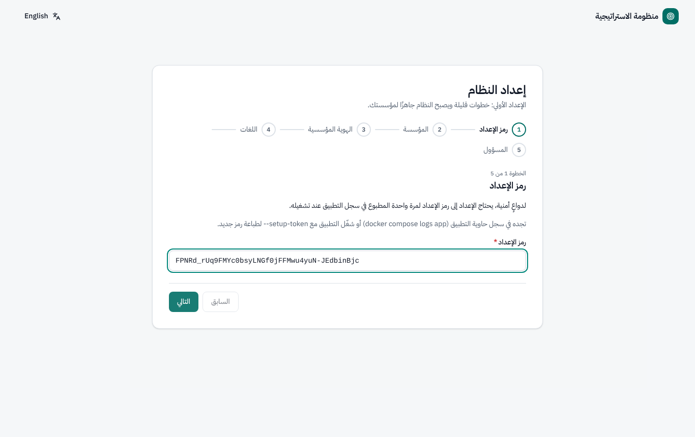
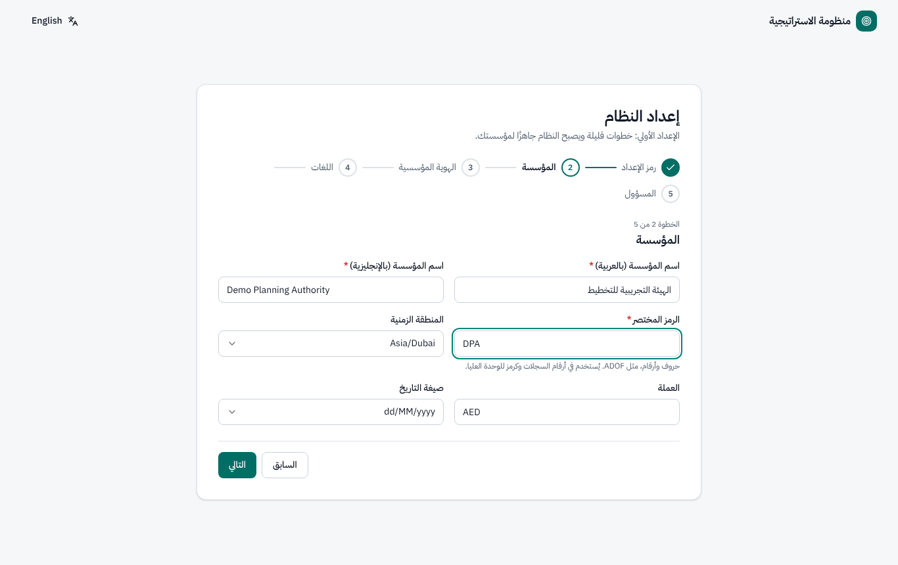
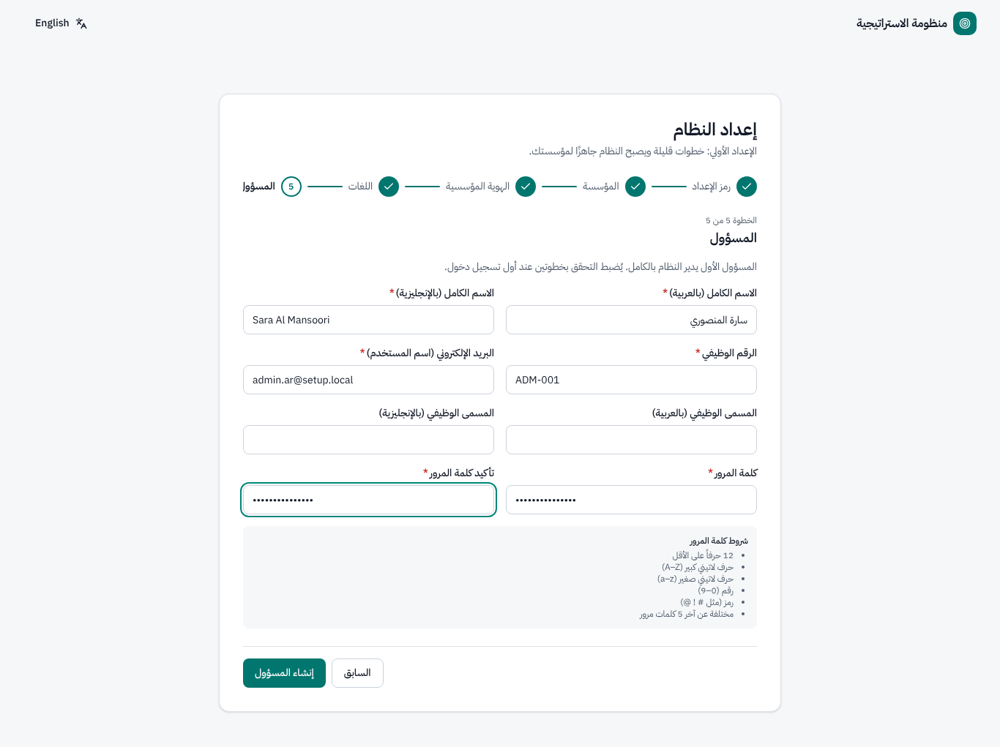

**المرحلة الثانية — بعد الدخول بحساب المسؤول**

سجّل الدخول؛ فيُطلب منك فوراً إعداد التحقق بخطوتين (إلزامي لمسؤولي النظام). ثم يتابع المعالج خطوات اختيارية — يمكن تخطي كل منها
وإنجازها لاحقاً من الإعدادات: **خادم البريد** (مع *إرسال رسالة تجريبية*)، و**مزود المصادقة**، و**مزود الذكاء الاصطناعي** (مع *اختبار
الاتصال*)، و**ساعات العمل والعطلات الرسمية**، و**استيراد الهيكل التنظيمي** (نزّل النماذج، واستورد الوحدات ثم الموظفين)، و**الأنظمة
المطلوب تفعيلها**، و**البيانات التجريبية** الاختيارية للعروض التقديمية فقط. ويسجّل زر **إنهاء** اكتمال الإعداد؛ وإلى ذلك الحين يمكن
إعادة فتح المعالج من **الإعدادات ← معالج الإعداد** (بصلاحية *معالج الإعداد الأولي* التي يحملها دور مسؤول الإعدادات).

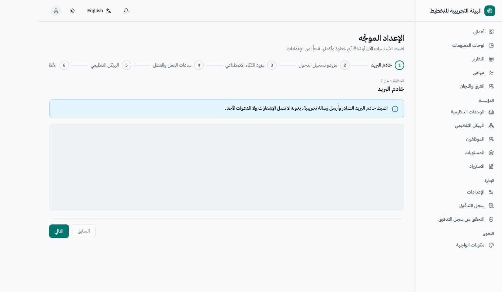
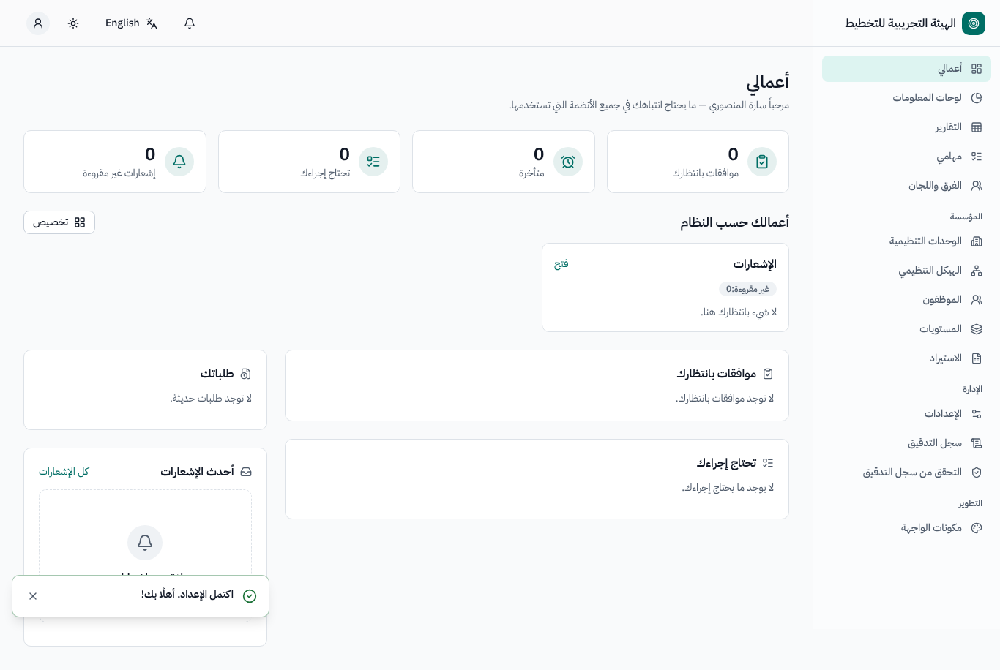

**بيانات العرض التجريبي.** تُحمّل **الإعدادات ← بيانات العرض التجريبي** جهة تجريبية وثمانية أشخاص تجريبيين (`<name>@demo.example.org`
بكلمة المرور التي تُدخلها) وبضعة سجلات في كل نظام، تُنشأ عبر الإجراءات المعتادة لكل نظام (مُدقَّقة، بقناة *الاستيراد*). ويلغي زر **إزالة
البيانات التجريبية** تلك السجلات أو يعطّلها، ويقفل حسابات المستخدمين التجريبيين، ويعطّل الوحدات التجريبية — دون أي حذف نهائي، لذا تبقى
السجلات التجريبية الملغاة ظاهرة بحالتها. استخدمها في تثبيتات العروض فقط (القرار المعماري 0153). المكافئ من سطر الأوامر:
`--seed-demo --password-file /dev/stdin` و`--remove-demo`.

**الإصدار وملاحظات الإصدار.** تعرض نافذة *حول النظام* في قائمة المستخدم رقم الإصدار المثبّت وملاحظاته.

البديل البرمجي للمرحلة الأولى هو أمر المضيف `--create-admin` (راجع `deploy/README.md`)؛ وبمجرد وجود مسؤول تُغلق مرحلة الرمز.

## 2. مركز الإعدادات

افتح **الإعدادات** من قائمة الملف الشخصي. القائمة الجانبية مجمّعة — **عام**، **البيانات واللغة**، **الصلاحيات**، **المستخدمون وتسجيل
الدخول**، **الهيكل التنظيمي**، **الإشعارات والملفات والمهام**، **الذكاء الاصطناعي والتكامل** — ولا تعرض إلا الصفحات التي تسمح بها
صلاحياتك (ويتحقق الخادم من كل طلب مرة أخرى). تُحفظ معظم الصفحات كاملة مع رقم إصدار: إذا حفظ مسؤول آخر في الأثناء يُطلب منك إعادة
التحميل (لا يحدث استبدال صامت). وكل تغيير في الإعدادات يُسجَّل في سجل التدقيق بقيمه القديمة والجديدة.

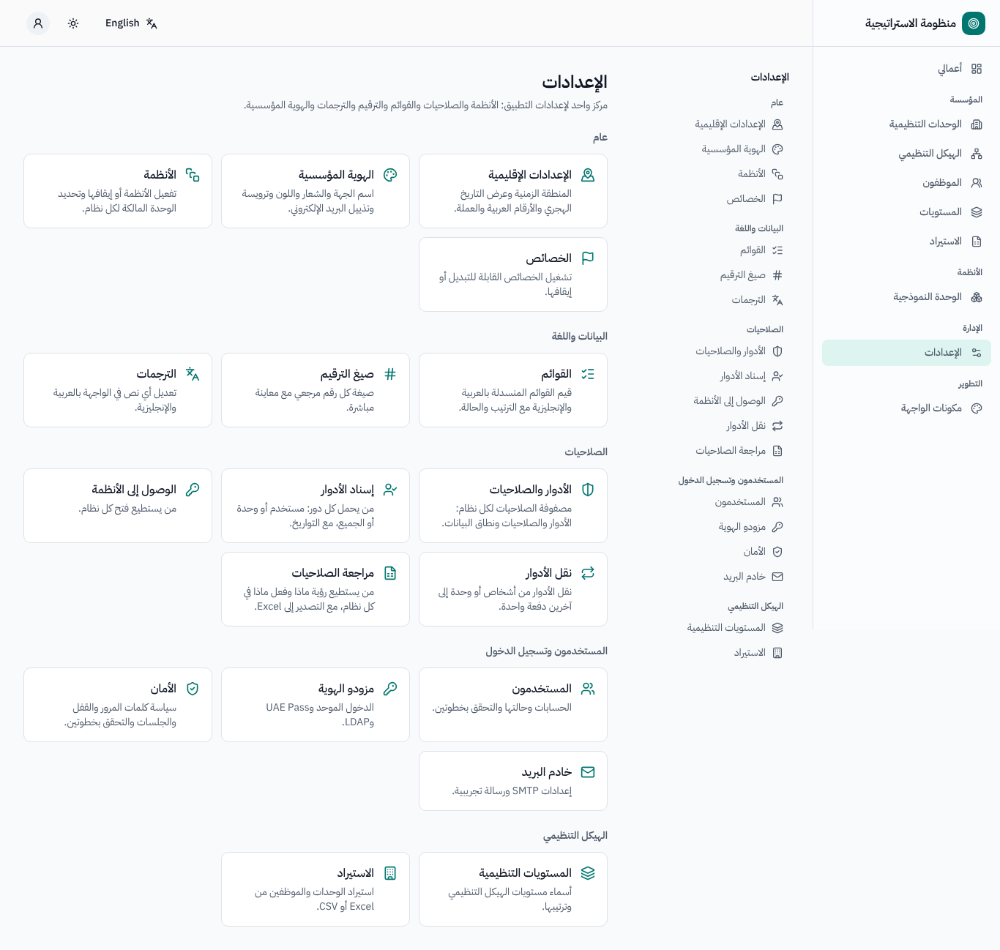

## 3. عام

| الصفحة | ما تتحكم فيه | القيم الافتراضية وتنبيهات |
|---|---|---|
| **الإعدادات الإقليمية** | **المنطقة الزمنية**، **عرض التاريخ الهجري**، **الأرقام العربية الهندية**، **رمز العملة**، **صيغة التاريخ** | Asia/Dubai، الهجري غير مفعّل (تبقى البيانات ميلادية دائماً)، أرقام لاتينية، AED، dd/MM/yyyy. تحدد المنطقة الزمنية كل مهلة وتذكير ومعنى «اليوم». |
| **الهوية المؤسسية** | اسم الجهة (عربي / إنجليزي)، **اللون الرئيسي**، الشعار للمظهر الفاتح والداكن (PNG أو JPEG أو WebP حتى 512 كيلوبايت)، ترويسة البريد وتذييله (عربي / إنجليزي) | تُستخدم في واجهة النظام وكل رسالة بريد وكل ملف PDF (القرارات والشهادات والتقارير) وفي بوابة واصل. |
| **المظهر** | السمات المتاحة (**الكلاسيكي**، **المؤسسي**، **العصري**)، و**السمة الافتراضية** و**الوضع الافتراضي** (فاتح / داكن / حسب الجهاز)، و**السماح للمستخدمين باختيار السمة**، و**السماح للمستخدمين باختيار الوضع الفاتح أو الداكن**، و**التطبيق الافتتاحي لكل دور** (قواعد مرتبة: دور ← تطبيق)، ولكل **تطبيق**: اسم العرض بالعربية والإنجليزية، والأيقونة، ولون التمييز، وترتيب التبويبات وإخفاؤها، ولوحة الصفحة الرئيسية | الكلاسيكي، حسب الجهاز، اختيار السمة **غير مفعّل**، واختيار الوضع مفعّل. تُطبق أول قاعدة مطابقة، ويتقدم عليها التطبيق الذي يختاره المستخدم لنفسه، وتفتح السمة الكلاسيكية دائماً صفحة أعمالي. إعدادات التطبيقات تغيّر الشكل فقط ولا تمنح أي صلاحية. اختر ألوان تمييز داكنة بما يكفي للأيقونات البيضاء (تنبّه الصفحة إذا قل التباين عن 3 : 1). يُطبق الشعار واللون الأساسي من الهوية المؤسسية في جميع السمات. |
| **الأنظمة** | تفعيل كل نظام أو إيقافه وتحديد **الوحدة المالكة** له | مكونات المنصة مفعّلة دائماً. إيقاف نظام يخفيه ويخفي روابطه في السجلات الأخرى وبطاقته في صفحة أعمالي وأدوات MCP وميزات الذكاء الاصطناعي الخاصة به — وتبقى البيانات. والوحدة المالكة هي ما تُحلّ إليه خطوات الموافقة من نوع «الوحدة المالكة لهذا النظام» (مثلاً نقل إدارة المخاطر من مكتب التدقيق إلى مكتب الاستراتيجية بتغيير واحد). |
| **الخصائص** | الخصائص الاختيارية: *رموز الوصول الشخصية* (مفعّلة)، *ضبط تغيير تعريف المؤشر* (مفعّل)، *دورة التدقيق الكاملة (المرحلة الثانية)* (غير مفعّلة) | لخصائص المعايير في المحافظ والمشاريع مفاتيحها الخاصة في **الإعدادات ← المحافظ والمشاريع** (§7). |
| **لوحات المعلومات** | اللوحات الافتراضية لكل دور، تُبنى من مكتبة الأدوات وتُنشر دون برمجة | راجع [دليل لوحات المعلومات](user-dashboards.md) §6. |
| **التقارير** | **مستوى الإدارات**، **تبدأ السنة المالية في**، فترة التحديث الكامل (10 دقائق افتراضياً)، حد صفوف التصدير (50 000)، تفعيل المرفقات وحجمها، مدة الاحتفاظ بالملفات المرسلة (30 يوماً)، **حدود مقارنة الإدارات** (حد الأخضر والأصفر لكل عمود)، **تحديث الآن** لكل نظام | الأنظمة التي تتغير بياناتها تُحدَّث خلال دقيقة تقريباً؛ وتعرض الصفحة لكل نظام تاريخ *حتى* وآخر خطأ. |
| **ساعات العمل** | أيام العمل وساعاته (يمكن إنشاء أكثر من سجل)، والوحدات بساعات خاصة، وحاسبة («البداية + عدد ساعات العمل») | القيمة الأولية: *الساعات الرسمية*، من الاثنين إلى الجمعة 07:30–15:30. تستخدم الوحدة سجلها الخاص، وإلا سجل الوحدة الأم، وإلا السجل الافتراضي. وتعتمد عليها كل مهلة (مهل الموافقات، ونوافذ المؤشرات، والمهام، وخطة العمل التصحيحية، والتحديثات الشهرية…). |
| **العطلات الرسمية** | العطلات والإغلاقات حسب السنة، والتواريخ المتكررة سنوياً، وأجزاء الأيام، وسجلات ساعات العمل التي تنطبق عليها، والاستيراد من Excel | تُدخل العطلات الهجرية لكل سنة كتواريخ. ولا يجوز أن تتداخل عطلتان فعّالتان تشتركان في سجل ساعات العمل نفسه. |

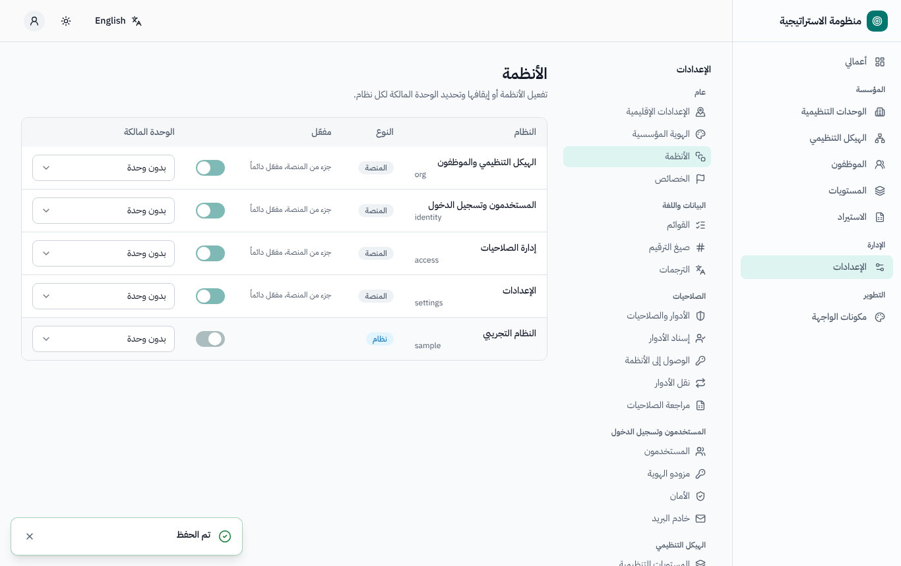
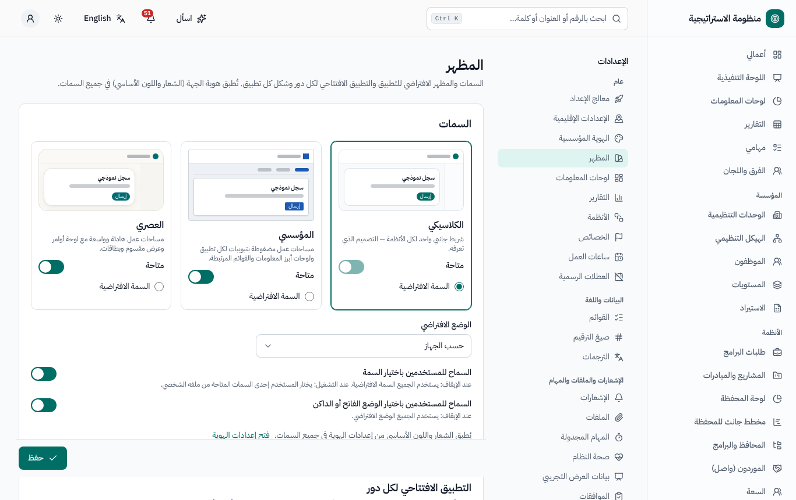
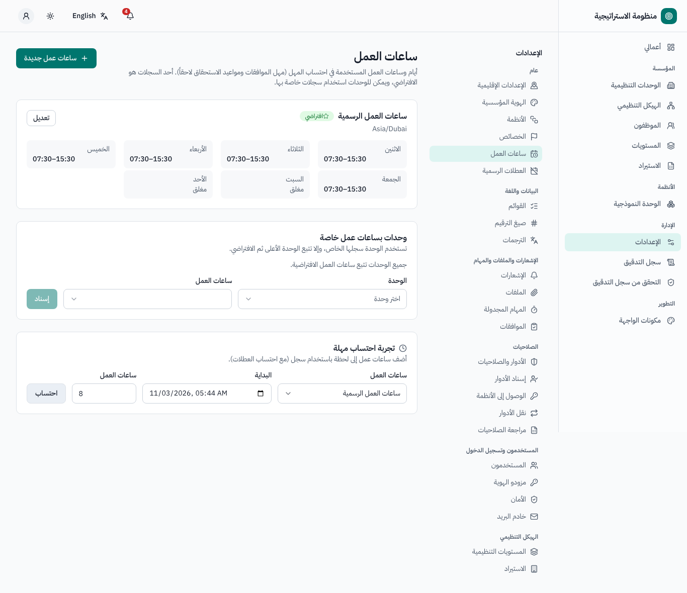

## 4. البيانات واللغة

- **القوائم** — كل قائمة منسدلة (الأهداف الاستراتيجية، فئات المخاطر، أنواع الوثائق، أنواع المهام…) بتسميات عربية وإنجليزية وترتيب
  وحالة. لا يعتمد منطق النظام إلا على **الرموز**، فيمكنك تغيير التسميات بحرية؛ وعطّل القيم بدلاً من حذفها. تحمّل كل جهة قيمها الخاصة
  (نماذج استيراد Excel)، والقيم الأولية محايدة (الملحق «أ» من المواصفات، Q-P7).
- **صيغ الترقيم** — صيغة كل رقم مرجعي مع معاينة مباشرة. الرموز: `{YYYY}`، `{YY}`، `{MM}`، `{UNIT}`، `{TYPE}`، `{ORG}`، `{SEQ:n}`
  (تسلسل بعدد *n* من الخانات، ويكون آخر رمز). أمثلة على الصيغ الافتراضية: طلبات البرامج `PR-{SEQ:4}`، والمشاريع
  `PROJ-{UNIT}-{YYYY}-{SEQ:3}`، والوثائق `{ORG}-{UNIT}-{TYPE}-{YYYY}-{SEQ:2}`، والملكية الفكرية `IP-Registry-{SEQ:4}`، وقرارات تشكيل
  الفرق `MEMO-{YYYY}-{SEQ:4}`. ويعيد زر **استعادة الافتراضي** الصيغة الأصلية. ولا يؤثر تغيير الصيغة إلا في الأرقام الجديدة.
- **الترجمات** — تعديل أي نص في الواجهة بالعربية والإنجليزية. تُحفظ التعديلات في قاعدة البيانات، وتلتقطها الجلسات المفتوحة الأخرى خلال
  خمس دقائق تقريباً.

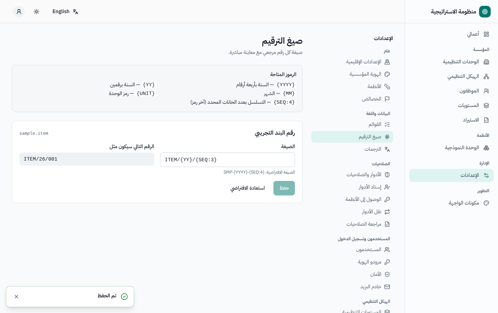 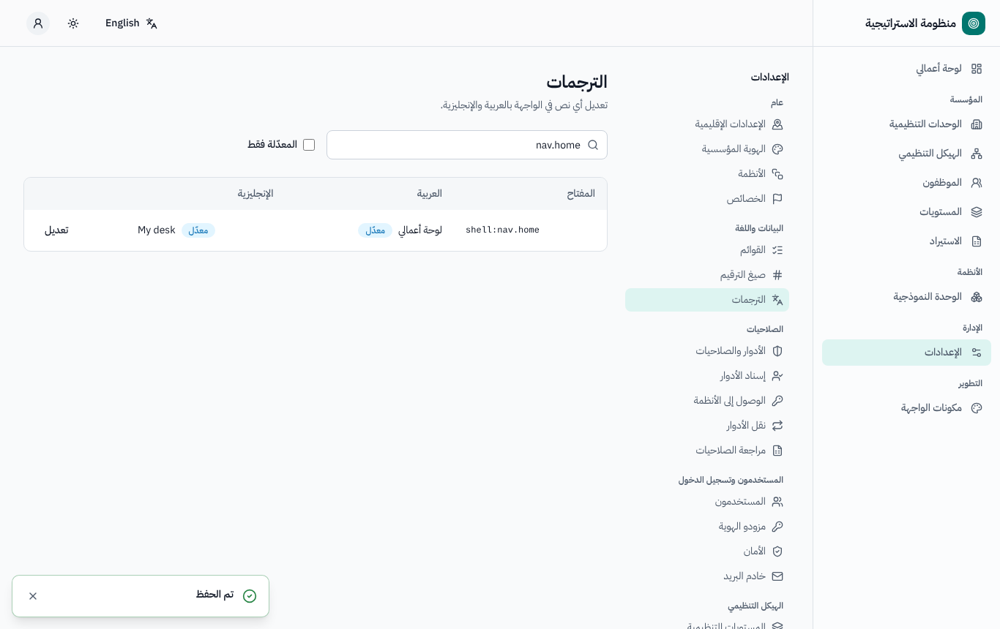

## 5. الإشعارات والملفات والمهام المجدولة

- **الإشعارات** — كل قوالب البريد والإشعارات داخل النظام، مصنفة حسب النظام، بعنوان ونص عربي وإنجليزي (`{{placeholders}}` وزر رابط
  `{{button}}`)، مع المعاينة و**الاستعادة إلى الافتراضي**؛ إضافة إلى **سجل إرسال البريد** (حالة كل محاولة وخطؤها). تُعرض الرسائل بلغتين
  جنباً إلى جنب بهويتك المؤسسية. ويوضع الإرسال في طابور مع إعادة المحاولة (الهدف: خلال 5 دقائق).
- **الملفات** — **أكبر حجم للرفع (ميغابايت)** (قد يحدد كل نوع مستند حداً أقل)، و**فحص الملفات المرفوعة باستخدام ClamAV** (يتطلب حاوية
  `clamav` الاختيارية)، و**حجز الملفات حتى يتم فحصها**، وخادم ClamAV ومنفذه. يُفحص كل ملف مرفوع وفق قائمة الأنواع المسموحة وحسب
  محتواه الفعلي؛ ولا تُقبل أبداً ملفات SVG وHTML والملفات التنفيذية.
- **المهام المجدولة** — كل مهمة خلفية مع جدولها وموعد تشغيلها التالي وآخر تشغيل (الحالة والمدة والرسالة) والتشغيلات الأخيرة؛ مع
  **التشغيل الآن** والإيقاف المؤقت والاستئناف؛ وطابور الرسائل (الرسائل المعلقة والفاشلة التي يمكن إعادتها إلى الطابور). من المهام
  المجدولة في الإصدار 1.0: تصعيد مهل الموافقات (كل 15 دقيقة)، وتذكيرات المهام (كل 15 دقيقة)، ونوافذ فترات المؤشرات (كل ساعة)، ودورة
  التحديث الشهري للمشاريع (كل ساعة)، ومتابعة المخاطر وخطة العمل التصحيحية والمقارنات المرجعية والتدقيق (كل ساعة)، وصلاحية الوثائق
  (يومياً 02:15)، وتجديد الملكية الفكرية (يومياً 02:30)، والتقييمات التلقائية للفرق (يومياً 01:10) وتقاريرها الدورية (02:10)، والملخص
  اليومي للإشعارات (07:20)، وتحديث مجاميع لوحات المعلومات (كل دقيقة) والإرسال المجدول (كل 5 دقائق)، وإقفال مجاميع الشهر، وصلاحيات
  بوابة واصل (كل ساعة)، والتحقق من سلامة سجل التدقيق (يومياً 02:10)، وإعادة فحص الملفات المعلقة، ومهام التنظيف. ويمكن إعادة تشغيل
  جميع المهام بأمان.

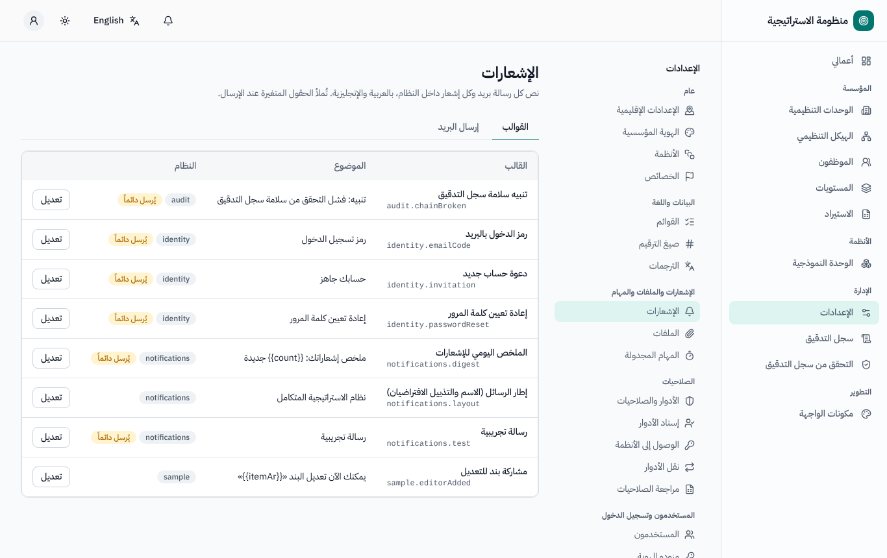
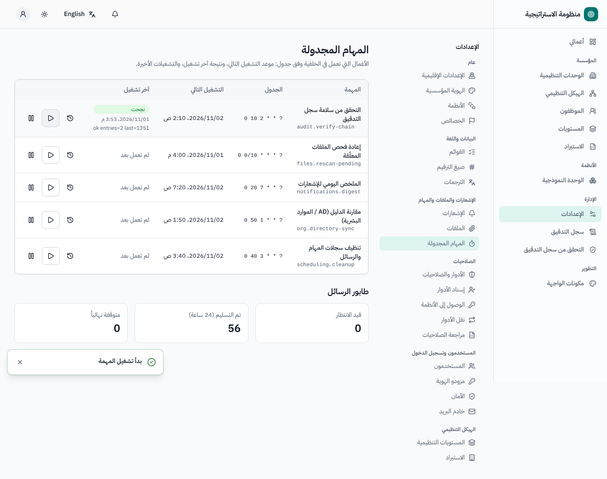

> عند الترقية من إصدار سابق للمرحلة 17: لم تكن المهام المجدولة تعمل وفق جدولها قبل ذلك الإصلاح. بعد الترقية تبدأ التذكيرات والملخصات
> والتصعيدات بالإرسال — نبّه المستخدمين إلى ذلك.

## 6. الموافقات (مركز إعدادات الموافقات)

تعرض **الإعدادات ← الموافقات** كل مسارات الموافقة في جميع الأنظمة في مكان واحد (اعتماد الطلبات، والميثاق، والتخطيط، والتحديثات
الشهرية، والإغلاق، والأثر، وطلبات التغيير، ومراجعات السبرنت، ونتائج المؤشرات، ومراجعة المخاطر ومراجعتها الدورية وإغلاقها، وتشكيل الفرق
وتقييمها ومكافآتها، وبوابات الوثائق والملكية الفكرية والمقارنات، واعتماد الإجراءات التصحيحية وإنجازها وتمديدها، وخطة التدقيق ومراجعة
المتابعات، وأنواع الطلبات…).

افتح المسار لتعديل **خطواته المرتبة**. ولكل خطوة:

- **قاعدة المعتمد** — دور في النظام، أو علاقة تنظيمية (مدير القسم أو مدير الإدارة للسجل، رئيس وحدة، *الوحدة المالكة لهذا النظام*)، أو
  موظف محدد، أو دور على السجل (مثل مالك المشروع)، أو دور في فريق، أو مدير مقدم الطلب؛
- **شرط الدخول** — تعبير على متغيرات المسار (مثل `budget > 50000` أو `residualBand == "critical"` أو `f_amount > 50000` لحقول أنواع
  الطلبات)؛ يعرض المحرر المتغيرات ويتحقق من التعبير أثناء الكتابة. وتُتخطى الخطوة التي لا يتحقق شرطها (وتظهر في السجل متخطاة)؛
- **الإجراءات** (موافقة / رفض / إعادة للتصحيح، مع تسميات مخصصة) و**إلزامية التعليق** عند الرفض أو الإعادة؛
- **المهلة** بساعات العمل أو بالساعات التقويمية، وأي ساعات عمل تُعتمد (الافتراضية، أو ساعات وحدة السجل، أو سجل محدد)، وجهة
  **التصعيد**؛
- ما يحدث إذا لم يوجد من يعتمد.

تعرض **المعاينة المباشرة** من سيعتمد سجلاً تجريبياً خطوة بخطوة. وينشئ **الحفظ** مع ملاحظة **إصداراً** جديداً؛ وتبقى الموافقات الجارية على
الإصدار الذي بدأت به. ويُثبَّت المعتمدون الذين حُدّدوا على كل مهمة موافقة.

المسارات الأولية (الملحق «أ»): التحديث الشهري مدير الإدارة ← مكتب إدارة المشاريع (Q-P1)؛ وخطوات مدير القسم لا تُضاف إلا إذا كانت وحدة
السجل قسماً يختلف مديره عن مدير الإدارة وعن مقدم الطلب (Q-P4)؛ وتضيف طلبات التغيير قسم الخدمات المالية عند تأثر التكلفة، ومكتب المدير
العام عند الإلغاء أو الدمج أو عند تجاوز تغيير التكلفة حد المدير العام؛ وتشكيل الفرق مدير الإدارة ← المدير العام (Q-T5)؛ ونتائج المؤشرات
خطوة واحدة لمكتب الاستراتيجية؛ ومراجعة المخاطر لمكتب المخاطر؛ والإجراءات التصحيحية لمكتب إدارة المشاريع.

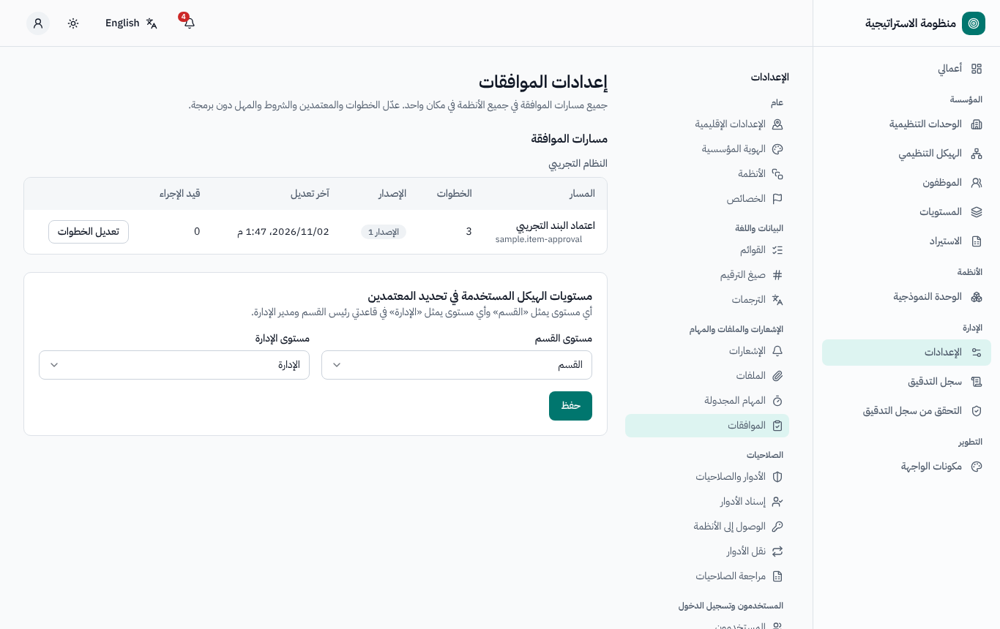
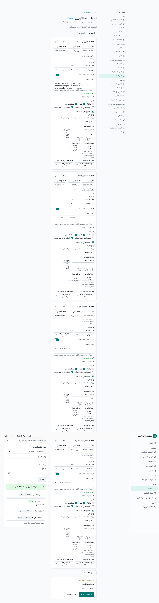

## 7. إعدادات كل نظام

| الصفحة | أهم المحتويات (القيم الافتراضية بين قوسين) |
|---|---|
| **المهام** | مسار العمل لكل نوع مهمة (*كامل*: إسناد ← قبول ← تنفيذ ← تقديم ← اعتماد المنشئ؛ *مبسّط*: للتنفيذ ← قيد التنفيذ ← منجزة)؛ **من يمكن إسناد المهام إليه** (الجميع / الوحدة / المرؤوسون المباشرون)؛ إنشاء السكرتير المهام نيابة عن مديره؛ الفئات السرية؛ سلّم التقييم؛ التذكير قبل الاستحقاق وإشعار التأخر والتصعيد إلى مدير المكلف وتذكير القبول؛ الملخص؛ حد العبء الزائد. أنواع المهام ومصادرها وفئاتها قوائم. **إعادة إسناد المهام المفتوحة لموظف** (عند المغادرة أو الانتقال): استعرض المهام ثم أسندها إلى موظف آخر أو أعدها إلى منشئيها — مع إشعار الجميع وتسجيل الإجراء في سجل التدقيق. |
| **الفرق** | عام (حد العبء الزائد، تذكيرات التقارير والتقييمات، مدة استحقاق التوصيات الافتراضية)، **أنواع الفرق** (اعتماد التشكيل، قرار التشكيل، محفّز التقييم: سنوي / تاريخ الانتهاء / إغلاق السجل المرتبط / يدوي، المقيّم)، **أدوار الأعضاء** (القائد، المقرر، من يطّلع على النتائج، النصاب)، **نماذج التقييم** (بإصدارات: المعايير والمستويات وأسئلة الأعضاء وشرائح التقدير وحد الأدلة)، **مصفوفة المكافآت** (المبالغ حسب التقدير × العبء × الدور، والميزانية السنوية، والتقديرات المستحقة للشهادة — تبدأ فارغة، Q-T5). |
| **المحافظ والمشاريع** | حد المبلغ بين المشروع والمبادرة (50 000 درهم، Q-P5)، معايير الأولوية وأوزانها، فئات الأولوية (عالية ≥ 80٪، متوسطة ≥ 60٪)، نطاقات التواريخ، خطوة الاعتماد التي تحدد الميزانية المعتمدة، نموذج نطاق المشروع، نماذج **دورة حياة المشروع** للمشاريع والمبادرات (الميثاق، أمر الشراء المحلي، تشكيل الفريق، الإغلاق، الأثر — Q-P2 / Q-P3)، استحقاق التحديث الشهري (10 أيام عمل) والتذكير (3)، هامش التأخير (5 نقاط، Q-P6)، حد مكتب المدير العام لطلبات التغيير (100 000)، اقتراحات المنهجية ووضع اعتماد Agile (شهري)، **الميزات** (المحافظ والبرامج، تحديد الأولوية، مؤشر الصحة RAG، خطوط الأساس، *القيمة المكتسبة* (غير مفعّلة)، سجل RAID، مصفوفة المخاطر، RACI، خطة التواصل، المنافع، الجودة، المشتريات، تقرير الحالة، قوائم التحقق للبوابات، النماذج — إيقاف الميزة يخفي شاشاتها ويرفض واجهاتها البرمجية، وتبقى البيانات)، حدود مؤشر الصحة، قوائم تحقق البوابات، نماذج المشاريع، **واصل** (وضع التحديث الافتراضي *مدير المشروع فقط*، قاعدة انتهاء الوصول، الإنهاء عند الإغلاق، أيام عدم النشاط قبل تعطيل الحساب (90)، الحقول المرئية للمورد، UAE Pass للموردين). |
| **إدارة الأداء (المؤشرات)** | عام (التذكير 3 أيام عمل قبل الاستحقاق، والتصعيد بعد يومي عمل، الأخضر ≥ 95٪ والبرتقالي ≥ 80٪، تنبيه القفزة، إلزامية الدليل، فتح النتائج للخطط المعتمدة فقط، الرموز اليدوية)، **قواعد نوافذ الفترات** (Q-K2: تُفتح في اليوم التالي لانتهاء الفترة، والاستحقاق في اليوم الخامس عشر)، **طرق القياس** (مجموع / متوسط)، **قائمة التحقق**، **الهيكل الاستراتيجي** (الرؤية ← المنظورات ← الأهداف، وتواريخ الدورة)، **نوافذ الفترات** لكل سنة (إقفال الفترة وإعادة فتحها). |
| **إطار المخاطر** | بإصدارات: طريقة التقييم والمعادلة (تعبير آمن مع معاينة مباشرة للمصفوفة وعدد المخاطر المتأثرة)، ومقاييس الاحتمالية والأثر بمعاييرها، ونطاقات التصنيف وحالة المخاطر المتبقية، ومقياس فاعلية الضوابط، ودورية المراجعة لكل نطاق، والفئات مع **مستوى الرغبة في المخاطر** (فارغ افتراضياً، Q-R3)، والتصعيد وإعدادات النظام. ويمكن عند حفظ إصدار جديد إعادة احتساب المخاطر القائمة. |
| **أنواع الطلبات** | منشئ النماذج: أنواع الطلبات وأقسامها وحقولها، والمراحل (اعتماد / معالجة)، وقوالب PDF، وفئة الكتالوج، ومن يحق له التقديم، والصفحة القابلة للتضمين والرابط المباشر للإنترانت، والمصادر المسموح لها بالتضمين. |
| **سجل الوثائق** | رمز الجهة (`{ORG}`)، **أنواع الوثائق** (رمز الترقيم، الصلاحية بالأشهر أو *حتى الاستبدال*، *تُنشئ قيدًا في سجل الملكية الفكرية*، الإقرار بالاطلاع)، **صلاحيات الاطلاع حسب درجة السرية** (عام · داخلي · سري · سري للغاية — من يحق له القراءة)، تذكيرات انتهاء الصلاحية (60 و30 يوماً)، ختم «غير خاضعة للرقابة عند الطباعة»، الروابط العامة (غير مفعّلة). |
| **الملكية الفكرية** | أنواع الحماية مع المدة بالسنوات و*بداية احتساب المدة* (التسجيل أو أول نشر) و*داخلي فقط*؛ تذكيرات التجديد (6 و3 أشهر)؛ ترويسة نموذج الوزارة. |
| **خطة العمل التصحيحية** | أيام الاستحقاق حسب الأولوية، احتساب أيام العمل، تأكيد مكتب إدارة المشاريع للرفض (غير مفعّل)، إعادة الإسناد داخل الوحدة فقط، قاعدة السبب الجذري، يوم التذكير الشهري، تصعيد الإجراءات المتأخرة للمكتب، التحقق من الفعالية، عكس إنجاز المشروع المرتبط، الملاحظات التلقائية من عدم تحقيق مستهدفات المؤشرات ومن أحداث المخاطر والضوابط غير الفعالة. |
| **المقارنات المرجعية** | إشعار البحث قبل الربع (30 يوماً)، أيام العمل، متابعة الأثر بعد الإغلاق (6 أشهر)، تحديث القيم المرجعية للمؤشرات عند اعتماد التحليل. |
| **إدارة التدقيق** | اطلاع الإدارات (ما يراه مستخدمو الإدارات، وأي مستوى تنظيمي يُعد إدارة)، المراجعة الداخلية للمتابعات (المدقق ← رئيس التدقيق الداخلي)، التذكيرات، مهلة إصدار التقرير، إرسال فرص التحسين إلى خطة العمل التصحيحية، بطاقات مؤشرات التدقيق المطلوب نشرها. |

## 8. الذكاء الاصطناعي والتكامل

### 8.1 الذكاء الاصطناعي (الإعدادات ← الذكاء الاصطناعي)

الذكاء الاصطناعي **غير مفعّل** في التثبيت الجديد، ويعمل كل شيء دونه. التبويبات:

- **المزودون** — **إضافة مزود**: *Anthropic Claude* أو *OpenAI* أو *Azure OpenAI* أو *متوافق مع OpenAI (Ollama وvLLM)* لنموذج مستضاف
  داخلياً؛ وعنوان الخدمة، و**مفتاح الواجهة البرمجية** (يُحفظ مشفّراً ولا يُعرض مرة أخرى)، و**جلب النماذج** أو كتابتها، والنموذج
  الافتراضي، ودرجة الإبداع، وأقصى عدد رموز للرد، ومهلة الانتظار. ويرسل **اختبار الاتصال** طلباً من سطر واحد. ثم اختر **المزود
  الافتراضي**.
- **الميزات** — كل ميزة (تعبئة النماذج من المستندات، ملخص المعتمد، الترجمة، السجلات المشابهة، اسأل النظام، ومساعدات كل نظام) مع
  مفتاح تفعيلها ومزودها ونموذجها، و**من يمكنه استخدامها** (صلاحية لكل ميزة يحملها دور *مستخدم الذكاء الاصطناعي* المسند إلى الجميع —
  أزلها منه لتقييد الميزة).
- **مشاركة البيانات والحدود** — **إخفاء البيانات الشخصية** (مفعّل)، و**السماح بإرسال المستندات المرفوعة**، ولكل نظام هل **يُسمح
  بالإرسال** و**حقول لا تُرسل أبدًا**؛ و**التعرف على النص في المستندات الممسوحة (OCR)** (غير مفعّل؛ يتطلب Tesseract بالعربية
  والإنجليزية، وهو مضمّن في الصورة)؛ والحدود الشهرية (الرموز للتثبيت كله، والطلبات لكل مستخدم).
- **الاستخدام** — طلبات هذا الشهر ورموزه وإخفاقاته، وسجل الاستخدام (المستخدم، الميزة، النموذج، الرموز، المدة، النتيجة).

ثم فعّل **استخدام الذكاء الاصطناعي في هذا التثبيت**. يُسجَّل كل استدعاء للذكاء الاصطناعي ويُدقَّق (القناة `ai`)؛ ومخرجاته دائماً مسودة
يقبلها شخص، ولا يعتمد ولا يرفض ولا يقدّم ولا يحفظ أبداً.

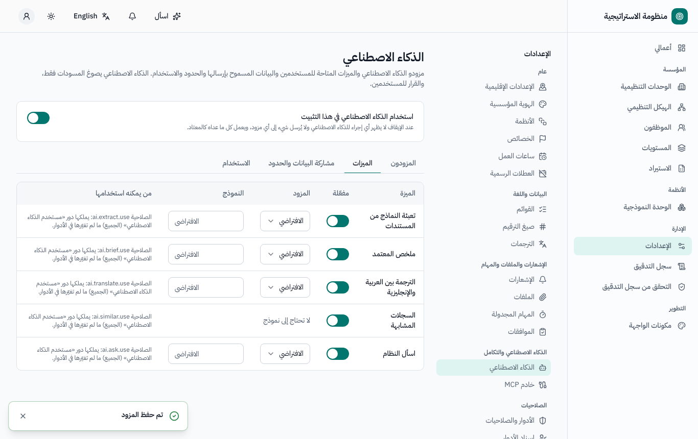
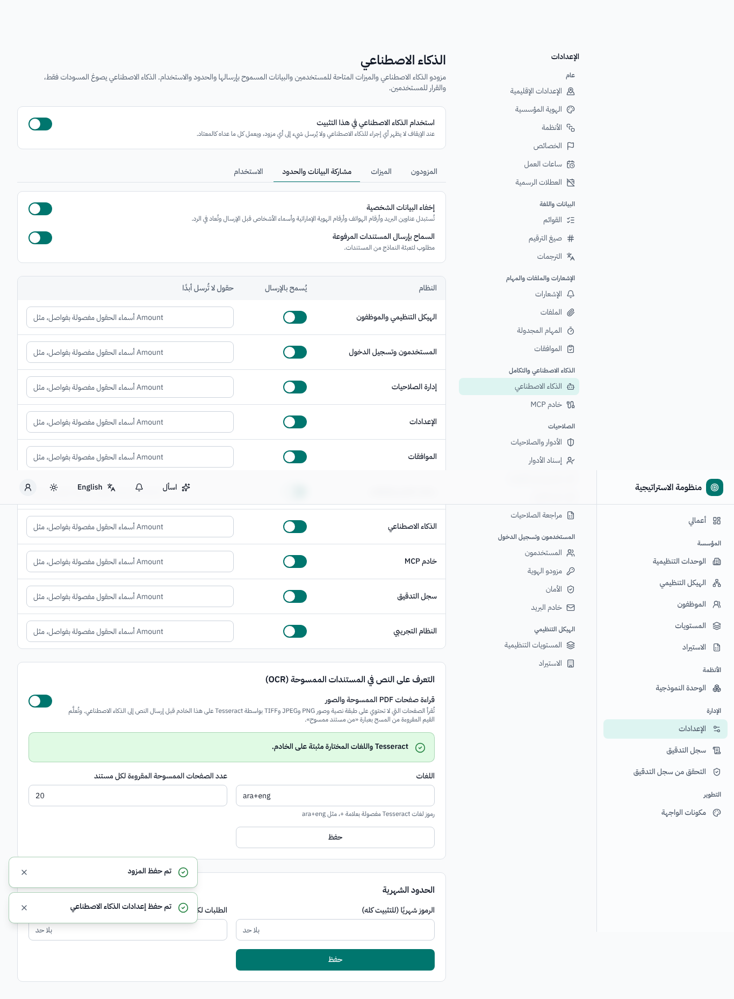

### 8.2 خادم MCP (الإعدادات ← خادم MCP)

يتيح لـ Claude ولعملاء MCP الآخرين استخدام النظام **بصفة الشخص الذي ربطهم**. فعّل **تشغيل خادم MCP**؛ وراجع **تسجيل دخول عملاء
MCP ‏(OAuth 2.1)** (*السماح للعملاء بتسجيل أنفسهم*، **مضيفو إعادة التوجيه المسموح بهم**)، ومدة صلاحية الرموز (رمز الوصول 60 دقيقة،
والبقاء متصلاً 30 يوماً)، و**استدعاءات الأدوات لكل مستخدم في الدقيقة**، وجدول **الأدوات**: أدوات القراءة مفعّلة، و**أدوات الكتابة
موقوفة** حتى تفعّلها، و**أدوات الاعتماد** (`approval_decide` و`approve_task`) لا تُفعّل افتراضياً أبداً. ويعرض **العملاء المتصلون**
قائمة العملاء؛ ويوقف **قطع الاتصال** رموز العميل للجميع. ويتطلب تسجيل الدخول عبر OAuth بروتوكول HTTPS. تعليمات المستخدمين:
[دليل MCP](mcp.md).

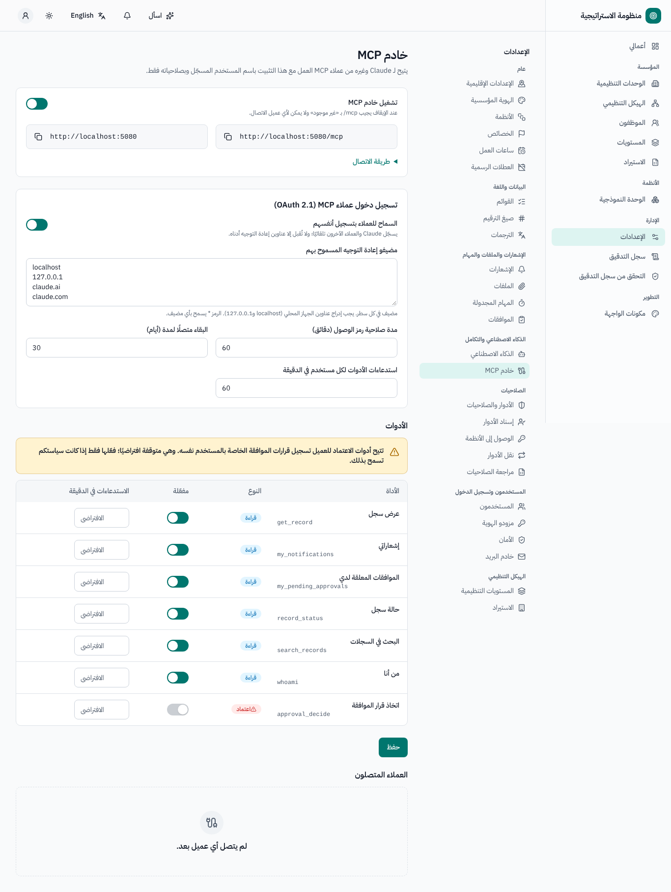

## 9. الصلاحيات: الأدوار والصلاحيات

للصلاحيات ثلاث طبقات يتحقق منها الخادم في كل صفحة وطلب برمجي ومهمة خلفية واستدعاء MCP:

1. **الوصول إلى الأنظمة** — من يستطيع فتح كل نظام أصلاً (**الإعدادات ← الوصول إلى الأنظمة**: مستخدم أو وحدة أو الجميع).
2. **أدوار النظام** — أدوار كل نظام وصلاحياته (`<system>.<object>.<action>`)، ولكل منها **نطاق بيانات**: *الخاص* (السجلات التي يملكها
   الشخص)، *الفريق* (إضافة إلى مرؤوسيه المباشرين)، *الوحدة* (وحدته أو وحدة يرأسها)، *الوحدة وما يتبعها*، *الكل*. وتُجمع الأدوار
   المتعددة.
3. **الأدوار على السجلات** — دور الشخص على سجل بعينه (مدير المشروع، مالك المشروع، عضو الفريق، مالك الخطر، المكلف بالمهمة، معتمد
   موافقة مفتوحة…). يمنحها النظام نفسه ويسحبها، ولا تُعدّل يدوياً أبداً.

الصفحات:

- **الأدوار والصلاحيات** — اختر نظاماً: مصفوفة الأدوار × الصلاحيات مع نطاق لكل خانة، وتبويب للأدوار على السجلات؛ وإنشاء دور وتحديد هل
  يتطلب التحقق بخطوتين.
- **إسناد الأدوار** — من يحمل كل دور: مستخدم، أو وحدة (كل من فيها)، أو الجميع، مع تاريخي البداية والنهاية.
- **الوصول إلى الأنظمة** — من يستطيع فتح كل نظام.
- **نقل الأدوار** — نقل الأدوار من أشخاص أو وحدة إلى آخرين دفعة واحدة مع ذكر السبب؛ فتُعاد توجيه الموافقات المعلقة لتلك الأدوار إلى
  حامليها الجدد ويُسجَّل النقل في سجل التدقيق.
- **مراجعة الصلاحيات** — من يستطيع رؤية ماذا وفعل ماذا في كل نظام (مباشرة / عبر الوحدة / عبر الجميع، والأدوار على السجلات)، مع
  **التصدير إلى Excel** للمدققين.

يُجاب عن السجلات خارج النطاق بـ*غير موجود* (404) حتى لا يُكشف وجودها؛ أما السجلات المرئية التي يُمنع عليها إجراء ما فيُجاب عنها
بـ*ممنوع*. والأدوار الأولية لكل نظام تتبع أقسام الصلاحيات في المواصفات ويمكن تعديلها. احرص على وجود شخصين على الأقل بدور مسؤول
الصلاحيات (لا يمكن تعطيل آخر مسؤول فعّال).

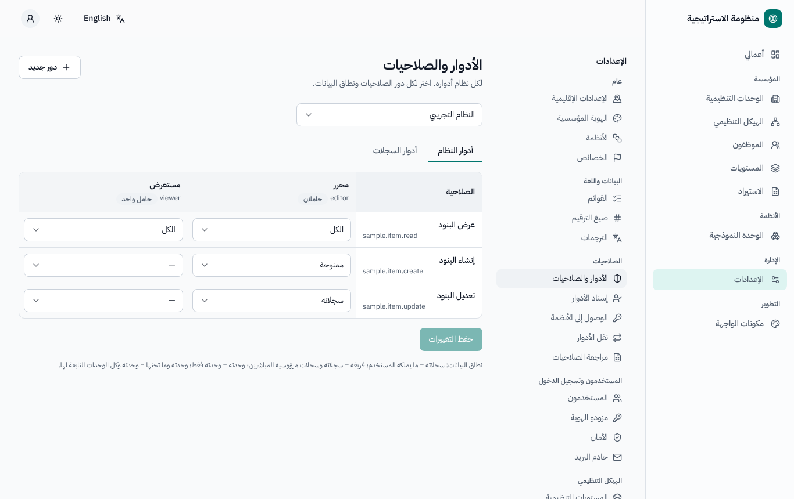
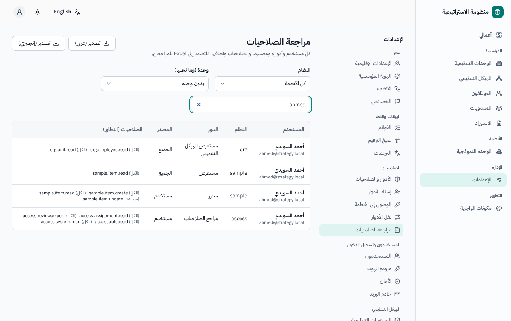

## 10. المستخدمون وتسجيل الدخول

- **المستخدمون** — الحسابات وحالتها (فعّال، مقفل، غير فعّال)، ورسالة الدعوة، وحالة التحقق بخطوتين، وإعادة التعيين، والتعطيل. يرتبط
  المستخدم عادةً بموظف.
- **مزودو الهوية** — **مزود جديد**: *OpenID Connect* (Entra ID وADFS وKeycloak…)، *الهوية الرقمية (UAE Pass)* (إعدادات جاهزة لبيئتي
  الاختبار والإنتاج)، *SAML 2.0*، *LDAP / Active Directory*. نص الزر بالعربية والإنجليزية، والاتصال، والمطالبات والسمات، و**ربط
  الحسابات** (*مطابقة الموظفين حسب* البريد الإلكتروني / الرقم الوظيفي / اسم المستخدم، *الربط تلقائياً*، *إنشاء الحساب عند أول دخول*)؛
  سجّل عناوين إعادة التوجيه والبيانات الوصفية المعروضة لدى المزود؛ ثم **اختبار الاتصال**. لا يُنشأ موظف أبداً عند تسجيل الدخول. خطوات
  تفصيلية لكل مزود: [`docs/identity-providers.md`](../../identity-providers.md).
- **الأمان** — سياسة كلمات المرور (12 حرفاً، حرف لاتيني كبير وصغير ورقم ورمز، وعدم تكرار آخر 5 كلمات مرور)، والقفل (5 محاولات ← 15
  دقيقة)، والجلسات (30 دقيقة دون نشاط، و12 ساعة كحد أقصى)، و**من يلزمه التحقق بخطوتين** (*إلزامي لمسؤولي النظام* افتراضياً)، والطرق
  المسموحة (تطبيقات المصادقة، الرموز عبر البريد)، والتحقق بخطوتين بعد الدخول الموحد (غير مفعّل)، ومدد رموز الوصول الشخصية (90 / 365
  يوماً).
- **خادم البريد** — خادم SMTP، والمنفذ، وأمان الاتصال (StartTLS / TLS / بدون)، واسم المستخدم وكلمة المرور (تُحفظ مشفّرة)، وعنوان المرسِل
  واسمه (عربي / إنجليزي)، و**عنوان التطبيق** (العنوان العام المستخدم في روابط البريد). ثم **إرسال رسالة تجريبية**.

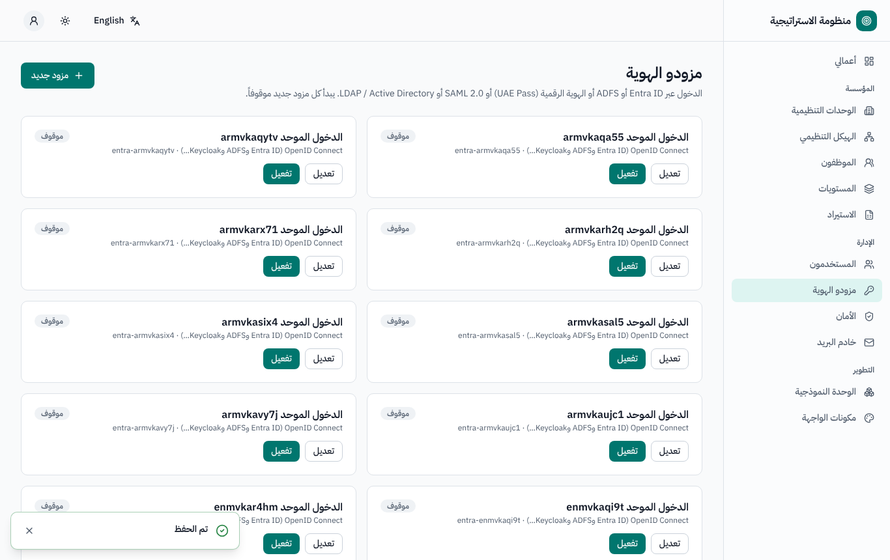
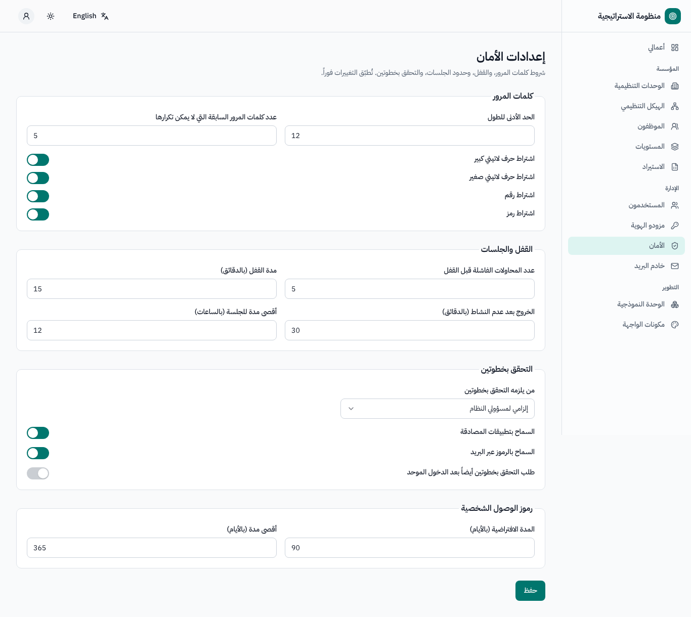

الموردون (واصل) نوع مستقل من الحسابات يُدار من المحافظ والمشاريع (راجع [دليل واصل](user-wasel.md))؛ ويستخدمون التحقق بخطوتين دائماً، ولا
يمكنهم أبداً استخدام النظام الداخلي أو الذكاء الاصطناعي أو خادم MCP.

## 11. الهيكل التنظيمي

- **المستويات التنظيمية** — أسماء مستويات الهيكل وترتيبها (الجهة، القطاع، الإدارة، القسم، الوحدة…).
- **الوحدات التنظيمية** و**الهيكل التنظيمي** و**الموظفون** (القائمة الجانبية ← المؤسسة) — تسلسل هرمي غير محدود مع الرئيس ونائبه، مع
  الاحتفاظ بالتاريخ عند تغيّر الهيكل (اعرض الهيكل *كما كان في تاريخ*)؛ والموظفون بوحداتهم ومديريهم ومسمياتهم الوظيفية وحالاتهم (على رأس
  العمل / في إجازة / غادر). وعند تحديد موظف بأنه *غادر* يعرض النظام إعادة إسناد مهامه المفتوحة.
- **الاستيراد** — نزّل نماذج Excel / CSV، واستورد **الوحدات أولاً ثم الموظفين**؛ ويعرض تقرير التحقق كل خطأ قبل حفظ أي شيء.

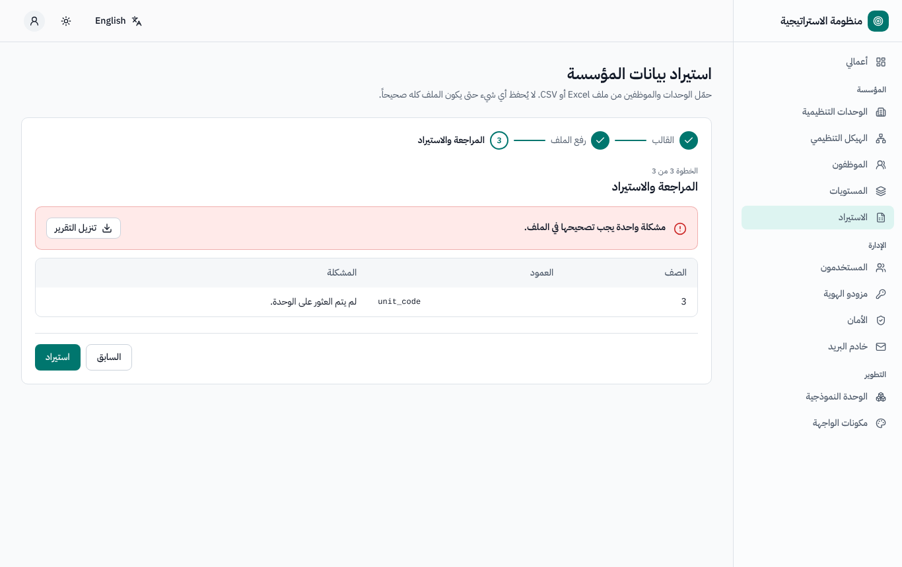
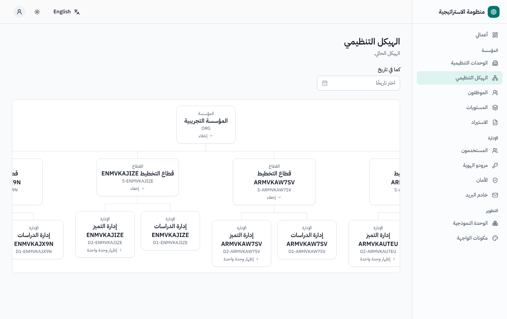

## 12. سجل التدقيق والتحقق من سلامته

يُسجَّل تلقائياً كل إنشاء وتعديل وحذف في كل سجل (من، ونيابة عمن، ومتى، وعنوان IP، والجهاز، و**القناة** — الواجهة، الواجهة البرمجية،
MCP، الذكاء الاصطناعي، مهمة مجدولة، استيراد، واصل، النظام — والحقل والقيمة القديمة ← الجديدة والسبب)، إضافة إلى عمليات الدخول والموافقات
وتنزيل الملفات والتصدير وتغييرات الإعدادات والصلاحيات واستدعاءات الذكاء الاصطناعي وMCP. ولا يستطيع أحد، بمن فيهم مسؤولو النظام، تعديل
القيود أو حذفها.

- **سجل التدقيق** (القائمة الجانبية ← الإدارة) — بحث في جميع الأنظمة حسب المستخدم والنظام والكائن والإجراء والقناة والتواريخ؛ مع
  **تصدير إلى Excel** و**تصدير إلى PDF**. ولكل سجل أيضاً تبويب **السجل** الخاص به.
- **التحقق من سجل التدقيق** — تشكل القيود سلسلة تجزئة؛ ويفحصها زر **تحقق الآن** (وتشغّلها أيضاً مهمة ليلية)، فيُبلغ بأن السلسلة *سليمة*
  أو يحدد أول قيد مكسور.

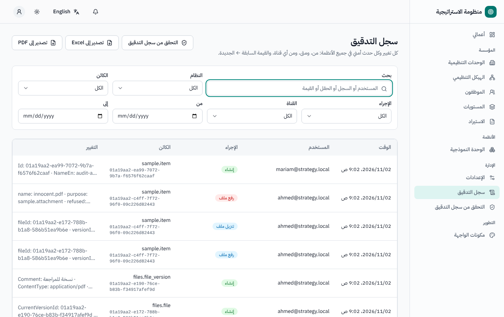
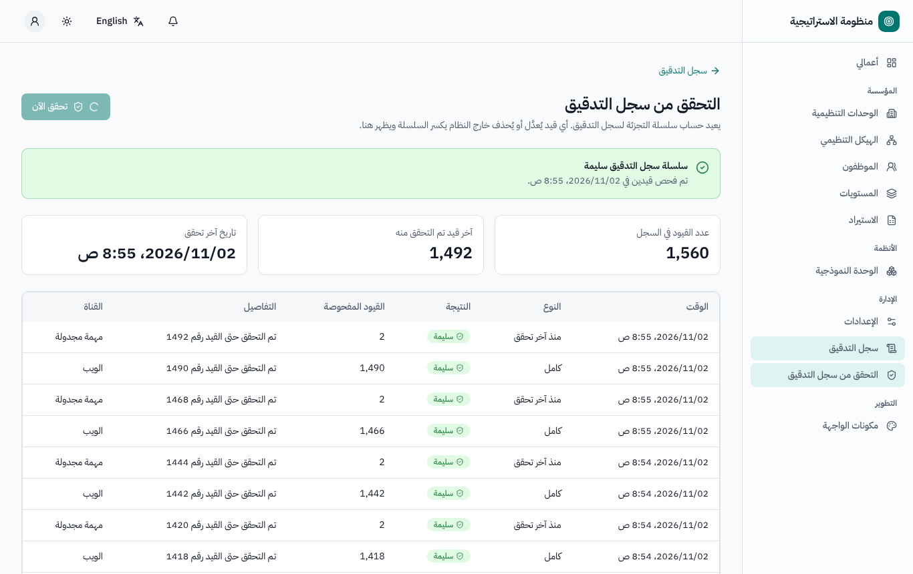

## 13. صفحة صحة النظام

تعرض **الإعدادات ← صحة النظام** (القرار المعماري 0151؛ بصلاحية *عرض صحة النظام* التي يحملها دور مسؤول الإعدادات) سطراً لكل فحص بحالة *سليم* أو *تحذير* أو *خطأ* أو *غير مُعدّ*:

قاعدة البيانات (زمن الاستجابة والإصدار والحجم) · التحديثات المعلقة لقاعدة البيانات لكل نظام · المجدول وكل مهمة (آخر تشغيل وحالته
والتشغيل التالي والإخفاقات خلال 24 ساعة) · طابور الرسائل (المعلقة والفاشلة وأقدم رسالة معلقة) · البريد (الإعداد وآخر إرسال والإخفاقات)
· مزود الذكاء الاصطناعي · التعرف الضوئي على النص (Tesseract ولغاته) · تخزين الملفات (قابلية الكتابة والمساحة الحرة) · خدمة PDF
‏(Gotenberg) · انتهاء صلاحية الشهادات · آخر تحقق من سجل التدقيق · الإصدار ومدة التشغيل.

راجعها بعد كل ترقية وكلما أفاد المستخدمون بغياب الرسائل أو التذكيرات. وتبقى نقطتا الفحص `/health/live` و`/health/ready` متاحتين لموزعات
الأحمال والحاويات. يظهر الفحص الذي يفشل أو يستغرق أكثر من 10 ثوانٍ خطأً باسمه، وتبقى بقية الفحوص ظاهرة. تُحدَّد ملفات الشهادات المراد مراقبة
انتهائها في إعداد الخادم `Health:CertificatePaths`، وعتبة تحذير القرص في `Health:DiskWarningPercent`.

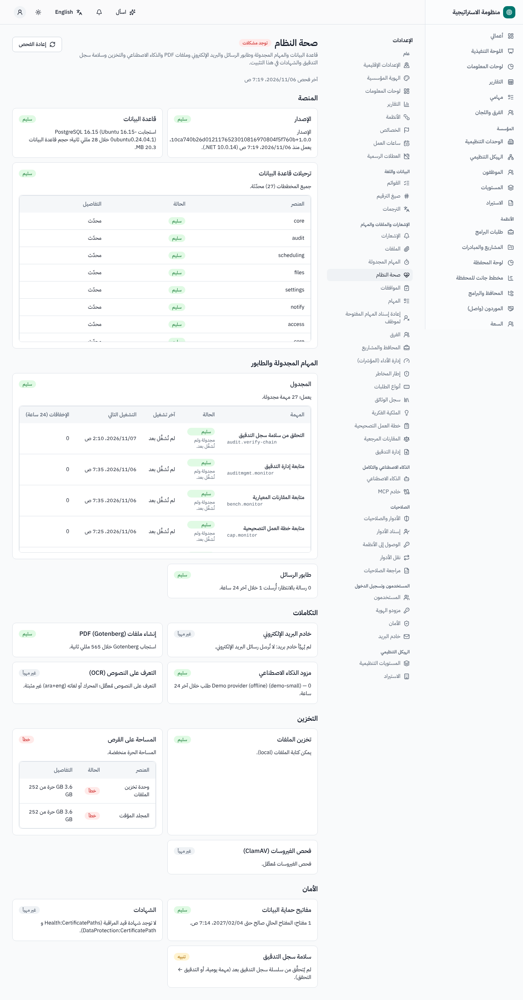

## 14. ممارسات جيدة

- اضبط الإعدادات بهذا الترتيب: الإقليمية ← الهوية المؤسسية ← استيراد الهيكل ← ساعات العمل والعطلات ← الأنظمة والوحدات المالكة ←
  الأدوار والوصول إلى الأنظمة ← مسارات الموافقة ← نصوص الإشعارات ← الذكاء الاصطناعي وMCP.
- اختبر تغييرات الموافقات بـ**المعاينة المباشرة** قبل الحفظ، واكتب ملاحظة لكل إصدار.
- فضّل تعطيل قيم القوائم والأدوار والمزودين على حذفها؛ فيبقى التاريخ مقروءاً.
- راجع تصدير **مراجعة الصلاحيات** دورياً وبعد إعادة الهيكلة، واستخدم **نقل الأدوار** عند تنقّل الموظفين.
- احتفظ بمسؤولَين اثنين يستخدمان التحقق بخطوتين، ولا تشارك الحسابات أبداً.
- انسخ قاعدة البيانات احتياطياً مع وحدة تخزين الملفات ومفاتيح حماية البيانات وشهادتها (دليل التثبيت).

