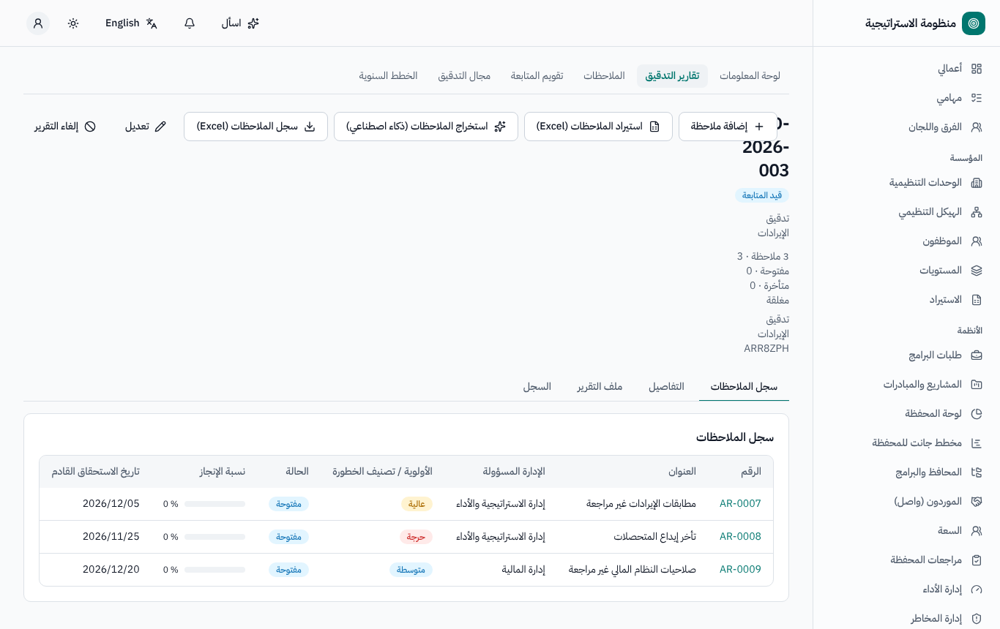
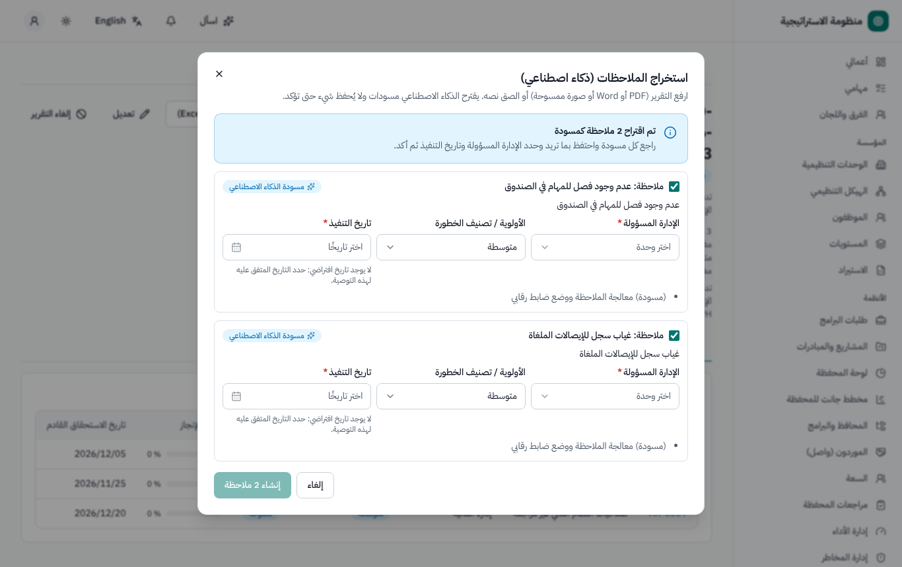
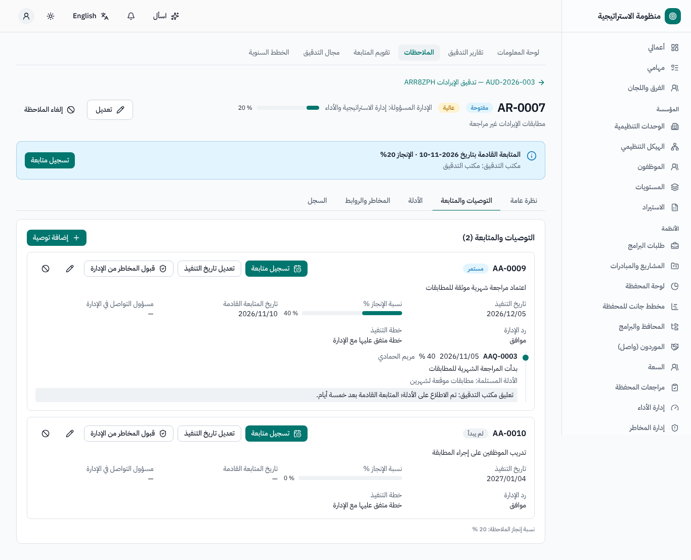
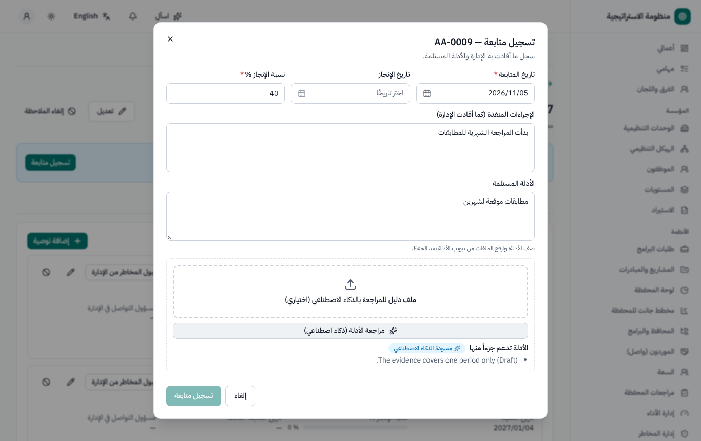
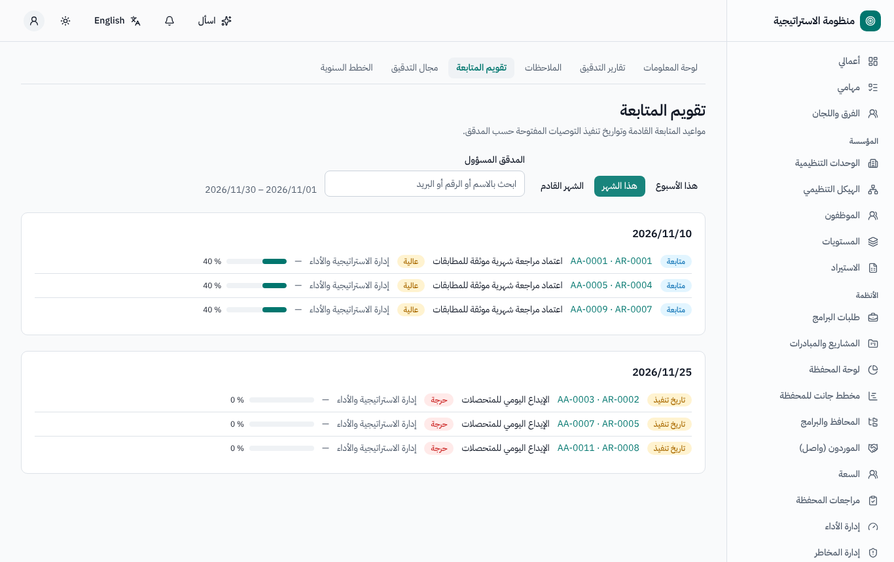
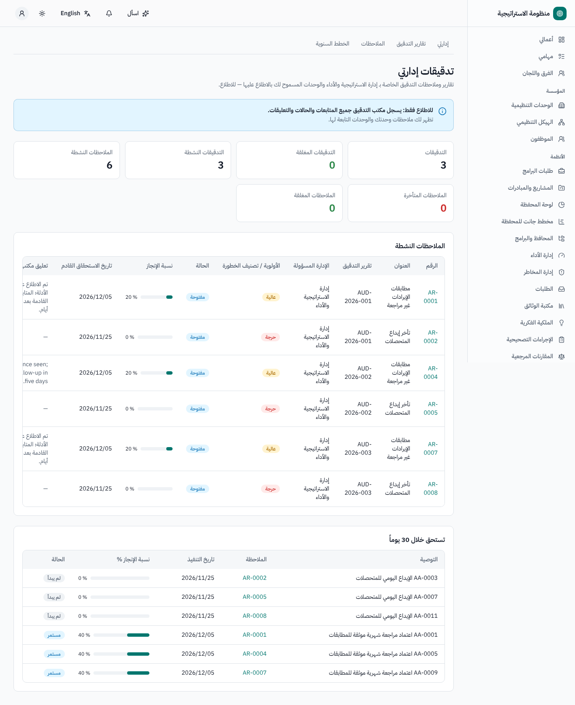
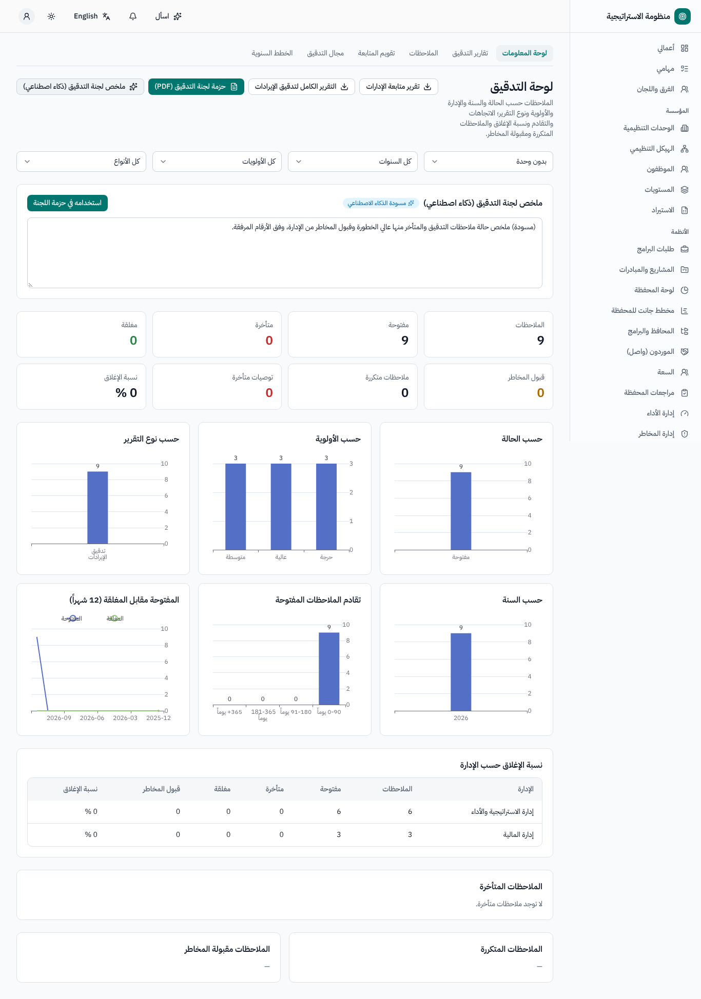
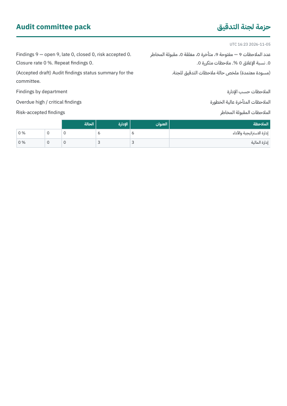
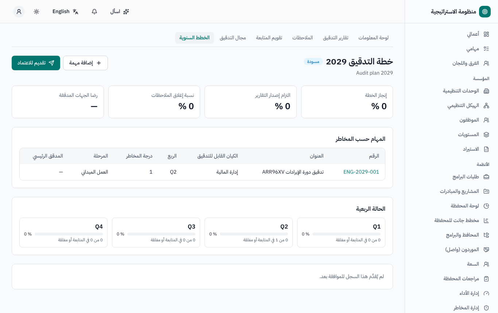
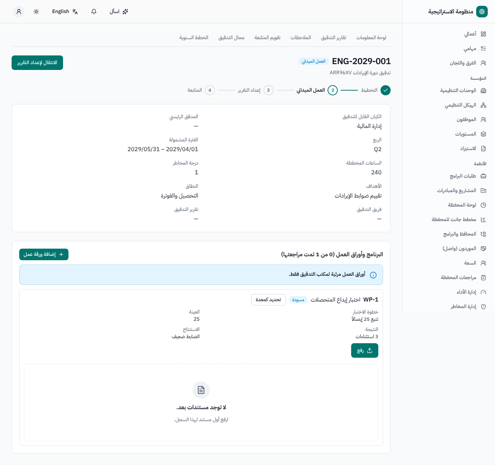

# إدارة التدقيق — دليل المستخدم

لمكتب التدقيق (المدققين ورئيس التدقيق الداخلي)، ومستخدمي الإدارات، ولجنة التدقيق. النسخة الإنجليزية: [`../en/user-audit.md`](../en/user-audit.md).

القائمة الجانبية ← **إدارة التدقيق**: **لوحة المعلومات**، **إدارتي**، **تقارير التدقيق**، **الملاحظات**، **تقويم المتابعة**؛ ومع تفعيل دورة
التدقيق الكاملة أيضاً **مجال التدقيق** و**الخطط السنوية**.

**مكتب التدقيق وحده يكتب** (التقارير والملاحظات والتوصيات والمتابعات). ويقرأ مستخدمو الإدارات ملاحظات إداراتهم، وتقرأ لجنة التدقيق كل شيء.

## 1. تقارير التدقيق والملاحظات (مكتب التدقيق)

1. **تقارير التدقيق ← تقرير تدقيق جديد**: النوع، والسنة، والوحدات المدققة، وقائمة التوزيع، وملف التقرير.
2. أضف الملاحظات إلى **سجل الملاحظات**: الوضع القائم، والمعيار، والسبب، والأثر، والأولوية، والإدارة المسؤولة، وتاريخ الإغلاق المتوقع،
   و**التوصيات** (لكل منها مسؤول وتاريخ تنفيذ). وهناك اختصاران:
   - **استيراد الملاحظات (Excel)**: **تنزيل النموذج**، واملأه، ثم **تحقق** (تقرير صفاً صفاً)، ثم **استيراد**؛
   - **استخراج الملاحظات (ذكاء اصطناعي)**: ارفع ملف التقرير أو الصق نصه ← **اقتراح الملاحظات** ← راجع المسودات ← **إنشاء … ملاحظة**.
3. **إصدار التقرير**: يُشعَر من في قائمة التوزيع. ثم تتبع حالة التقرير ملاحظاته: *مسودة · صادر · قيد المتابعة · مغلق · ملغى*.

## 2. متابعة التوصيات

- **تسجيل متابعة** على توصية: تاريخ المتابعة، وتاريخ الإنجاز، والنسبة، والإجراءات المنفذة، والأدلة (نص وملفات)، والتعليق، و**تاريخ المتابعة
  القادمة** (إلزامي دون 100٪). ويمكن للذكاء الاصطناعي مراجعة الأدلة.
- مع تفعيل *المراجعة الداخلية للمتابعات* تنتظر المتابعة اعتماد رئيس التدقيق الداخلي قبل أن تُطبَّق.
- الحالات محسوبة: التوصية *لم يبدأ · مستمر · متأخر · مكتمل*؛ ويدوياً *قبول المخاطر* (مع مبرر ومرجع)، و*ملغى* (مع سبب)؛ و**تعديل تاريخ التنفيذ**
  (تاريخ جديد وسبب، مع الاحتفاظ بالأصلي). والملاحظة: *مفتوحة · متأخرة · مغلقة · قبول المخاطر · ملغاة*.
- تصل التذكيرات إلى المدقق المسؤول قبل المتابعة القادمة وقبل تواريخ التنفيذ؛ وإشعار تأخر عندما تتأخر توصية؛ وإشعارات للإدارات عند ضبط ذلك.
- **تقويم المتابعة**: هذا الأسبوع / هذا الشهر، حسب المدقق، والمتأخرات.

## 3. الروابط مع الأنظمة الأخرى

في تبويب **المخاطر والروابط** للملاحظة: اربط المخاطر والضوابط (إدارة المخاطر)، ووثيقة (سجل الوثائق)، وحدّد الملاحظات *المتكررة*، وأرسل فرص
التحسين إلى خطة العمل التصحيحية، وأنشئ فريقاً. ويمكن نشر مؤشرات التدقيق (نسبة إغلاق الملاحظات، والملاحظات المتأخرة، ونسبة إنجاز الخطة،
والتزام إصدار التقارير، ورضا الجهات المدققة) في إدارة الأداء.

## 4. عرض الإدارة

**إدارتي**: تدقيقات وحدتك (الإجمالي والمغلق والنشط)، والملاحظات النشطة بحالتها ونسبة إنجازها، وآخر تعليق لمكتب التدقيق، وما يستحق قريباً — للقراءة
فقط.

## 5. لوحة المعلومات والتقارير

**لوحة المعلومات**: حسب الحالة والسنة والإدارة والأولوية ونوع التقرير؛ واتجاه المفتوح مقابل المغلق؛ والمتأخرات وأعمارها؛ ونسبة الإغلاق لكل
إدارة؛ والملاحظات المتكررة؛ وقبول المخاطر. والتقارير: سجل الملاحظات لكل تقرير، وتقرير متابعة الإدارة، والتقرير الكامل للتدقيق، و**حزمة لجنة
التدقيق** (PDF / Excel)؛ ويمكن قبول **ملخص لجنة التدقيق (ذكاء اصطناعي)** في الحزمة.

## 6. دورة التدقيق الكاملة (اختيارية، ميزة *دورة التدقيق الكاملة (المرحلة الثانية)*، غير مفعّلة افتراضياً)

مجال التدقيق، و**الخطة السنوية** (مرتبة حسب المخاطر وآخر تدقيق؛ تُقدَّم لاعتماد لجنة التدقيق؛ مع الحالة الربعية)، و**مهام التدقيق** بمراحلها
*مخطط ← التخطيط ← العمل الميداني ← إعداد التقرير ← المتابعة ← مغلق* (الأهداف، والنطاق، والفريق، والبرنامج وأوراق العمل، والتقرير، والاستبيان)،
إضافة إلى لوحة برنامج ضمان الجودة والتحسين.

## 7. من يستطيع ماذا (افتراضياً)

| الدور | الصلاحيات |
|---|---|
| مكتب التدقيق | كل شيء: التقارير والملاحظات والتوصيات والمتابعات والاستيراد والاستخراج بالذكاء الاصطناعي والروابط والإعدادات |
| رئيس التدقيق الداخلي | صلاحيات مكتب التدقيق، إضافة إلى اعتماد المتابعات عند تفعيل المراجعة |
| مستخدم الإدارة (الجميع) | قراءة ملاحظات إدارته (ويُرفض أي تعديل) |
| لجنة التدقيق | قراءة الكل، ولوحة المعلومات، والتصدير، والملخص بالذكاء الاصطناعي؛ واعتماد الخطة السنوية |

