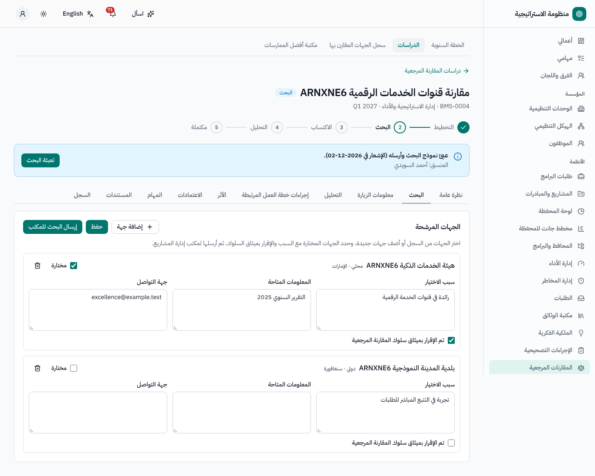
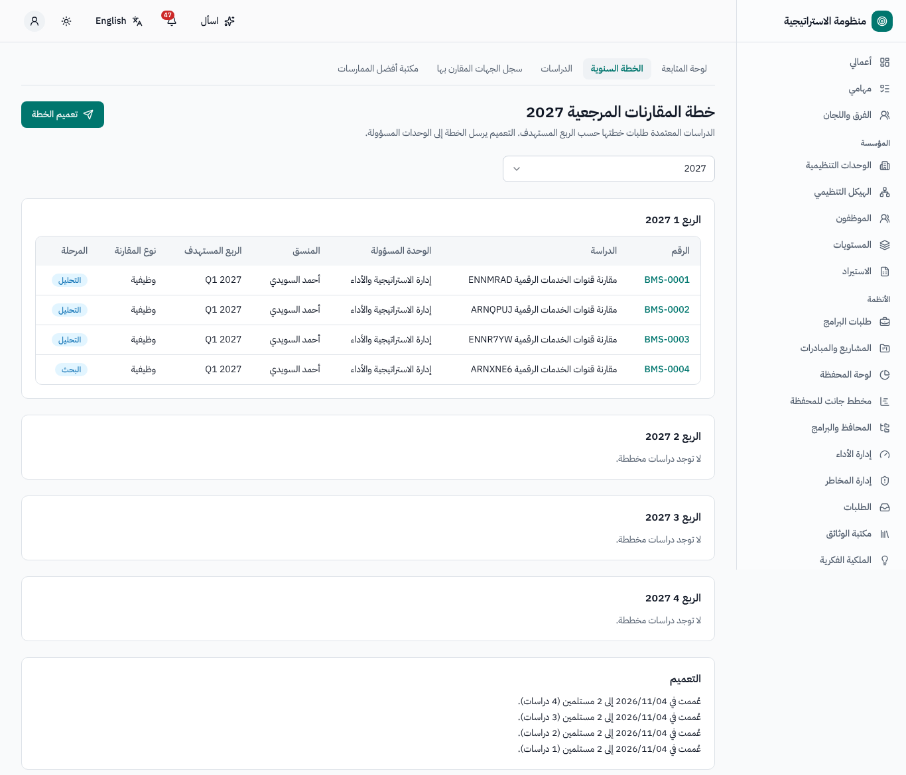
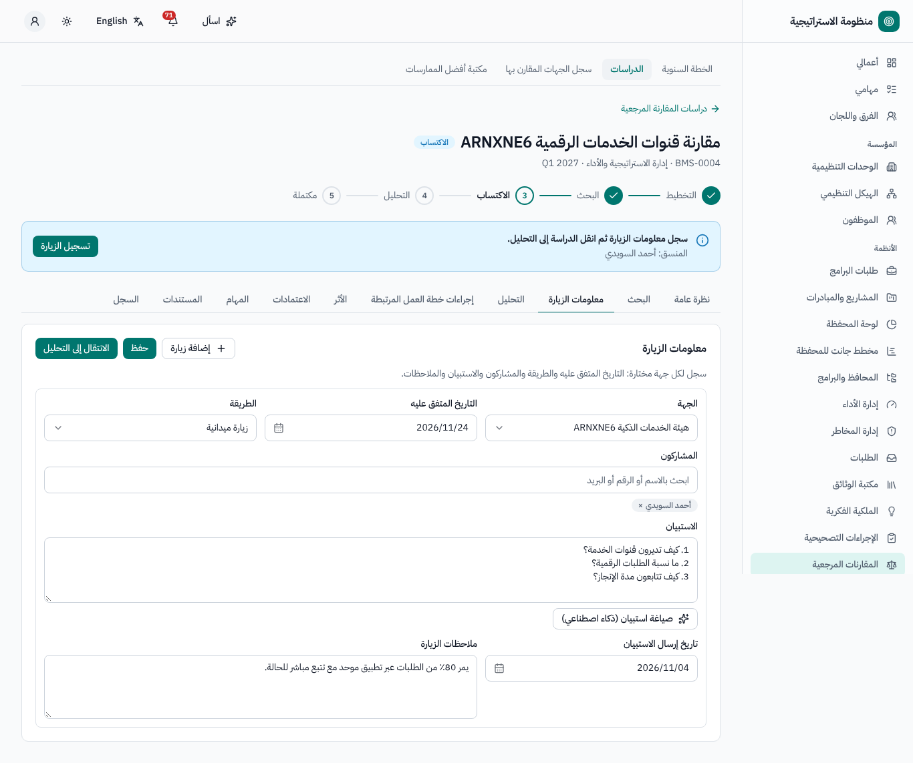
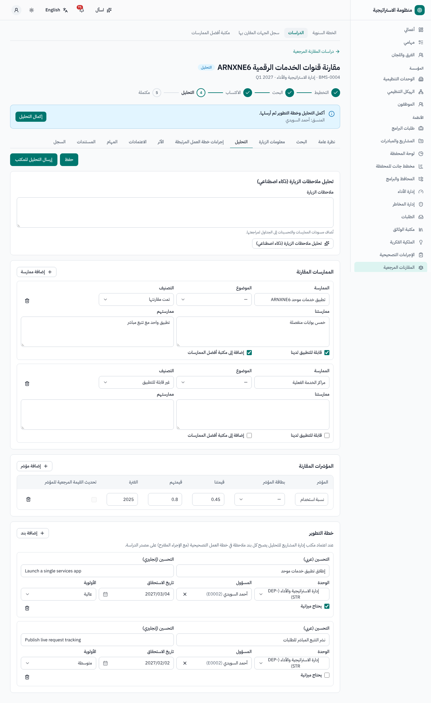
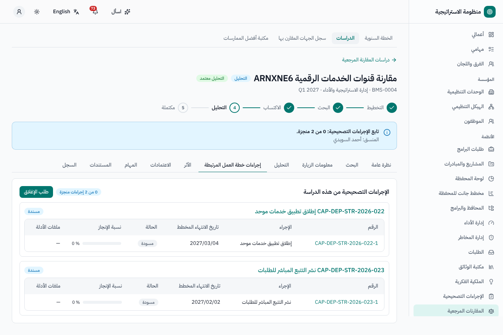
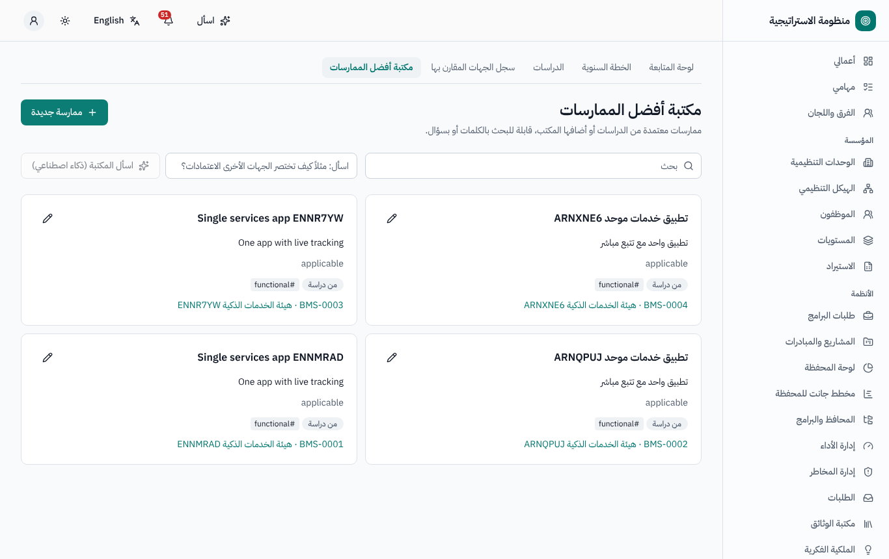
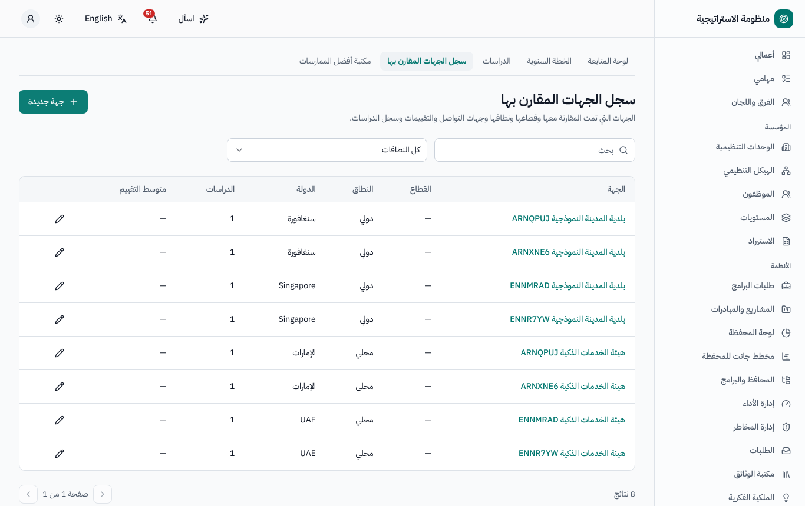

# المقارنات المرجعية — دليل المستخدم

لمقدمي طلبات الدراسات ومنسقيها، وأصحاب المحاور، ومكتب إدارة المشاريع (مكتب المقارنات). النسخة الإنجليزية:
[`../en/user-benchmarking.md`](../en/user-benchmarking.md).

القائمة الجانبية ← **المقارنات المرجعية**: **لوحة المتابعة**، **الخطة السنوية**، **الدراسات**، **سجل الجهات المقارن بها**، **مكتبة أفضل
الممارسات**.

## 1. مراحل الدراسة

*التخطيط › البحث › الاكتساب › التحليل › مكتملة* — ويعتمد مكتب إدارة المشاريع كل بوابة.

| المرحلة | من يملأ | البوابة |
|---|---|---|
| **التخطيط** | مقدم الطلب: *طلب المقارنة المرجعية* في دليل الطلبات | يعتمد مكتب إدارة المشاريع الطلب ← تنضم الدراسة `BMS-0001` إلى الخطة السنوية |
| **البحث** | المنسق: الجهات المرشحة وأسباب اختيارها وجهات الاتصال والمعلومات المتاحة وسجل التواصل | **إرسال البحث للمكتب** ← الاعتماد |
| **الاكتساب** | المنسق: معلومات الزيارة (التاريخ، والطريقة، والمشاركون، والفريق اختيارياً، واستبيان ما قبل الزيارة) | **الانتقال إلى التحليل** (بعد زيارة واحدة على الأقل بتاريخ وطريقة) |
| **التحليل** | المنسق: مقارنات الممارسات، ومقارنات المؤشرات، و**خطة التطوير** (بند واحد على الأقل بمسؤول وتاريخ استحقاق) | **إرسال التحليل للمكتب** ← يُنشئ الاعتماد ملاحظات في خطة العمل التصحيحية |
| **مكتملة** | — | **طلب الإغلاق** ← يعتمده مكتب إدارة المشاريع حين يكتمل كل إجراء مرتبط في خطة العمل التصحيحية مع الدليل |

حالة الدراسة: *نشطة · مكتملة · ملغاة* (ويمكن لمكتب إدارة المشاريع إلغاؤها مع ذكر السبب).

## 2. طلب دراسة (التخطيط)

دليل الطلبات ← طلب المقارنة المرجعية: العنوان بالعربية والإنجليزية، والوحدة والقسم المسؤولان، والموظف المسؤول (المنسق)، والسنة و**الربع**
المستهدفان، ونوع المقارنة (داخلية، تنافسية، وظيفية، عامة)، والغرض، والنطاق، و**محاور المقارنة** (المحور، والمسؤول، والوصف). قدّم ← اعتماد مكتب
إدارة المشاريع. وعند الإعادة صحّح وأعد التقديم؛ وعند الرفض تُلغى الدراسة.

## 3. الخطة السنوية

**الخطة السنوية**: الدراسات المعتمدة حسب السنة ← الربع ← الوحدة مع مرحلة كل منها. ويمكن لمكتب إدارة المشاريع **تعميم الخطة** على رؤساء جميع
الوحدات والمنسقين (ويُسجَّل كل تعميم). وقبل **ربع الدراسة بثلاثين يوماً** (قابلة للضبط، أيام عمل أو أيام تقويمية) يُذكَّر المنسق ورئيس الوحدة
بتعبئة البحث.

## 4. البحث والزيارة والتحليل

- تبويب **البحث**: اختر الجهات المقارن بها من **سجل الجهات المقارن بها** أو أضف جهات جديدة؛ ويمكن للذكاء الاصطناعي اقتراح جهات.
- تبويب **معلومات الزيارة**: الزيارات والاستبيان (ويمكن للذكاء الاصطناعي صياغته).
- تبويب **التحليل**: صفوف الممارسات (حدّد *إضافة إلى المكتبة*)، وصفوف المؤشرات (اختر بطاقة مؤشر؛ و*تحديث القيمة المرجعية للمؤشر*)، وخطة
  التطوير. ويمكن للذكاء الاصطناعي تحويل ملاحظات الزيارة إلى مقارنات وتحليل فجوات — كمسودة.

## 5. بعد اعتماد التحليل

- تُنشأ في خطة العمل التصحيحية **ملاحظة** لكل بند من بنود خطة التطوير (مع إجراء مقترح معبأ مسبقاً)؛ ويعرض تبويب **إجراءات خطة العمل المرتبطة**
  تقدمها مباشرة.
- تصبح صفوف الممارسات المحددة للمكتبة **أفضل ممارسات**؛ وتحدّث صفوف المؤشرات المحددة القيمة المرجعية في بطاقة المؤشر.
- عند اكتمال جميع الإجراءات يصلك إشعار؛ ثم **طلب الإغلاق** ← الاعتماد ← *مكتملة*.
- متابعة **الأثر** بعد الإغلاق (6 أشهر افتراضياً): **تسجيل الأثر** (ما نُفّذ، والمؤشرات التي تحسّنت، والملاحظات).

## 6. سجل الجهات المقارن بها ومكتبة أفضل الممارسات

- **سجل الجهات المقارن بها**: كل جهة خارجية مع دراساتها ومتوسط تقييمها.
- **مكتبة أفضل الممارسات**: بحث في النص الكامل وباللغة الطبيعية حسب العنوان والوصف والمحور والوسوم؛ مع التصفية حسب القطاع والمحور.

## 7. من يستطيع ماذا (افتراضياً)

| الدور | الصلاحيات |
|---|---|
| المشارك (الجميع) | طلب دراسة، وقراءة دراساته، والخطة، والسجل، والمكتبة |
| المنسق (دور على السجل) | تعبئة البحث والزيارة والتحليل؛ وطلب الإغلاق |
| صاحب المحور | قراءة الدراسة وملاحظاتها في خطة العمل التصحيحية |
| مكتب إدارة المشاريع (مكتب المقارنات) | اعتماد كل البوابات، وتعميم الخطة، والإلغاء، وإدارة السجل والمكتبة |

