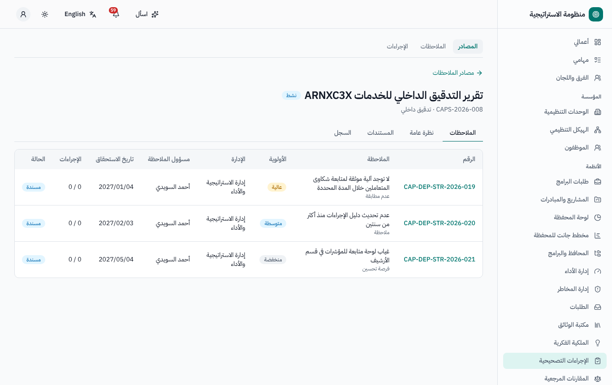
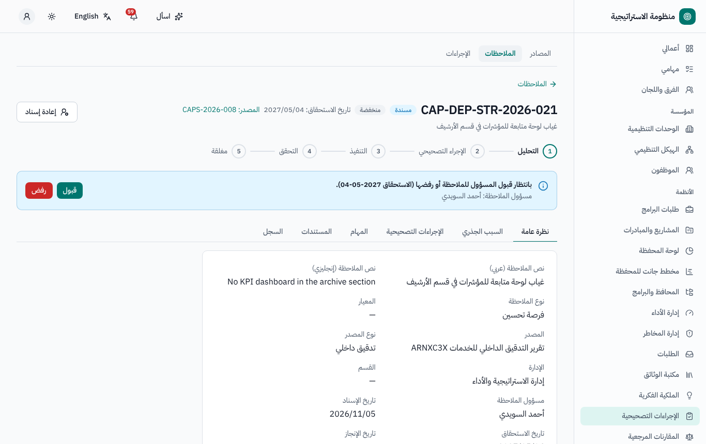
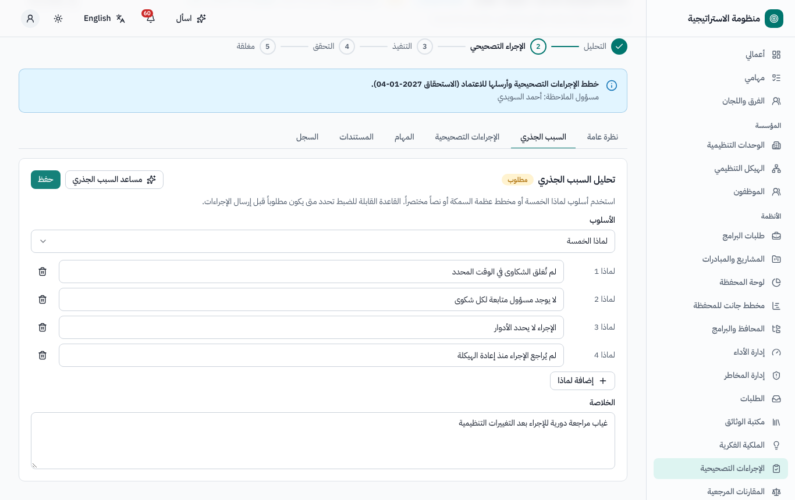
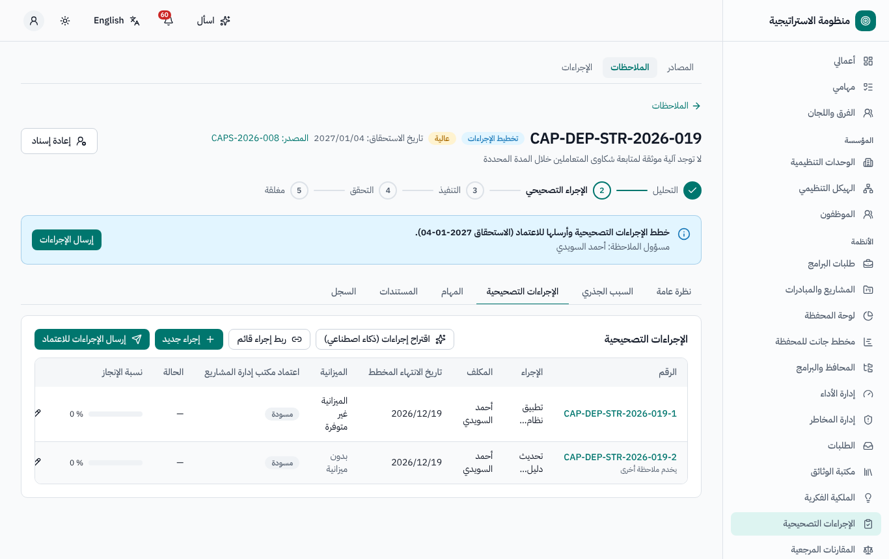
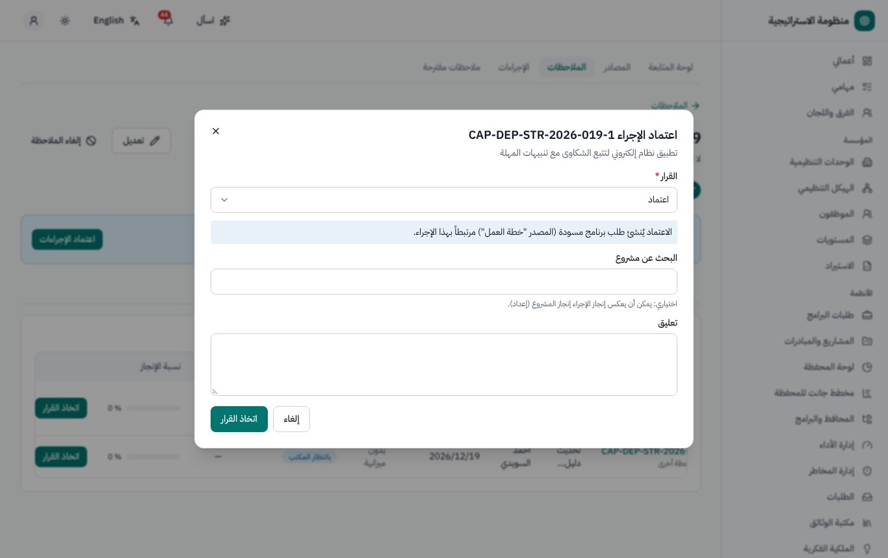
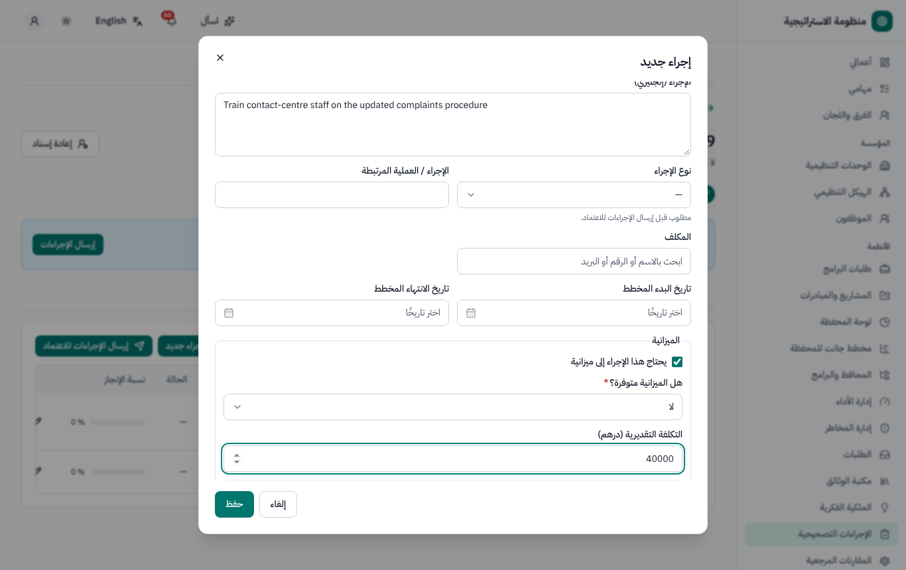
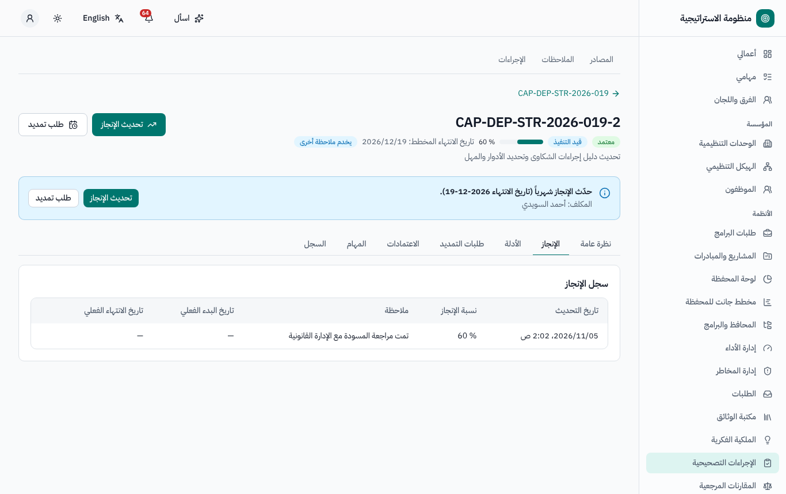
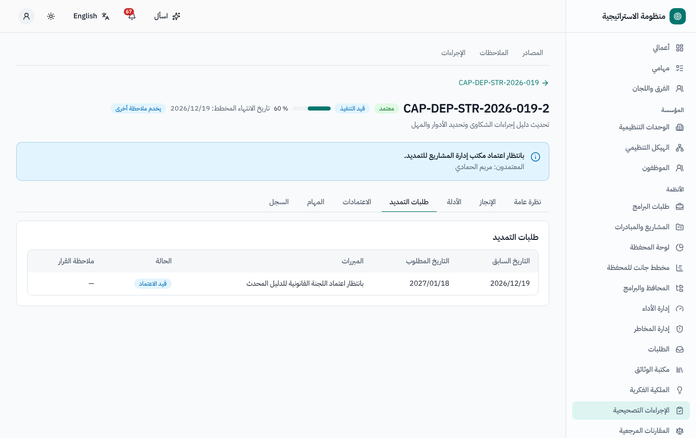
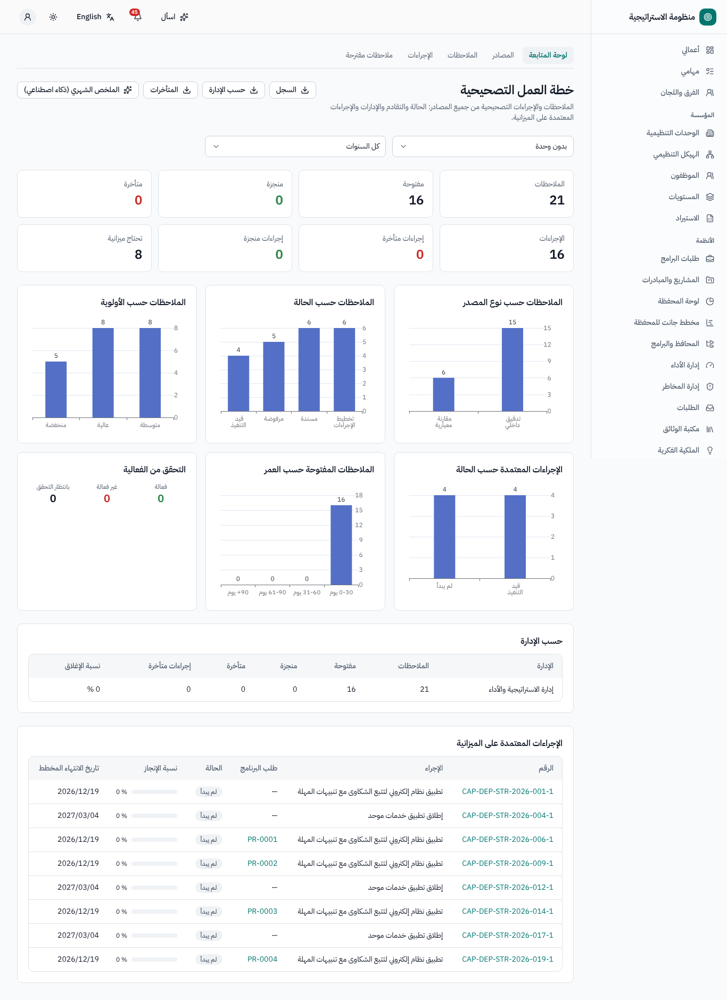

# خطة العمل التصحيحية — دليل المستخدم

لأصحاب الملاحظات (رؤساء الأقسام والإدارات)، والمكلفين بالإجراءات، ومكتب إدارة المشاريع (جهة الاعتماد الوحيدة). النسخة الإنجليزية:
[`../en/user-cap.md`](../en/user-cap.md).

القائمة الجانبية ← **الإجراءات التصحيحية**: **لوحة المتابعة**، **المصادر**، **الملاحظات**، **الإجراءات**، **ملاحظات مقترحة**.

## 1. آلية العمل

يضم **المصدر** (تقرير تدقيق، دراسة مقارنة مرجعية، شكوى متعامل، مؤشر لم يحقق مستهدفه، حدث خطر…) **ملاحظات**. ولكل ملاحظة مسؤول يقبلها
ويحلل سببها الجذري ويخطط **الإجراءات التصحيحية**؛ ويعتمد مكتب إدارة المشاريع الإجراءات؛ وينفذها المكلفون مع الأدلة؛ وتُغلق الملاحظة حين
تكتمل كل إجراءاتها المعتمدة.

مراحل الملاحظة: *التحليل › الإجراء التصحيحي › التنفيذ › التحقق › مغلقة*.
حالات الملاحظة: *مسندة · رفض بانتظار التأكيد · تخطيط الإجراءات · قيد الاعتماد · معادة للتصحيح · قيد التنفيذ · التحقق · منجزة · مرفوضة ·
ملغاة*.

وتصل الملاحظات أيضاً تلقائياً من الأنظمة الأخرى: المقارنات المرجعية (بنود خطة التطوير)، وإدارة التدقيق (فرص التحسين، عند ضبط ذلك)، ومستهدفات
المؤشرات غير المحققة وأحداث المخاطر والضوابط غير الفعالة (عند ضبط ذلك؛ وتظهر أولاً في **ملاحظات مقترحة** حيث يعتمدها مكتب إدارة المشاريع
أو يستبعدها).

## 2. إنشاء المصادر والملاحظات (مكتب إدارة المشاريع)

**المصادر ← مصدر جديد**: العنوان، والنوع، وتاريخ الاستلام، والمسؤول، والمستندات، والفريق اختيارياً. **إضافة ملاحظة**: النص (عربي /
إنجليزي)، والمعيار، والنوع، والأولوية، والإدارة والقسم، والمسؤول (افتراضياً رئيس القسم، وإلا رئيس الإدارة). و**تاريخ الاستحقاق** = تاريخ
الإسناد + الأيام المحددة للأولوية (الإعدادات ← خطة العمل التصحيحية). ويمكن للذكاء الاصطناعي **استخراج الملاحظات من تقرير**.

## 3. الرد على الملاحظة (المسؤول)

1. يصلك إشعار. اختر **قبول**، أو **رفض** مع السبب (نهائي، إلا إذا كان على مكتب إدارة المشاريع تأكيد الرفض — فتبقى الحالة *رفض بانتظار
   التأكيد* حتى **تأكيد الرفض** أو **إعادة**).
2. تبويب **السبب الجذري**: لماذا الخمس (حتى 7 مستويات)، أو فئات مخطط عظم السمكة (الأفراد، العمليات، المعدات، المواد، البيئة، الإدارة)، أو
   نص حر، مع المرفقات؛ وهو إلزامي قبل الإرسال إذا قررت جهتك ذلك. ويمكن للذكاء الاصطناعي المساعدة.
3. تبويب **الإجراءات التصحيحية**: إجراءات جديدة (التفاصيل، والنوع، والمكلف، والتواريخ المخططة، وأسئلة الميزانية: هل هي مطلوبة؟ هل هي
   متوفرة؟ التكلفة التقديرية) أو **ربط إجراء قائم** لملاحظة أخرى (ويتحقق الذكاء الاصطناعي من التكرار).
4. **إرسال الإجراءات** ← يذهب كل إجراء إلى اعتماد مكتب إدارة المشاريع.

## 4. الاعتماد (مكتب إدارة المشاريع)

تعرض **اعتماد الإجراءات** كل إجراءات الملاحظة جنباً إلى جنب: اعتمد كل إجراء أو ارفضه أو أعده (بتعليق)؛ واربط مشروعاً اختيارياً. **توجيه
الميزانية**: الإجراء المعتمد الذي يحتاج إلى ميزانية غير متوفرة وليس له مشروع يُنشئ تلقائياً **مسودة طلب برنامج** في المحافظ والمشاريع (ويعرض
الإجراء شارته؛ ومع تفعيل *عكس إنجاز المشروع المرتبط* يُنسخ إنجاز المشروع إلى الإجراء).

بعد الاعتماد تنتقل الملاحظة: إذا بقي إجراء بانتظار الاعتماد ← *قيد الاعتماد*؛ وإذا أعيد أي إجراء ← *معادة للتصحيح*؛ وإذا رُفضت كلها ← تعود إلى
*تخطيط الإجراءات*؛ وإلا ← *قيد التنفيذ*.

## 5. تنفيذ الإجراء (المكلف)

- تذكير شهري بإجراءاتك. **تحديث الإنجاز**: النسبة، والبداية والنهاية الفعليتان، وملاحظة (مع الاحتفاظ بالسجل).
- بعد تاريخ الانتهاء ودون 100٪ يصبح الإجراء *متأخراً*؛ ويُشعَر المكلف ومسؤول الملاحظة؛ ثم مكتب إدارة المشاريع بعد عدد من أيام العمل.
- **طلب تمديد** (تاريخ انتهاء جديد ومبرر) ← اعتماد مكتب إدارة المشاريع ← تاريخ انتهاء معدّل (مع الاحتفاظ بالأصلي).
- عند 100٪ مع ملف دليل واحد على الأقل ← **طلب اعتماد الإنجاز** ← اعتماد مكتب إدارة المشاريع ← *منجز*.
- عند اكتمال كل الإجراءات تصبح الملاحظة *منجزة* — أو تمر أولاً بـ**التحقق** (فحص الفعالية بعد عدد من الأشهر، عند تفعيله): **التحقق من
  الفعالية** ← منجزة، أو غير فعالة ← تُعاد فتحها بإجراءات جديدة.

## 6. لوحة المتابعة والتقارير

**لوحة المتابعة**: الملاحظات حسب نوع المصدر والإدارة والحالة والأولوية؛ والإجراءات حسب الحالة؛ والمتأخرات وأعمارها (0–30، 31–60، 61–90،
أكثر من 90 يوماً)؛ ونسبة الإغلاق لكل وحدة؛ والإجراءات المعتمدة على الميزانية؛ ونتائج الفعالية. **التقارير**: سجل خطة العمل حسب المصدر،
وخطة الإدارة، والإجراءات المتأخرة (PDF / Excel، ثنائية اللغة).

## 7. من يستطيع ماذا (افتراضياً)

| الدور | الصلاحيات |
|---|---|
| الجميع | فتح خطة العمل التصحيحية ورؤية الملاحظات التي يتولونها والإجراءات المسندة إليهم |
| مسؤول الملاحظة (دور على السجل) | القبول / الرفض، والسبب الجذري، وتخطيط الإجراءات وإرسالها، وإعادة الإسناد |
| المكلف بالإجراء | تحديث الإنجاز، وطلب التمديد واعتماد الإنجاز |
| متابعو المصدر (مثل منسق المقارنة المرجعية) | قراءة ملاحظات مصدرهم |
| مكتب إدارة المشاريع | المصادر والملاحظات، والاعتماد، والتأكيدات، والإلغاء، والإعدادات |

