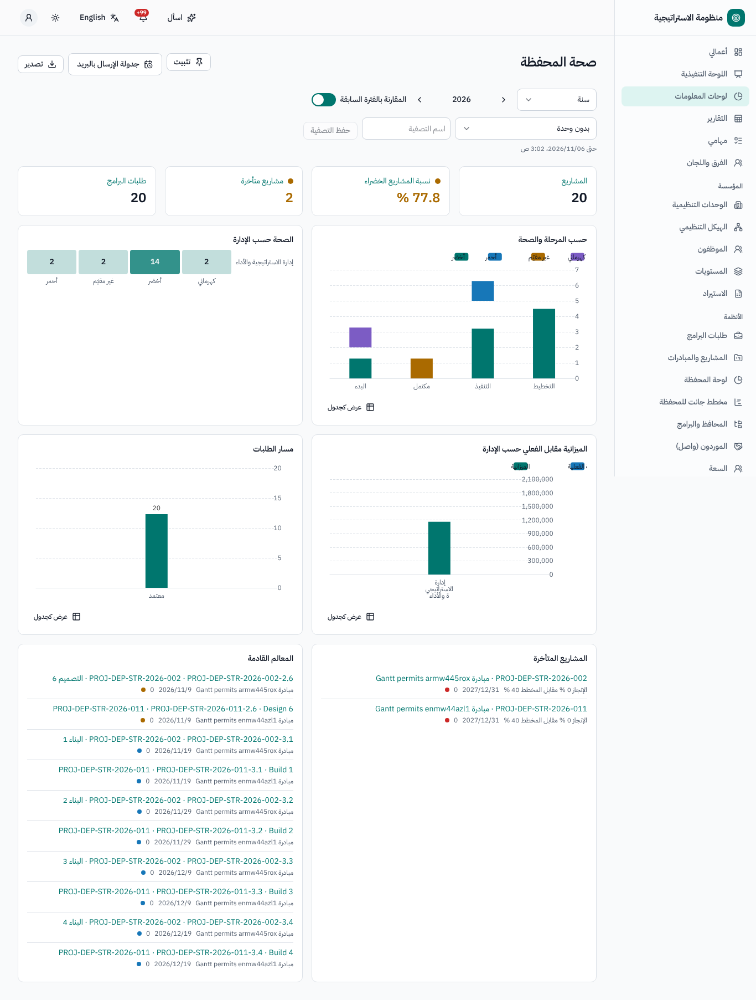
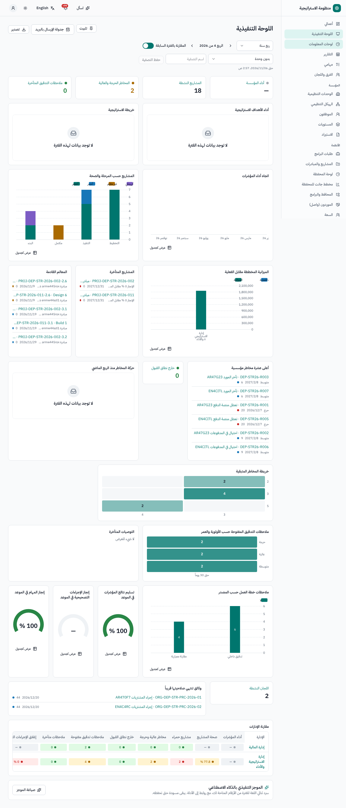
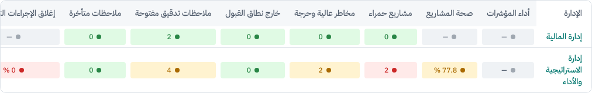
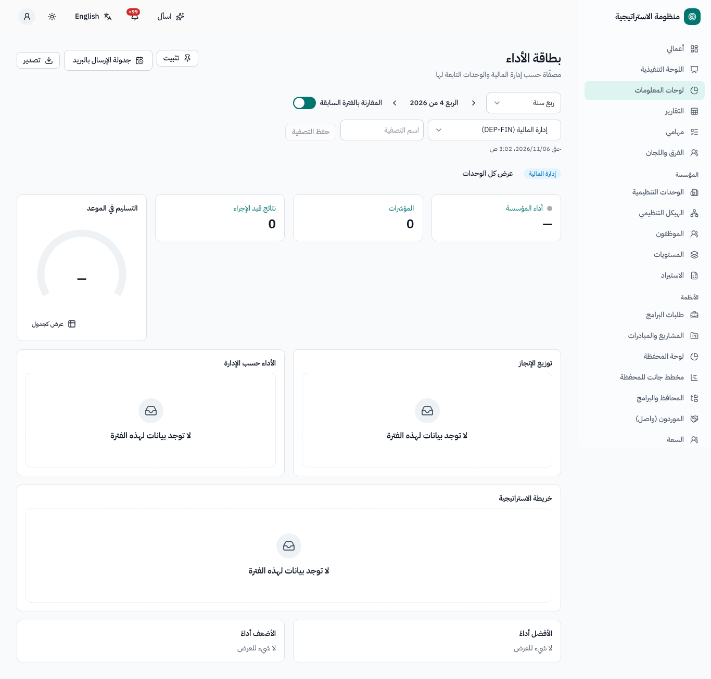
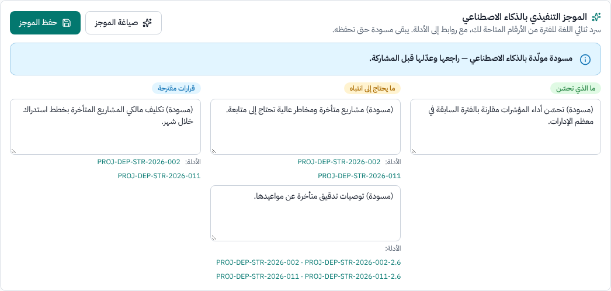
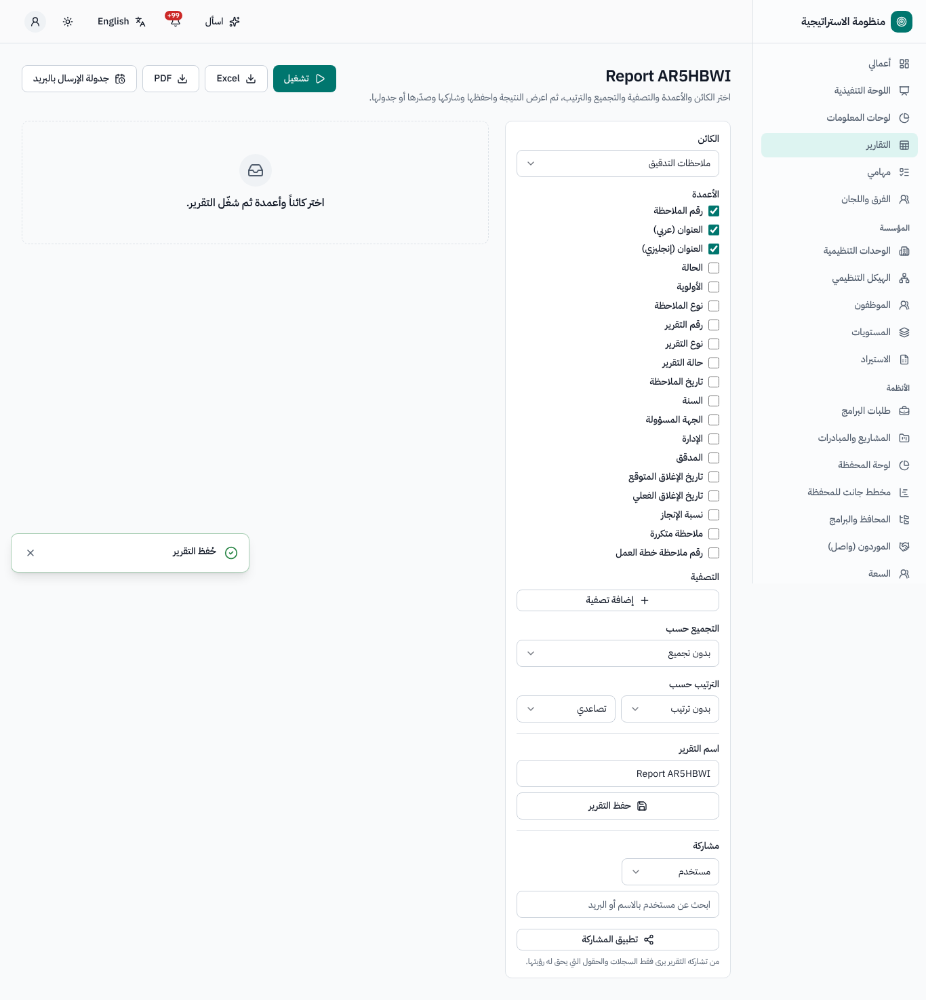
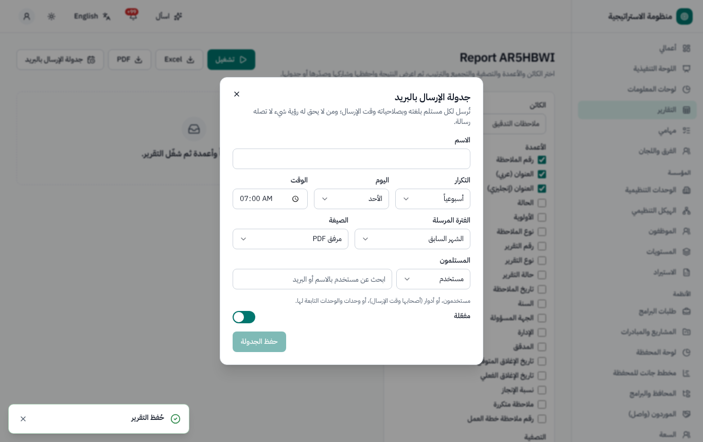
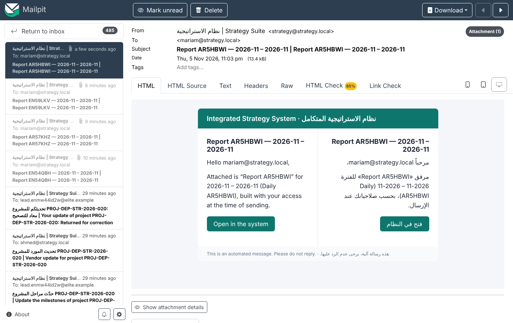
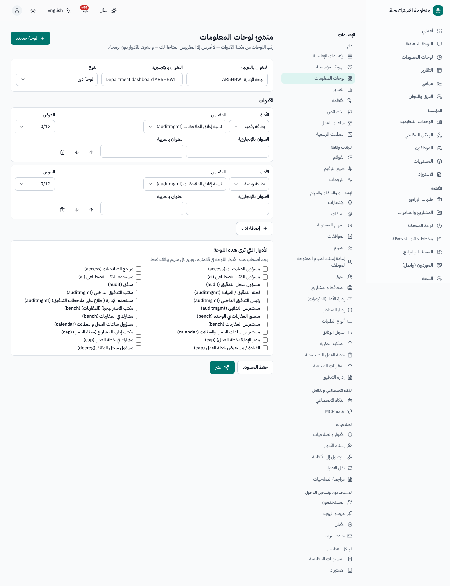

# لوحات المعلومات والتقارير — دليل المستخدم

لكل من يطّلع على لوحات المعلومات، ومُعدّي التقارير، والقيادة التنفيذية، ومسؤولي اللوحات. النسخة الإنجليزية:
[`../en/user-dashboards.md`](../en/user-dashboards.md).

القائمة الجانبية: **لوحات المعلومات**، **اللوحة التنفيذية** (للقيادة)، **التقارير**. كل رقم يراعي صلاحياتك: فاللوحة نفسها تعرض أرقاماً مختلفة
لأشخاص مختلفين، والرقم الذي لا يحق لك رؤيته يظهر *غير متاح* — ولا يظهر صفراً أبداً.

## 1. المستويات الأربعة

| المستوى | المحتوى | المكان |
|---|---|---|
| 1 — **أعمالي** | موافقاتك المعلقة ومهامك وبنودك المستحقة من كل الأنظمة | الصفحة الرئيسية ([الدليل](user-my-work.md)) |
| 2 — **لوحات الأدوار** | عروض تشغيلية داخل كل نظام: لوحة مدير المشروع، ولوحة المحفظة، ونتائج المؤشرات المعلقة، وخرائط حرارة المخاطر، وتقويم متابعة التدقيق، وتقييمات الفرق، وقائمة اعتماد الإجراءات التصحيحية… | صفحة *لوحة المؤشرات* الخاصة بكل نظام |
| 3 — **لوحات الأنظمة** | العرض الإداري لنظام واحد (صحة المحفظة، وبطاقة أداء المؤشرات، وملف المخاطر، وإغلاق التدقيق، وإغلاق الإجراءات التصحيحية، ومكتبة الوثائق، وسجل الملكية الفكرية، وخطة المقارنات، وتقييمات الفرق، وأداء المهام…) | **لوحات المعلومات** ← اختر نظاماً؛ وهي مرتبطة أيضاً من كل نظام |
| 4 — **اللوحة التنفيذية** | صفحة واحدة تشمل الأنظمة كلها للمدير العام والقيادة | **اللوحة التنفيذية** |

## 2. قراءة اللوحة

- **الفترة**: *شهر* أو *ربع سنة* أو *سنة* أو *نطاق مخصّص* (أشهر كاملة)، مع **الفترة السابقة** / **الفترة التالية**، و*المقارنة بالفترة السابقة* (تتبع
  الأسهم والفروقات هل الأعلى أفضل أم لا). والأرقام التي تصف حالة (مثل المخاطر المفتوحة) تعرض الحالة في نهاية الفترة؛ أما الأرقام التي تعدّ
  أحداثاً (مثل الاعتمادات) فتجمع الأشهر.
- **مرشح الوحدة** («مصفّاة حسب *الوحدة* والوحدات التابعة لها»، و**عرض كل الوحدات**)، ومرشحات خاصة بكل نظام، و**التصفيات المحفوظة**.
- تخبرك عبارة *حتى …* بموعد آخر تحديث للأرقام (تظهر التغييرات خلال دقيقة تقريباً، ويُجرى تحديث كامل كل 10 دقائق).
- **كل رقم قابل للنقر**: الرقم ← لوحة النظام مصفاة حسب الوحدة والفترة ← السجلات.
- لكل مخطط خيار **عرض كجدول** (بديل ميسّر)؛ و**التصدير** ← PDF أو Excel أو صورة (PNG).
- **ثبّت** اللوحة لتظهر في صفحة أعمالي.

## 3. اللوحة التنفيذية

- **الأداء الاستراتيجي**: درجات الجهة والأهداف من المؤشرات (الأداء المحدود)، والاتجاه، والخريطة الاستراتيجية ملوّنة حسب الأداء.
- **المحفظة**: المشاريع حسب المرحلة والصحة، والميزانية مقابل الفعلي، والمشاريع المتأخرة، والمراحل القادمة.
- **المخاطر**: أعلى عشرة مخاطر، والمخاطر الحرجة والعالية، والمخاطر خارج الرغبة، والتغير منذ الفترة السابقة.
- **الحوكمة**: ملاحظات التدقيق المفتوحة حسب الأولوية والعمر، والتوصيات المتأخرة، وملاحظات خطة العمل التصحيحية حسب المصدر.
- **صحة المؤسسة**: نسب الالتزام بالموعد في تقديم نتائج المؤشرات والإجراءات التصحيحية والمهام؛ واللجان النشطة؛ والوثائق القريبة من الانتهاء.
- **مقارنة الإدارات**: صف لكل إدارة (درجة المؤشرات، وصحة المشاريع، والمخاطر، وملاحظات التدقيق، وإغلاق الإجراءات التصحيحية، والمهام المتأخرة)
  ملوّن وفق الحدود المضبوطة في الإعدادات ← التقارير. وانقر أي خانة للتعمق.
- **الموجز التنفيذي بالذكاء الاصطناعي** (عند تفعيله): **صياغة الموجز** ← *ما الذي تحسّن*، و*ما يحتاج إلى انتباه*، و*قرارات مقترحة*، ولكل منها روابط
  إلى **الأدلة**. وهو مسودة مُنشأة بالذكاء الاصطناعي لا تُبنى إلا مما يحق لك رؤيته؛ عدّلها ثم **حفظ الموجز** للاحتفاظ به للفترة.

## 4. منشئ التقارير

**التقارير ← تقرير جديد** (لمُعدّي التقارير):

1. **الكائن**: المشاريع، والمراحل، وطلبات البرامج، وبطاقات المؤشرات ونتائجها، والمخاطر وإجراءات معالجتها، والفرق وتقييماتها، والمهام،
   والوثائق، وسجلات الملكية الفكرية، ودراسات المقارنات، وملاحظات خطة العمل التصحيحية وإجراءاتها، وملاحظات التدقيق وتوصياتها، والطلبات.
2. **الأعمدة**، و**التصفية** (**إضافة تصفية**: الحقل والشرط والقيمة؛ مع التواريخ النسبية مثل «هذا الربع»)، و**التجميع حسب** (حتى مستويين، مع
   العدد / المجموع / المتوسط)، و**الترتيب حسب**.
3. **تشغيل** (معاينة مقسمة إلى صفحات)، والتصدير إلى **Excel** (ورقة من اليمين إلى اليسار بالعربية) أو **PDF** (ثنائي اللغة).
4. **حفظ التقرير**، و**مشاركة** مع مستخدمين أو أدوار أو وحدات.

الأمان: تُحذف من الأعمدة الحقول التي لا يحق لك رؤيتها (مثل الميزانيات دون صلاحية التكاليف، والبيانات الشخصية المخفية)، ويُرفض استخدامها في
التصفية والتجميع والترتيب. ويعمل التقرير المشترك دائماً **بصلاحيات من يشغّله** لا بصلاحيات منشئه.

## 5. الإرسال المجدول بالبريد

في لوحة أو تقرير: **جدولة الإرسال بالبريد** ← الاسم، و**التكرار** (يومياً في وقت محدد، أو أسبوعياً في يوم، أو شهرياً في يوم)، و**الفترة المرسلة**
(الشهر أو الربع أو السنة، السابق أو الحالي)، و**الصيغة** (PDF أو Excel أو رابط فقط)، و**المستلمون** (مستخدمون، أو حاملو أدوار، أو وحدات). ويتلقى
كل مستلم المحتوى **مبنياً بصلاحياته هو وبلغته هو**؛ ومن لا يحق له رؤية شيء لا يتلقى شيئاً. وتعرض **الجداول** جدولاتك مع موعدَي التشغيل القادم
والأخير و**الإرسالات**.

## 6. بناء اللوحات (لمسؤولي النظام)

**الإعدادات ← لوحات المعلومات** (أو **لوحات المعلومات ← منشئ اللوحات**): **لوحة جديدة** ← العنوان (عربي / إنجليزي)، والنوع، و**إضافة أداة**
(*بطاقة رقمية*، *مخطط أعمدة*، *مخطط خطي*، *مخطط فقاعي*، *خريطة حرارية*، *جدول*، *قائمة*، *خريطة الاستراتيجية*، *مقارنة الإدارات*، *مقياس*،
*الموجز التنفيذي بالذكاء الاصطناعي*) مع **مقياس** أو **قائمة**، و**التصنيف حسب** / **ثم حسب**، والعرض والترتيب؛ و**الأدوار التي ترى هذه اللوحة**؛ ثم
**حفظ المسودة** و**نشر** (بإصدارات جديدة؛ ويمكن تعديل لوحات الأنظمة واللوحة التنفيذية الأولية، ولا تُستبدل النسخة المعدّلة أبداً عند إعادة التهيئة).
ولا يعرض المنشئ إلا المقاييس التي يحق لمنشئ اللوحة رؤيتها، ويرى كل مشاهد نطاقه هو دائماً.

