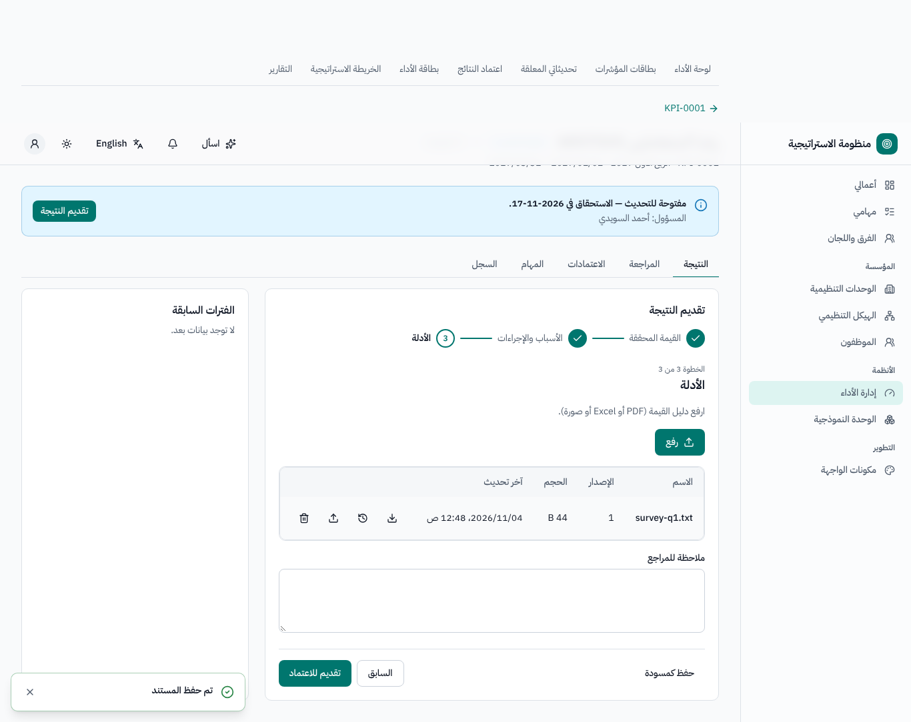
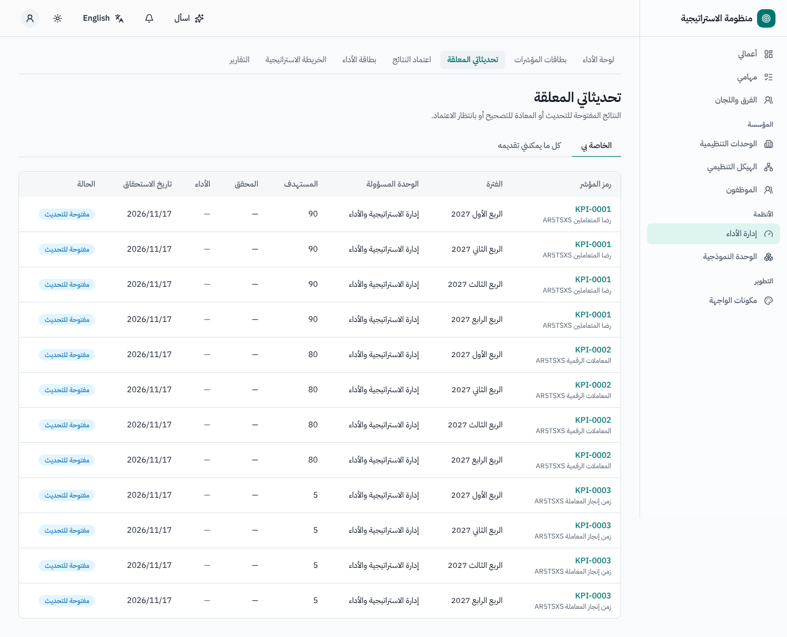
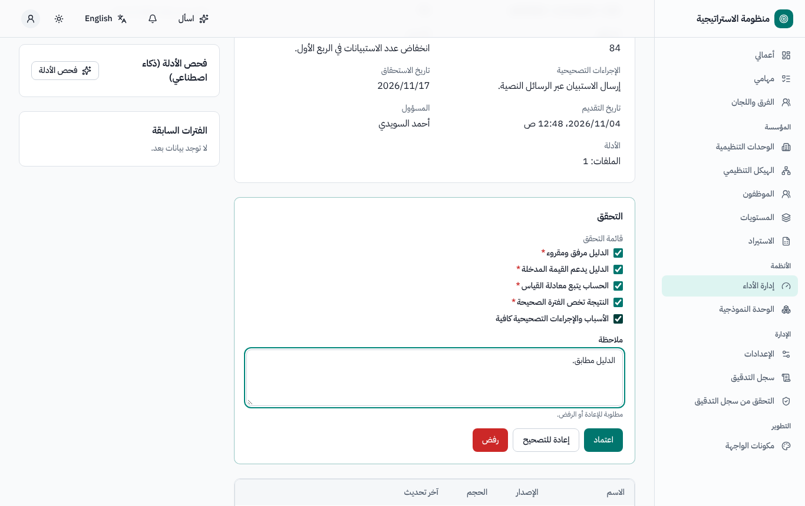
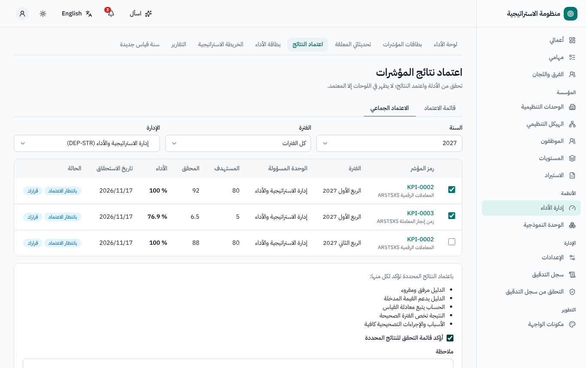
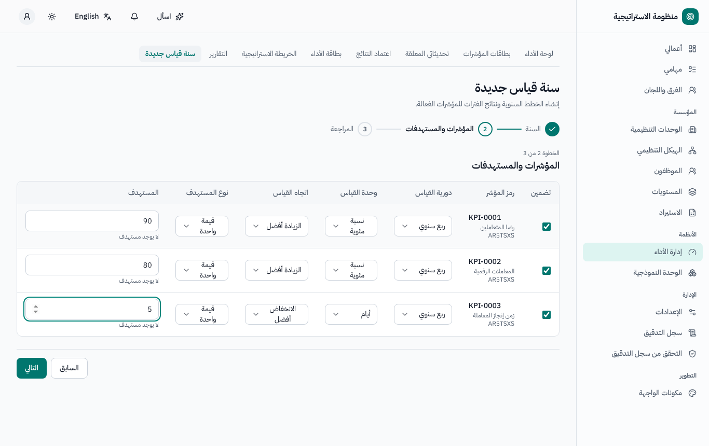
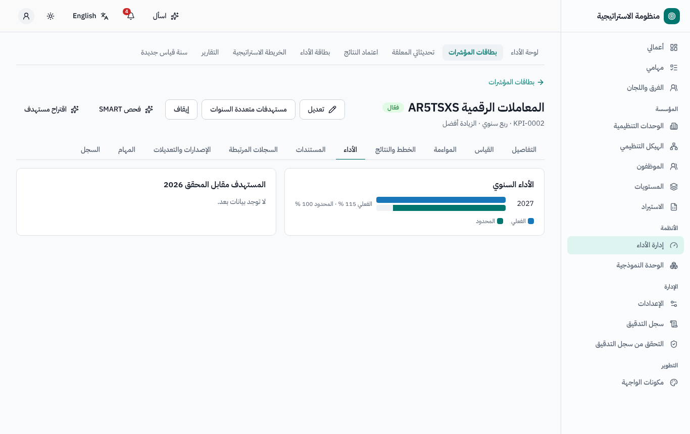
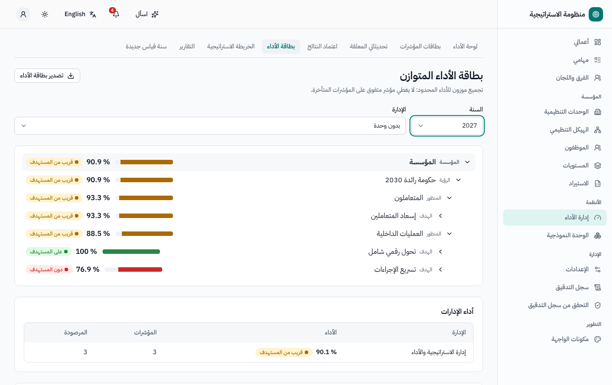
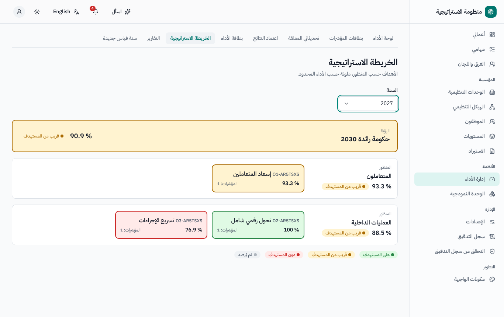

# إدارة الأداء (المؤشرات) — دليل المستخدم

لأصحاب المؤشرات (الموظفين المسؤولين)، ومديري الإدارات، ومكتب الاستراتيجية / مكتب إدارة المشاريع. النسخة الإنجليزية:
[`../en/user-kpi.md`](../en/user-kpi.md).

القائمة الجانبية ← **إدارة الأداء**: **لوحة الأداء**، **بطاقات المؤشرات**، **تحديثاتي المعلقة**، **اعتماد النتائج**، **بطاقة الأداء**،
**الخريطة الاستراتيجية**، **التقارير**، **سنة قياس جديدة** (لمكتب الاستراتيجية).

## 1. المفاهيم

| المصطلح | المعنى |
|---|---|
| **بطاقة المؤشر** | تعريف المؤشر: الرمز، والاسم، والوحدة والموظف المسؤولان، والدورية (ربع سنوي، نصف سنوي، سنوي، كل سنتين)، والاتجاه (الأعلى أفضل / الأقل أفضل / نطاق)، ونوع المستهدف، ووحدة القياس، والمعادلة، وطريقة القياس، والمواءمة مع هدف استراتيجي، وخط الأساس، والقيمة المرجعية |
| **الخطة السنوية** | خطة لكل بطاقة وسنة قياس، فيها مستهدفات الفترات |
| **النتيجة** | نتيجة لكل فترة من السنة؛ يقدّمها صاحب المؤشر ويعتمدها مكتب الاستراتيجية |
| **الأداء** | *الفعلي* (قد يتجاوز 100٪) و*المحدود* (لا يتجاوز 100٪، ويُستخدم في كل تجميع حتى لا يرفع مؤشرٌ متفوق درجةً فوق 100٪) |
| **مؤشر الألوان** | *على المستهدف* (الأداء المحدود ≥ 95٪)، *قريب من المستهدف* (≥ 80٪)، *دون المستهدف*، *لم يُرصد* — والنطاقات قابلة للضبط، ولكل مؤشر أيضاً |

## 2. تقديم النتيجة (صاحب المؤشر)

1. تُفتح الفترة **في اليوم التالي لانتهائها** (افتراضياً، Q-K2): مثلاً الربع الأول (يناير–مارس) يُفتح في 1 أبريل و**يستحق في 15 أبريل**؛
   والنصف الأول يُفتح في 1 يوليو؛ والنصف الثاني / السنة كاملة تُفتح في 1 يناير من السنة التالية وتستحق في 31 يناير. يصلك إشعار عند فتح
   النتائج، وتذكير قبل الاستحقاق بثلاثة أيام عمل، وإشعار عند التأخر (ثم لمديرك بعد يومي عمل آخرين). ويُسمح بالتقديم المتأخر مع تمييزه.
2. تعرض **تحديثاتي المعلقة** نتائجك *المفتوحة للتحديث* و*المعادة للتصحيح*. افتح إحداها ← **تقديم النتيجة**:
   - أدخل **القيمة المحققة** (أو عناصر بيانات المؤشر المركب، أو **مستوى السلّم** للمؤشر النوعي) — وتتحدث معاينة الأداء أثناء الكتابة؛
   - عند عدم تحقيق المستهدف اكتب الأسباب والإجراءات التصحيحية (ويمكن للذكاء الاصطناعي صياغتها من ملاحظاتك)؛
   - أرفق **الدليل** (إلزامي إذا قررت جهتك ذلك)؛
   - أو حدّد **غير منطبقة لهذه الفترة** (تُستبعد من الاحتساب بعد الاعتماد)؛
   - ثم **تقديم للاعتماد**.
3. يمكنك **الاسترجاع** ما دام أحد لم يتخذ قراراً. وتعرض النتيجة المعادة تعليق المراجع؛ فصحّحها وقدّمها مرة أخرى.

## 3. مراجعة النتائج (مكتب الاستراتيجية)

- يعرض **اعتماد النتائج** النتائج التي تنتظرك. اختر **المراجعة واتخاذ القرار**: تعرض لوحة المراجع **قائمة التحقق** (يجب تحديد البنود
  الإلزامية للاعتماد)، وفحص الذكاء الاصطناعي للدليل (هل تظهر القيمة في الدليل، وهل تتطابق الفترة)، وتنبيهات القيم الشاذة (قفزة مقارنة
  بالفترة السابقة، أو قيمة مطابقة، أو قيمة غير معقولة). ثم **موافقة** أو **إعادة للتصحيح** / **رفض** (وكلاهما يعيدها إلى صاحبها مع تعليق
  إلزامي).
- **الاعتماد الجماعي**: اختر السنة والإدارة والفترة، وحدّد النتائج، وأكّد قائمة التحقق مرة واحدة، ثم **تحديث**؛ ويُتخذ القرار في كل نتيجة على
  حدة وتُعرض النتيجة لكل منها.
- المسار الافتراضي: خطوة واحدة لمكتب الاستراتيجية؛ ويمكن لمسؤول النظام إضافة خطوة مراجعة لمدير الإدارة.
- **إعادة فتح** نتيجة معتمدة (السبب إلزامي)؛ و**إقفال** الفترة في نهاية السنة من الإعدادات ← إدارة الأداء ← نوافذ الفترات.

## 4. سنة قياس جديدة (مكتب الاستراتيجية)

معالج **سنة قياس جديدة**: اختر السنة؛ فتُعرض كل بطاقة فعّالة بدوريتها ووحدتها واتجاهها ونوع مستهدفها ومستهدفها (من المستهدف متعدد
السنوات، وإلا من خطة السنة الماضية). ألغِ تحديد البطاقات غير المطلوبة، وعدّل، ثم **قدّم**: فتُنشأ الخطط والنتائج (وإعادة التشغيل لا تضيف إلا
البطاقات الناقصة). ثم راجع مستهدفات الفترات في كل خطة و**اعتمدها** (فردياً أو جماعياً) — ولا تُفتح النتائج إلا للخطط المعتمدة (افتراضياً).

## 5. البطاقات وبطاقة الأداء والخريطة الاستراتيجية

- **بطاقات المؤشرات**: سجل مع التصفية؛ ولكل بطاقة تبويبات **التفاصيل**، **القياس**، **المواءمة**، **الخطط والنتائج**، **الأداء** (الفعلي
  والمحدود سنوياً، واتجاه الفترات)، **المستندات**، **السجلات المرتبطة** (المشاريع والمخاطر)، **الإصدارات والتعديلات**، **المهام**،
  **السجل**. ومع تفعيل *ضبط تغيير تعريف المؤشر* (افتراضياً) تمر تعديلات تعريف البطاقة بموافقة وتُنشئ إصداراً جديداً. ويمكن للذكاء
  الاصطناعي صياغة بطاقة من وصف مع فحص SMART.
- **بطاقة الأداء**: الجهة ← المنظور ← الهدف ← المؤشر، بمتوسطات موزونة للأداء **المحدود**؛ مع عرض للإدارات.
- **الخريطة الاستراتيجية**: الأهداف حسب المنظورات، ملوّنة حسب الأداء.
- **التقارير**: جودة البيانات لكل إدارة (نسبة الالتزام بالموعد، ونسبة الإعادة، واكتمال الأدلة)، والتصدير؛ ومسودة السرد الربعي بالذكاء
  الاصطناعي.

تتبع الأرقام السنوية طريقة القياس في البطاقة: *مجموع* (تُجمع قيم الفترات ومستهدفاتها) أو *متوسط*.

## 6. الروابط مع الأنظمة الأخرى

- يمكن للمشاريع ربط مؤشراتها بالمؤشرات المؤسسية.
- تقرأ إدارة المخاطر نتيجة المؤشر المعتمدة: فمؤشرات المخاطر الرئيسية (KRI) المرتبطة بالبطاقة قد تسجّل تجاوزاً وتستدعي إعادة تقييم الخطر.
- قد يُنشئ عدم تحقيق المستهدف ملاحظة في خطة العمل التصحيحية (عند ضبط ذلك في الإعدادات ← خطة العمل التصحيحية).
- يمكن لدراسات المقارنات المرجعية تحديث القيمة المرجعية للبطاقة.

## 7. من يستطيع ماذا (افتراضياً)

| الدور | الصلاحيات |
|---|---|
| صاحب المؤشر (الموظف المسؤول) | تقديم نتائج مؤشراته واسترجاعها |
| مدير الإدارة | الاطلاع على مؤشرات إدارته (والاعتماد إذا أُضيفت خطوة مراجعة) |
| مكتب الاستراتيجية / مكتب إدارة المشاريع | الاعتماد، والاعتماد الجماعي، وإعادة الفتح، والسنة الجديدة، والخطط، والبطاقات |
| مسؤول إدارة الأداء | الإعدادات، والهيكل الاستراتيجي، وطرق القياس |
| الجميع (افتراضياً) | فتح إدارة الأداء ورؤية المؤشرات التي هم مسؤولون عنها |

