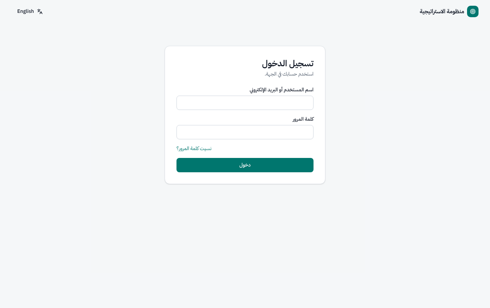
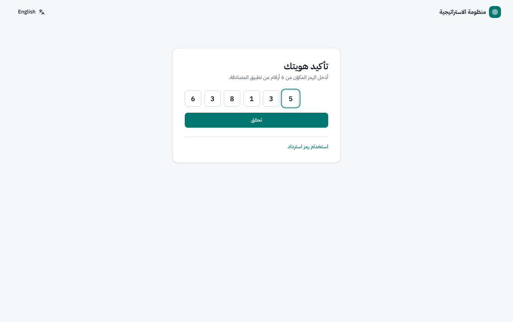
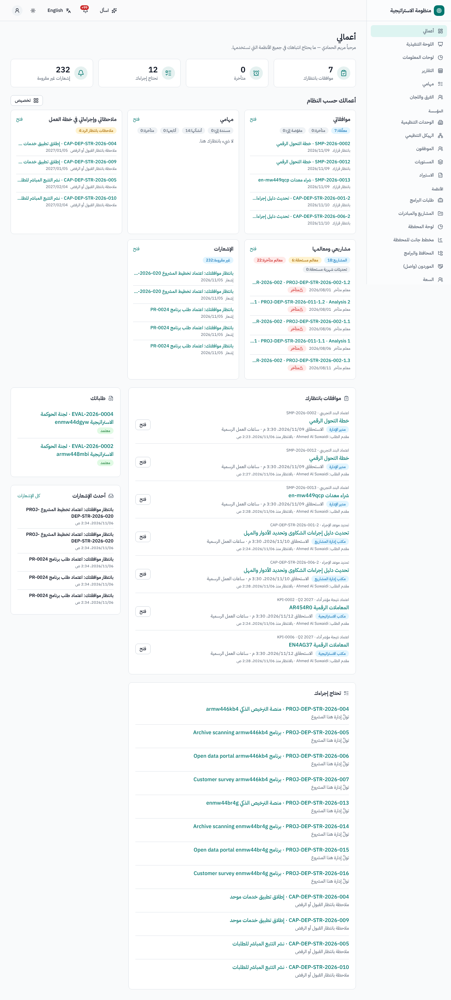
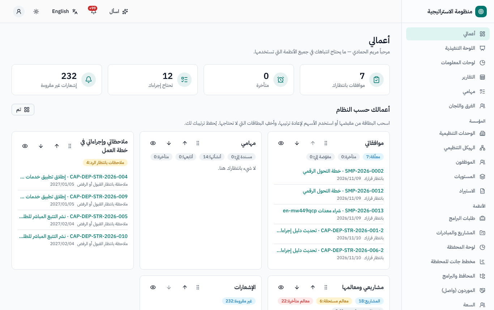
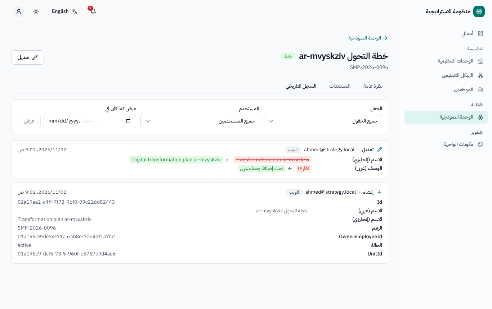
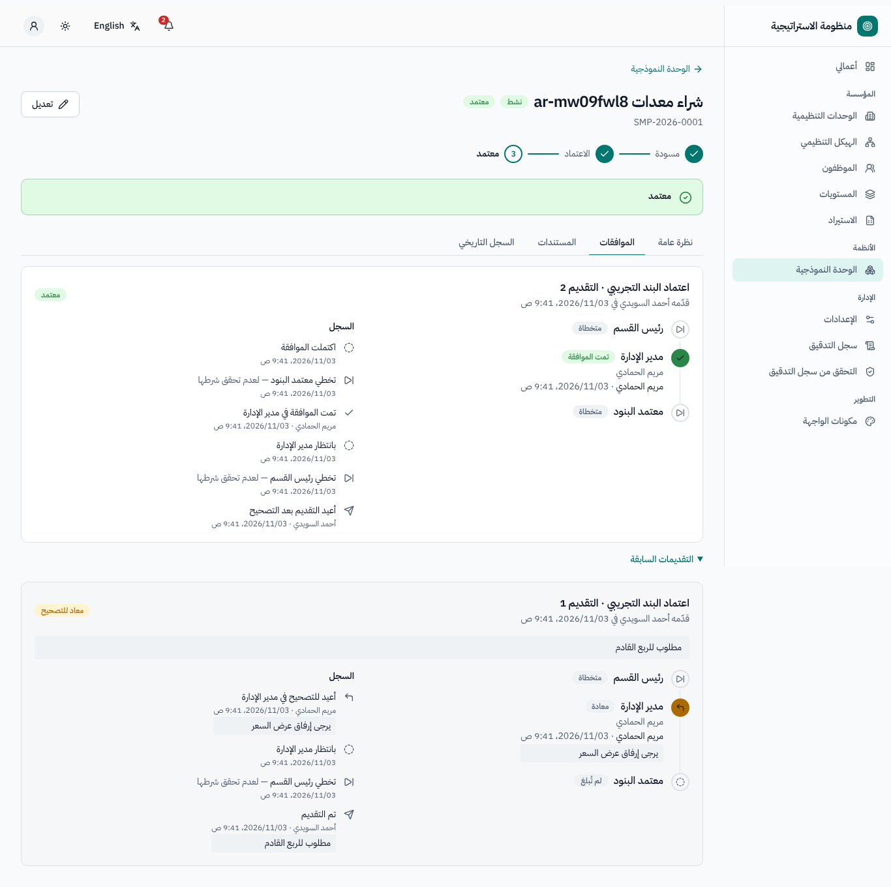
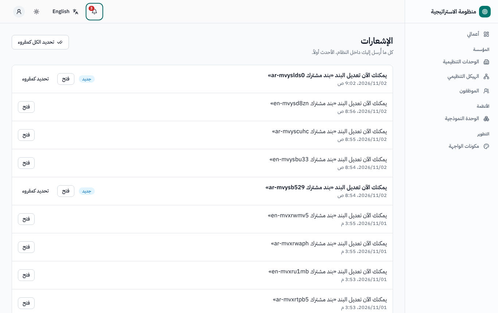
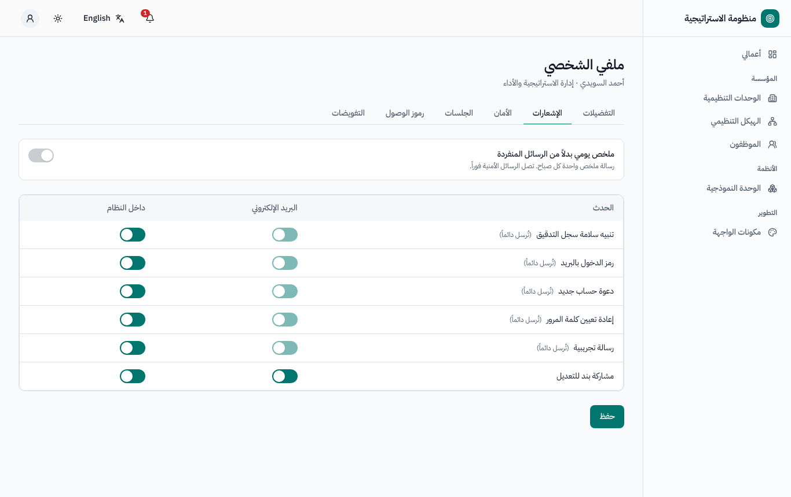
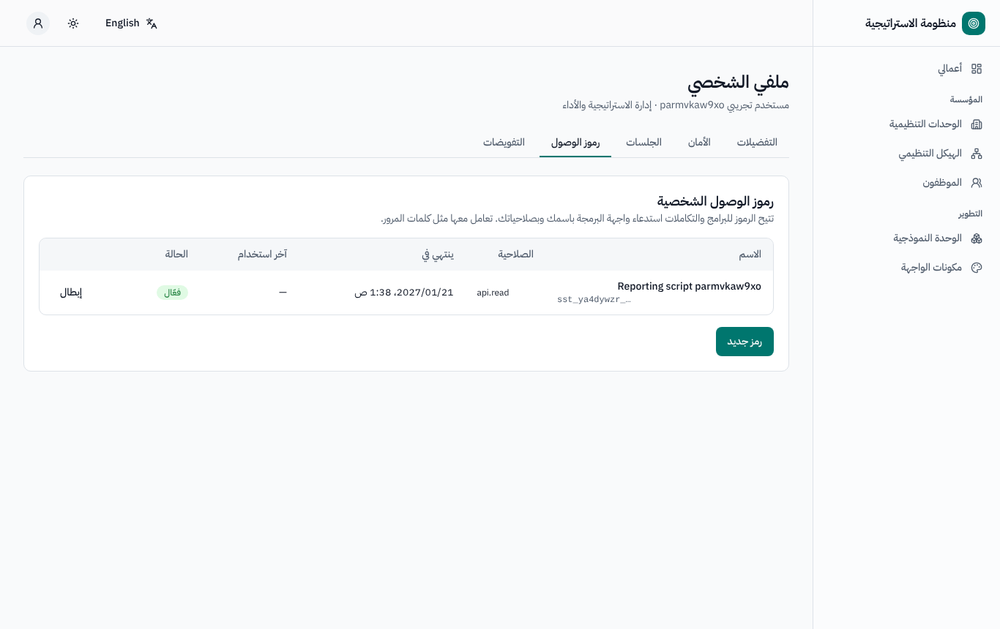
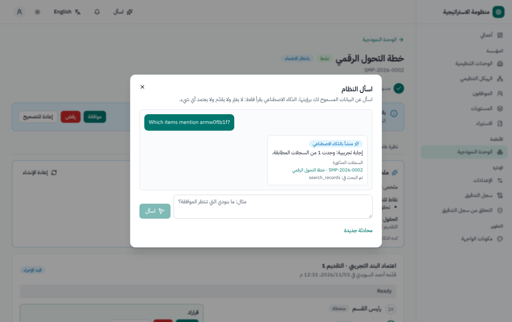

# أعمالي والموافقات والإشعارات وملفك الشخصي

لجميع المستخدمين. النسخة الإنجليزية: [`../en/user-my-work.md`](../en/user-my-work.md).

## 1. تسجيل الدخول

1. افتح عنوان النظام في جهتك، وأدخل **اسم المستخدم أو البريد الإلكتروني** و**كلمة المرور**، ثم اضغط **دخول**. إذا كانت جهتك تستخدم
   الدخول الموحد أو UAE Pass أو الدليل (LDAP) فاستخدم زر **المتابعة باستخدام …** بدلاً من ذلك.
2. إذا كان التحقق بخطوتين مفعّلاً لحسابك، أدخل **رمز التحقق** من تطبيق المصادقة، أو اختر **أرسل لي رمزاً بالبريد**. ويصلح كل
   **رمز استرداد** لمرة واحدة إذا فقدت هاتفك.
3. يجب على مسؤولي النظام (وعلى الجميع إذا قررت جهتك ذلك) إعداد التحقق بخطوتين عند أول دخول: امسح رمز QR بتطبيق المصادقة (أو اختر
   الرمز بالبريد)، وأكّد رمزاً، ثم **احفظ رموز الاسترداد** التي تظهر مرة واحدة فقط.

 

معلومات مفيدة (قيم افتراضية قد يغيّرها مسؤول النظام): خمس محاولات خاطئة لكلمة المرور تقفل الحساب 15 دقيقة؛ وتنتهي الجلسة بعد 30 دقيقة
دون نشاط، وبعد 12 ساعة في كل الأحوال. ويرسل رابط **نسيت كلمة المرور؟** رابطاً لإعادة التعيين إلى بريدك.

## 2. أعمالي — صفحتك الرئيسية

تجمع صفحة **أعمالي** (أول عنصر في القائمة الجانبية) كل ما ينتظرك من جميع الأنظمة المسموح لك بفتحها:

- **العدادات**: *موافقات بانتظارك*، *متأخرة*، *تحتاج إجراءك*، *طلباتك قيد الإجراء*، *إشعارات غير مقروءة*.
- **موافقات بانتظارك**: كل مهمة موافقة تنتظرك في أي نظام — السجل والخطوة و*مقدم الطلب* و*بالانتظار منذ* و*الاستحقاق* — بما فيها
  المهام التي تتولاها **نيابة عن** زميل فوّضك. تظهر المهام المتأخرة أولاً، ويأخذك زر **فتح** إلى السجل.
- **أعمالك حسب النظام**: بطاقة لكل نظام يحق لك فتحه — مثل مهامي، ونتائج مؤشراتي المطلوب إدخالها، ومخاطري وإجراءات معالجتها،
  وملاحظاتي وإجراءاتي في خطة العمل التصحيحية، ومشاريعي والمراحل المستحقة، وتقديمات واصل المطلوب مراجعتها، وفرقي والتقييمات المعلقة،
  وطلباتي (الوثائق والملكية الفكرية والمقارنات)، ومتابعات التدقيق (لمكتب التدقيق)، والإشعارات، واللوحات المثبتة. ولا تظهر أبداً
  بطاقات الأنظمة التي لا يحق لك فتحها.
- **تخصيص**: اسحب البطاقة (أو استخدم *نقل إلى الأعلى* / *نقل إلى الأسفل* من لوحة المفاتيح)، وأخفِ البطاقات أو أظهرها، ثم اضغط
  **تم**. يُحفظ الترتيب في ملفك الشخصي.

## 3. صفحات السجلات وشريط الحالة الحالية

يُفتح كل سجل (مشروع، نتيجة مؤشر، خطر، فريق، مهمة، طلب، ملاحظة، ملاحظة تدقيق…) في صفحة بالشكل نفسه:

- **الترويسة**: الرقم والعنوان وشارات الحالة.
- **مؤشر المراحل**: موقع السجل في دورة حياته.
- **شريط الحالة الحالية**: ما الذي ينتظر، و*من* عليه أن يتصرف، وأزرار الإجراءات التي يحق **لك** اتخاذها الآن. إذا لم يظهر زر فلا
  شيء ينتظرك.
- **التبويبات**: نظرة عامة، والعناصر المرتبطة، و**المستندات** (الرفع والإصدارات والمعاينة)، و**السجل** (كل تغيير: من ومتى والقيمة
  القديمة ← الجديدة والقناة؛ مع التصفية حسب الحقل أو المستخدم، وعرض السجل *كما كان في تاريخ معين*).

## 4. الموافقة

عندما تكون المعتمد الحالي تعرض صفحة السجل لوحة **الموافقات** مع أزرارك: **موافقة**، **رفض**، **إعادة للتصحيح** (وقد تضيف بعض
المسارات إجراءات بأسمائها الخاصة). التعليق إلزامي عند الرفض أو الإعادة (يحدد ذلك مسؤول النظام لكل خطوة). اختر **اتخاذ القرار**،
واكتب التعليق، ثم **تأكيد**.

- تعرض اللوحة كل الخطوات (المنجزة والحالية والمتخطاة وسبب تخطيها والقادمة)، والمعتمدين، وتاريخ الاستحقاق («الاستحقاق … · اسم ساعات
  العمل»)، وسجل جميع التقديمات (*التقديمات السابقة*).
- **ملخص المعتمد** (عند تفعيل الذكاء الاصطناعي): فقرة عن السجل و*ما الذي تغير منذ التقديم السابق* — والحقول المعدلة مأخوذة من سجل
  التغييرات لا من الذكاء الاصطناعي. ويحمل الملخص وسم «مُنشأ بالذكاء الاصطناعي»، ويبقى القرار لك.
- لكل خطوة مهلة بساعات العمل. وعند تجاوزها يُذكَّر المعتمدون، وقد تُصعَّد الخطوة إلى شخص آخر.

يستطيع مقدم الطلب في العادة **استرجاع** التقديم ما دام لم يُتخذ أي قرار (فيعود السجل مسودة).

## 5. تفويض اعتماداتك (عند الإجازة)

**ملفي الشخصي ← التفويضات ← تفويض اعتماداتي**: اختر الزميل، و**اليوم الأول**، و**اليوم الأخير**، و**السبب** (يجب أن يكون حسابك
مرتبطاً بموظف). خلال هذه الفترة تظهر مهام موافقتك أيضاً في صفحة أعمالي لدى المفوَّض إليه؛ وعندما يتصرف يُظهر السجل «*المفوَّض*
نيابة عن *أنت*» وتصلك إشعارات بذلك. ويختار المفوَّض إليه في اللوحة **التصرف بصفة** ← أنت أو هو نفسه. ويمكنك إلغاء التفويض في أي وقت
من التبويب نفسه.

## 6. الإشعارات

- يعرض **الجرس** في الشريط العلوي عدد الإشعارات غير المقروءة؛ وتفتح القائمة السجل المعني، ويمسحها زر **تحديد الكل كمقروء**. وتجد
  جميع الإشعارات في صفحة الإشعارات.
- رسائل البريد ثنائية اللغة (العربية يميناً والإنجليزية يساراً) وفيها رابط السجل.
- **ملفي الشخصي ← الإشعارات**: اختر لكل حدث **البريد الإلكتروني** و/أو **داخل النظام**، أو فعّل **ملخص يومي بدلاً من الرسائل
  المنفردة**. أما رسائل الأمان (إعادة تعيين كلمة المرور والرموز) فـ*تُرسل دائماً*.

## 7. اللغة والمظهر وملفك الشخصي

- **اللغة**: يبدّل زر اللغة في الشريط العلوي بين العربية والإنجليزية فوراً (وتنعكس الواجهة بالكامل). ويُحفظ اختيارك في ملفك الشخصي
  (**ملفي الشخصي ← التفضيلات**) ويُستخدم لرسائل بريدك أيضاً.
- **المظهر**: فاتح أو داكن أو *حسب النظام*.
- **ملفي الشخصي ← الأمان**: غيّر **كلمة المرور** (يُنهي ذلك جلساتك في الأماكن الأخرى)، وأدِر **التحقق بخطوتين** (إضافة طريقة أو
  إيقافها، و*رموز استرداد جديدة*).
- **ملفي الشخصي ← الجلسات**: *الأماكن التي سجّلت الدخول منها*؛ **تسجيل الخروج** من جهاز معين أو **تسجيل الخروج من كل الجلسات
  الأخرى**.

## 8. رموز الوصول الشخصية (واجهة البرمجة ومساعدات الذكاء الاصطناعي)

**ملفي الشخصي ← رموز الوصول ← رمز جديد**: اسم، والصلاحية (**قراءة البيانات** أو **قراءة البيانات وتعديلها** أو **مساعدات الذكاء
الاصطناعي (MCP)**)، و**مدة الصلاحية (بالأيام)** (90 يوماً افتراضياً، و365 كحد أقصى ما لم يغيّره مسؤول النظام). **انسخ الرمز الآن،
فلن يظهر مرة أخرى.** يعمل الرمز باسمك وبصلاحياتك نفسها تماماً. **أبطِله** عندما لا تعود بحاجة إليه، فيتوقف كل ما يستخدمه فوراً. طريقة
ربط Claude: [دليل MCP](mcp.md).

## 9. اسأل النظام (عند تفعيل الذكاء الاصطناعي)

يفتح زر **اسأل** نافذة *اسأل النظام*: اطرح سؤالاً بالعربية أو الإنجليزية (مثل «ما بنودي التي تنتظر الموافقة؟»). لا تستخدم الإجابة إلا
السجلات المسموح لك برؤيتها، وتعرض *السجلات المذكورة* مع روابطها. لا يعتمد الذكاء الاصطناعي ولا يقدّم ولا يحفظ أي شيء من تلقاء نفسه؛
وكل اقتراح منه في النظام مسودة موسومة بـ«مُنشأ بالذكاء الاصطناعي» حتى تقبلها أو تعدّلها.

