

# إدارة المحافظ والمشاريع — دليل المستخدم

لمقدمي الطلبات ومديري المشاريع ومالكيها ومكتب إدارة المشاريع. النسخة الإنجليزية: [`../en/user-portfolio.md`](../en/user-portfolio.md).
التعاون مع الموردين مشروح في [دليل واصل](user-wasel.md).

عناصر القائمة الجانبية: **طلبات البرامج**، **المشاريع والمبادرات**، **لوحة المحفظة**، **مخطط جانت للمحفظة**، و— عند تفعيل الميزات —
**المحافظ والبرامج**، **الموردون (واصل)**، **السعة**، **مراجعات المحفظة**.

## 1. الصورة العامة

| الخطوة | المسؤول | النتيجة |
|---|---|---|
| 1. طلب البرنامج (معالج) | أي موظف (مقدم الطلب) | رقم مثل `PR-0001`، يُقدَّم للاعتماد |
| 2. اعتماد الطلب | المدير ← مكتب إدارة المشاريع ← مكتب المدير العام ← الميزانية (يختلف المسار حسب الطلب) | عند الاعتماد يُنشأ **مشروع** أو **مبادرة** |
| 3. البدء (للمشاريع فقط) | يتولى مدير المشروع الإدارة، ويكتب **الميثاق**، ثم اعتماد الميثاق، وأمر الشراء، وتشكيل الفريق | تُفتح مرحلة التخطيط |
| 4. التخطيط | مدير المشروع: النطاق والمراحل وأوزانها (أو الإصدارات والملاحم في Agile) | اعتماد التخطيط ← التنفيذ |
| 5. التنفيذ | مدير المشروع: **التحديث الشهري** للمراحل مع الأدلة | إنجاز معتمد؛ وعند بلوغ 100٪ ← الإغلاق |
| 6. الإغلاق ← الأثر | مدير المشروع: نموذج الإغلاق والدروس المستفادة ثم الأثر | **مكتمل** |

**مشروع أم مبادرة؟** يُحسب التصنيف من إجابات الفرز والميزانية التقديرية: *مشروع* إذا كانت كل إجابات الفرز *نعم* **وكانت** الميزانية أعلى
من الحد (50 000 درهم افتراضياً)؛ وإلا فهو *مبادرة*. ويمكن لمكتب إدارة المشاريع **تغيير التصنيف** مع ذكر السبب. تتخطى المبادرات الميثاق
وأمر الشراء وتشكيل الفريق واعتماد الإغلاق والأثر: التخطيط ← التنفيذ ← مكتمل (يؤكد مكتب إدارة المشاريع الاكتمال عند 100٪). ويمكن لجهتك
تغيير نماذج المراحل هذه.

## 2. تقديم طلب برنامج

1. **طلبات البرامج ← طلب برنامج جديد**. اختر **التعبئة يدوياً** أو **البدء من مستند** (بالذكاء الاصطناعي عند تفعيله: ارفع مستنداً أو
   أكثر ثم **قراءة المستندات**؛ فيُملأ النموذج بمسودات مميزة تراجعها حقلاً حقلاً — وما *لم يُعثر عليها في المستندات* تملؤه بنفسك).
2. للمعالج ست خطوات: **البرنامج**، **الميزانية وملفات التكلفة**، **الفرز والأولوية**، **التنفيذ والشركاء**، **التكاليف التشغيلية
   والعائد**، **الممارسات والمراجعة**. استخدم **حفظ المسودة** في أي وقت؛ وتظهر الأخطاء بجانب الحقول، وتظهر جميعها معاً عند التقديم.
3. مسار الميزانية: حسب إجاباتك إما أن **ترفع ملف تقدير التكلفة**، أو **تنزّل نموذج نطاق المشروع** ثم **ترفع نطاق المشروع** (فينتقل
   الطلب إلى إدارة الشؤون الإدارية التي **ترفع عروض الأسعار** قبل أن تتمكن من التقديم).
4. **تقديم للاعتماد**. تعرض صفحة السجل مؤشر المراحل (*مسودة › اعتماد المدير › مكتب إدارة المشاريع › مكتب المدير العام › الميزانية ›
   معتمد*، وتظهر الخطوات غير الواردة في مسارك باهتة) والحالة الحالية («بانتظار اعتماد مكتب إدارة المشاريع»…).
5. إذا **أعيد** الطلب فصحّحه ثم **إعادة التقديم بعد التصحيح**. أما **الرفض** فنهائي. ويمكنك **إلغاء الطلب** (مع ذكر السبب) ما دام
   مسودة لديك.

عند الاعتماد يعرض الطلب «معتمد — أُنشئ المشروع *رقم*» وزر **فتح المشروع**.

ويرى مكتب إدارة المشاريع تبويب **تقييم المقترح** (تقييم يصوغه الذكاء الاصطناعي، بإصدارات)، ويمكنه **تحديد الميزانية المعتمدة** في خطوة
الميزانية.

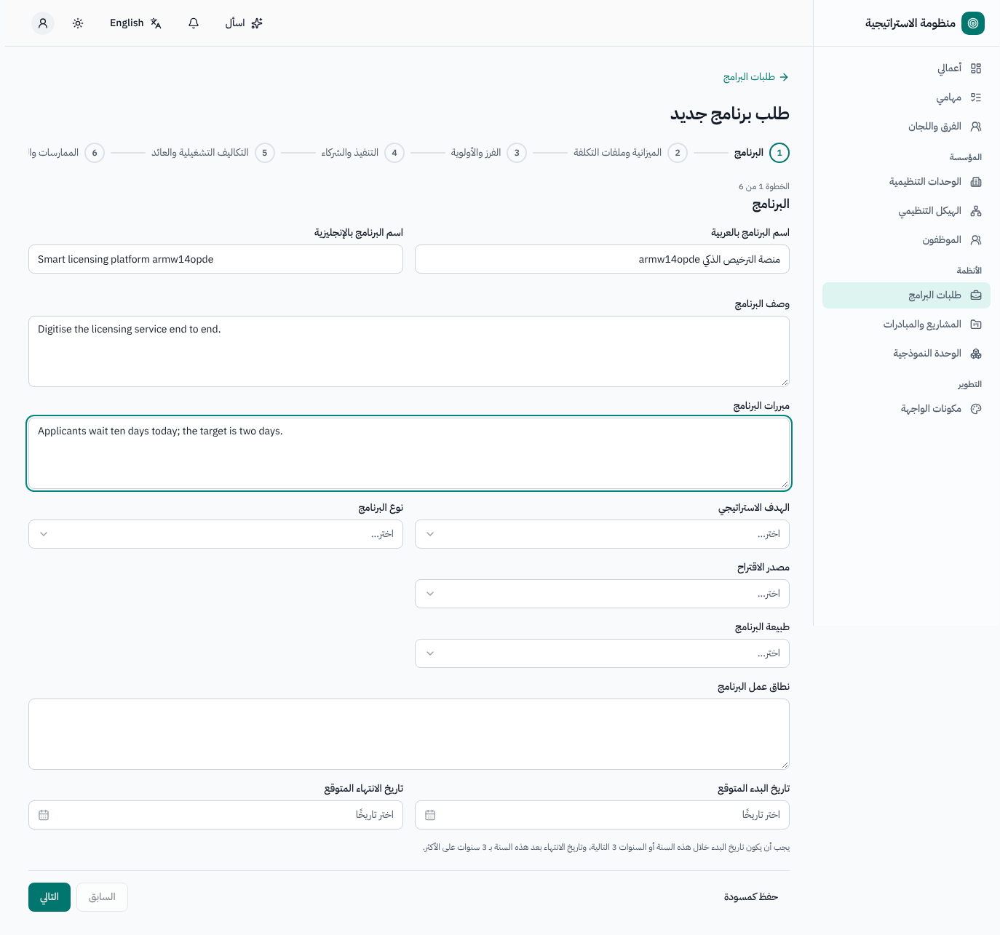
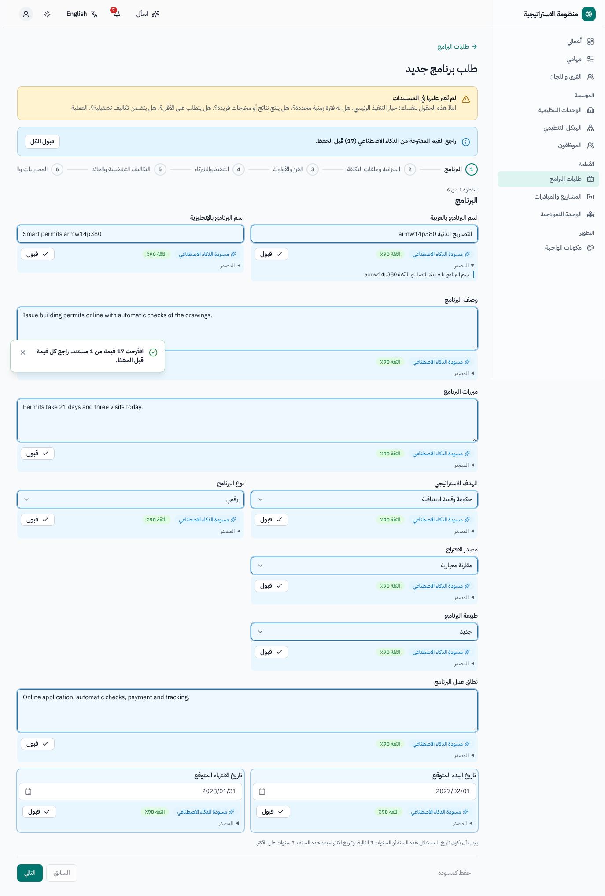
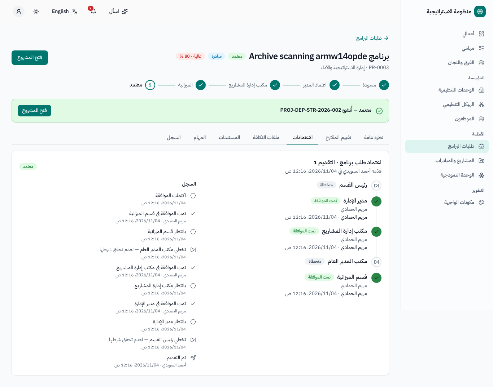

## 3. تولي إدارة المشروع والميثاق (للمشاريع)

1. يظهر المشروع الجديد بحالة «بانتظار مدير مشروع». ويمكن لأي موظف في قسم المشروع **تولي إدارة المشروع** (أو يعيّن مكتب إدارة المشاريع
   مدير المشروع).
2. **اختيار المنهجية** (تقليدية (شلالية) أو رشيقة (أجايل) أو هجينة) أثناء صياغة الميثاق؛ ولا تتغير بعد ذلك إلا بطلب تغيير معتمد.
3. املأ تبويبات الميثاق: **نظرة عامة** (التفاصيل والميزانية والتكاليف)، **المؤشرات**، **المخاطر** (تُقيَّم بإطار المخاطر في الجهة)،
   **أصحاب المصلحة**، **الفريق** (الأعضاء المقترحون)، **النطاق**، **الافتراضات والقيود**، **القيم المضافة**، والخطة عالية المستوى في
   **المراحل**.
4. **تقديم الميثاق**. تتحقق بوابة الميثاق من كل الشروط معاً: مؤشر واحد على الأقل، وخطر واحد، وصاحب مصلحة واحد، وثلاثة أعضاء مقترحين
   للفريق، ونطاق، وخطة عالية المستوى مجموع أوزانها 100٪.
5. بعد اعتماد الميثاق (المسار الافتراضي: مدير القسم عند الاقتضاء ← مدير الإدارة ← مكتب إدارة المشاريع) **يرفع** مسؤول المشتريات **أمر
   الشراء**، ثم **تشكيل فريق المشروع** (سجل فريق مشروع في نظام الفرق؛ وتُفتح مرحلة التخطيط حين يصبح الفريق نشطاً).

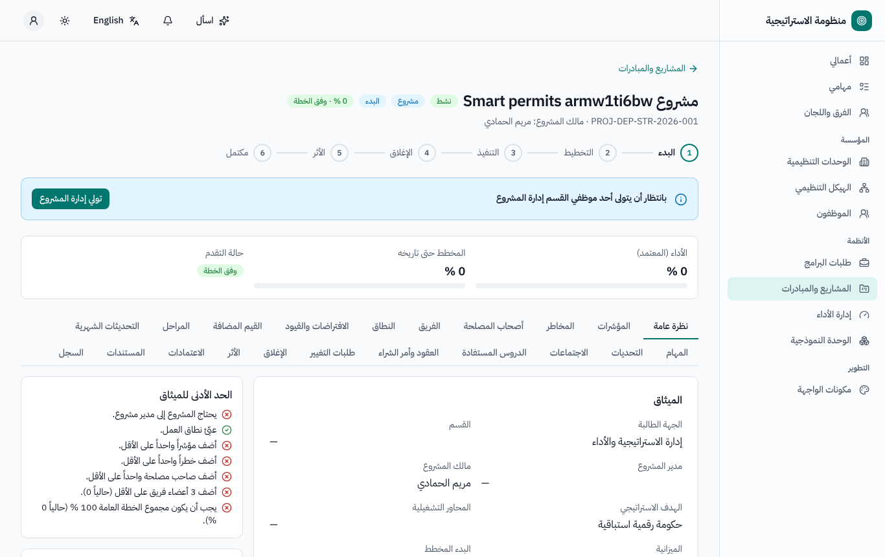
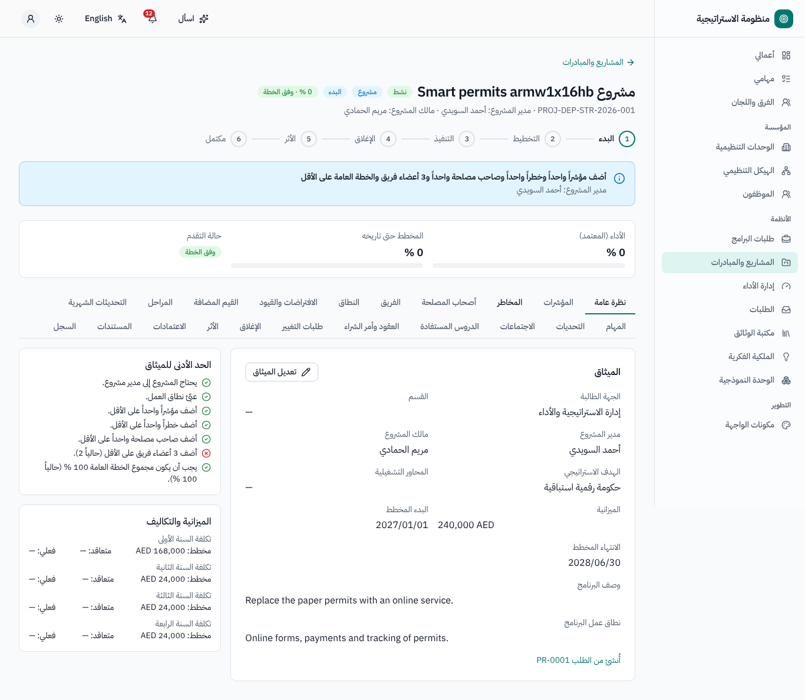

## 4. التخطيط

- **المراحل**: مراحل رئيسية (مستوى واحد) تندرج تحتها المراحل الفرعية؛ ولكل مرحلة فرعية تاريخا بدء وانتهاء مخططان و**وزن**. ويجب أن
  يكون مجموع أوزان المراحل الفرعية التفصيلية **100٪ بالضبط**. حدّد المخرجات واملأ حقولها. ومع تفعيل **النماذج** يمكنك *تطبيق نموذج*.
- **النطاق**: بند واحد على الأقل *ضمن النطاق*.
- **تقديم التخطيط** ← اعتماد التخطيط (بالمسار الافتراضي نفسه للميثاق). وعند الاعتماد يُؤخذ خط الأساس **الإصدار 1** (عند تفعيل خطوط
  الأساس) ويبدأ التنفيذ.

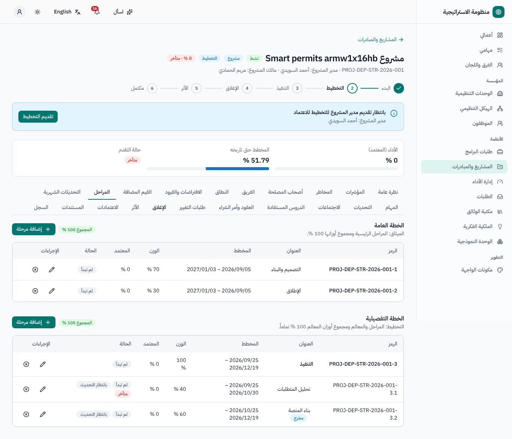

## 5. التنفيذ — التحديث الشهري

- في أول يوم عمل من كل شهر تُفتح نافذة التحديث (ويصلك إشعار). ويستحق التحديث بعد **10 أيام عمل** (مع تذكير قبل الاستحقاق بثلاثة أيام
  عمل، وإشعار تأخر بعده). ويمكن لمكتب إدارة المشاريع **فتح نافذة التحديث الآن**.
- **تحديث المراحل**: لكل مرحلة الجزء المنجز (ولا يقل أبداً عما سبق اعتماده)، وتاريخ البدء الفعلي مع أول إنجاز، و**تاريخ الانتهاء الفعلي
  وملف دليل عند 100٪**، و**أسباب التأخر والإجراءات التصحيحية عندما تتأخر المرحلة**. ووجود مهام مفتوحة على مرحلة بلغت 100٪ يعطي تحذيراً
  فقط.
- قدّم التحديث الشهري ← الاعتماد (افتراضياً **مدير الإدارة ← مكتب إدارة المشاريع**، Q-P1). تُقفل القيم المعتمدة ويُعاد حساب إنجاز
  المشروع. وإذا أُعيد التحديث فصحّحه في النافذة نفسها.
- تكون حالة الإنجاز **متأخر** إذا قل الإنجاز المعتمد عن المخطط حتى تاريخه بأكثر من 5 نقاط، أو تجاوزت مرحلةٌ تاريخ انتهائها المخطط دون أن
  تبلغ 100٪؛ وإلا فهي **وفق الخطة**.
- مع تفعيل **تقرير الحالة** يمكن تنزيل الشهر المعتمد كملف PDF ثنائي اللغة (ويمكن للذكاء الاصطناعي صياغة السرد لتعدّله أنت).

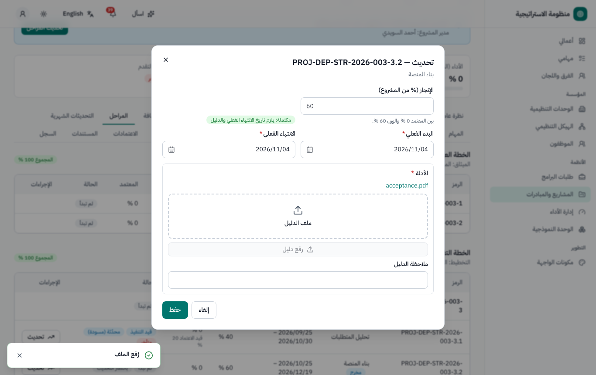
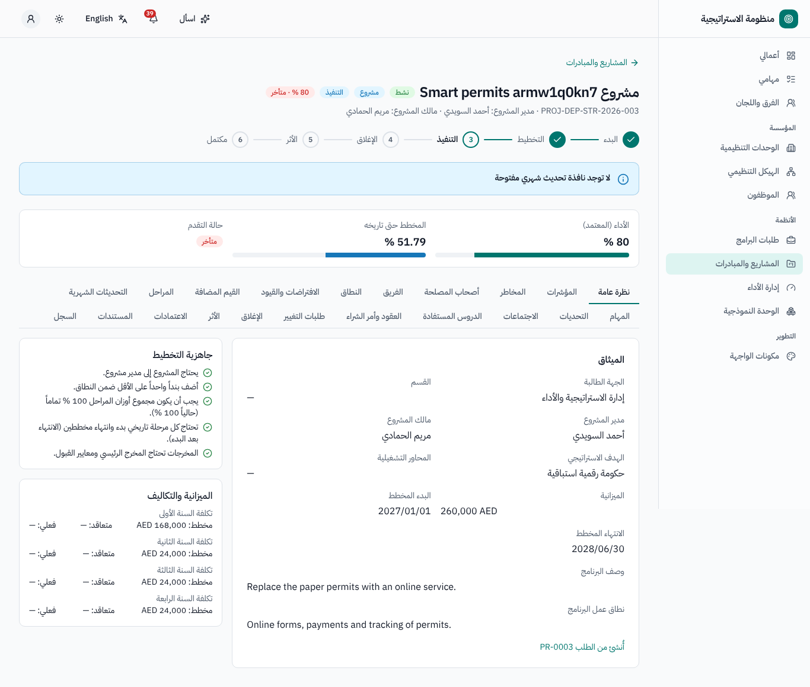

تبويبات أخرى أثناء التنفيذ: **المهام** (مهام من نظام إدارة المهام مرتبطة بالمشروع أو بمرحلة)، **التحديات**، **الاجتماعات**، **الدروس
المستفادة**، **العقود وأمر الشراء**، **الاعتمادات**، **المستندات**، **السجل**.

## 6. طلبات التغيير

تبويب **طلبات التغيير** ← **طلب تغيير جديد** من نوع **تفاصيل** أو **تأجيل** أو **ملكية** أو **إلغاء** أو **دمج** أو **تعليق المشروع** ←
**تقديم**. المسار الافتراضي: مدير الإدارة ← مكتب إدارة المشاريع ← قسم الخدمات المالية (عند تأثر التكلفة) ← مكتب المدير العام (للإلغاء أو
الدمج أو عند تجاوز تغيير التكلفة حد المدير العام). ولا يجوز أن يكون في المشروع أكثر من طلب تغيير واحد قيد المراجعة.

بعد الاعتماد لا يتغير شيء حتى يفتح مدير المشروع **تطبيق التغييرات**: تُملأ النافذة مسبقاً من الطلب (مدير المشروع أو المالك الجديد،
والتواريخ، والميزانية، والنطاق؛ واختيارياً **إعادة خط الأساس** لطلبات التفاصيل والتأجيل)؛ فتؤكّد، ويُطبَّق كل تغيير ويُسجَّل ← الحالة
**تم تطبيق التغييرات**.

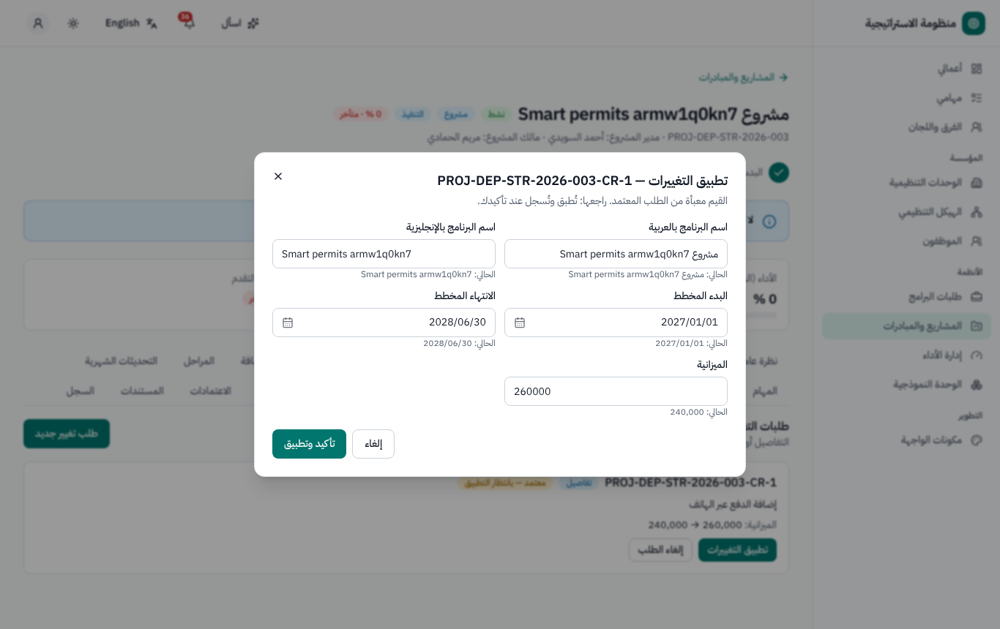

تعليق المشروع واستئنافه وإلغاؤه من صلاحيات مكتب إدارة المشاريع (مع ذكر السبب). ويمكن لمقدم الاعتماد أو لمكتب إدارة المشاريع **استرجاع**
اعتماد معلق.

## 7. الإغلاق والأثر

حين يبلغ مجموع الإنجاز المعتمد 100٪ ينتقل المشروع إلى **الإغلاق**: **تعبئة نموذج الإغلاق** (ملخص الإنجاز والمخرجات الرئيسية) وتسجيل
**درس مستفاد** واحد على الأقل ← اعتماد الإغلاق. ويفتح اعتماد الإغلاق تقييم فريق المشروع في نظام الفرق. ثم **إدخال الأثر** (أداء التكلفة
وثلاثة تقييمات للرضا وقياس المنافع) ← اعتماد الأثر (مكتب إدارة المشاريع) ← **مكتمل**.

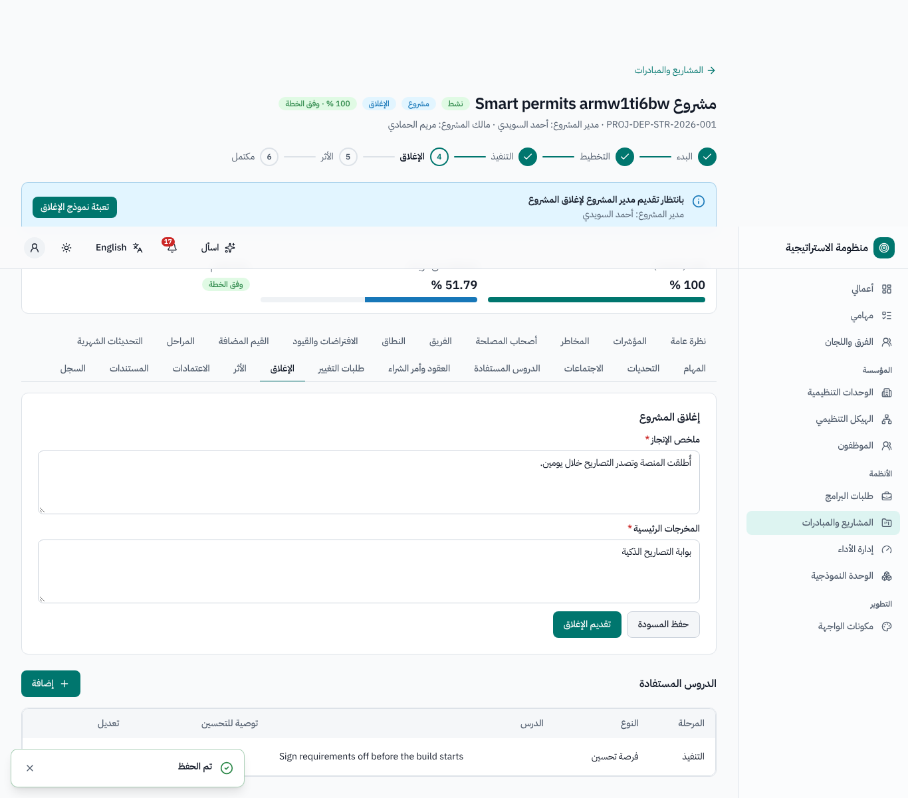 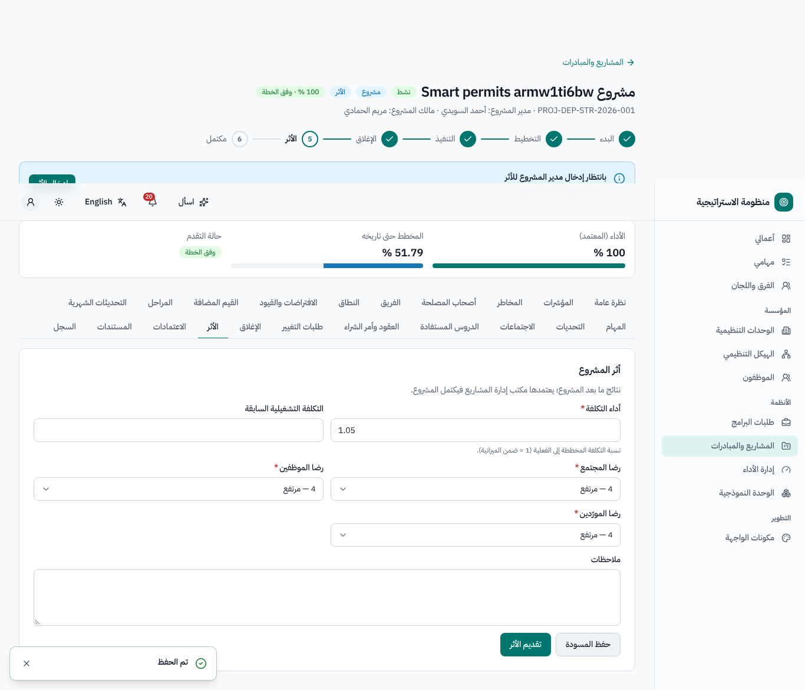

## 8. المشاريع الرشيقة (أجايل) والهجينة

- **الرشيقة (أجايل)**: خطط للإصدارات ← الملاحم (مجموع أوزانها 100٪) ← قصص المستخدمين (بالنقاط) في **قائمة الأعمال**؛ واعمل في
  **السبرنتات** (من يوم إلى 28 يوماً، 14 افتراضياً) على **اللوحة**؛ والرسوم: المتبقي (burndown)، والمنجز (burnup)، والسرعة، والتدفق
  التراكمي، وزمن الدورة. الإنجاز = مجموع (وزن الملحمة × النقاط المنجزة المعتمدة ÷ نقاط الملحمة).
- **الهجينة**: مراحل رئيسية وفرعية تقليدية؛ والمرحلة المحددة بأنها *تُنفَّذ عبر سبرنتات* لها ملاحمها الخاصة (مجموعها 100٪ من تلك
  المرحلة).
- **اعتماد الإنجاز**: *تجميع شهري* (افتراضي؛ يدخل كل سبرنت مغلق في التحديث الشهري) أو *كل سبرنت على حدة* (يُعتمد كل سبرنت مغلق
  منفرداً: مدير الإدارة ← مكتب إدارة المشاريع). والمشاريع الهجينة شهرية دائماً.
- يمكن للذكاء الاصطناعي (عند تفعيله) صياغة الخطة والقصص وسرد الحالة؛ وتقبلها أنت أو تعدّلها.

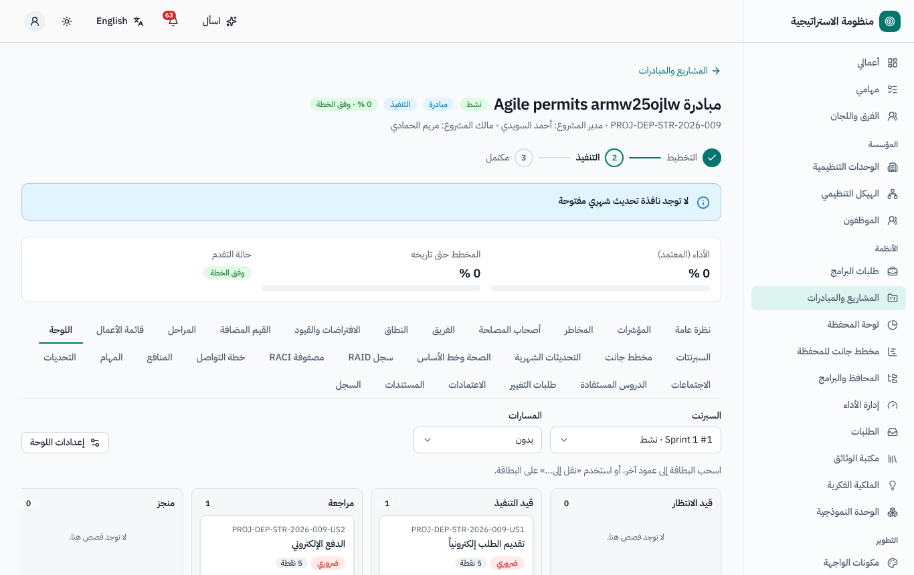
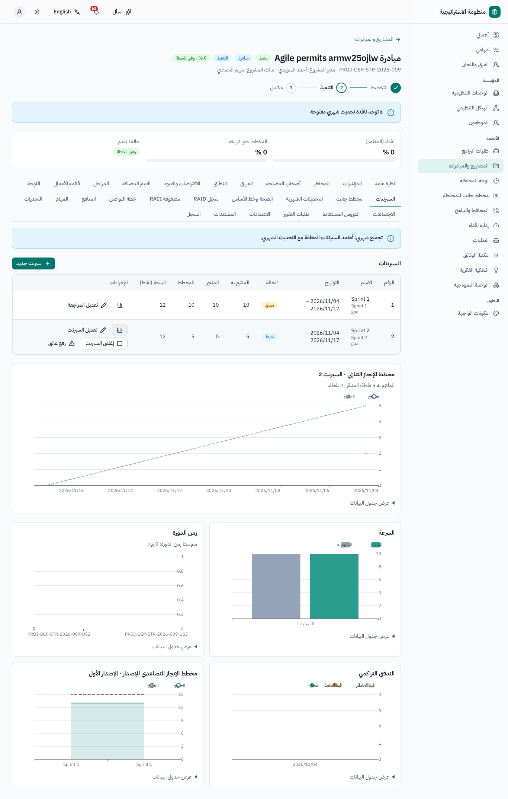

## 9. ميزات المعايير (لكل منها مفتاح في الإعدادات ← المحافظ والمشاريع)

| الميزة | المكان | الافتراضي |
|---|---|---|
| المحافظ والبرامج | القائمة الجانبية *المحافظ والبرامج*؛ والتصفية في اللوحات ومخطط جانت | مفعّلة |
| تحديد الأولوية (معايير موزونة، وفئات: عالية ≥ 80٪، متوسطة ≥ 60٪) | تقييم الطلب | مفعّلة |
| مؤشر الصحة RAG (الجدول الزمني، التكلفة، النطاق، المخاطر؛ قابل للتجاوز مع مبرر) | تبويب **الصحة وخط الأساس** واللوحات | مفعّلة |
| خطوط الأساس والانحرافات (الإصدار 1 عند اعتماد التخطيط؛ ولا تُنشأ إصدارات جديدة إلا بطلب تغيير مع *إعادة خط الأساس*) | **الصحة وخط الأساس** | مفعّلة |
| القيمة المكتسبة (PV وEV وAC وSPI وCPI وEAC…) | **الصحة وخط الأساس** | **غير مفعّلة** |
| سجل RAID (المشكلات والافتراضات والاعتماديات والقرارات) | تبويب **سجل RAID** | مفعّلة |
| مصفوفة المخاطر 5 × 5، وRACI، وخطة التواصل، والمنافع، واعتماد الجودة، ودفعات المشتريات وتقييم المورد، وقوائم تحقق البوابات، ونماذج المشاريع | تبويباتها | مفعّلة |
| تقرير الحالة الشهري PDF | التحديثات الشهرية | مفعّلة |

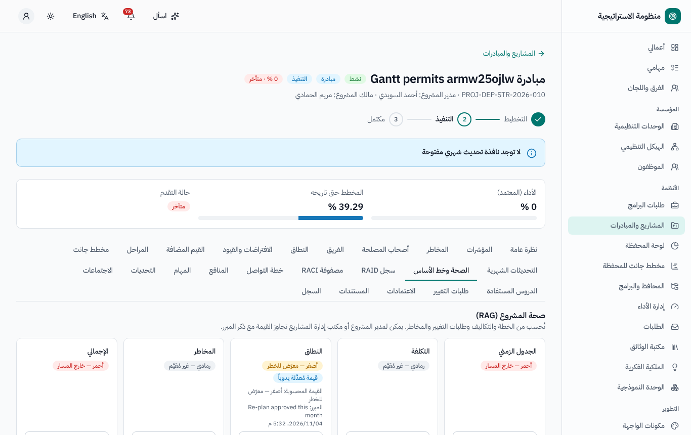
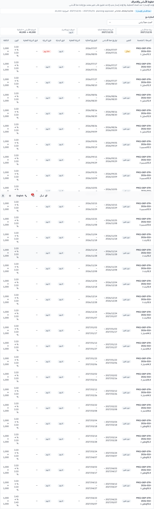
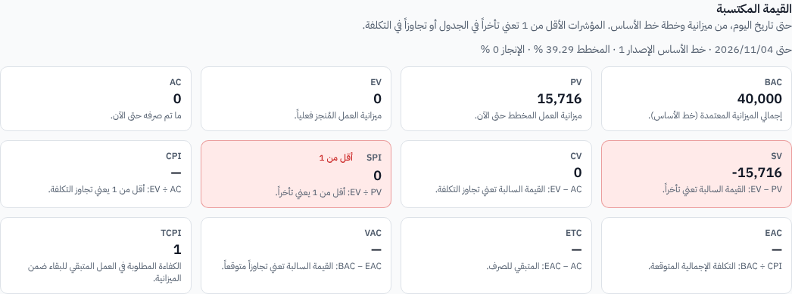

## 10. مخطط جانت واللوحة وعروض المحفظة

- تبويب **مخطط جانت** (لكل مشروع) و**مخطط جانت للمحفظة**: المراحل الرئيسية والفرعية مع أشرطة المخطط والفعلي وخط الأساس، ونسبة الإنجاز،
  وتلوين المتأخر، والاعتماديات، والتجميع حسب الأرباع؛ ويُعكس اتجاهه في العربية. مع التصدير PNG / PDF.
- **لوحة المحفظة**: المشاريع حسب المرحلة والصحة، والميزانية مقابل الفعلي، والمشاريع المتأخرة، والمراحل القادمة؛ مع الانتقال إلى المشاريع.
  ولا تظهر التكاليف والميزانيات إلا لمن يحق له رؤية التكاليف.
- **السعة** (توزيع الأشخاص على المشاريع) و**مراجعات المحفظة** (سجلات المراجعة الربعية) لمكتب إدارة المشاريع.

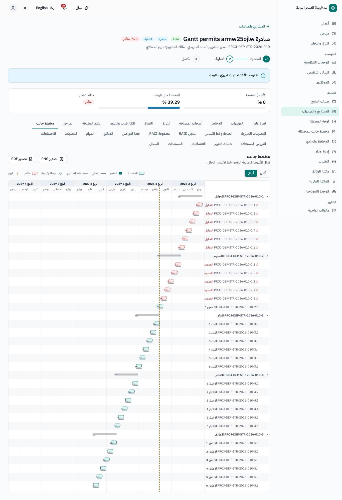
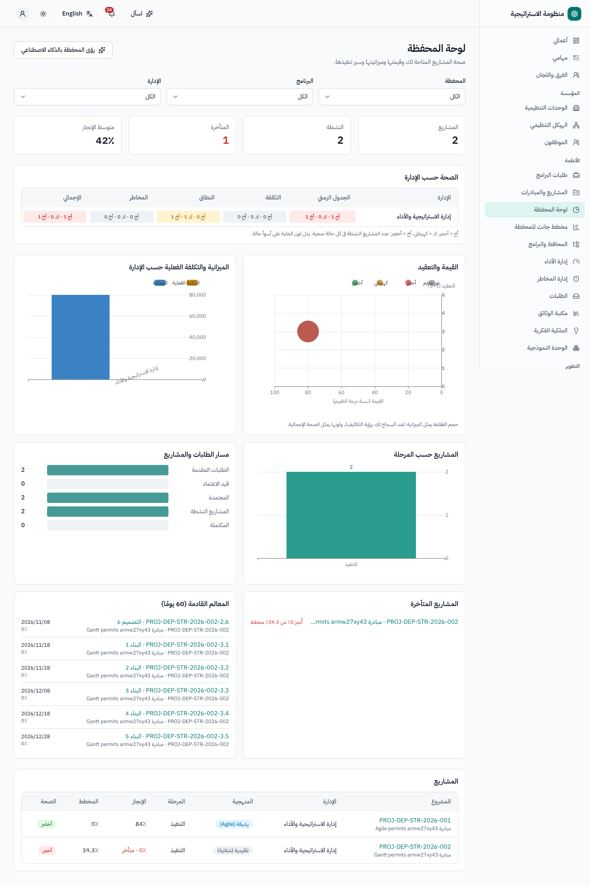

## 11. من يستطيع ماذا (افتراضياً)

| الدور | الصلاحيات |
|---|---|
| مقدم الطلب (الجميع) | إنشاء طلباته وتقديمها والاطلاع عليها |
| مدير المشروع (دور على المشروع) | تعديل المشروع، والتحديثات الشهرية، وطلبات التغيير، وتطبيق التغييرات المعتمدة |
| مالك المشروع / عضو الفريق (أدوار على المشروع) | الاطلاع على المشروع (ويمكن لأعضاء الفريق اقتراح بنود في سجل RAID) |
| مكتب إدارة المشاريع | كل المشاريع: تعيين مديري المشاريع، وتغيير التصنيف، وفتح النوافذ، والتعليق والاستئناف والإلغاء، وتأكيد الاكتمال |
| مكتب المدير العام، قسم الميزانية، الشؤون الإدارية، القسم المالي، مكتب المدير العام للتغييرات | خطوات الاعتماد أو التسليم الخاصة بهم |

يمكن لمسؤول النظام تغيير ذلك من الإعدادات ← الأدوار والصلاحيات.

## 12. نصائح

- يخبرك **شريط الحالة الحالية** دائماً بالخطوة التالية ومن ينتظرها؛ اتبع أزراره.
- يجب أن يكون مجموع الأوزان 100٪ قبل تقديم التخطيط — ويعرض تبويب المراحل المجموع الحالي.
- الدليل إلزامي للمراحل المنجزة بنسبة 100٪؛ ارفعه في نافذة التحديث.
- مساعدات الذكاء الاصطناعي (البدء من مستند، ومولّد الخطة، ومساعد التحديث، وسرد الحالة) تصوغ مسودات فقط؛ ولا يُحفظ شيء حتى تقبله.

