

# الطلبات وسجل الوثائق والملكية الفكرية — دليل المستخدم

لمقدمي الطلبات، والمعالجين (المكاتب)، وأصحاب الوثائق والملكية الفكرية. النسخة الإنجليزية: [`../en/user-requests.md`](../en/user-requests.md).

**إطار الطلبات** محرّك واحد لكل أنواع الطلبات: الوثائق، والملكية الفكرية، ودراسات المقارنات المرجعية، وأي نوع مخصص يبنيه مسؤول النظام
(الإعدادات ← أنواع الطلبات).

## الجزء الأول — الطلبات

القائمة الجانبية ← **الطلبات**: **دليل الطلبات**، **طلباتي**، **قائمة المعالجة** (للمكاتب).

### 1.1 تقديم طلب

1. **دليل الطلبات**: أنواع الطلبات التي يحق لك تقديمها، مجمّعة حسب الفئة مع وصف؛ ابحث ثم **ابدأ**. (وقد تربط الإنترانت في جهتك مباشرة بنموذج
   طلب.)
2. للمعالج خطوة لكل قسم من النموذج؛ و**احفظه كمسودة** في أي وقت؛ وتُتحقق الحقول أثناء الإدخال وعلى الخادم؛ ثم خطوة المراجعة.
3. قدّم الطلب. تعرض صفحة الطلب **مؤشر المراحل**، والحالة الحالية («بانتظار اعتماد …»، ومن يتصرف بعد ذلك)، وقيم النموذج (القيم السرية مثل رقم
   الهوية الإماراتية مخفية دائماً)، والمرفقات، ولوحة الاعتماد، والخط الزمني، والمستندات، والسجل، والمهام.
4. **معاد للتصحيح** ← صحّحه وأعد تقديمه. ويمكنك إلغاء مسودتك أو طلبك المعلق.

الحالات: *مسودة · قيد المراجعة · معاد للتصحيح · قيد المعالجة · مكتمل · مرفوض · ملغى*.

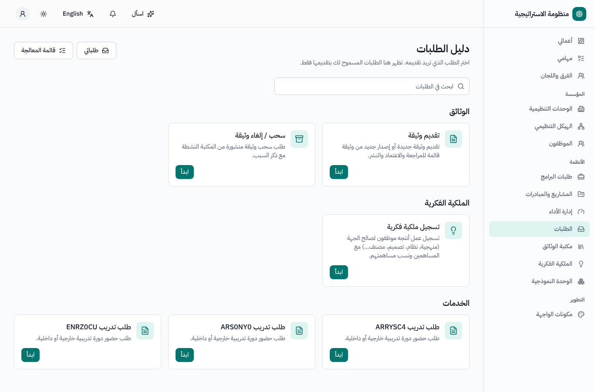

### 1.2 المعالجة (للمكاتب)

**قائمة المعالجة** ← *بانتظاري*، مع التصفية حسب النوع والمرحلة والحالة والوحدة و*المتأخرة فقط*؛ ومؤشر للمهلة بوقت العمل. تُتخذ قرارات مراحل
الاعتماد في لوحة الاعتماد (وبعضها يتطلب نموذجاً قصيراً، مثل تصنيف الوثيقة، قبل الاعتماد)؛ ولمراحل المعالجة أزرار إجراءات (مثل *إكمال* و*نشر*
و*إعادة*). ولا يُتاح **إكمال المحدد** إلا حيث لا يحتوي نموذج الإكمال على حقل إلزامي.

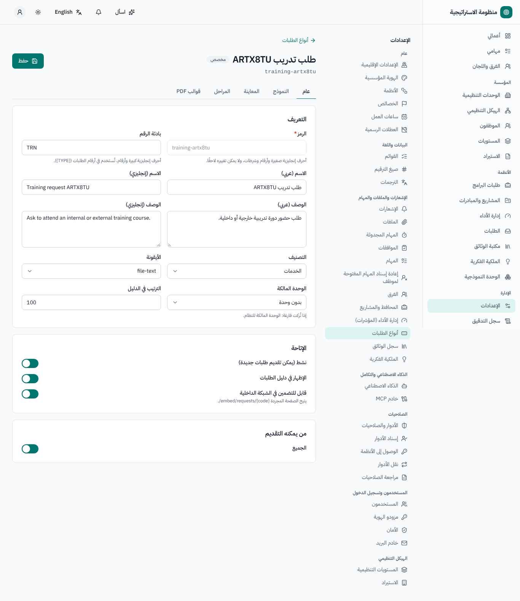

## الجزء الثاني — سجل الوثائق

القائمة الجانبية ← **مكتبة الوثائق**: **المكتبة**، **لوحة المعلومات**، **تقديم وثيقة**.

### 2.1 تقديم وثيقة أو إصدار جديد

1. **تقديم وثيقة** (نوع الطلب *وثيقة*): الاسم بالعربية والإنجليزية، والوحدة المالكة، والوصف، و**ملف المسودة**. ولإصدار جديد من وثيقة منشورة حدّد
   *إصدار جديد*، واختر الوثيقة، واذكر **سبب التغيير**.
2. **المراجعة** (مكتب الاستراتيجية / الوثائق): الاعتماد مع التصنيف — المستوى (استراتيجي، تشريعي، تشغيلي)، والنوع (سياسة، إجراء، دليل، وثيقة
   قانونية، استراتيجية، نموذج…)، و**درجة السرية** (*عام · داخلي · سري · سري للغاية*). ويمكن للذكاء الاصطناعي اقتراح التصنيف وملخص والوثائق المكررة
   المحتملة. وعند الاعتماد يُمنح **رمز الوثيقة** (مثل `ORG-UNIT-POL-2026-01`) والإصدار (1.0 ثم 2.0…).
3. **النشر** (المكتب): رفع ملف PDF النهائي الموقّع، و*الإتاحة للجميع*، وتاريخ السريان، وتاريخ انتهاء الصلاحية (يُقترح من النوع: مثلاً السياسات
   والإجراءات 24 شهراً، والأدلة والاستراتيجيات 36 شهراً، والوثائق القانونية والنماذج حتى الاستبدال)، والإقرار بالاطلاع. ويصبح الإصدار السابق
   *مستبدَلاً*.

الحالات: *مقدَّمة · قيد المراجعة · معادة للتصحيح · مرفوضة · معتمدة – بانتظار النشر · منشورة · منتهية الصلاحية · مسحوبة*.

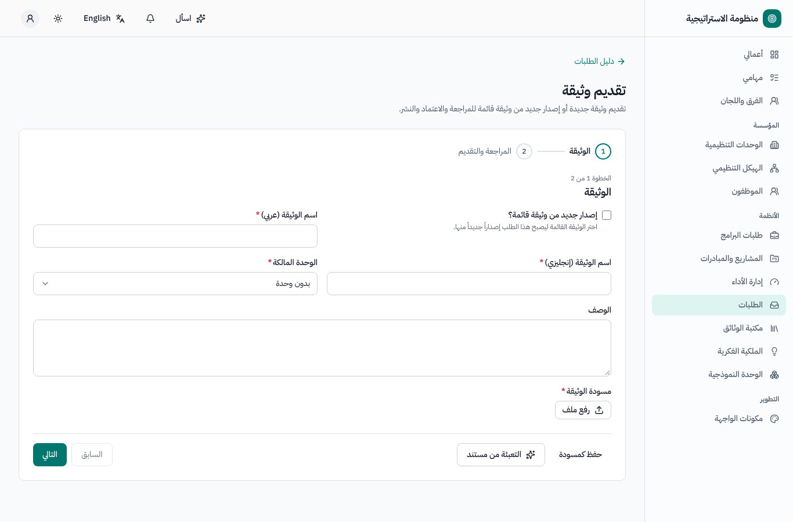
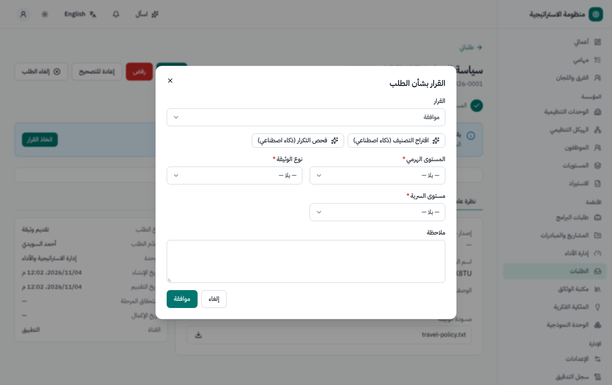

### 2.2 المكتبة وصفحة الوثيقة

- **المكتبة**: التصفح حسب المستوى ← النوع ← الوحدة المالكة، والبحث في النص الكامل (العناوين والوصف ونص الملف المنشور، مع توحيد الكتابة العربية)،
  والتصفية حسب الحالة ودرجة السرية والوحدة و*تنتهي خلال … يومًا*. ولا ترى أبداً إلا الوثائق التي تسمح بها صلاحية اطلاعك (والأخرى لا تظهر مطلقاً).
- **صفحة الوثيقة**: العارض، والبيانات الوصفية، وسجل الإصدارات مع ملخصات التغيير، و**مقارنة** إصدارين (فروقات النص؛ ويمكن للذكاء الاصطناعي تلخيص
  ما تغيّر)، والوثائق ذات الصلة، وشارة الملكية الفكرية، والإقرارات (**إقرار بالاطلاع**)، ولوحة الصلاحية.
- يحمل **التنزيل** ختم «نسخة غير خاضعة للرقابة عند الطباعة» على كل صفحة (ولا يتغير الملف المحفوظ أبداً).
- **أسئلة وأجوبة** بالذكاء الاصطناعي على الوثائق المنشورة التي يحق لك رؤيتها، مع الإحالة إلى مصادرها.

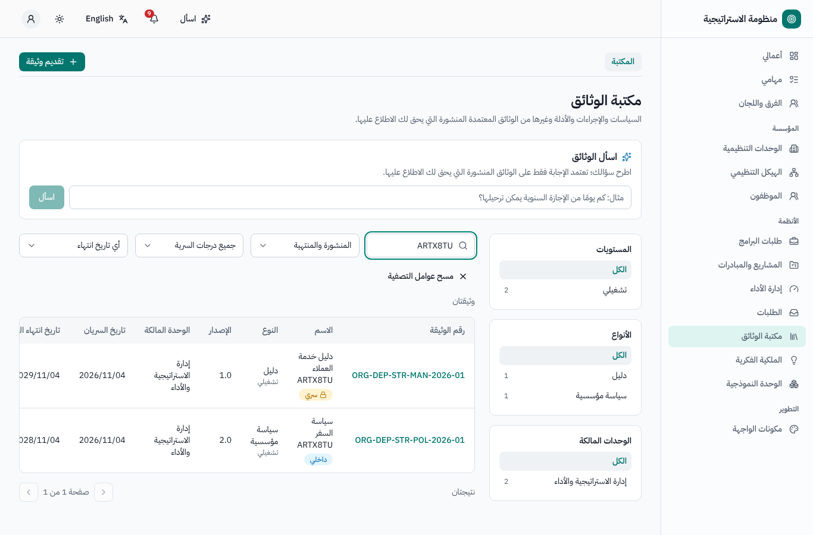
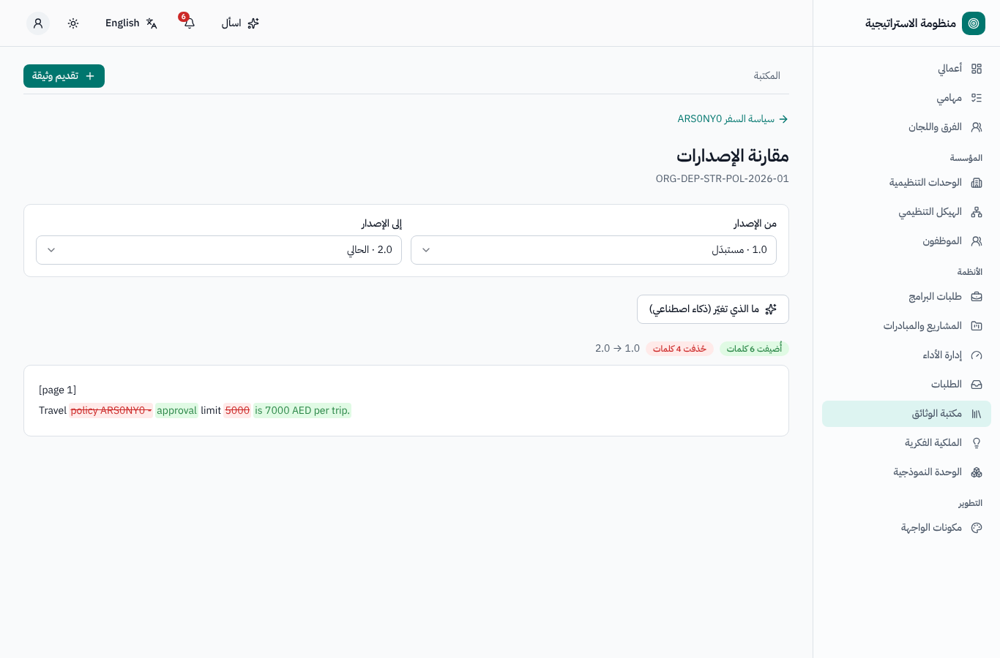

### 2.3 الصلاحية وانتهاؤها (لأصحاب الوثائق)

تذكيرات قبل انتهاء الصلاحية بـ**60 و30 يوماً**، مع ثلاثة إجراءات في صفحة الوثيقة: **تأكيد استمرار الصلاحية** (تُمدد بمدة النوع)، و**تقديم إصدار
جديد** (يبقى الإصدار الحالي سارياً حتى نشر الجديد)، و**طلب سحب الوثيقة** (طلب سحب ← اعتماد ← *مسحوبة*). ودون أي إجراء تصبح الوثيقة **منتهية
الصلاحية** (تبقى ظاهرة مع تمييزها).

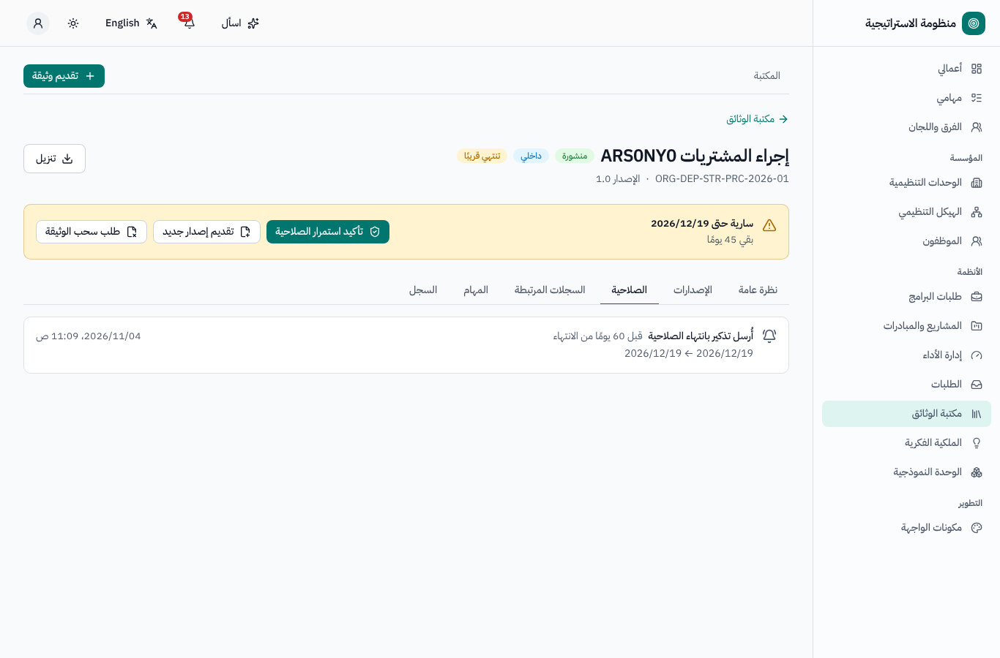

## الجزء الثالث — الملكية الفكرية

القائمة الجانبية ← **الملكية الفكرية**: **سجل الملكية الفكرية**، **لوحة المؤشرات**؛ وتعرض *ملكيتي الفكرية* السجلات التي أنت مساهم فيها.

### 3.1 تسجيل ملكية فكرية

1. من دليل الطلبات: الاسم (عربي / إنجليزي)، والوصف، والملفات الداعمة، و**المساهمون** (موظف أو شخص من خارج الجهة، والجهة، ورقم الهوية الإماراتية —
   يُحفظ مشفّراً ويُخفى دائماً، والدور، و**النسبة** — ومجموع النسب 100٪)، و**الإقرار** بأن الحقوق تعود إلى الجهة.
2. **المراجعة** (مكتب الملكية الفكرية): الاعتماد مع نوع الملكية ونوع الحماية ← *معتمد للإيداع*. ويمكن للذكاء الاصطناعي اقتراح الأنواع والبحث عن
   سجلات مشابهة.
3. يتابع المكتب في صفحة السجل: **تنزيل نموذج الوزارة** (PDF ثنائي اللغة فيه المساهمون — لمسؤولي الملكية الفكرية فقط، ويُسجَّل في التدقيق)،
   و**تسجيل الإيداع** ← *مودَع لدى الوزارة*؛ و**تسجيل بيانات التسجيل** (رقم التسجيل وتاريخه، وتاريخ الانتهاء المقترح من مدة الحماية، والشهادة) ←
   *مسجَّل* (ويُشعَر المساهمون من الموظفين)؛ أو **رفض من الوزارة** ← إعادة الإيداع أو **إغلاق السجل**. وللحماية الداخلية فقط (الأسرار التجارية):
   **تسجيل داخلي** برقم داخلي.
4. تذكيرات التجديد قبل الانتهاء بـ**6 و3 أشهر**؛ و**تسجيل التجديد** ← *مجدَّد*؛ وعند الانتهاء ← *منتهي الحماية*.

عندما يُحدَّد نوع وثيقة بأنه *تُنشئ قيدًا في سجل الملكية الفكرية*، فإن نشر وثيقة من هذا النوع يُنشئ سجل ملكيتها الفكرية تلقائياً (*معتمد للإيداع*،
ومرتبطاً بالوثيقة).

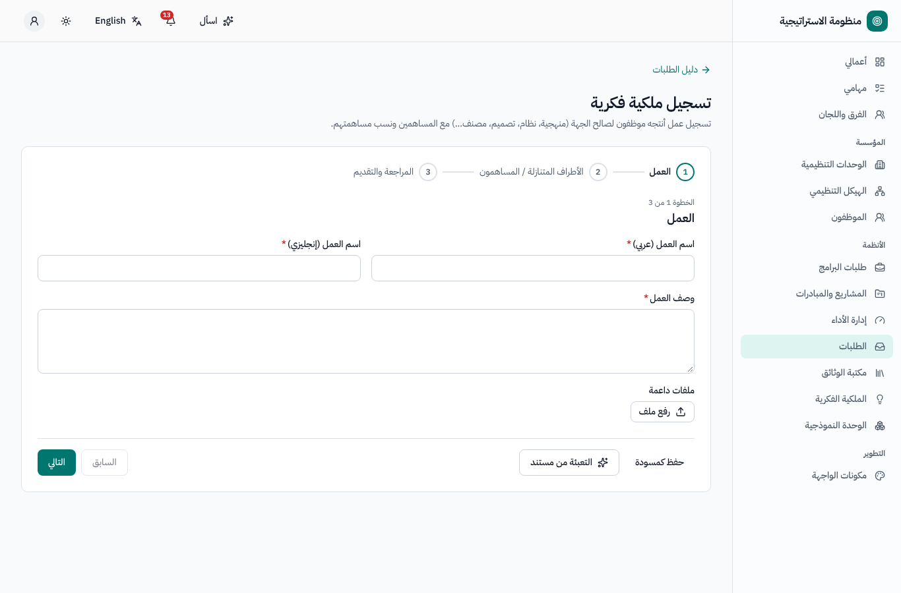
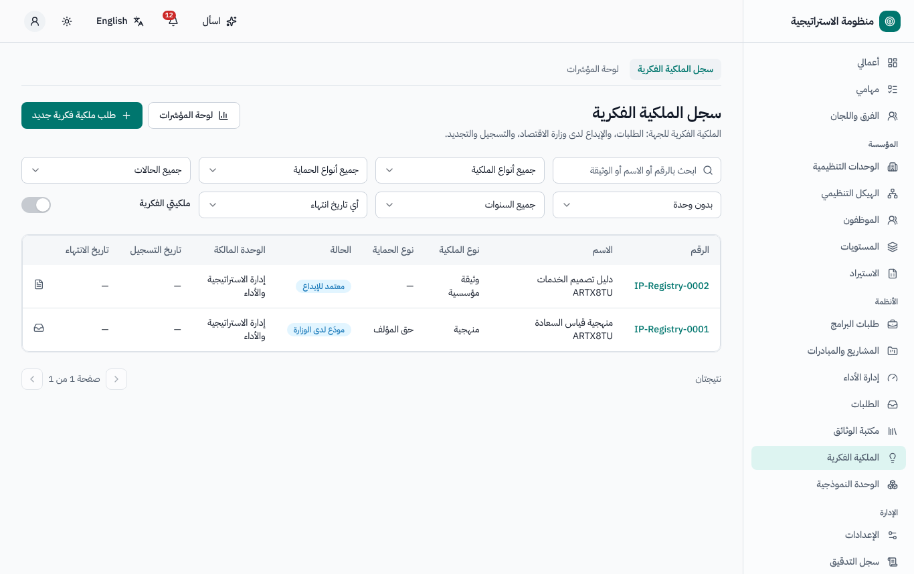
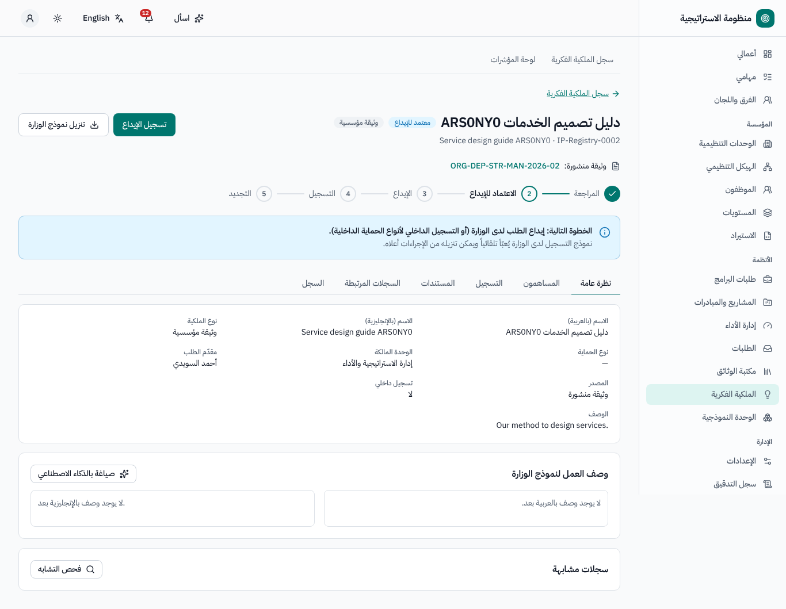
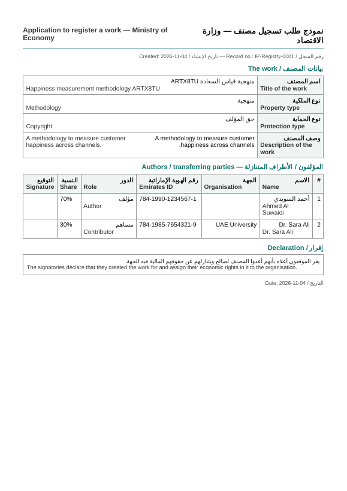

## من يستطيع ماذا (افتراضياً)

| الدور | الصلاحيات |
|---|---|
| الجميع | فتح الطلبات والمكتبة والملكية الفكرية؛ وتقديم الطلبات؛ وقراءة الوثائق التي تسمح بها صلاحية اطلاعهم؛ وقراءة سجلات ملكيتهم الفكرية |
| مكتب الطلبات / الوثائق / الملكية الفكرية | المعالجة والاعتماد، والنشر، وتحديد الانتهاء، وإيداع الملكية الفكرية وتسجيلها |
| مسؤول سجل الوثائق / مسؤول الملكية الفكرية | الإعدادات؛ ويستطيع مسؤولو الملكية الفكرية أيضاً كشف أرقام الهوية وتنزيل نموذج الوزارة |
| مسؤول أنواع الطلبات | منشئ النماذج |

