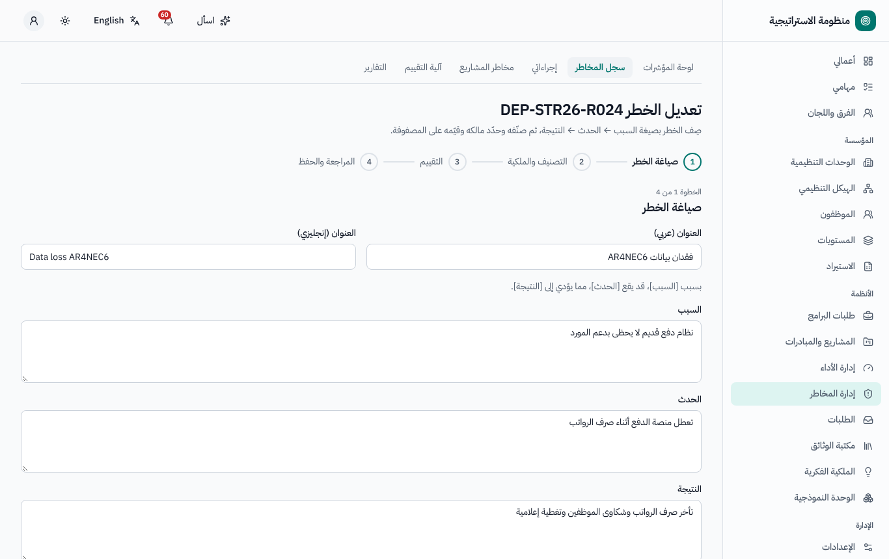
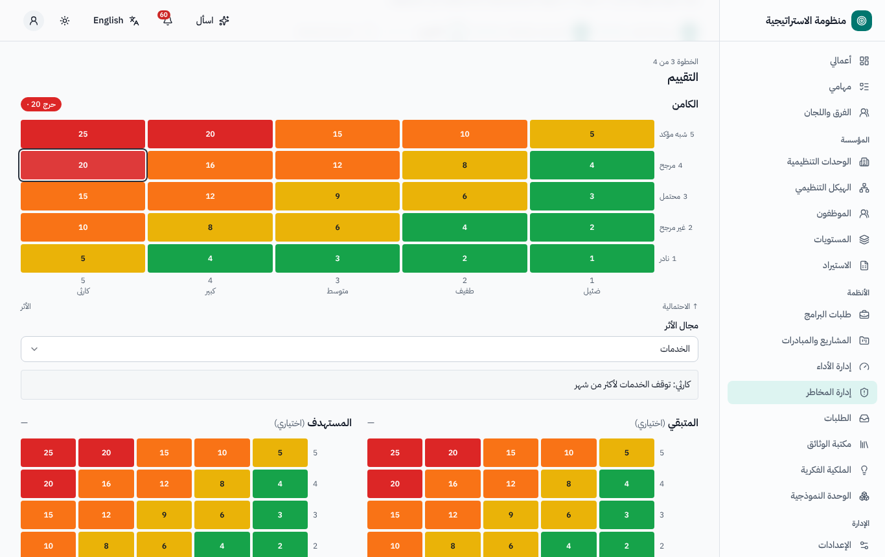
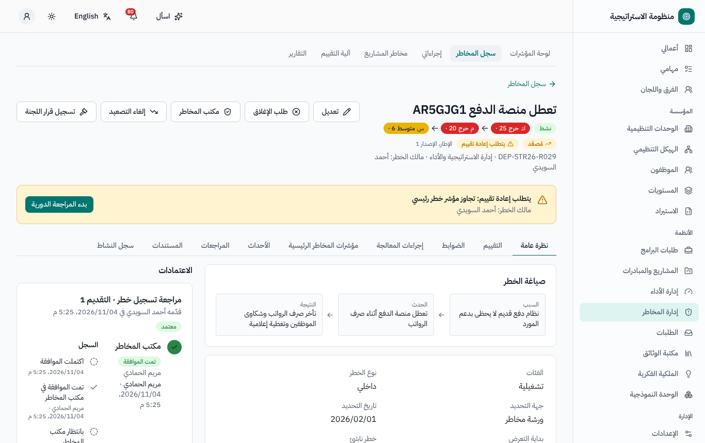
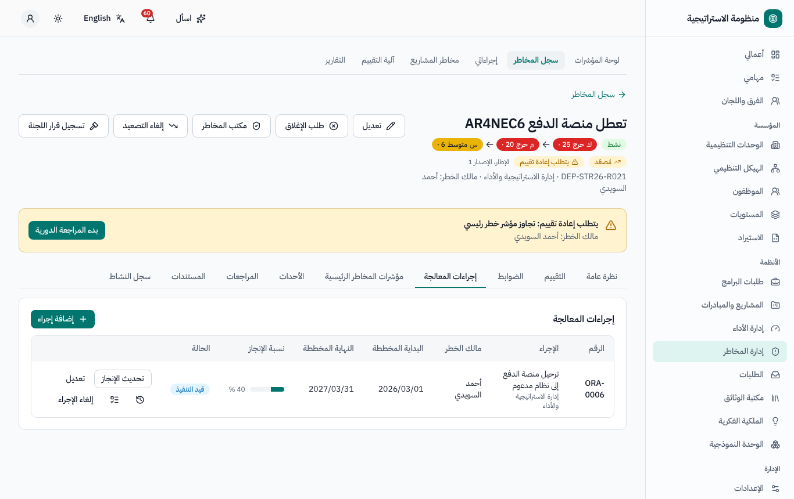
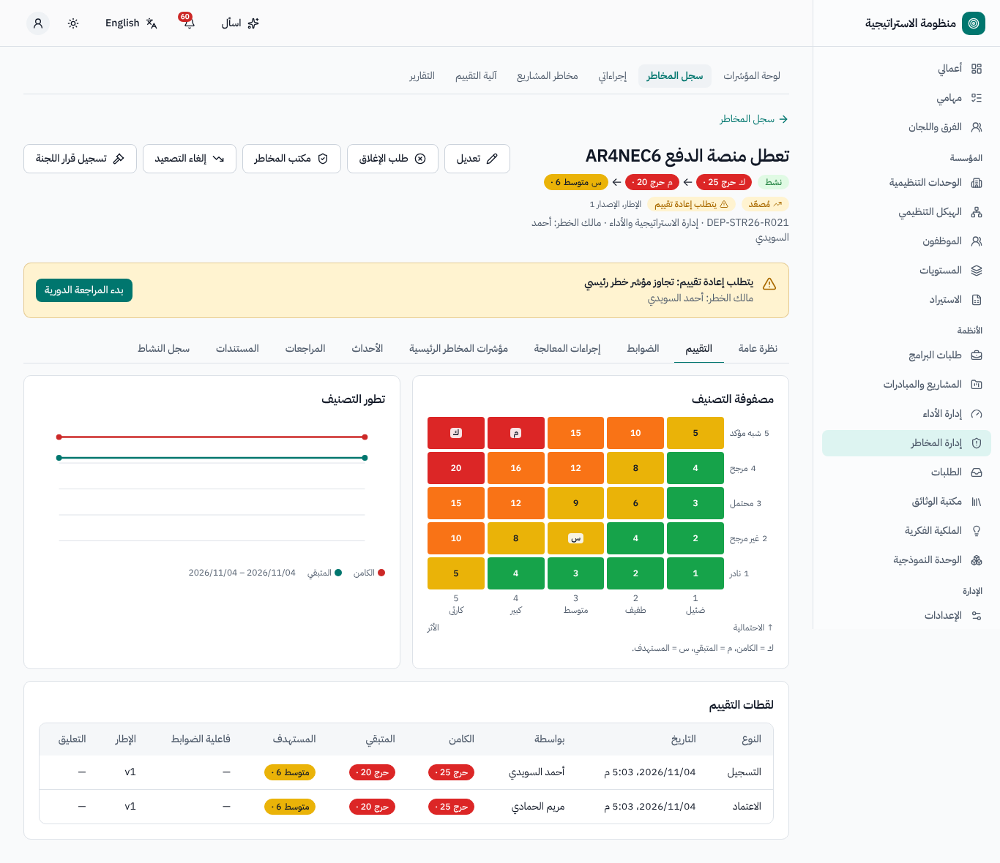
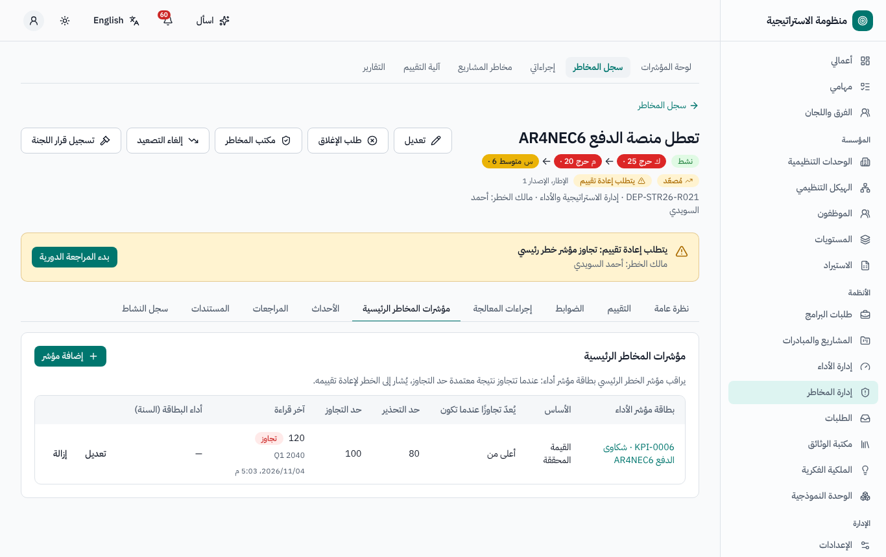
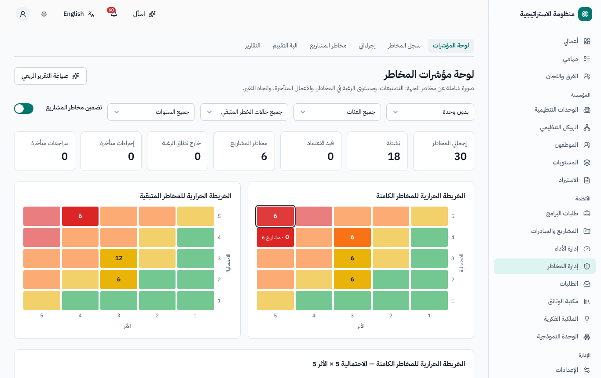
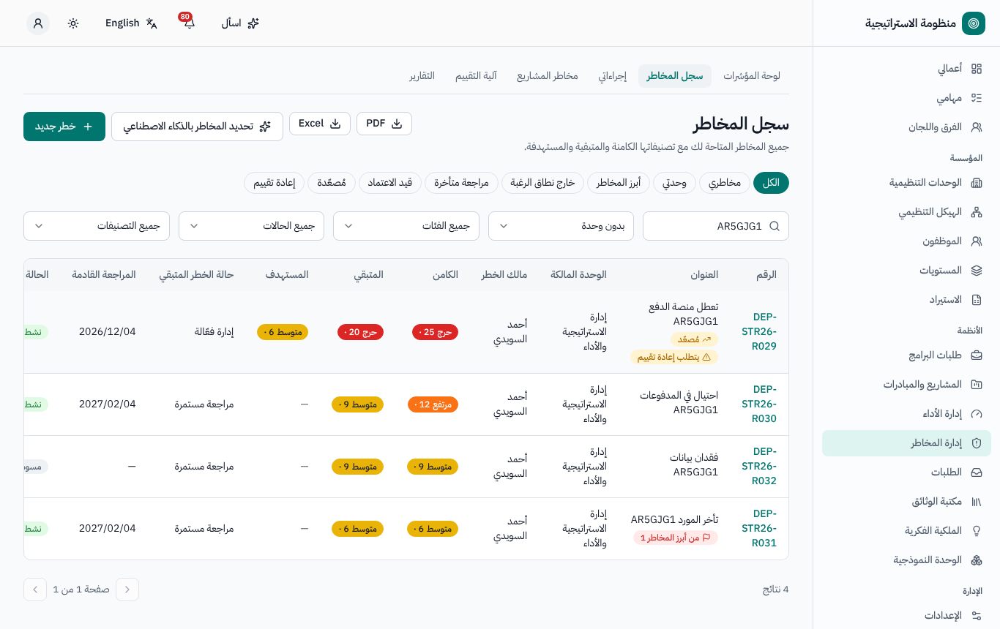
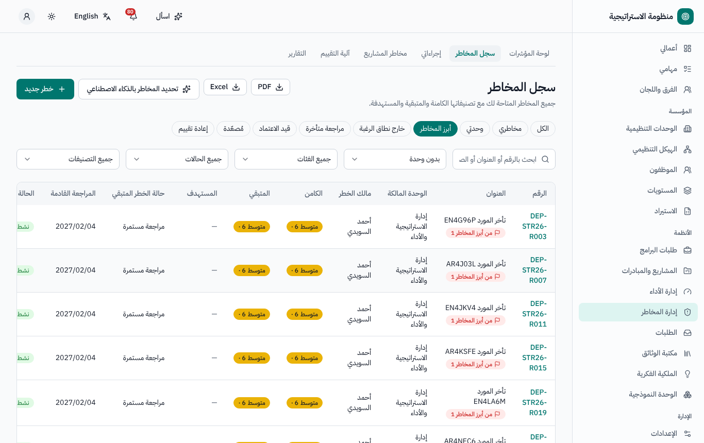

# إدارة المخاطر — دليل المستخدم

لأصحاب المخاطر ومنسقيها، وأصحاب إجراءات المعالجة، ومكتب المخاطر، ولجنة المخاطر. النسخة الإنجليزية:
[`../en/user-risk.md`](../en/user-risk.md).

القائمة الجانبية ← **إدارة المخاطر**: **لوحة المؤشرات**، **سجل المخاطر**، **إجراءاتي**، **مخاطر المشاريع**، **آلية التقييم**، **التقارير**.

## 1. المفاهيم

- يُقيَّم كل خطر بـ**إطار المخاطر** في الجهة (الإعدادات ← إطار المخاطر): حاصل الاحتمالية × الأثر على المقاييس المضبوطة يعطي درجة
  و**تصنيفاً** (مثل منخفض، متوسط، عالٍ، حرج).
- التقييم **الأصلي** (قبل الضوابط) ← التقييم **المتبقي** (بعد الضوابط القائمة وفق فاعليتها) ← التقييم **المستهدف** (بعد المعالجة المخططة).
- **مستوى الرغبة في المخاطر** لكل فئة: الدرجة المتبقية التي تتجاوزه تكون *خارج الرغبة* ويُصعَّد الخطر.
- الحالات: *مسودة · قيد الاعتماد · نشط · مغلق · مرفوض*.

## 2. تسجيل خطر

1. **سجل المخاطر ← خطر جديد**. خطوات المعالج: **صياغة الخطر** (السبب ← الحدث ← النتيجة؛ ويمكن للذكاء الاصطناعي فحص الصياغة واقتراح مخاطر من
   نص أو مستند) ← **التصنيف والملكية** (الفئة والوحدة والمالك والأهداف) ← **التقييم** (انقر خانة المصفوفة للاحتمالية والأثر) ← **المراجعة
   والحفظ**. ويُمنح الخطر رقمه عند أول حفظ.
2. أضف في صفحة الخطر **الضوابط** (الضوابط القائمة وفاعليتها)، و**إجراءات المعالجة**، و**مؤشرات المخاطر الرئيسية**.
3. **إرسال للاعتماد** ← يراجعه مكتب المخاطر (وله أن يعدّل التقييمات والاستجابة وقائمة أعلى عشرة مخاطر قبل الاعتماد). عند الاعتماد يصبح
   *نشطاً* مع تاريخ المراجعة التالية. وعند الإعادة يعود مسودة مع التعليق. وعند الرفض يصبح *مرفوضاً* (ويمكن لمكتب المخاطر إعادة فتحه).

## 3. إجراءات المعالجة

- تعرض **إجراءاتي** إجراءات المعالجة المفتوحة لديك. اختر **تحديث الإنجاز**: ملاحظة، ونسبة الإنجاز، والتواريخ الفعلية، والدليل. يصلك تذكير
  قبل تاريخ الانتهاء المخطط، وتُصعَّد الإجراءات المتأخرة إلى مالك الخطر.
- عند 100٪ يكتمل الإجراء ويمكنك **تحويل إلى ضابط** (مع تقييم فاعليته): فيُعاد حساب التقييم المتبقي للخطر ويُطلب إعادة تقييمه.
- يربط زر **إنشاء مهمة** مهمة من نظام إدارة المهام بالإجراء حين ينفّذ العمل فريق.

## 4. المتابعة والمراجعة الدورية

- يعتمد **تاريخ المراجعة التالية** على التصنيف المتبقي (دورية المراجعة في الإطار)، ويُنقل إلى يوم عمل. ويصلك تذكير قبله وإشعار عند تأخره.
- **بدء المراجعة الدورية**: أكّد فاعلية كل ضابط أو حدّثها، والاحتمالية والأثر المتبقيين، وملاحظات على الإجراءات، وتعليقاً ← قدّم ← اعتماد
  مكتب المخاطر. ويمكن للذكاء الاصطناعي تلخيص ما تغيّر منذ المراجعة السابقة.
- تُطلب إعادة تقييم غير مجدولة عند **تجاوز مؤشر خطر رئيسي** حدّه (من نتيجة مؤشر معتمدة)، أو تسجيل **حدث خطر**، أو تجاوز الرغبة في المخاطر،
  أو ربط ملاحظة تدقيق، أو حين يغيّر تعديلٌ في الإطار التصنيفَ.
- **الأحداث ← تسجيل حدث**: ما الذي حدث، والتاريخ، والأثر المالي وغيره، والحادث الوشيك، والسبب الجذري، والدروس المستفادة.

## 5. التصعيد والإغلاق

- يُصعَّد تلقائياً إلى لجنة المخاطر ومكتب المخاطر كل خطر تصنيفه المتبقي حرج أو يقع خارج الرغبة في المخاطر؛ ويمكن لمكتب المخاطر **التصعيد** /
  **إلغاء التصعيد** يدوياً؛ وتُسجَّل قرارات اللجنة على الخطر.
- **طلب الإغلاق** مع ذكر السبب ← مكتب المخاطر، ثم **لجنة المخاطر** حين يكون التصنيف المتبقي حرجاً. وتبقى المخاطر المغلقة في السجل التاريخي،
  ويمكن لمكتب المخاطر **إعادة الفتح**.

## 6. لوحة المؤشرات والسجل والتقارير

- **لوحة المؤشرات**: بطاقات أرقام، و**خريطتا الحرارة للتقييم الأصلي والمتبقي** (انقر خانة لعرض مخاطرها؛ وتعمل بلوحة المفاتيح)، والتوزيع حسب
  الفئة / الوحدة / التصنيف، والمخاطر خارج الرغبة، وأعلى عشرة مخاطر، والإجراءات والمراجعات المتأخرة، والتغير خلال الربع، وتجاوزات المؤشرات؛
  مع المرشحات وخيار *تضمين مخاطر المشاريع*.
- **سجل المخاطر** مع طرق العرض المحفوظة (*مخاطري*، *مُصعّدة*، *إعادة تقييم*…) وشارات التصنيف والتصدير.
- **مخاطر المشاريع**: مخاطر مشاريع المحافظ، مباشرة وللقراءة فقط، مصفاة حسب صلاحيتك على المشاريع؛ ويفتح كل صف الخطر داخل مشروعه. ولا تُنسخ
  إلى السجل المؤسسي.
- **آلية التقييم**: الإطار الحالي كوثيقة ثنائية اللغة قابلة للطباعة.
- **التقارير**: السجل، وأعلى عشرة مخاطر، وملف الوحدة، ومتابعة الإجراءات (PDF / Excel).

## 7. من يستطيع ماذا (افتراضياً)

| الدور | الصلاحيات |
|---|---|
| الجميع | فتح إدارة المخاطر، وتسجيل خطر، ورؤية المخاطر التي يملكونها |
| مالك الخطر / المنسق (أدوار على السجل) | تعديل مخاطرهم وتقديمها ومراجعتها وطلب إغلاقها |
| صاحب الإجراء | تحديث إنجاز إجراءاته |
| مكتب المخاطر | المراجعة والاعتماد، وتعديل التقييمات، وأعلى عشرة مخاطر، والتصعيد، وإعادة الفتح، والإطار |
| لجنة المخاطر | خطوة الإغلاق الثانية للمخاطر الحرجة، وقرارات اللجنة |

