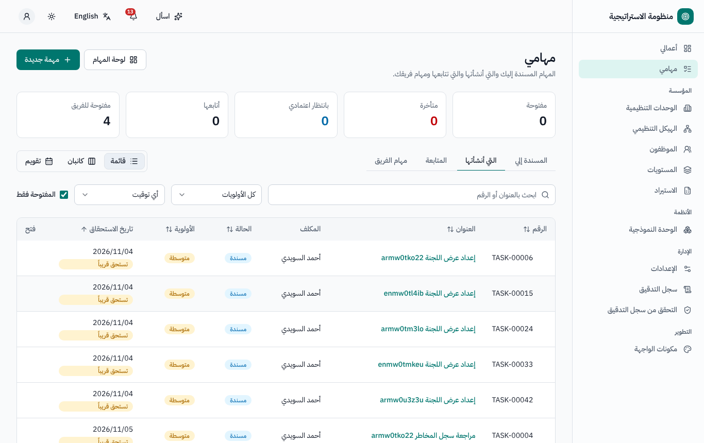
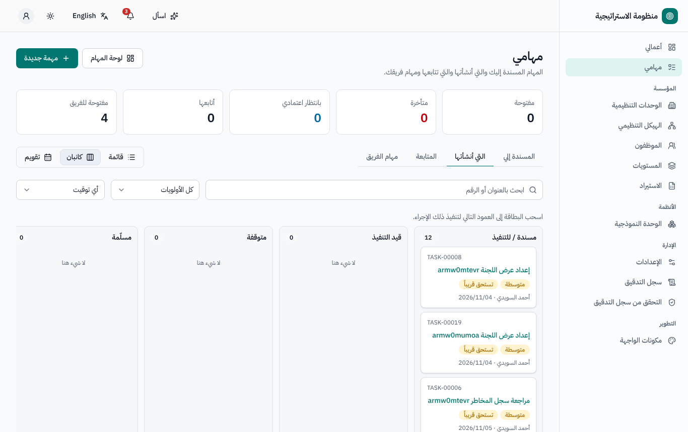
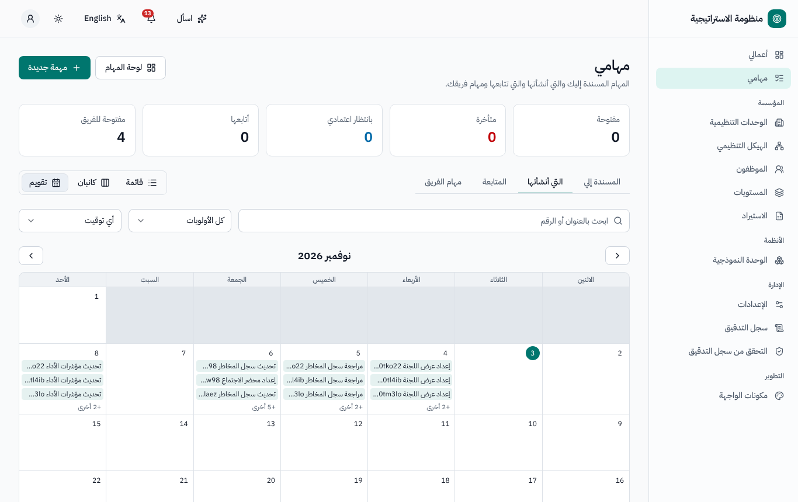
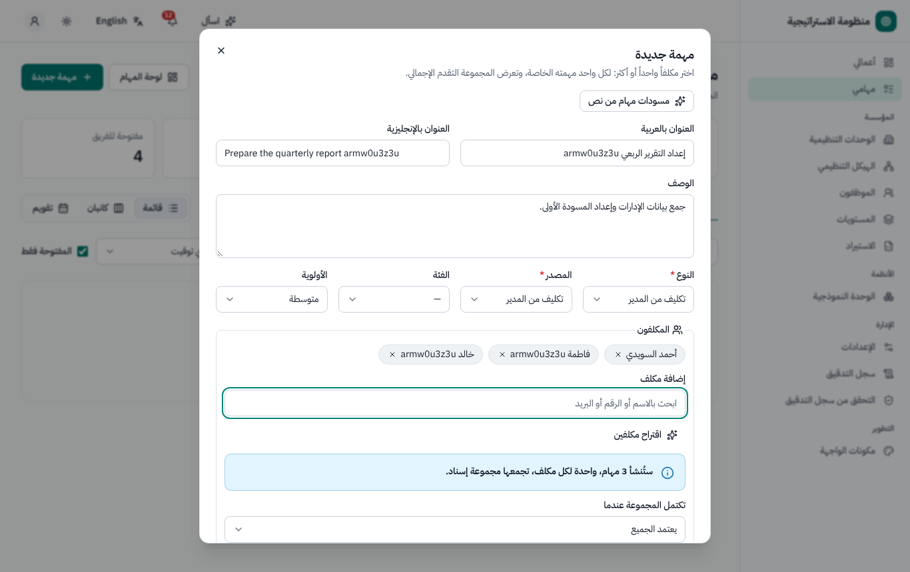
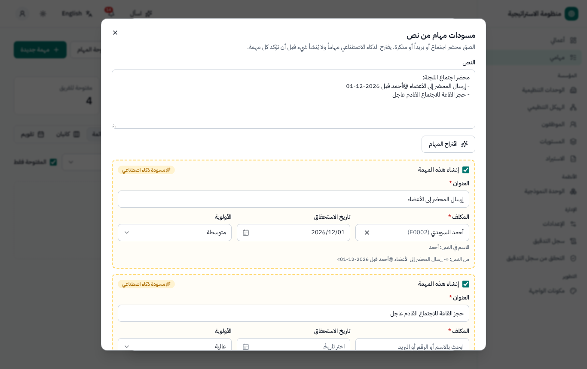
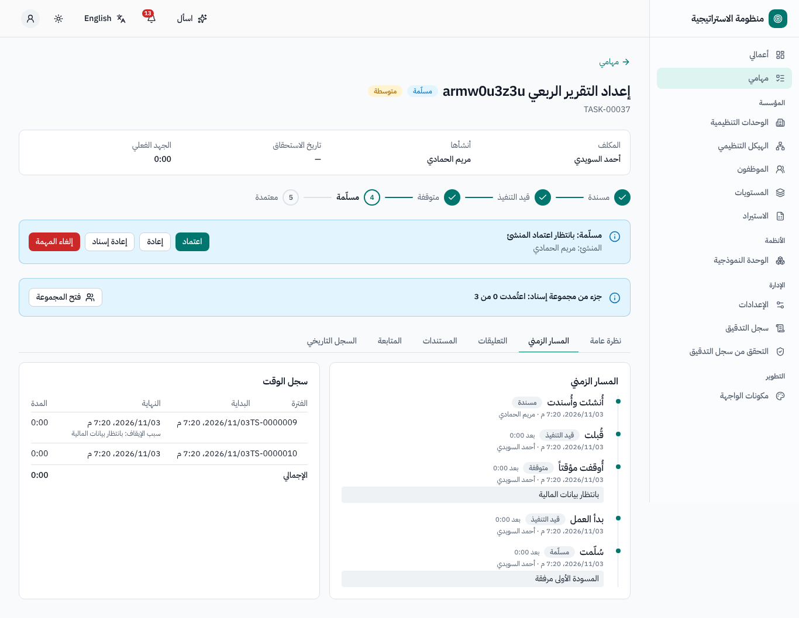
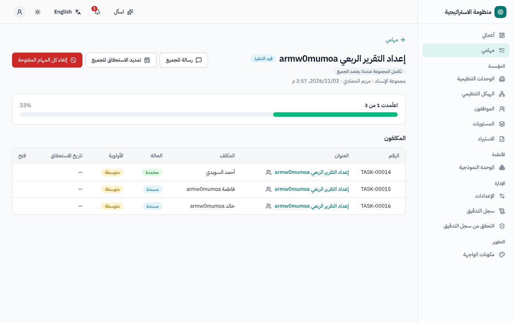
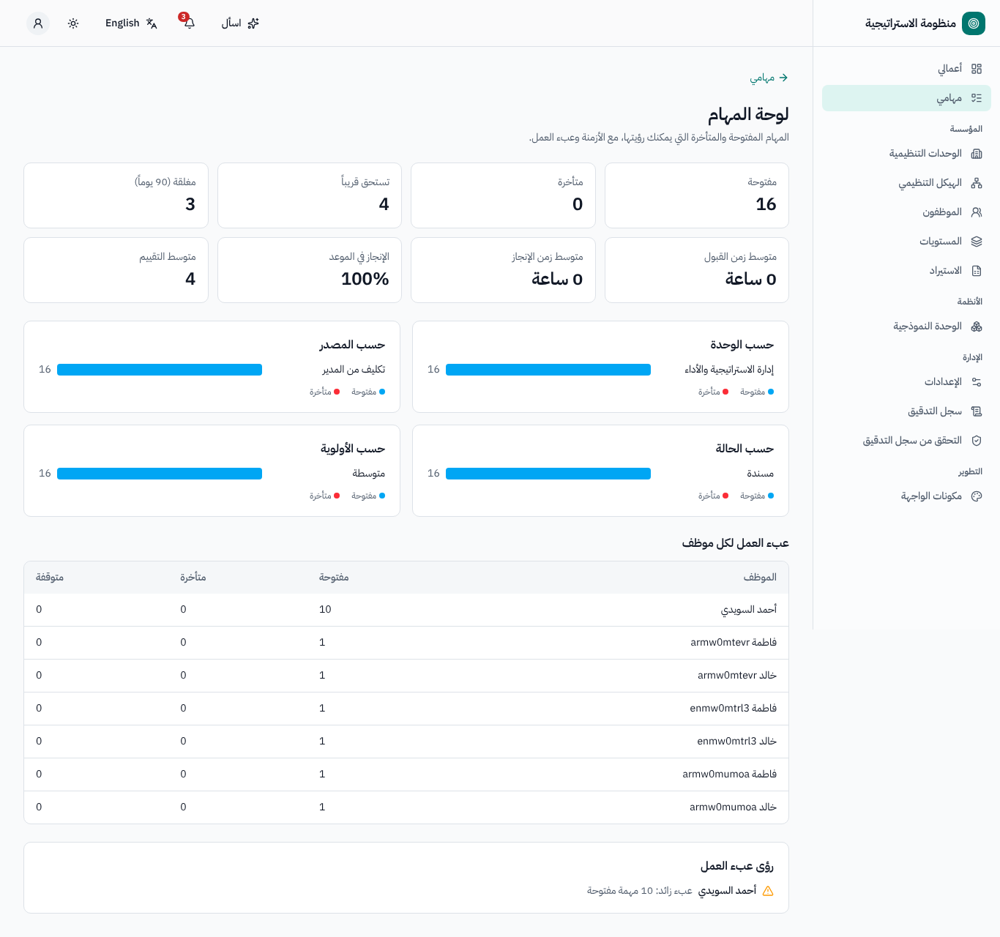
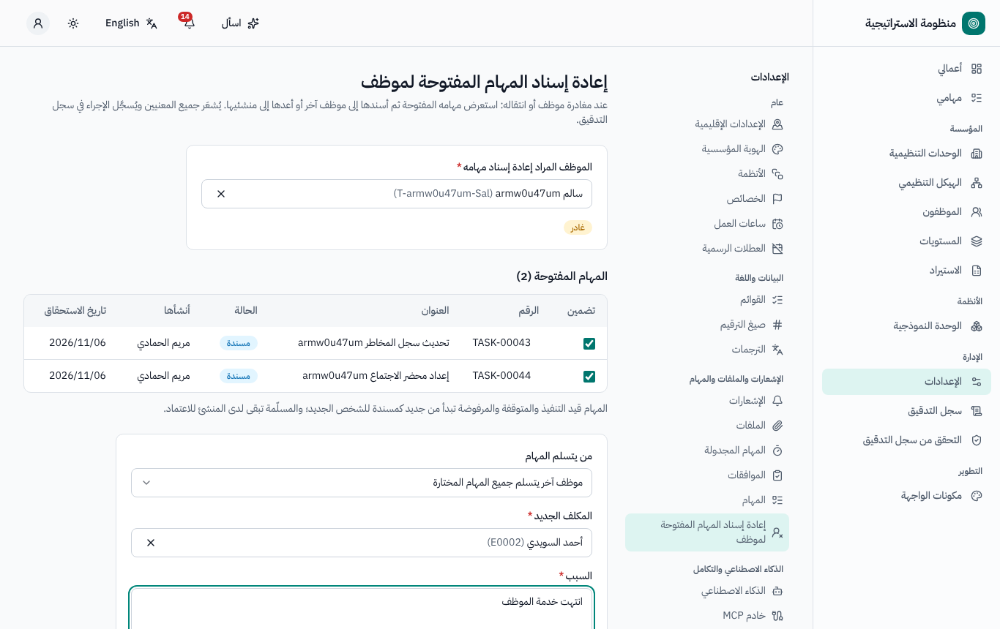

# إدارة المهام — دليل المستخدم

لجميع المستخدمين. النسخة الإنجليزية: [`../en/user-tasks.md`](../en/user-tasks.md).

القائمة الجانبية ← **مهامي**. يمكن أن تكون المهمة مستقلة أو مرتبطة بسجل في أي نظام (مرحلة مشروع، إجراء معالجة خطر، توصية فريق، ملاحظة في خطة
العمل التصحيحية، ملاحظة تدقيق…)؛ ويعرض السجل حينها مهامه.

## 1. مهامي

التبويبات **المسندة إلي**، **التي أنشأتها**، **المتابعة**، **مهام الفريق** (للمديرين: مرؤوسوك المباشرون)، مع الأعداد. وطرق العرض **قائمة**،
و**كانبان** (اسحب البطاقة لتغيير حالتها)، و**تقويم**. وتعرض كل مهمة مؤشراً لحالتها: *في الموعد*، *تستحق قريباً*، *متأخرة*، *متوقفة*.

## 2. إنشاء مهمة

**مهمة جديدة**: العنوان، والوصف، والنوع، والمصدر، والفئة، والأولوية، وتاريخا البدء والاستحقاق، والملفات، وقائمة التحقق، والسجل المرتبط،
والتكرار (يومي / أسبوعي / شهري، حتى تاريخ أو لعدد مرات)، و*سرية*.

- **عدة مكلفين** (**إضافة مكلف**، أو وحدة كاملة، أو **أعضاء فريق (مهمة لكل عضو)**): مهمة لكل شخص، تربطها **مجموعة إسناد** (تكتمل عند إنجاز
  *الجميع* أو *أي منهم*). ومن صفحة المجموعة يمكنك مراسلة الجميع، أو تمديد تاريخ الاستحقاق لكل المهام المفتوحة، أو إلغاء كل المهام المفتوحة.
- **اقتراح مكلفين** و**مسودات مهام من نص** (بالذكاء الاصطناعي عند تفعيله) تُعدّان مسودات فقط.
- **حفظ كمسودة** أو **إنشاء المهمة**. وموعد الاستحقاق هو نهاية وقت العمل في تاريخ الاستحقاق حسب وحدة المكلف (وينتقل يوم العطلة الأسبوعية أو
  الرسمية إلى يوم العمل التالي).
- من يمكنك إسناد المهام إليه يتوقف على الإعداد (*الجميع* أو *وحدتي* أو *مرؤوسيّ المباشرين*). ويمكن لسكرتير الإدارة إنشاء مهام نيابة عن مديره
  (فيعتمدها المدير).

## 3. العمل على المهمة

**المسار الكامل** (افتراضي):

| الحالة | يستطيع المكلف | يستطيع المنشئ |
|---|---|---|
| مسندة | **قبول** (← قيد التنفيذ) أو **رفض** مع السبب | التعديل، الإلغاء |
| مرفوضة | — | **إعادة إسناد** أو الإلغاء |
| قيد التنفيذ | **إيقاف مؤقت** (مع السبب ← متوقفة)، **تسليم** مع تعليق الإنجاز، **إضافة مهمة فرعية** | الإلغاء |
| متوقفة | **بدء** من جديد | الإلغاء |
| مسلّمة | — | **اعتماد** (مع درجة تقييم وتعليق)، **إعادة**، **إعادة إسناد** |

**المسار المبسّط** (حسب نوع المهمة): *للتنفيذ ← قيد التنفيذ ← منجزة* (**تم الإنجاز**)، دون قبول أو اعتماد.

القواعد: لا يمكن تسليم المهمة أو إنجازها ما دامت لها مهمة فرعية أو مهمة سابقة (اعتمادية) مفتوحة؛ ولا يعتمدها إلا منشئها (فلا يستطيع مسؤول
النظام اعتماد مهمة غيره). ويُحتسب الوقت تلقائياً من القبول / البدء حتى التسليم، مع فترات التوقف وأسبابها (تبويب **المسار الزمني** مع **سجل الوقت**).

تبويبات صفحة المهمة: **نظرة عامة** (الوصف وقائمة التحقق والمهام الفرعية والاعتماديات والسجل المرتبط)، **المسار الزمني** (الأحداث وسجل الوقت)،
**التعليقات** (مع الإشارة @ إلى المشاركين)، **المستندات**، **المتابعة** (أضف موظفين يتابعون المهمة ويمكنهم التعليق)، **السجل**.

## 4. التذكيرات والتصعيد (افتراضياً)

تذكير للمكلف قبل تاريخ الاستحقاق، وإشعار تأخر للمكلف والمنشئ، وتصعيد إلى مدير المكلف بعد عدد من أيام العمل من التأخر، وتذكير بقبول المهمة
المتروكة بحالة *مسندة*، وملخص اختياري بالبريد. وتُضبط القيم من الإعدادات ← المهام.

## 5. المهام السرية

لا يرى المهمة السرية إلا منشئها والمكلف بها وموظفو المتابعة — لا المديرون ولا مسؤولو النظام ولا من يستطيع رؤية السجل المرتبط. وبعض الفئات
سرية افتراضياً.

## 6. لوحة المؤشرات والأداء

**لوحة المهام** (للمديرين والموارد البشرية): المهام المفتوحة والمتأخرة حسب الوحدة والمصدر والحالة والأولوية؛ ومتوسط زمن القبول والإنجاز؛ ونسبة
الالتزام بالموعد؛ ومتوسط التقييم؛ وعبء العمل لكل موظف. وتُعد نتائج المهام (زمن القبول، وزمن الإنجاز، والالتزام بالموعد، والتقييم) مدخلاً في أداء
الموظف.

## 7. عند مغادرة موظف

يستخدم مسؤولو النظام **الإعدادات ← إعادة إسناد المهام المفتوحة لموظف** (ويُعرض أيضاً عند تحديد موظف بأنه *غادر*): استعرض مهامه المفتوحة، ثم
أسندها إلى موظف آخر أو أعدها إلى منشئيها مع ذكر السبب. ويُشعَر جميع المعنيين.

