

# الفرق واللجان — دليل المستخدم

لمقدمي الطلبات، وقادة الفرق، والمقررين، والأعضاء، والرعاة، والموارد البشرية (مسؤولي الفرق). النسخة الإنجليزية:
[`../en/user-teams.md`](../en/user-teams.md).

القائمة الجانبية ← **الفرق واللجان**: السجل (تبويبات *الكل*، *فرقي*، *فرق أقودها*، بانتظار التقييم)، و**طلب تشكيل فريق**، ولوحة المؤشرات.
الفرق مشتركة: يمكن ربط فريق بالمشاريع والتدقيقات والإجراءات التصحيحية ودراسات المقارنة وغيرها من السجلات.

## 1. طلب تشكيل فريق

1. **طلب تشكيل فريق**: النوع (فريق دائم أو مؤقت، لجنة، فريق مشروع…)، والاسم بالعربية والإنجليزية، والموضوع، والأهداف والمهام (ويمكن للذكاء
   الاصطناعي صياغتها)، والتواريخ، والوحدة المالكة، و**الأعضاء وأدوارهم** ومسؤولياتهم (ويمكن للذكاء الاصطناعي *اقتراح أعضاء*)، والسجل
   المرتبط، وطريقة قرار التشكيل (يُصدره النظام أو قرار خارجي).
2. **تقديم للاعتماد** ← اعتماد التشكيل (افتراضياً: مدير إدارة الوحدة المالكة ← المدير العام، Q-T5). بعض أنواع الفرق لا تحتاج اعتماداً
   وتصبح نشطة فوراً.
3. عند الاعتماد يصبح الفريق **نشطاً**: يُصدَر **قرار التشكيل** (`MEMO-YYYY-NNNN`، ملف PDF ثنائي اللغة فيه الأعضاء ومسار الاعتماد) ويُشعَر
   الأعضاء. ومع *القرار الخارجي* يرفع مقدم الطلب القرار الموقّع بدلاً من ذلك. وعند الإعادة يعود مسودة؛ وعند الرفض أو السحب يصبح *ملغى*.

الحالات: *مسودة · بانتظار الاعتماد · نشط · غير نشط · بانتظار التقييم · التقييم بانتظار الاعتماد · مغلق · مستبدَل · ملغى*.

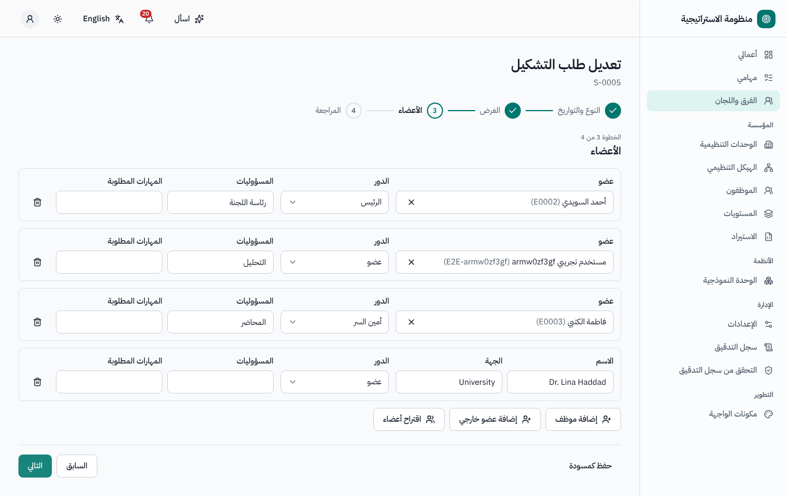
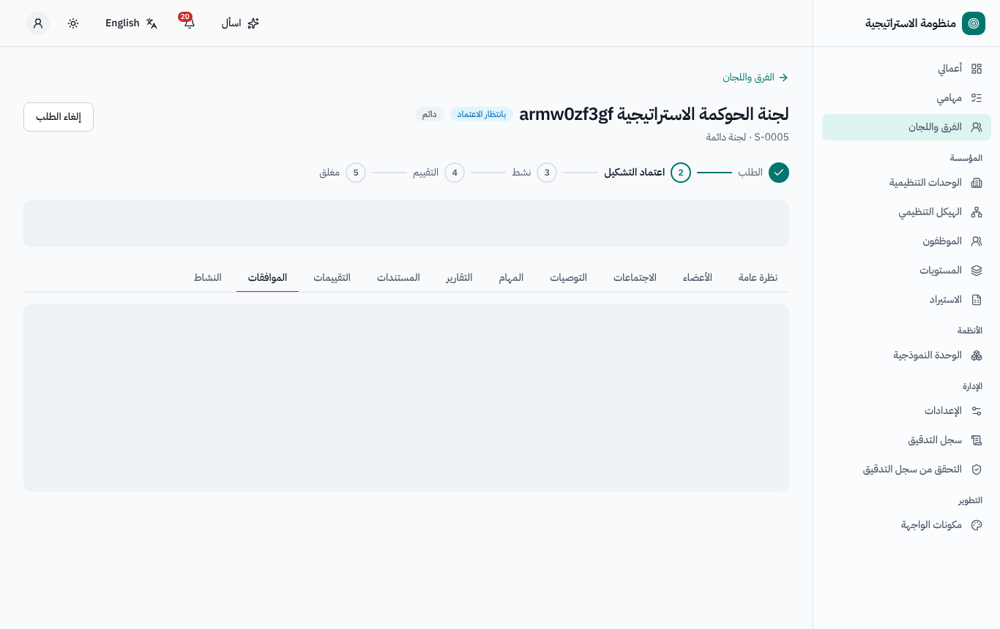
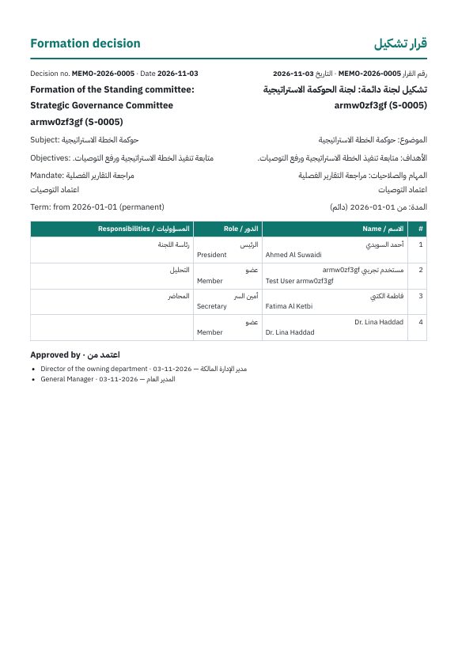

## 2. إدارة عمل الفريق

تبويبات صفحة الفريق: **نظرة عامة**، **الأعضاء** (مع السجل التاريخي)، **الاجتماعات**، **التوصيات**، **المهام**، **التقارير**،
**المستندات**، **التقييمات**، **الموافقات**، **النشاط**.

- **الأعضاء** (المسؤول): إضافة، ومغادرة (التاريخ والسبب)، واستبدال، وتغيير الدور — ويُحتفظ بكل تغيير.
- **الاجتماعات** (القائد / المقرر): **جدولة اجتماع**، وتسجيل الحضور، و**المحضر** و**القرارات**، ثم **اعتماد المحضر** (يُقاس التأخر منذ
  الاجتماع ويُستخدم في التقييم). وتصوغ **كتابة المحضر بالذكاء الاصطناعي** المحضر والقرارات والتوصيات من ملاحظاتك؛ فتراجعها ثم **استخدام
  المسودة**.
- سجل **التوصيات**: المسؤول وتاريخ الاستحقاق؛ ويحدّث المسؤول الحالة مع الدليل؛ ويفتح **إنشاء مهمة** مهمة مرتبطة بالتوصية.
- **المهام**: تُنشئ **مهمة لجميع الأعضاء** مهمة لكل عضو نشط (مجموعة إسناد).
- **التقارير**: تُنشأ التقارير الدورية (شهرية / ربعية / … حسب النوع) تلقائياً مع تاريخ استحقاق؛ ويقدّم القائد ملخصاً وملفات؛ وتصل التذكيرات
  وإشعارات التأخر إلى القائد والراعي.

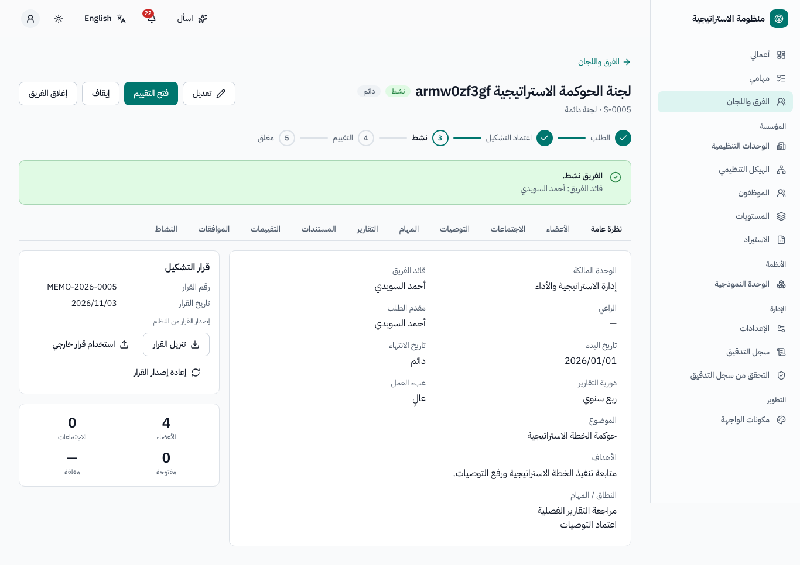
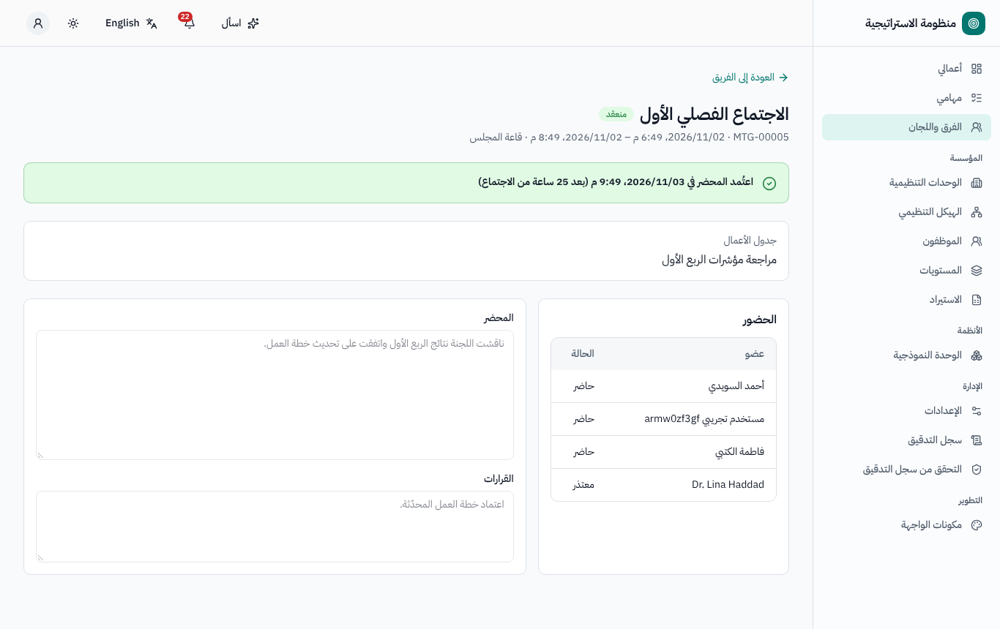
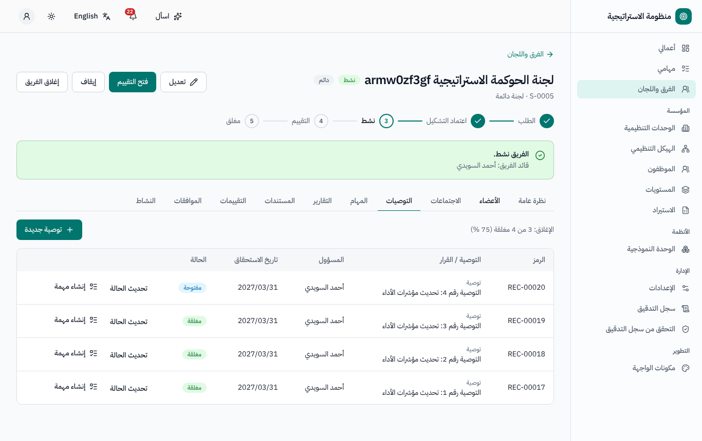

## 3. التقييم

يُفتح التقييم **سنوياً** للفرق الدائمة (افتراضياً في 1 يناير عن السنة السابقة)، وعندما **يبلغ الفريق المؤقت تاريخ انتهائه**، وعندما **يُغلق
السجل المرتبط به** (مثل اعتماد إغلاق المشروع)، أو يدوياً.

1. يفتح المقيّم (افتراضياً القائد) **فتح معالج التقييم**:
   - **معايير الفريق** — مستوى لكل معيار؛ وبعض المستويات *مقترحة* من البيانات (مثل التوصيات المغلقة وتأخر المحاضر)، واختيار مستوى مختلف
     يتطلب مبرراً؛
   - **كل عضو** — إجابات من 1 إلى 5 على الأسئلة مع تعليق (ويقيّم القائدَ مقيّمُ القائد)؛
   - **الأدلة** — إلزامية فوق حد الدرجة؛
   - المراجعة ← **تقديم لاعتماد الموارد البشرية**.
2. تنبّه *نقاط تستحق المراجعة* إلى التناقضات (تقييم الجميع بـ5، تساوي النقاط، أعلى تقدير مع حضور منخفض…)؛ وتراها الموارد البشرية أيضاً،
   ويمكن للذكاء الاصطناعي تلخيصها.
3. تعتمد **مراجعة الموارد البشرية** التقييم أو تعيده (بتعليق) مع عرض الدورات السابقة جنباً إلى جنب. ويُقفل الاعتماد الدرجات والتقديرات.

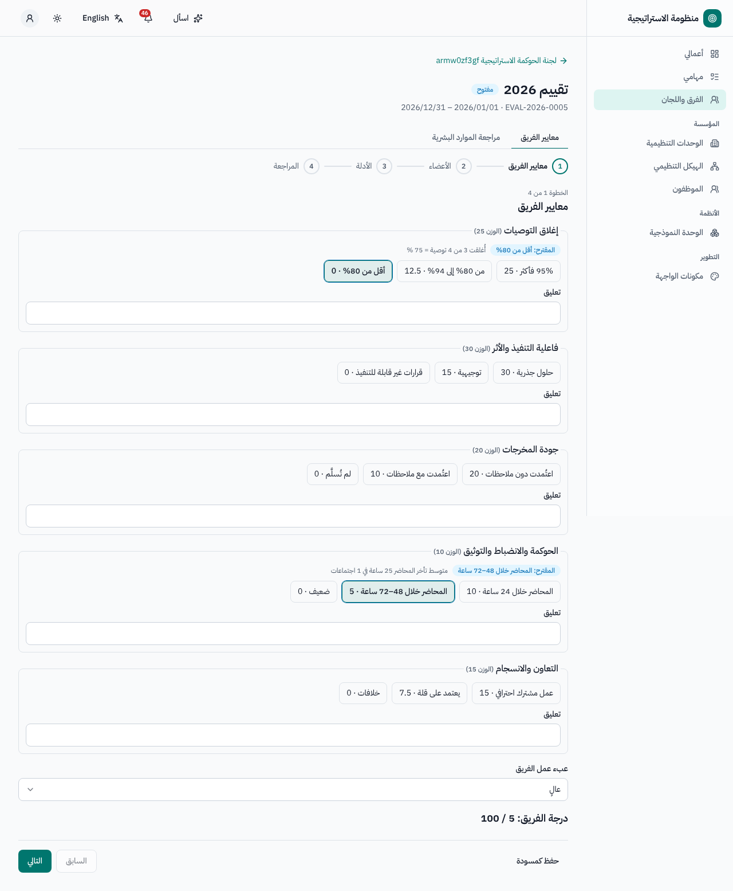
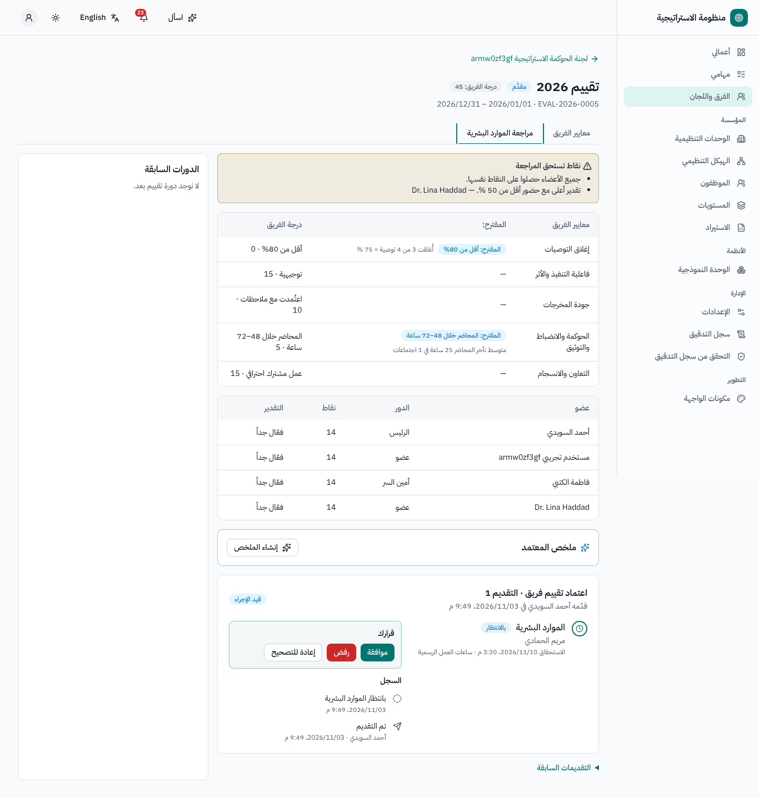

## 4. المكافآت والشهادات

بعد الاعتماد تفتح الموارد البشرية **المكافآت**: يأتي المبلغ المحسوب لكل عضو من **مصفوفة المكافآت** (التقدير × عبء عمل الفريق × الدور)؛
ويمكنها تغيير *المبلغ المعتمد* (مع مبرر عند الاختلاف)، وتحديد **شهادة** / **مكافأة مالية**، ثم **حفظ المكافآت** و**تقديم المكافآت للاعتماد**
(افتراضياً: رئيس الوحدة المالكة لنظام الفرق). وعند الاعتماد تُصدَر شهادات مرقّمة ثنائية اللغة (`CERT-YYYY-NNNN`)؛ وتعرض الميزانية السنوية
المستخدم والمتبقي.

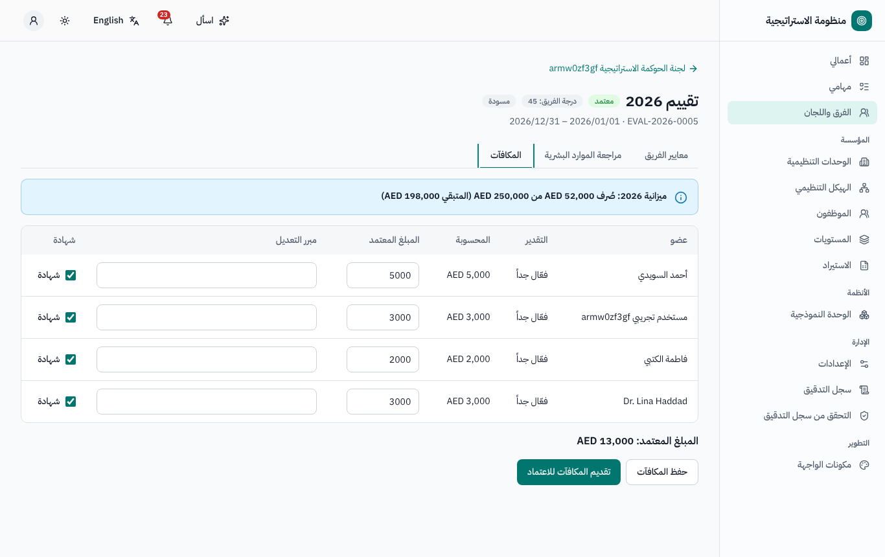
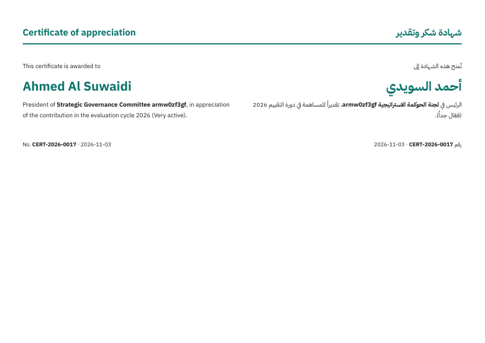

## 5. شاشات أخرى

- **لوحة المؤشرات**: الفرق حسب النوع والحالة، والتقييمات الجارية، وإغلاق التوصيات، وعبء العمل.
- **صفحة الموظف ← تبويب الفرق**: فرق الشخص وأدواره.
- **أعمالي**: بطاقة *فرقي والتقييمات المعلقة*.

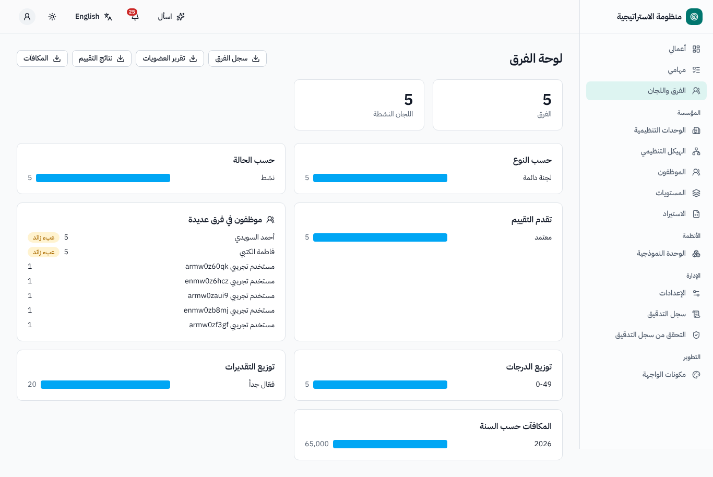

## 6. من يستطيع ماذا (افتراضياً)

| الدور | الصلاحيات |
|---|---|
| مقدم الطلب | طلب تشكيل فريق، وتعديل المسودة، وتقديمها، وإلغاؤها |
| القائد / المقرر (أدوار على السجل) | الاجتماعات والمحاضر والتوصيات والتقارير ومهام الفريق |
| العضو | الاطلاع على الفريق، وتوصياته ومهامه |
| المقيّم | تعبئة التقييم |
| مسؤول الفرق (الموارد البشرية) | الأعضاء، والإيقاف / الإغلاق، وفتح التقييمات يدوياً، ومراجعة الموارد البشرية، والمكافآت، والإعدادات |

