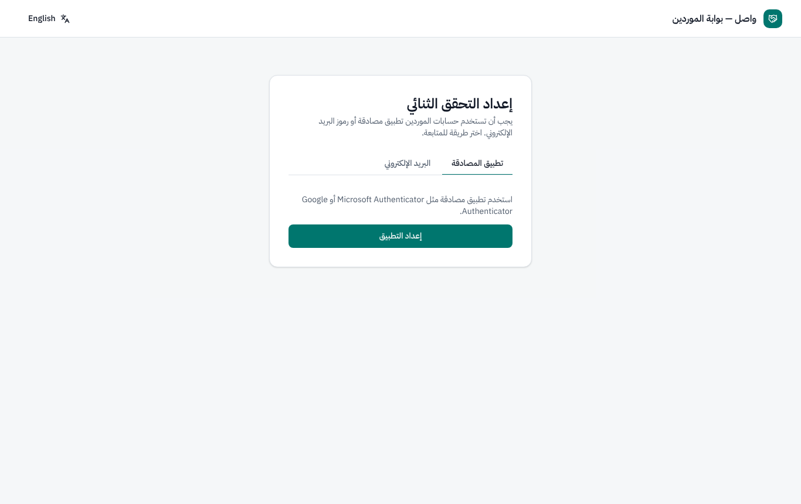
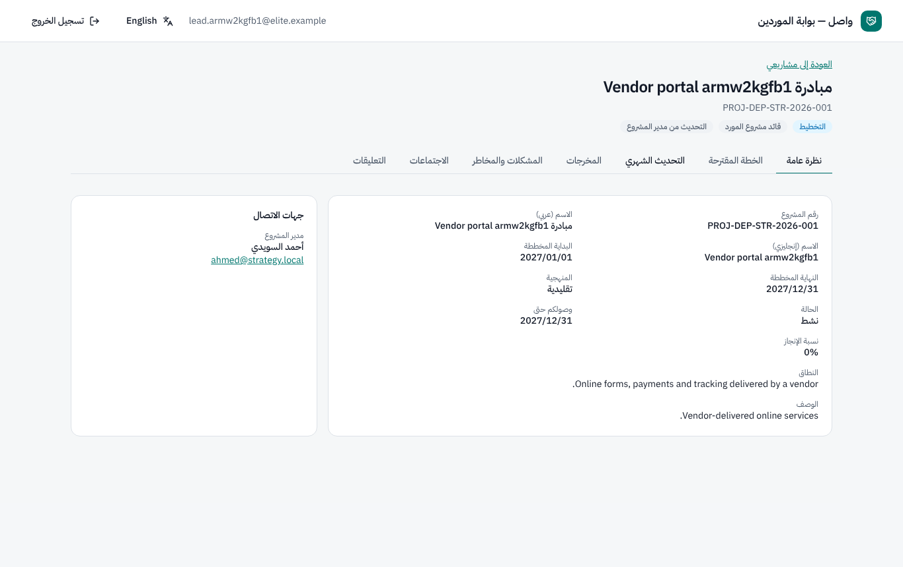
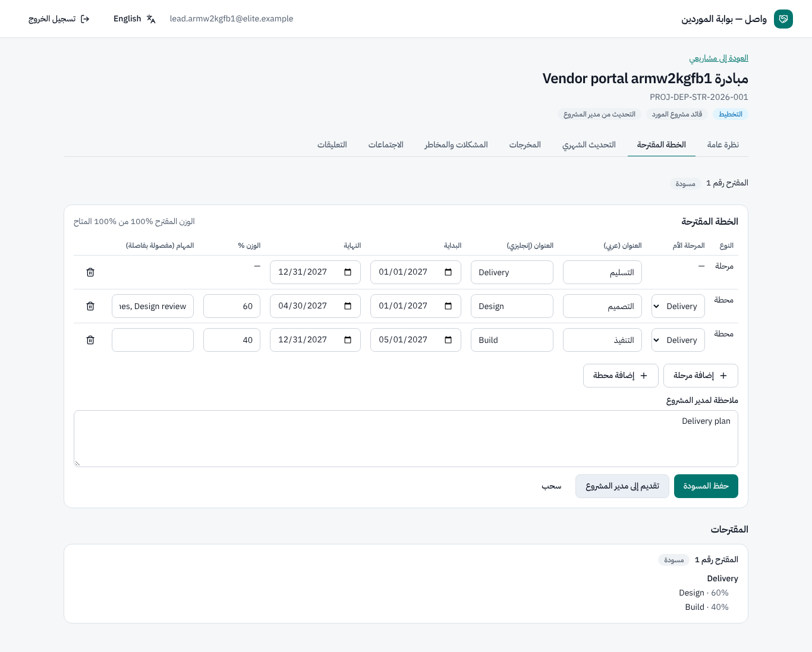
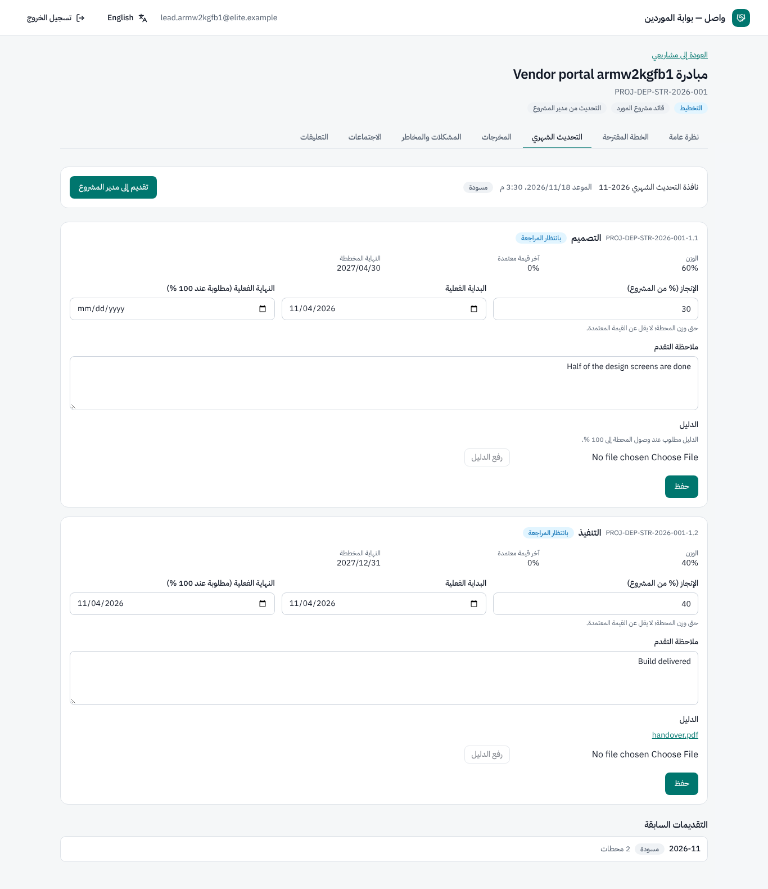
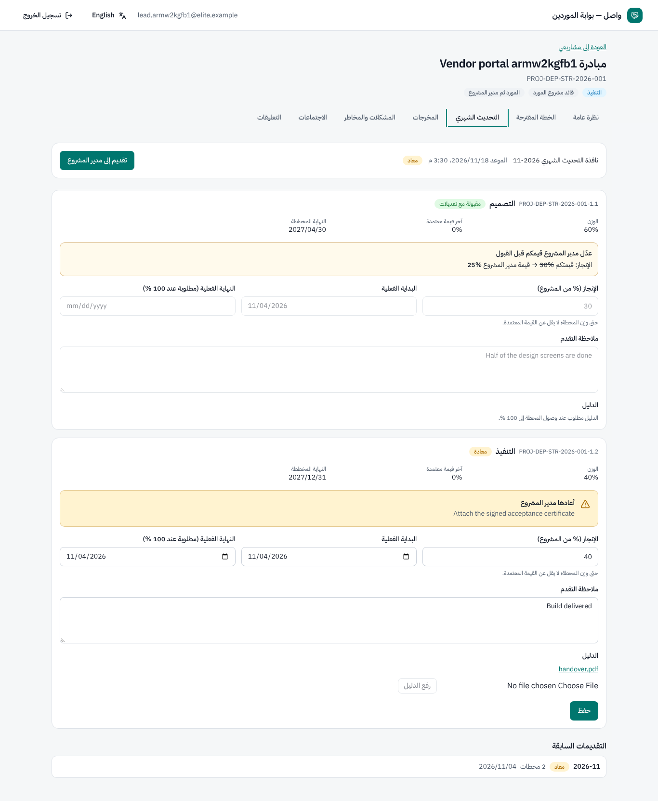
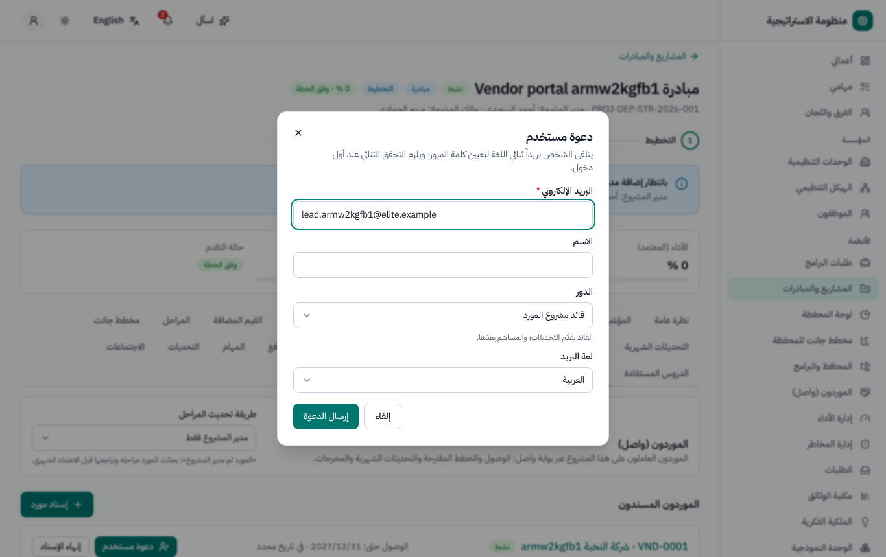
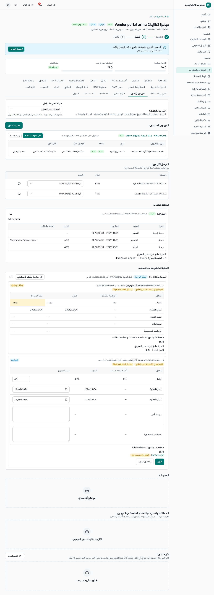
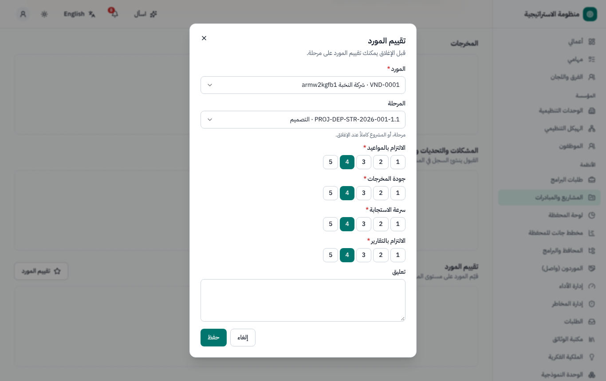

# بوابة الموردين «واصل» — دليل المستخدم

الجزء «أ» مخصص **للموردين** (مستخدمي الموردين)، والجزء «ب» **لمديري المشاريع ومكتب إدارة المشاريع** الذين يعملون مع الموردين. النسخة
الإنجليزية: [`../en/user-wasel.md`](../en/user-wasel.md).

«واصل» جزء من النظام نفسه، لكنه منطقة مستقلة تحمل هوية الموردين على العنوان `/wasel`. لا يرى المورد إلا المشاريع والمراحل المسندة إليه،
ولا يرى إلا الحقول التي تسمح بها الجهة (ولا يرى أبداً التعليقات الداخلية أو سجل الاعتمادات أو الميزانيات أو التكاليف ما لم تقرر الجهة
مشاركتها صراحة).

---

## الجزء «أ» — للموردين

### أ1. الدعوة وأول دخول

1. يدعوك مدير المشروع؛ فتصلك رسالة بريد (بالعربية والإنجليزية) فيها رابط **تعيين كلمة المرور**، صالح لمدة 3 أيام.
2. اختر كلمة المرور، ثم **الدخول إلى واصل** باستخدام **البريد الإلكتروني** و**كلمة المرور**.
3. التحقق بخطوتين **إلزامي دائماً** للموردين: عند أول دخول أعدّ تطبيق مصادقة (أو الرموز عبر البريد إذا سمحت بها الجهة) واحتفظ برموز
   الاسترداد. وتطلب عمليات الدخول اللاحقة الرمز.
4. إذا فعّلت جهتك UAE Pass للموردين وظهر زر UAE Pass في صفحة الدخول، يمكنك استخدامه بدلاً من كلمة المرور؛ ويُطابق حسابك بعنوان بريده
   الإلكتروني، ويبقى العامل الثاني مطلوباً.

ينتهي وصولك تلقائياً في التاريخ الذي حدده مدير المشروع (عادةً تاريخ انتهاء العقد أو إغلاق المشروع). وتُعطَّل الحسابات التي لم يُسجَّل بها
دخول لمدة 90 يوماً؛ اطلب من مكتب إدارة المشاريع إعادة تفعيل حسابك.

### أ2. مشاريعك

تعرض الصفحة الرئيسية مشاريعك. ويُفتح المشروع بالتبويبات التالية:

| التبويب | ما تقوم به |
|---|---|
| **نظرة عامة** | الرقم والاسم والنطاق والتواريخ المخططة والمرحلة والحالة واسم مدير المشروع وبريده، ومراحلك (مع حقول اختيارية مثل الإنجاز عند مشاركتها) |
| **الخطة المقترحة** | اقتراح خطة الجزء الخاص بك من العمل أثناء تخطيط المشروع |
| **التحديث الشهري** | إعداد الإنجاز الشهري لمراحلك (عندما يعتمد المشروع طريقة *المورد ثم مدير المشروع*) |
| **المخرجات** | رفع المخرجات (العنوان والمرحلة والملفات) ومعرفة هل قبلها مدير المشروع أو أعادها |
| **المشكلات والمخاطر** | اقتراح مشكلة أو تحدٍّ أو خطر؛ ويقبله مدير المشروع أو يرفضه |
| **الاجتماعات** | الاجتماعات التي تحضرها مع محاضرها؛ و*تأكيد* الإجراءات المتفق عليها |
| **التعليقات** | سلسلة لكل مرحلة أو تقديم أو مقترح أو مُخرَج؛ ويُشعَر مدير المشروع |

### أ3. اقتراح الخطة

أثناء تخطيط المشروع يُعدّ **قائد مشروع المورد** المقترح: للمشاريع التقليدية مراحل رئيسية وفرعية (العنوان بالعربية والإنجليزية،
والتواريخ، والوزن، وتحديد المُخرَج، والمهام المقترحة)؛ وللمشاريع الرشيقة والهجينة ملاحم مع قصص المستخدمين. ويجب أن يساوي مجموع الأوزان
المقترحة الحصة التي تخطط لها بالضبط (ولا يتجاوز الوزن غير الموزع من الخطة). ثم **قدّم**؛ فيقبله مدير المشروع (وقد يعدّله — وترى
الفروقات) أو **يعيده** بتعليق، فتعدّله وتعيد تقديمه. الحالات: *مسودة · مقدّم · معاد · مقبول · مسحوب*.

### أ4. التحديث الشهري (طريقة *المورد ثم مدير المشروع*)

عندما تُفتح نافذة التحديث الشهري للمشروع تصلك رسالة بريد.

1. يملأ القائد والمساهمون إنجاز كل مرحلة مسندة: الجزء المنجز (ولا يقل عما اعتُمد سابقاً)، والبدء الفعلي، و**الانتهاء الفعلي والدليل عند
   100٪**، و**أسباب التأخر والإجراءات التصحيحية عند التأخر**.
2. لا يستطيع **التقديم** إلا **القائد**.
3. يراجع مدير المشروع كل مرحلة: *مقبولة*، أو *مقبولة مع تعديلات* (وترى قيم مدير المشروع)، أو *معادة* بتعليق. وإذا أعيد أي بند يعود التقديم
   إليك.
4. عندما تعتمد الجهة الشهر يصبح تقديمك **مُدرج في التحديث المعتمد**.

الحالات: *مسودة · مقدّم · معاد · مقبول من مدير المشروع · مُدرج في التحديث المعتمد*.

### أ5. معلومات مفيدة

- لا يصل الموردون إلى النظام الداخلي ولا إلى مساعدات الذكاء الاصطناعي ولا إلى خادم MCP.
- كل ما تقدّمه يُسجَّل في سجل التدقيق (القناة *wasel*).

---

## الجزء «ب» — لمديري المشاريع ومكتب إدارة المشاريع

### ب1. سجل الموردين (مكتب إدارة المشاريع)

**الموردون (واصل)** في القائمة الجانبية: **مورد جديد** (سجل موردين مشترك)، والحالة *نشط · موقوف · في القائمة السوداء* (الإيقاف أو الإدراج في
القائمة السوداء ينهي وصول كل مستخدمي المورد فوراً)، ومستخدمو المورد بحالاتهم وآخر دخول لهم، والإسنادات، و**سجل الأداء** (التقييمات لكل
مشروع والمتوسطات لكل معيار).

### ب2. إسناد مورد إلى مشروعك

المشروع ← تبويب **الموردون (واصل)**:

1. **إسناد مورد**: المورد، والعقد، و**الوصول حتى** (اتركه فارغاً لاستخدام تاريخ انتهاء العقد؛ أو إغلاق المشروع / تاريخ محدد حسب
   الإعدادات).
2. **دعوة مستخدم**: البريد الإلكتروني، والاسم، و**الدور** (*قائد مشروع المورد* يقدّم التحديثات؛ *مساهم من المورد* يعدّها)، ولغة البريد ←
   **إرسال الدعوة**. ويُعاد استخدام حساب المورد إن كان موجوداً.
3. أسند المراحل إلى المورد (**المراحل لكل مورد**).
4. **طريقة تحديث المراحل**: *التحديث من مدير المشروع* (افتراضي؛ يرى الموردون المراحل ولا يعدّون التحديثات) أو *المورد ثم مدير المشروع*.
5. **سحب الوصول** من عضو أو **إنهاء الإسناد** في أي وقت مع ذكر السبب؛ ويُبلَّغ المورد.

### ب3. مراجعة عمل المورد

- **الخطة المقترحة**: راجعها جنباً إلى جنب، وعدّل إن لزم، ثم **قبول** (تُنشأ المراحل أو الملاحم وتُسند إلى المورد، وتُسجَّل الفروقات) أو
  **إعادة إلى المورد** بتعليق.
- **التقديم الشهري**: يعرض كل بند آخر قيم معتمدة · قيم المورد · قيمك. اختر *قبول* أو *تعديل ثم قبول* أو *إعادة* (التعليق إلزامي). ولا يمكنك
  تقديم التحديث الشهري ما دام تقديم المورد بانتظار مراجعتك. ويرى المعتمدون أي القيم جاءت *من المورد* وأيها *عدّلها مدير المشروع*. ويمكنك
  اختيارياً *مشاركة ملاحظة مع المورد* حول النتيجة (ولا تظهر تعليقات الاعتماد الداخلية للموردين أبداً).
- **المخرجات**: قبول أو إعادة. وقبول المُخرَج لا يعني اعتماد جودته (يبقى ذلك للمالك أو لمكتب إدارة المشاريع).
- **المشكلات والمخاطر** التي يقترحها المورد: يُنشئ القبول السجل الفعلي (مشكلة في سجل RAID أو تحدياً، أو خطراً للمشروع يُقيَّم بإطار
  المخاطر).

وتعرض صفحة أعمالي بطاقة **تقديمات واصل المطلوب مراجعتها**.

### ب4. تقييم المورد

عند الإغلاق (أو لكل مرحلة في أي وقت): **تقييم المورد** في *الالتزام بالمواعيد* و*جودة المخرجات* و*سرعة الاستجابة* و*الالتزام بالتقارير*
(من 1 إلى 5) مع تعليق؛ والإجمالي هو المتوسط. ويملأ تقييم الإغلاق مسبقاً رضا المورد في نموذج أثر المشروع.

### ب5. الإعدادات (مكتب إدارة المشاريع / مسؤول النظام)

الإعدادات ← المحافظ والمشاريع ← **واصل**: طريقة التحديث الافتراضية، وقاعدة انتهاء الوصول، وإنهاء الوصول عند إغلاق المشروع، وأيام عدم
النشاط (90)، والحقول الاختيارية المرئية للمورد (وصف المشروع وإنجازه ظاهران افتراضياً؛ والمالك والميزانية وحالة الاعتماد وتكلفة المرحلة
مخفية)، وUAE Pass للموردين. ومساعدات الذكاء الاصطناعي لمراجعة تقديمات الموردين متاحة لجهة مدير المشروع فقط.

