# Administrator guide

For platform, system and security administrators. Arabic version: [`../ar/administration.md`](../ar/administration.md).
Installation, backup, restore and upgrade are in the installation guide; this guide starts once the application is running.

Contents: [1. First-run setup wizard](#1-first-run-setup-wizard) · [2. The Settings centre](#2-the-settings-centre) ·
[3. General](#3-general) · [4. Data and language](#4-data-and-language) · [5. Notifications, files and jobs](#5-notifications-files-and-jobs) ·
[6. Approvals](#6-approvals-the-approval-settings-centre) · [7. System settings](#7-settings-of-each-system) ·
[8. AI and integrations](#8-ai-and-integrations) · [9. Access](#9-access-roles-and-permissions) ·
[10. Users and sign-in](#10-users-and-sign-in) · [11. Organisation](#11-organisation) · [12. Audit log](#12-audit-log-and-chain-verification) ·
[13. Health page](#13-health-page) · [14. Good practice](#14-good-practice)

---

## 1. First-run setup wizard

A new installation has no administrator. Until one exists, the application opens the **setup wizard** at `/setup` (Phase 18 design,
[`docs/design/release.md`](../../design/release.md) §2).

**Stage 1 — with the setup token (before any administrator exists)**

1. Read the **one-time setup token** from the application log (printed once at start-up, clearly framed). If you lost it, run the host
   command `--setup-token` (in Docker: `docker compose … run --rm app --setup-token`), which issues and prints a new one. The token
   expires after 24 hours; a restart issues a new one.
2. Open `/setup`, paste the token, then fill in:
   - **Organisation profile** — name in Arabic and English, short code, time zone, currency (becomes the root unit and the regional
     settings);
   - **Branding** — primary colour, e-mail header and footer;
   - **Languages** — default language, Hijri date display, Arabic-Indic digits;
   - **First administrator** — e-mail, password (password policy applies), name in Arabic and English.
3. The wizard creates the administrator with the platform administrator roles and **consumes the token**. Every token attempt is
   recorded in the audit trail.

**Stage 2 — signed in as the administrator**

Sign in; two-step verification is set up at once (required for administrators). The wizard continues with optional steps — each can be
skipped and done later in Settings: **Email server** (with *Send test email*), **authentication provider**, **AI provider** (with *Test
connection*), **business hours and holidays**, **organisation-structure import** (download the templates, import units, then
employees), **systems to enable**, and, for presentations only, the optional **demo data**. **Finish** marks the setup as completed; until
then the wizard can be reopened from Settings.

The scripted alternative to stage 1 is the `--create-admin` host command (see `deploy/README.md`); once an administrator exists the
token stage is closed.

## 2. The Settings centre

Open **Settings** from the profile menu. The left-hand navigation is grouped — **General**, **Data and language**, **Access**,
**Users and sign-in**, **Organisation**, **Notifications, files and jobs**, **AI and integrations** — and shows only the pages your
permissions allow (the server checks every call again). Most pages save as a whole with a version: if another administrator saved in the
meantime you are told to reload (no silent overwrite). Every settings change is recorded in the audit trail with old and new values.

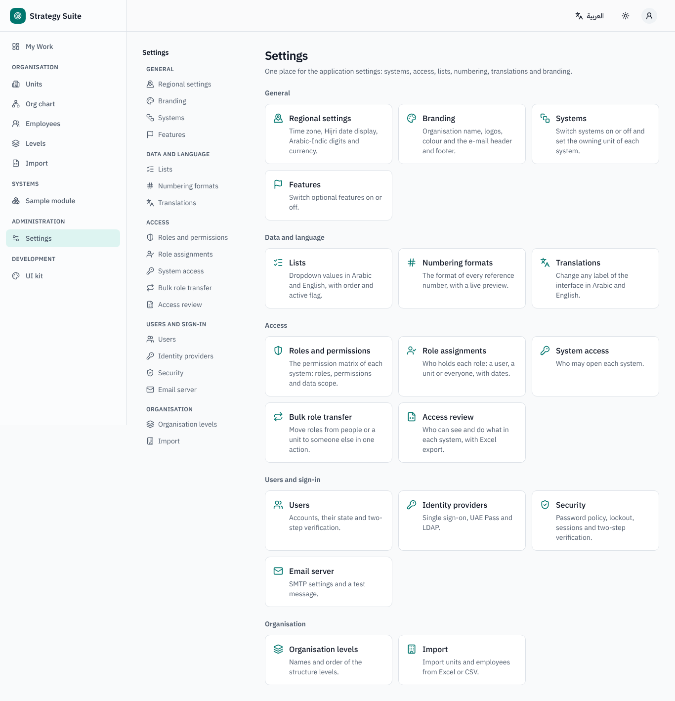

## 3. General

| Page | What it controls | Defaults and cautions |
|---|---|---|
| **Regional settings** | **Time zone**, **Show Hijri dates**, **Arabic-Indic digits**, **Currency code**, **Date format** | Asia/Dubai, Hijri off (data always stays Gregorian), Latin digits, AED, dd/MM/yyyy. The time zone drives every deadline, reminder and "today". |
| **Branding** | organisation name (AR / EN), **Primary colour**, logos for the light and dark theme (PNG / JPEG / WebP ≤ 512 KB), e-mail header and footer (AR / EN) | Used in the app shell, every e-mail, PDF (memos, certificates, reports) and the Wasel portal. |
| **Systems** | switch each system on or off and set its **Owning unit** | Platform components are always on. Switching a system off hides it, its links on other records, its My Work card, MCP tools and AI features — data stays. The owning unit is what approval steps of type "owning unit of this system" resolve to (e.g. move Risk Management from the Audit Office to the Strategy Office in one change). |
| **Features** | optional features: *Personal access tokens* (on), *KPI definition change control* (on), *Full audit lifecycle (layer 2)* (off) | Portfolio's standards features have their own switches in **Settings → Portfolio** (§7). |
| **Dashboards** | default dashboards per role, built from the widget catalogue, published without code | See [Dashboards guide](user-dashboards.md) §6. |
| **Reporting** | **Department level**, **Fiscal year starts in**, full refresh interval (default 10 min), export row limit (50 000), attachments on/off, attachment size, retention of sent files (30 days), **Department comparison limits** (green / amber per scorecard column), **Refresh now** per system | Changed systems refresh within about a minute; the page shows each system's *As of* and last error. |
| **Business hours** | working days and hours (several records allowed), units with their own hours, a calculator ("start + N working hours") | Seed: *Standard business hours*, Monday–Friday 07:30–15:30. A unit uses its own record, else its parent's, else the default. Every deadline (approval SLA, KPI windows, tasks, CAP, monthly updates…) uses it. |
| **Holidays** | public holidays and closures per year, recurring yearly dates, partial days, which business-hours records they apply to, Excel import | Hijri holidays are entered per year as dates. Two active holidays sharing a business-hours record may not overlap. |

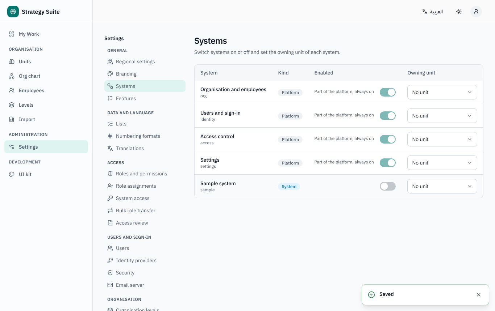
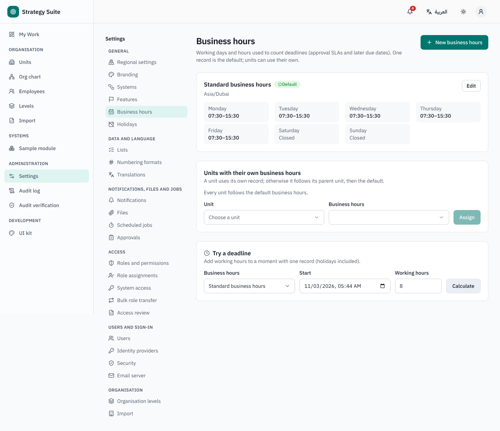

## 4. Data and language

- **Lists** — every dropdown (strategic objectives, risk categories, document types, task types…) with Arabic and English labels, order and
  active flag. Business logic only uses the **codes**, so you may rename labels freely; deactivate values instead of removing them. Each
  organisation loads its own values (Excel import templates); the seed is neutral (SPEC Appendix A, Q-P7).
- **Numbering formats** — the format of every reference number with a live preview. Tokens: `{YYYY}`, `{YY}`, `{MM}`, `{UNIT}`, `{TYPE}`,
  `{ORG}`, `{SEQ:n}` (sequence with *n* digits, last token). Examples of defaults: program requests `PR-{SEQ:4}`, projects
  `PROJ-{UNIT}-{YYYY}-{SEQ:3}`, documents `{ORG}-{UNIT}-{TYPE}-{YYYY}-{SEQ:2}`, IP `IP-Registry-{SEQ:4}`, team memo
  `MEMO-{YYYY}-{SEQ:4}`. **Back to default** restores a pattern. Changing a pattern affects new numbers only.
- **Translations** — change any interface label in Arabic and English. Overrides are stored in the database; other open sessions pick them
  up within about five minutes.

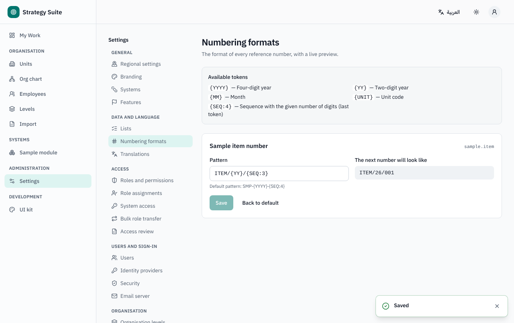 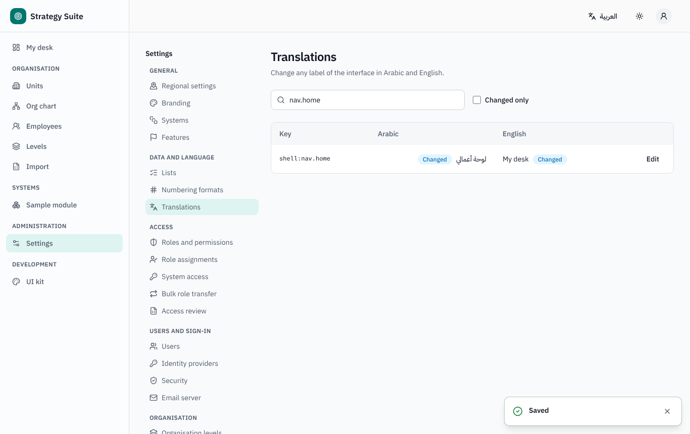

## 5. Notifications, files and jobs

- **Notifications** — every e-mail and in-app template, by system, with Arabic and English subject and body (`{{placeholders}}`, a
  `{{button}}` link), preview and **reset to default**; plus the e-mail **delivery log** (status and error of each attempt). E-mails are
  rendered bilingual side by side with your branding. Delivery is queued with retry (target: within 5 minutes).
- **Files** — **Largest upload (MB)** (each document type may set less), **Scan uploads with ClamAV** (needs the optional `clamav`
  container), **Hold files until they are scanned**, ClamAV host and port. Every upload is checked by type allow-list and content
  (magic number); SVG, HTML and executables are never accepted.
- **Scheduled jobs** — each background job with its schedule, next run, last run (status, duration, message) and recent runs; **Run now**,
  pause / resume; and the message queue (outbox: pending, failed / dead messages that you can re-queue). Jobs shipped with 1.0 include
  approval SLA escalation (every 15 min), task reminders (every 15 min), KPI period windows (hourly), project monthly cycle (hourly), risk,
  CAP, benchmarking and audit monitors (hourly), document validity (daily 02:15), IP renewals (daily 02:30), team evaluation triggers
  (daily 01:10) and periodic reports (02:10), notification digest (07:20), dashboard aggregates refresh (every minute) and scheduled
  delivery (every 5 min), monthly snapshot, Wasel access expiry (hourly), audit-chain verification (daily 02:10), re-scan of pending
  files and clean-up jobs. All jobs are safe to re-run.

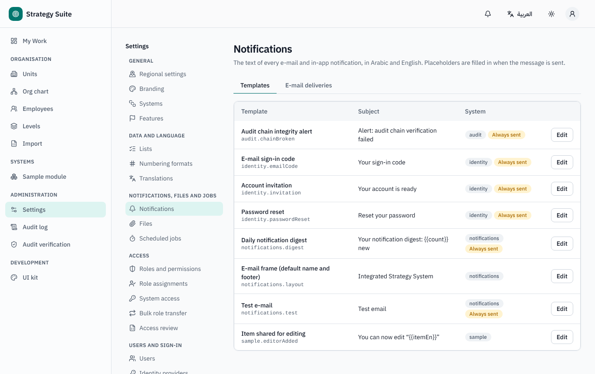
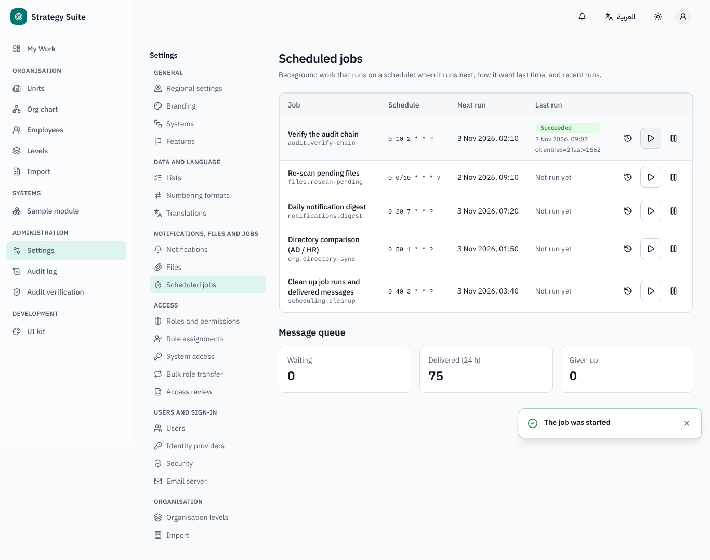

> Upgrading from a build before Phase 17: scheduled jobs did not run on their schedule before that fix. After the upgrade, reminders,
> digests and escalations start sending — warn your users.

## 6. Approvals (the Approval Settings centre)

**Settings → Approvals** lists every approval process of every system in one place (request approvals, charter, planning, monthly
updates, closure, impact, change requests, sprint reviews, KPI results, risk review / periodic review / closure, team formation /
evaluation / rewards, document / IP / benchmarking gates, CAP validation / completion / extension, audit plan and follow-up review, request
types…).

Open a process to edit its **ordered steps**. Per step:

- **Approver rule** — a system role, an organisation relation (section manager or department director of the record, head of a unit,
  *owning unit of this system*), a specific employee, a record role (e.g. Project Owner), a team role, or the submitter's manager;
- **Entry condition** — an expression on the process variables (e.g. `budget > 50000`, `residualBand == "critical"`,
  `f_amount > 50000` for request-type fields); the editor lists the variables and validates as you type. A step whose condition is false is
  skipped (shown as skipped on the record);
- **Actions** (Approve / Reject / Return for correction, custom labels) and whether a **comment is required** on reject / return;
- **SLA** in working or calendar hours, which business hours (default, the record's unit, a specific record), and an **escalation**
  target;
- behaviour when nobody can approve.

The **live preview** shows who would approve a sample record step by step. **Save** with a note creates a new **version**; running
approvals keep the version they started with. Resolved approvers are snapshotted on each task.

Seeded chains (SPEC Appendix A): monthly update Department Director → PM Office (Q-P1); section-manager steps only when the record's unit is
a section whose manager differs from the director and the submitter (Q-P4); change requests add Finance Service Section when cost is
affected and GM Office for cancellation / merge or a cost change above the GM threshold; team formation Department Director → General
Manager (Q-T5); KPI results one step Strategy Office; risk review Risk Office; CAP actions PM Office.

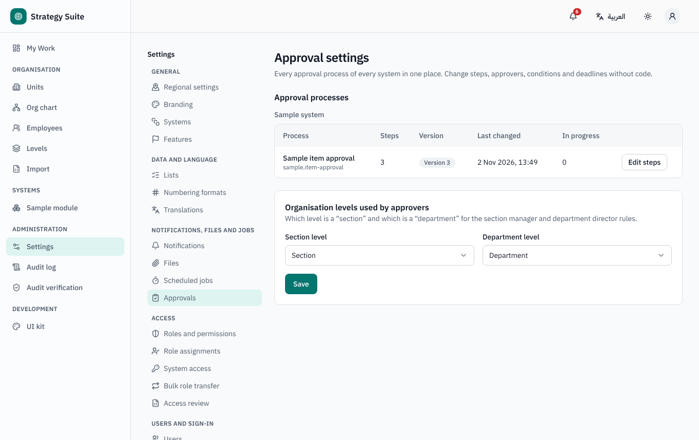
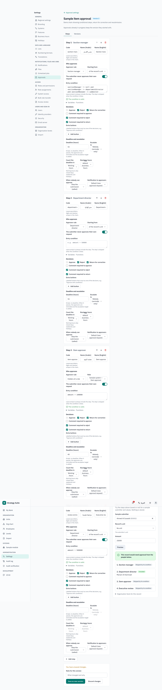

## 7. Settings of each system

| Page | Main contents (defaults in brackets) |
|---|---|
| **Tasks** | workflow per task type (*Full*: assign → accept → work → submit → creator approves; *Simple*: to do → in progress → done); **Who can be assigned** (anyone / unit / direct reports); secretaries creating on behalf of their manager; confidential categories; feedback scale; reminder before due, overdue notice, escalation to the assignee's manager, accept reminder; digest; overload threshold. Task types, sources and categories are lists. **Reassign open tasks of an employee** (leavers / movers): preview, then give the tasks to another employee or back to their creators — everyone notified, audited. |
| **Teams** | general (over-assignment threshold, report and evaluation reminders, default recommendation due days), **Team types** (formation approval, decision memo, evaluation trigger: annual / end date / linked record closed / manual, evaluator), **Member roles** (leader, secretary, results viewer, quorum), **Evaluation templates** (versioned: criteria, levels, member questions, grade bands, evidence threshold), **Reward matrix** (amounts per grade × workload × role, annual budget, certificate grades — seeded empty, Q-T5). |
| **Portfolio** | threshold amount project / initiative (AED 50 000, Q-P5), prioritisation criteria and weights, priority bands (High ≥ 80 %, Medium ≥ 60 %), date windows, the approval step that sets the approved budget, project scope template, **Project lifecycle** templates for projects and initiatives (charter, LPO, team formation, closure, impact — Q-P2 / Q-P3), monthly update due (10 working days) and reminder (3), delay tolerance (5 points, Q-P6), GM Office threshold for change requests (100 000), methodology suggestions and agile approval mode (monthly), **Features** (portfolios & programmes, prioritisation, RAG health, baselines, *earned value* (off), RAID, risk matrix, RACI, communication plan, benefits, quality, procurement, status report, gate checklists, templates — a switch off hides the screens and refuses the APIs; data stays), health thresholds, gate checklists, project templates, **Wasel** (default update mode *PM only*, access expiry rule, end at closure, dormant account days (90), vendor-visible fields, UAE Pass for vendors). |
| **Performance (KPI)** | general (reminder 3 working days before due, escalation 2 after, RAG green ≥ 95 % / amber ≥ 80 %, anomaly jump, evidence required, results open only for confirmed plans, manual codes), **Period window rules** (Q-K2: open the day after the period ends, due on the 15th day), **Measuring methods** (sum / average), **Verification checklist**, **Strategy hierarchy** (vision → perspectives → objectives, cycle dates), **Period windows** per year (lock / reopen a period). |
| **Risk framework** | versioned: scoring method and formula (sandboxed expression with live matrix preview and affected-risk count), likelihood and impact scales with criteria, bands and residual mapping, control effectiveness scale, review frequency per band, categories with **appetite** (empty by default, Q-R3), escalation and module settings. Saving a new version can recalculate existing risks. |
| **Request types** | form builder: request types, sections and fields, stages (approval / processing), PDF templates, catalogue category, who may submit, embeddable page and deep link for the intranet, allowed embed origins. |
| **Document Registry** | organisation code (`{ORG}`), **Document types** (number code, validity in months or *until superseded*, *Creates IP register entry*, acknowledgement required), **Sensitivity clearance** per level (Public · Internal · Confidential · Secret — who may read), expiry reminders (60 and 30 days), the "uncontrolled when printed" stamp, public links (off). |
| **Intellectual property** | protection types with term in years, *counts from* (registration or first publication) and *internal only*; renewal reminders (6 and 3 months); MOET form header. |
| **Corrective action plan** | due days by priority, count working days, PM Office confirms rejections (off), reassign only within the unit, root-cause rule, monthly reminder day, escalation of late actions to the PMO, effectiveness verification, mirror linked project progress, automatic remarks from missed KPI targets, risk events and ineffective controls. |
| **Benchmarking** | search notice before the quarter (30 days), working days, impact follow-up after closure (6 months), update KPI benchmark values on analysis approval. |
| **Audit management** | department visibility (what department users see, which level counts as a department), follow-up internal review (auditor → Chief Audit Executive), reminders, report timeliness target, improvement observations to CAP, audit KPI cards to publish. |

## 8. AI and integrations

### 8.1 Artificial intelligence (Settings → AI)

AI is **off** on a new installation and everything works without it. Tabs:

- **Providers** — **Add provider**: *Anthropic Claude*, *OpenAI*, *Azure OpenAI* or *OpenAI-compatible (Ollama, vLLM)* for a self-hosted
  model; endpoint, **API key** (stored encrypted, never shown again), **Fetch models** or type them, default model, temperature, maximum
  answer tokens, time-out. **Test connection** sends a one-line prompt. Choose the **Default provider**.
- **Features** — each feature (fill forms from documents, approver brief, translation, similar records, ask the system, and every
  system's own assistants) with its switch, provider and model, and **Who may use it** (a permission per feature, held by the *AI user*
  role assigned to everyone — remove it there to restrict).
- **Data sharing and limits** — **Mask personal data** (on), **Allow sending uploaded documents**, per system whether data **May be sent**
  and **Fields never sent**; **Text recognition for scans (OCR)** (off; needs Tesseract with Arabic and English, included in the image);
  monthly limits (tokens per installation, requests per user).
- **Usage** — this month's requests, tokens and failures, and the usage log (user, feature, model, tokens, time, outcome).

Then switch on **Use AI in this installation**. Every AI call is logged and audited (channel `ai`); AI output is always a draft a person
accepts, and AI never approves, rejects, submits or saves.

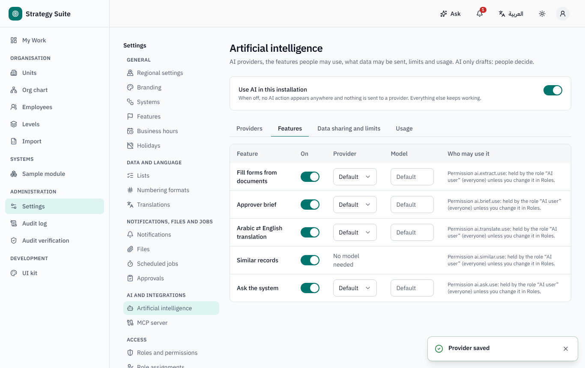
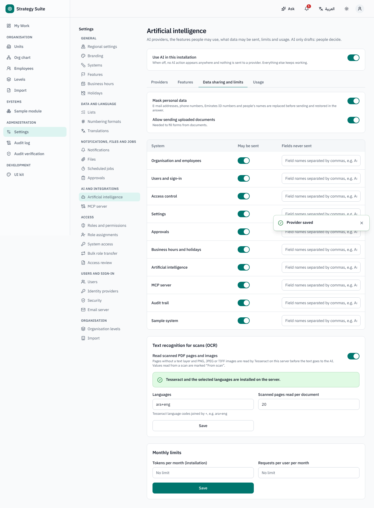

### 8.2 MCP server (Settings → MCP server)

Lets Claude and other MCP clients use the installation **as the person who connected them**. Switch **Turn on the MCP server** on; check
**Sign-in for MCP clients (OAuth 2.1)** (*Let clients register themselves*, **Allowed redirect hosts**), token lifetimes (access 60
minutes, stay connected 30 days), **Tool calls per user per minute**, and the **Tools** table: read tools are on, **write tools are off**
until you enable them, and **approve tools** (`approval_decide`, `approve_task`) are never on by default. **Connected clients** lists the
clients; **Disconnect** stops a client's tokens for everyone. HTTPS is required for the OAuth sign-in. User instructions: [MCP guide](mcp.md).

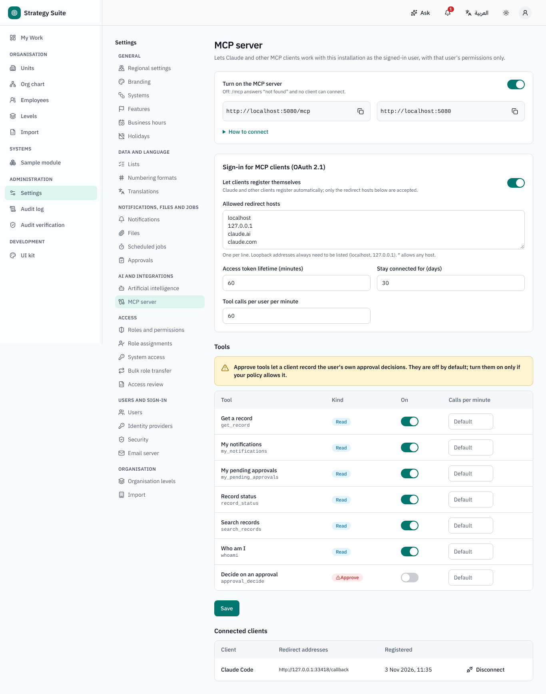

## 9. Access: roles and permissions

Access has three layers, checked by the server on every page, API call, background job and MCP call:

1. **System access** — who may open each system at all (**Settings → System access**: a user, a unit or everyone).
2. **System roles** — each system's roles and permissions (`<system>.<object>.<action>`), each with a **data scope**: *Own* (records the
   person owns), *Team* (+ their direct reports), *Unit* (their unit or a unit they head), *Unit and below*, *All*. Several roles combine.
3. **Record roles** — a person's role on one record (Project Manager, Project Owner, team member, risk owner, task assignee, approver of an
   open approval…). They are granted and revoked by the system itself, never by hand.

Pages:

- **Roles and permissions** — choose a system: matrix of roles × permissions with a scope per cell, plus a tab for record roles; create a
  role, mark whether it requires two-step verification.
- **Role assignments** — who holds each role: a user, a unit (everyone in it) or everyone, with from / to dates.
- **System access** — who may open each system.
- **Bulk role transfer** — move roles from people or a unit to someone else in one action, with a reason; pending approvals of those roles
  are re-routed to the new holders and the transfer is audited.
- **Access review** — who can see and do what in each system (direct / via unit / via everyone, record roles), with **Excel export** for
  auditors.

Out-of-scope records answer *not found* (404) so their existence never leaks; visible records with a forbidden action answer *forbidden*.
Seeded roles per system follow the SPEC access sections and can be edited. Keep at least two people with the access administrator role
(the last active one cannot be deactivated).

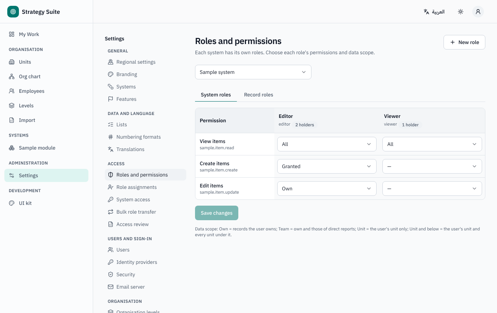
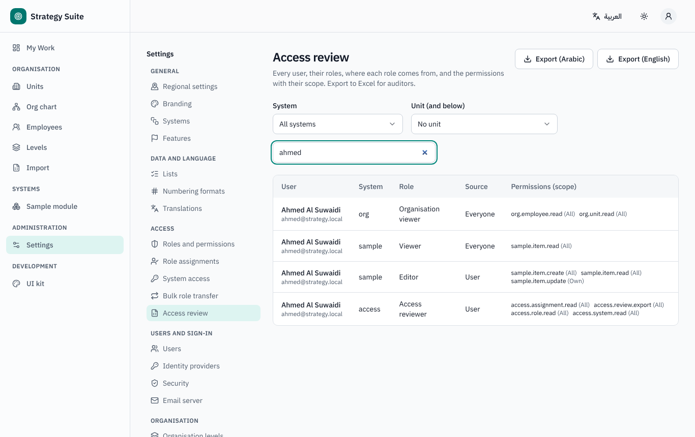

## 10. Users and sign-in

- **Users** — accounts and their state (active, locked, inactive), invitation e-mail, two-step verification status, reset, deactivate.
  Users are normally linked to an employee.
- **Identity providers** — **New provider**: *OpenID Connect* (Entra ID, ADFS, Keycloak…), *UAE Pass* (staging / production presets),
  *SAML 2.0*, *LDAP / Active Directory*. Button texts in Arabic and English, connection, claims / attributes, **Account linking** (*Match
  employees by* e-mail / employee number / user name, *Link automatically*, *Create the account on first sign-in*); register the
  displayed callback / metadata addresses at the provider; **Test the connection**. Employees are never created by sign-in. Step-by-step
  per provider: [`docs/identity-providers.md`](../../identity-providers.md).
- **Security** — password policy (12 characters, upper / lower / digit / symbol, 5 previous passwords), lockout (5 attempts → 15
  minutes), sessions (30 minutes idle, 12 hours maximum), **Who must use two-step verification** (*Required for administrators* by
  default), allowed methods (authenticator apps, codes by e-mail), two-step after single sign-on (off), personal access token lifetimes
  (90 / 365 days).
- **Email server** — SMTP server, port, security (StartTLS / TLS / none), user name and password (stored encrypted), sender address and
  names (AR / EN), **Application address** (the public URL used in e-mail links). **Send test email**.

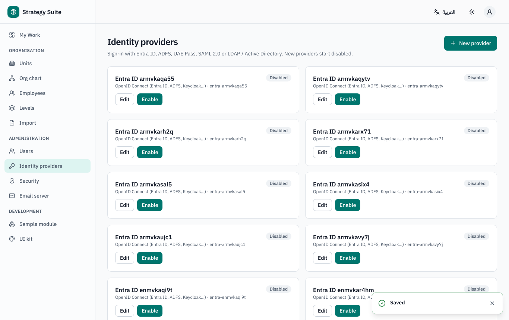
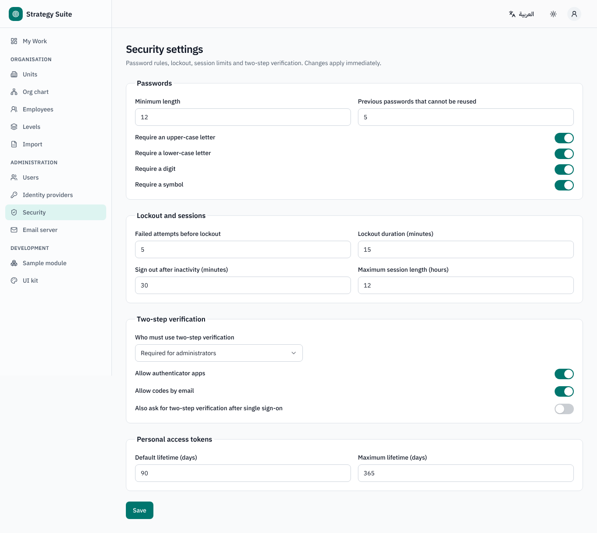

Vendors (Wasel) are a separate kind of account managed from Portfolio (see [Wasel guide](user-wasel.md)); they always use two-step
verification and can never use the internal application, AI or MCP.

## 11. Organisation

- **Organisation levels** — names and order of the structure levels (organisation, sector, department, section, unit…).
- **Units**, **Org chart**, **Employees** (sidebar → Organisation) — unlimited hierarchy with head and deputy, history kept when the
  structure changes (view the chart *as of* a date); employees with unit, manager, job title, status (active / on leave / left). Marking
  an employee *Left* offers to reassign their open tasks.
- **Import** — download the Excel / CSV templates, import **units first, then employees**; the validation report lists every error before
  anything is saved.

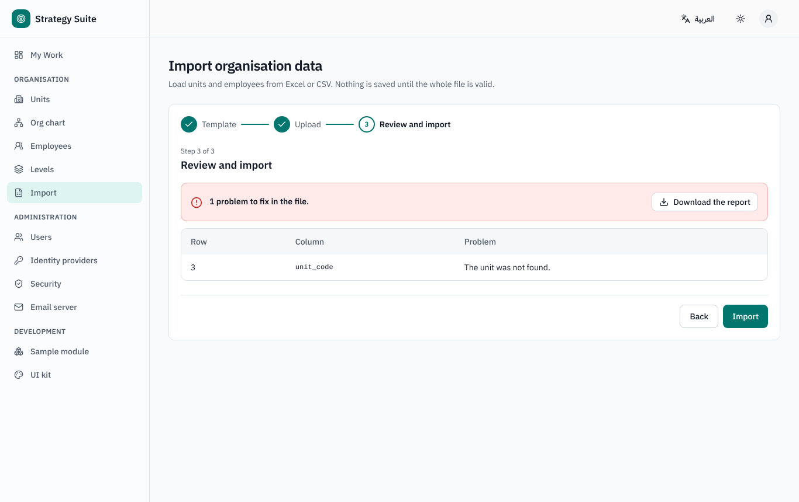
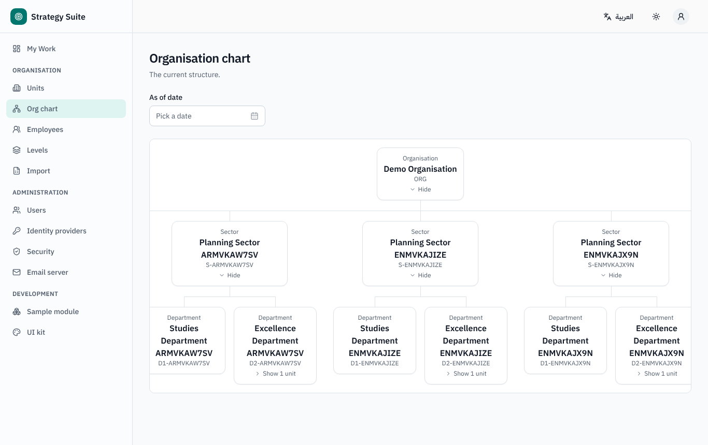

## 12. Audit log and chain verification

Every create / update / delete on every record is recorded automatically (who, on behalf of whom, when, IP, device, **channel** — UI,
API, MCP, AI, job, import, Wasel, system — field, old → new value, reason), plus sign-ins, approvals, file downloads, exports, settings and
permission changes, AI and MCP calls. Nobody, including administrators, can change or delete entries.

- **Audit log** (sidebar → Administration) — search across all systems by user, system, object, action, channel and dates; **Export to
  Excel** / **Export to PDF**. Each record also has its own **History** tab.
- **Audit verification** — the entries form a hash chain; **Verify now** checks it (a job also runs it nightly) and reports *intact* or
  the first broken entry.

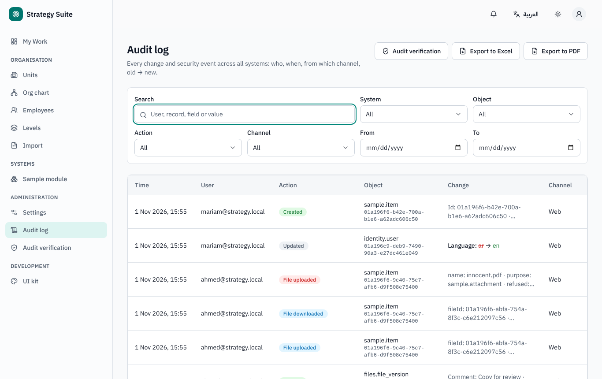
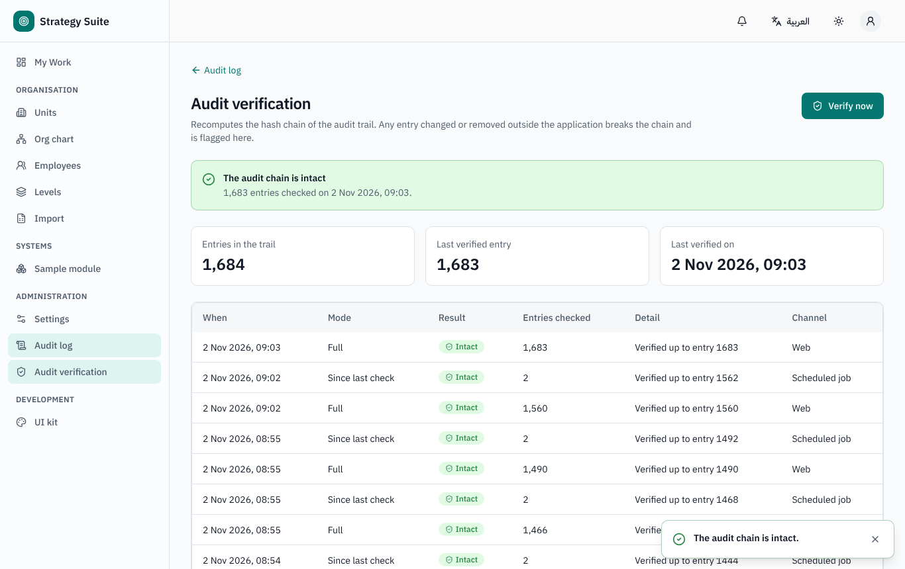

## 13. Health page

**Settings → Health** (Phase 18 design, [`docs/design/release.md`](../../design/release.md) §3; permission *view health*, held by the
platform administrator role) shows one line per check with *OK*, *Warning*, *Error* or *Not configured*:

database (latency, version, size) · pending migrations per system · scheduler and every job (last run, status, next run, failures in 24 h) ·
message queue (pending, failed, oldest pending) · e-mail (configured, last delivery, failures) · AI provider · OCR (Tesseract and
languages) · file storage (writable, free disk space) · PDF service (Gotenberg) · certificate expiry · last audit-chain verification ·
version and uptime.

Check it after every upgrade and whenever users report missing e-mails or reminders. The infrastructure probes `/health/live` and
`/health/ready` remain for load balancers and containers.

## 14. Good practice

- Configure in this order: regional → branding → organisation import → business hours and holidays → systems and owning units → roles and
  system access → approval chains → notification texts → AI / MCP.
- Test approval changes with the **live preview** before saving; keep a note on each version.
- Prefer deactivating list values, roles and providers over deleting them; history stays readable.
- Review the **Access review** export regularly and after re-organisations; use **Bulk role transfer** when people move.
- Keep two administrators with two-step verification; never share accounts.
- Back up the database together with the files volume and the Data Protection keys / certificate (installation guide).
