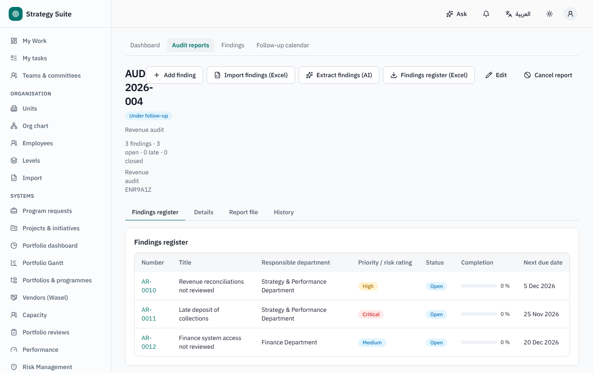
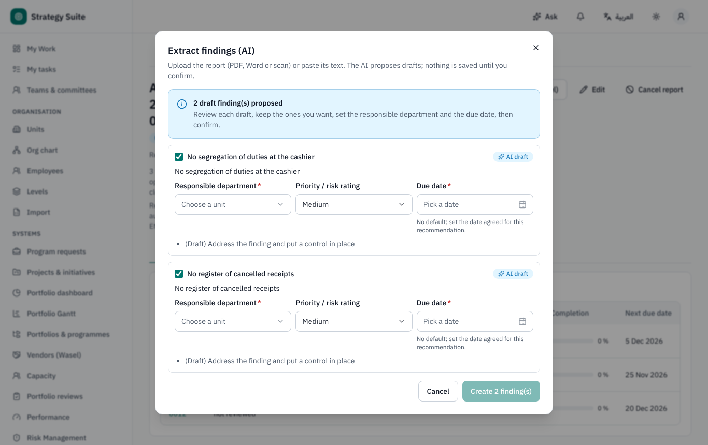
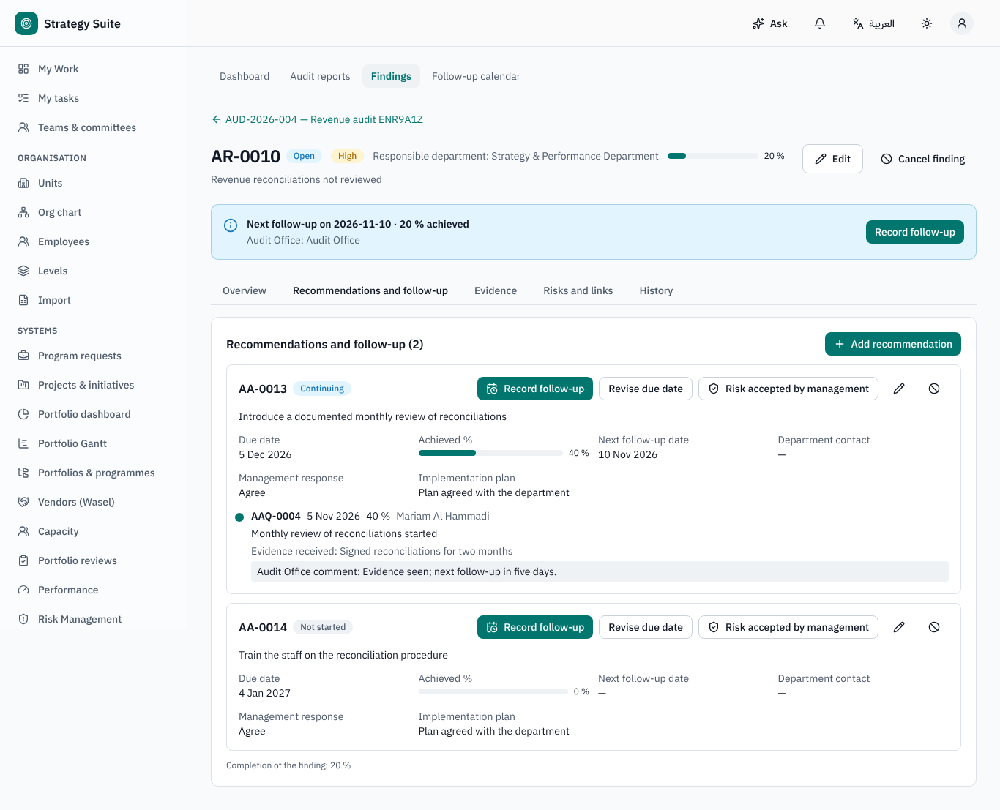
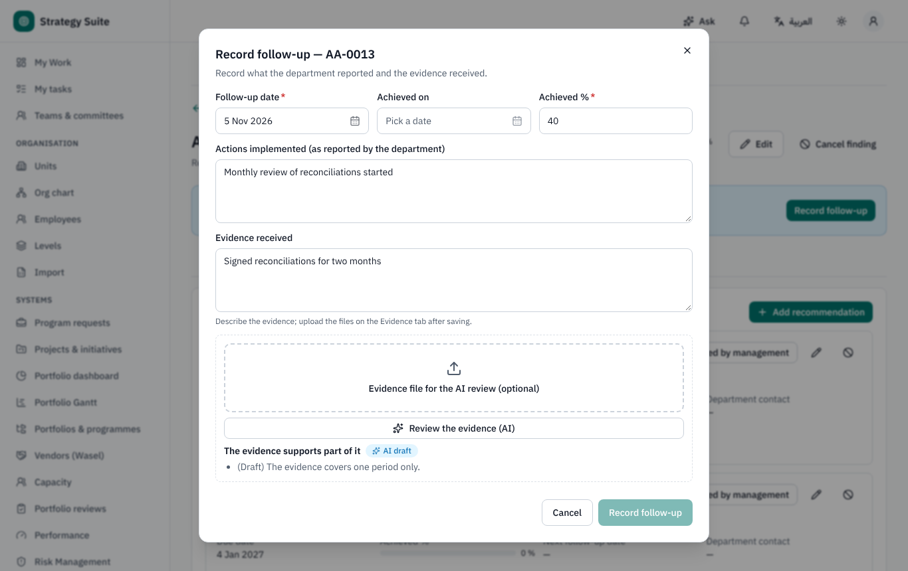
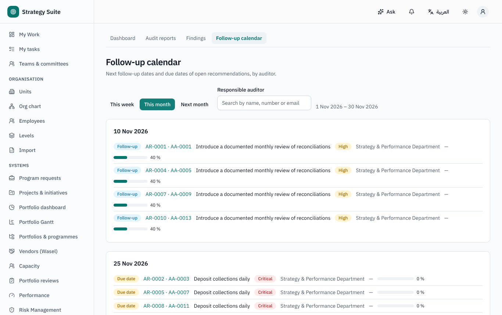
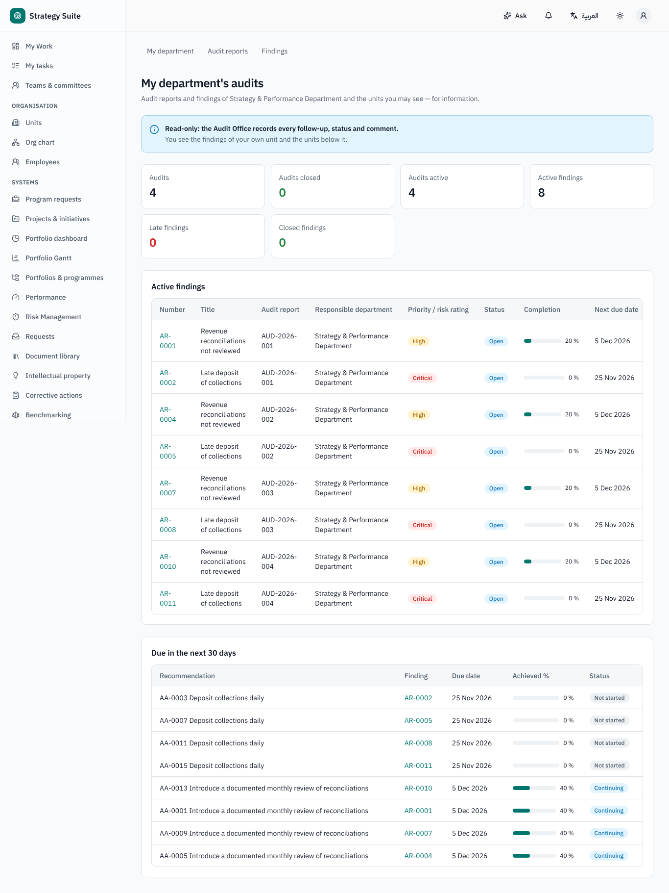
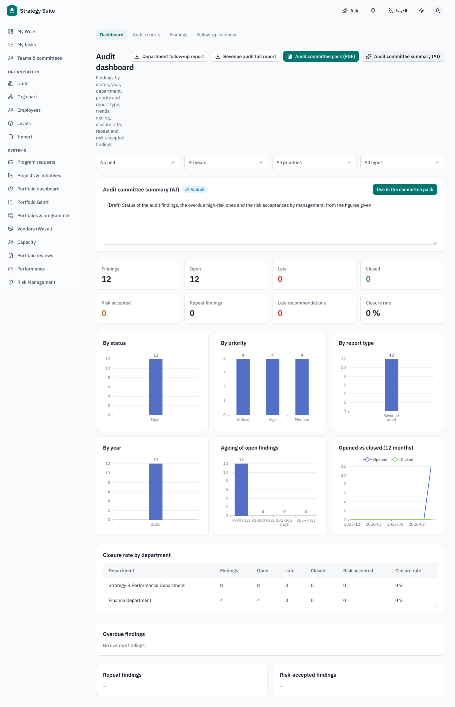
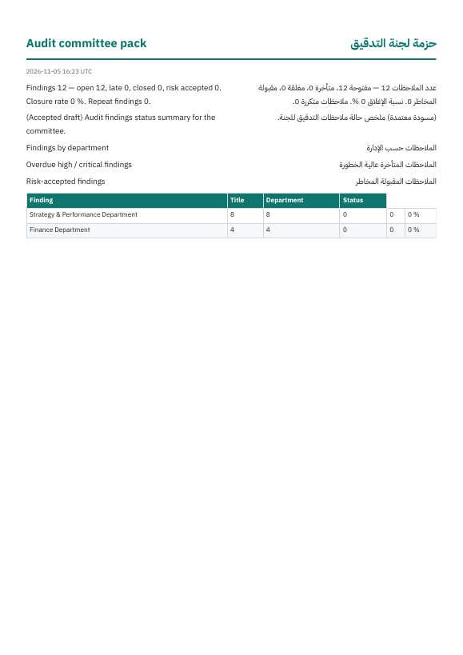
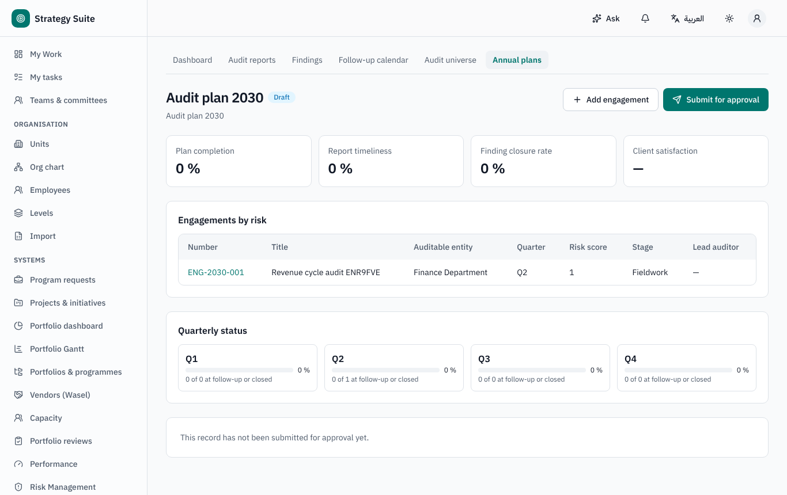
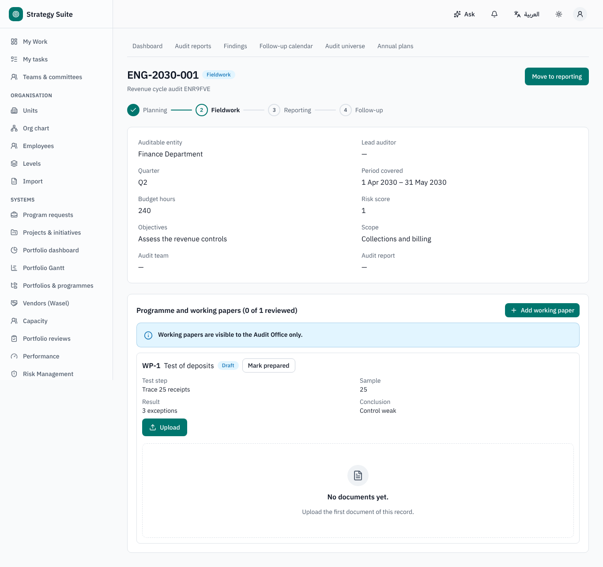

# Audit Management — user guide

For the Audit Office (auditors, Chief Audit Executive), department users and the audit committee. Arabic version:
[`../ar/user-audit.md`](../ar/user-audit.md).

Sidebar → **Audit management**: **Dashboard**, **My department**, **Audit reports**, **Findings**, **Follow-up calendar**; with the full
audit lifecycle switched on also **Audit universe** and **Annual plans**.

**Only the Audit Office writes** (reports, findings, recommendations, follow-ups). Department users read the findings of their own
department; the audit committee reads everything.

## 1. Audit reports and findings (Audit Office)

1. **Audit reports → New audit report**: type, year, audited units, distribution list, report file.
2. Add findings to the **Findings register**: condition, criteria, cause, effect, priority, responsible department, expected closing date,
   and **recommendations** (each with an owner and due date). Two shortcuts:
   - **Import findings (Excel)**: **Download the template**, fill it, **Validate** (row-by-row report), **Import**;
   - **Extract findings (AI)**: upload the report file or paste its text → **Propose findings** → review the drafts → **Create … finding(s)**.
3. **Issue report**: the distribution list is notified. The report status then follows its findings: *Draft · Issued · Under follow-up ·
   Closed · Cancelled*.

## 2. Following up recommendations

- **Record follow-up** on a recommendation: follow-up date, achieved date, %, actions implemented, evidence (text and files), comment, and
  the **next follow-up date** (required below 100 %). AI can review the evidence.
- With *internal review of follow-ups* on, the follow-up waits for the Chief Audit Executive's approval before it applies.
- Statuses are derived: recommendation *Not started · Continuing · Late · Completed*; manual *Risk accepted* (justification and reference),
  *Cancelled* (reason); **revise the due date** (new date and reason; the original is kept). Finding: *Open · Late · Closed · Risk
  accepted · Cancelled*.
- Reminders go to the responsible auditor before the next follow-up and before due dates; a late notice when a recommendation turns late;
  department notices when configured.
- **Follow-up calendar**: this week / this month, by auditor, overdue.

## 3. Links with other systems

On the finding's **Risks and links** tab: link risks and controls (Risk Management), a document (Document Registry), mark *repeat* findings,
send improvement observations to the Corrective Action Plan, create a team. Audit KPIs (closure rate, overdue findings, plan completion,
report timeliness, client satisfaction) can be published to Performance Management.

## 4. Department view

**My department**: your unit's audits (total, closed, active), active findings with status and completion, the last Audit Office comment
and what is due soon — read-only.

## 5. Dashboard and reports

**Dashboard**: by status, year, department, priority and report type; open vs closed trend; overdue and ageing; closure rate by department;
repeat findings; risk accepted. Reports: findings register per report, department follow-up report, full audit report, and the **audit
committee pack** (PDF / Excel); **Audit committee summary (AI)** can be accepted into the pack.

## 6. Full audit lifecycle (optional, *Full audit lifecycle (layer 2)* feature, off by default)

Audit universe, the **annual plan** (prioritised by risk and last audit; submitted to the audit committee for approval; quarterly status),
and **engagements** with stages *planned → planning → fieldwork → reporting → follow-up → closed* (objectives, scope, team, programme and
working papers, the report, a survey) plus a QAIP panel.

## 7. Who can do what (defaults)

| Role | Can |
|---|---|
| Audit Office | everything: reports, findings, recommendations, follow-ups, imports, AI extraction, links, settings |
| Chief Audit Executive | as the Audit Office, plus approving follow-ups when review is on |
| Department user (everyone) | read their department's findings (403 on any change) |
| Audit committee | read all, dashboard, exports, AI summary; approve the annual plan |
