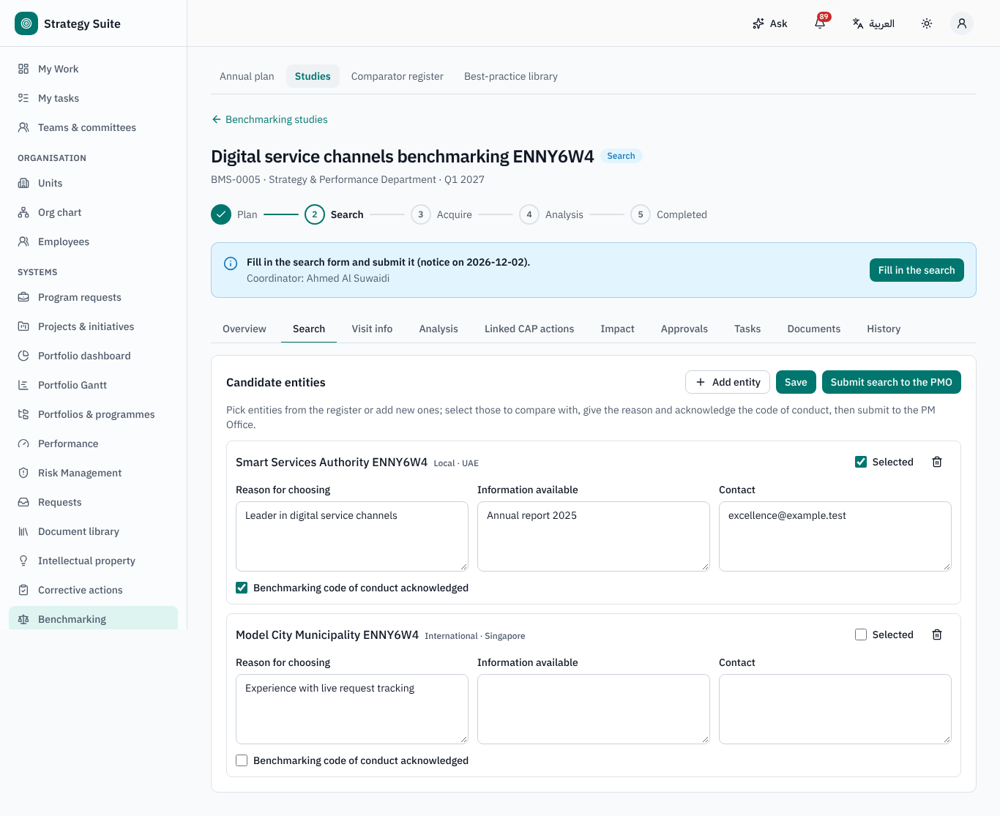
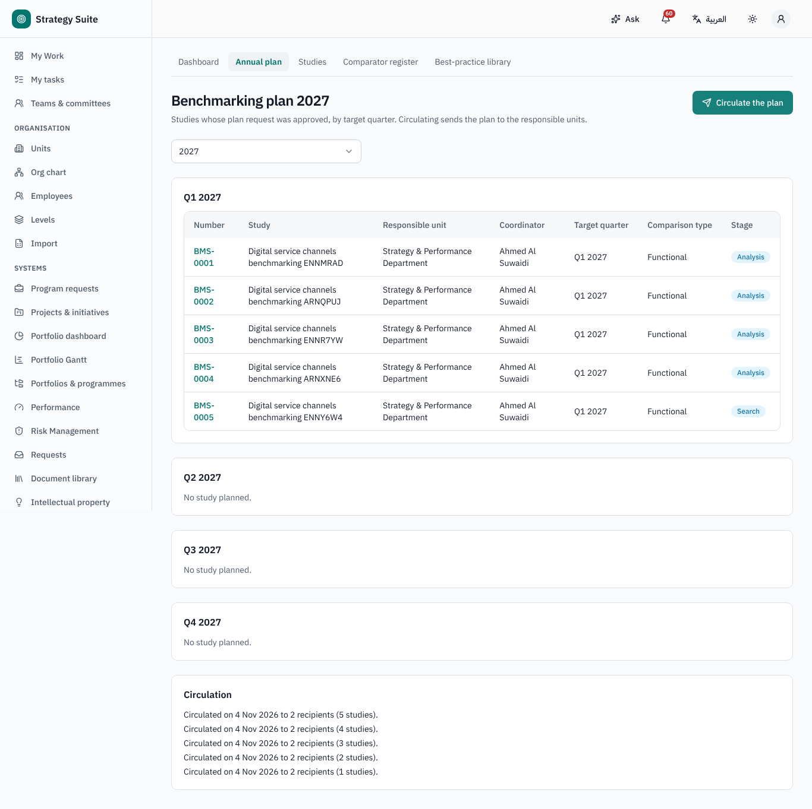
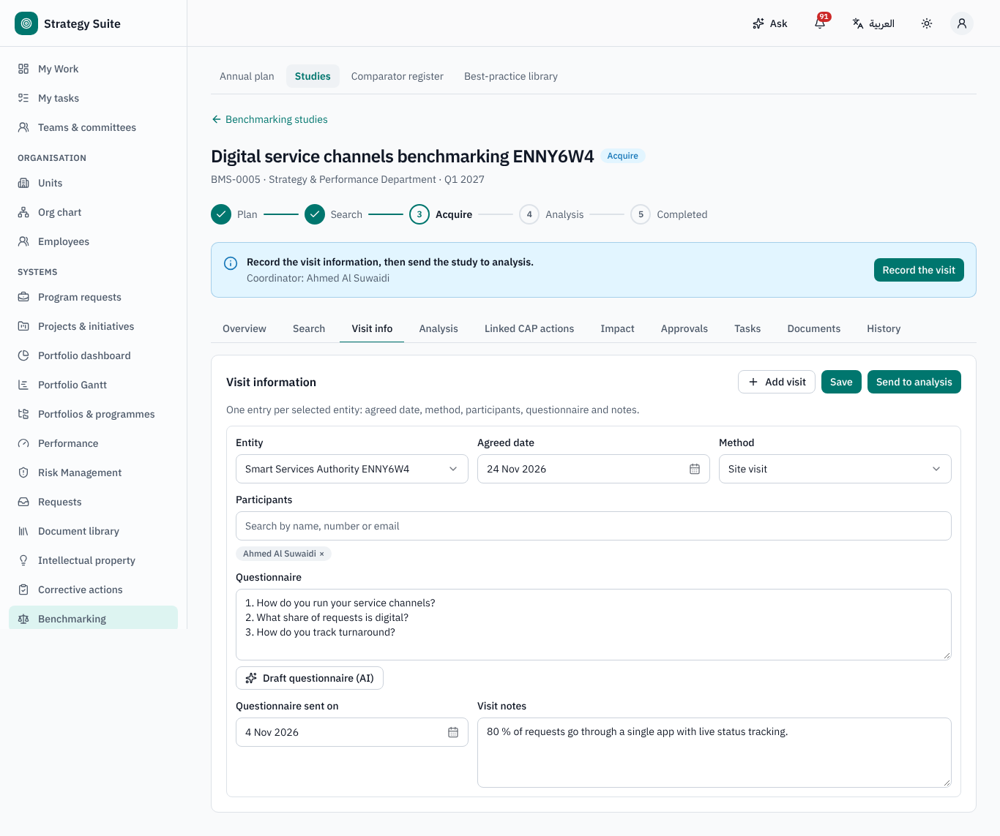
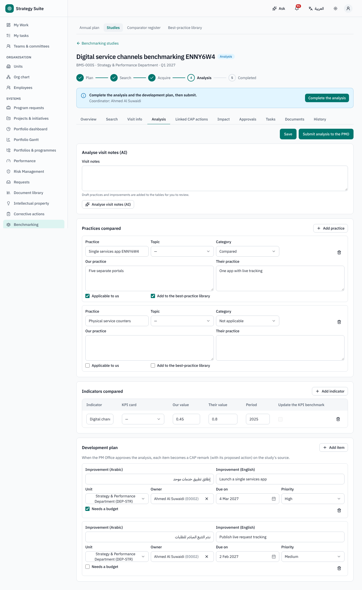
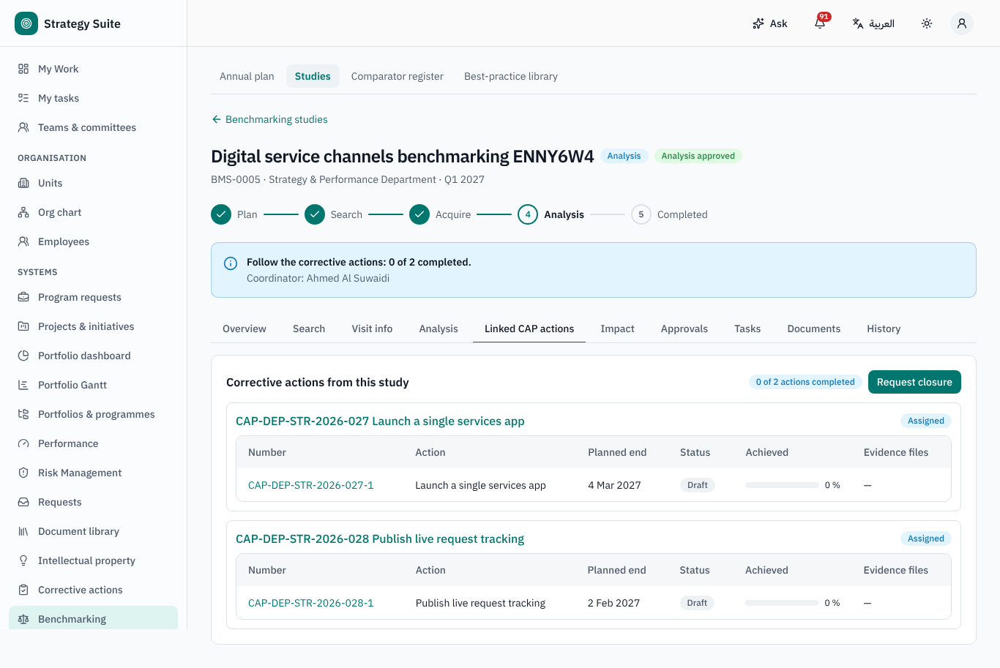
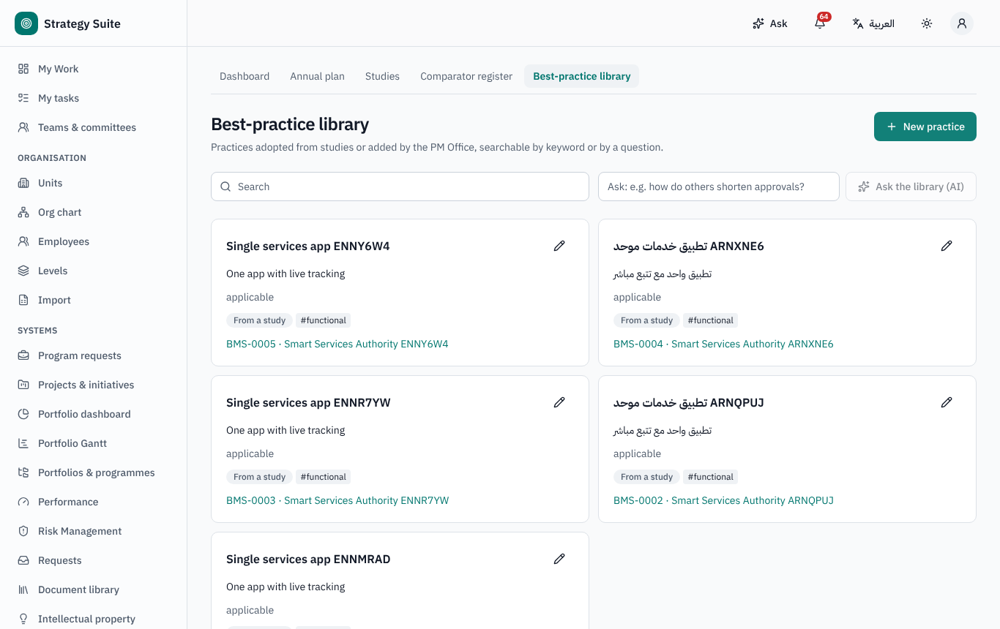
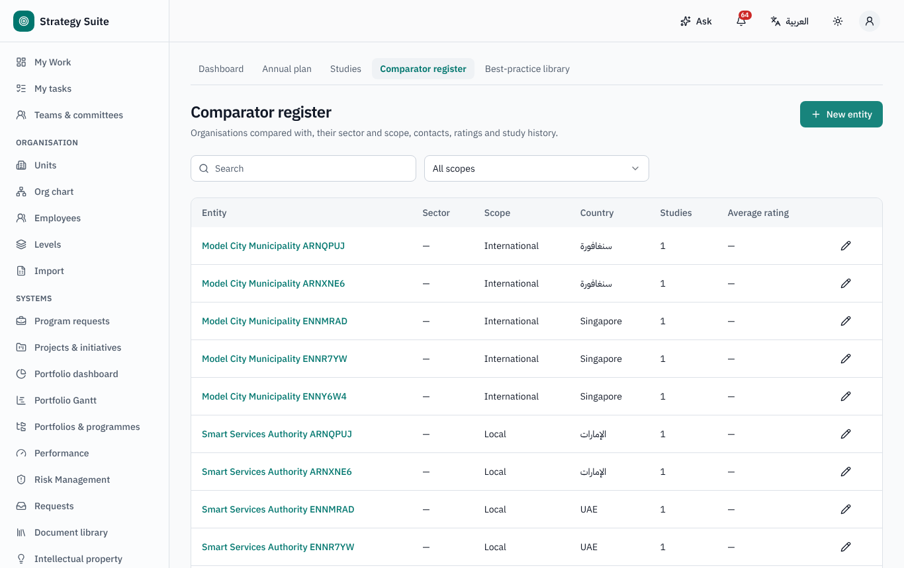

# Benchmarking — user guide

For study requesters and coordinators, topic owners and the PM Office (benchmarking office). Arabic version:
[`../ar/user-benchmarking.md`](../ar/user-benchmarking.md).

Sidebar → **Benchmarking**: **Dashboard**, **Annual plan**, **Studies**, **Comparator register**, **Best-practice library**.

## 1. Stages of a study

*Plan › Search › Acquire › Analysis › Completed* — each gate is approved by the PM Office.

| Stage | Who fills | Gate |
|---|---|---|
| **Plan** | requester: the *benchmarking request* in the Request catalogue | PM Office approves the request → study `BMS-0001` joins the annual plan |
| **Search** | coordinator: candidate entities, reasons, contacts, available information, outreach log | **Submit search to the PMO** → approval |
| **Acquire** | coordinator: visit information (date, method, participants, optional team, pre-visit questionnaire) | **Send to analysis** (at least one visit with date and method) |
| **Analysis** | coordinator: practice comparisons, indicator comparisons, **development plan** (at least one item with owner and due date) | **Submit analysis to the PMO** → approval creates CAP remarks |
| **Completed** | — | **Request closure** → PM Office approves when every linked CAP action is completed with evidence |

Study status: *Active · Completed · Cancelled* (the PM Office may cancel with a reason).

## 2. Requesting a study (Plan)

Request catalogue → benchmarking request: titles in Arabic and English, responsible unit and section, responsible employee (coordinator),
target year and **quarter**, comparison type (internal, competitive, functional, generic), purpose, scope and the **comparison topics**
(topic, owner, description). Submit → PM Office approval. Returned → correct and resubmit; rejected → cancelled.

## 3. Annual plan

**Annual plan**: approved studies by year → quarter → unit with their stage. The PM Office can **Circulate the plan** to the heads of all
units and the coordinators (recorded each time). **30 days before the study's quarter** (configurable, working or calendar days) the
coordinator and the unit head are reminded to fill the search.

## 4. Search, visit and analysis

- **Search** tab: pick comparators from the **Comparator register** or add new ones; AI can suggest comparators.
- **Visit info** tab: visits and the questionnaire (AI can draft it).
- **Analysis** tab: practice rows (mark *add to library*), indicator rows (pick a KPI card; *update the KPI benchmark*), the development
  plan. AI can turn visit notes into comparisons and a gap analysis — as a draft.

## 5. After analysis approval

- One **CAP remark** per development-plan item is created in the Corrective Action Plan (with a proposed action pre-filled); the
  **Linked CAP actions** tab shows their progress live.
- Practice rows marked for the library become **best practices**; indicator rows marked so update the KPI card's benchmark.
- When all actions are completed you are notified; **Request closure** → approval → *Completed*.
- **Impact** follow-up after closure (default 6 months): **Record the impact** (implemented, KPIs moved, notes).

## 6. Comparator register and best-practice library

- **Comparator register**: every external entity with its studies and average rating.
- **Best-practice library**: full-text and natural-language search by title, description, topic and tags; filter by sector and topic.

## 7. Who can do what (defaults)

| Role | Can |
|---|---|
| Participant (everyone) | request a study, read own studies, the plan, the register and the library |
| Coordinator (record role) | fill search, visit and analysis; request closure |
| Topic owner | read the study and its CAP remarks |
| PM Office (benchmarking office) | approve every gate, circulate the plan, cancel, manage the register and library |
