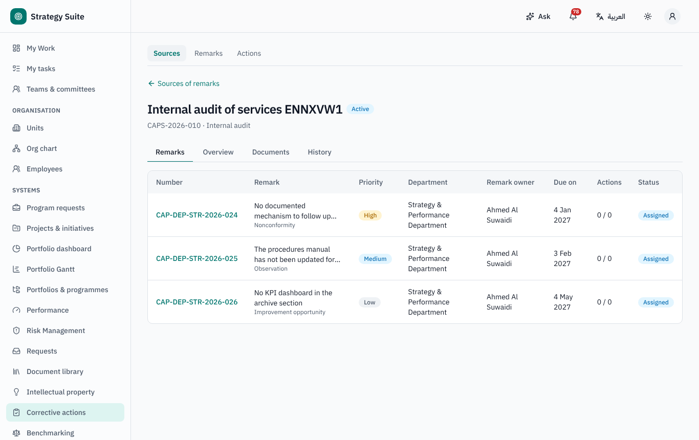
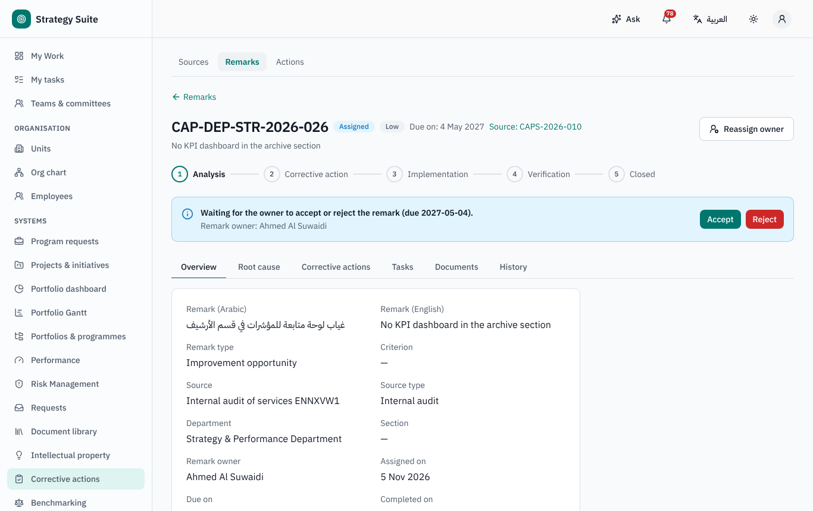
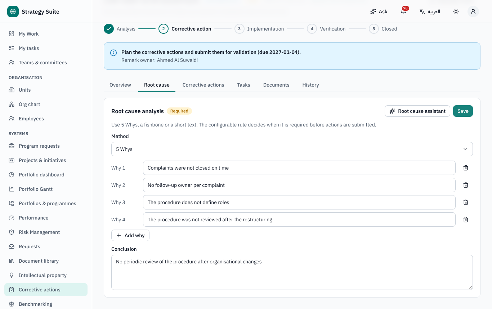
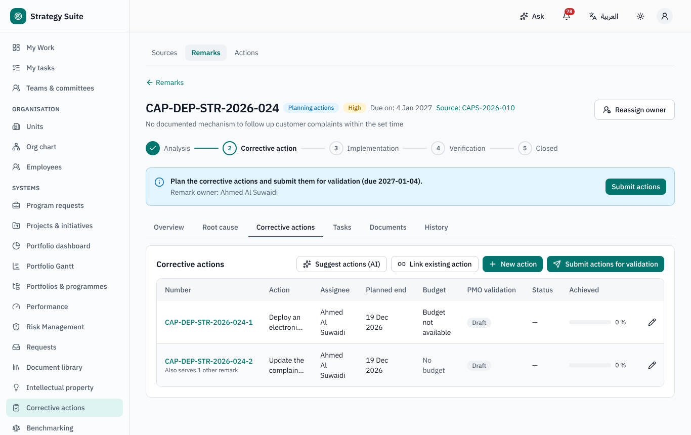
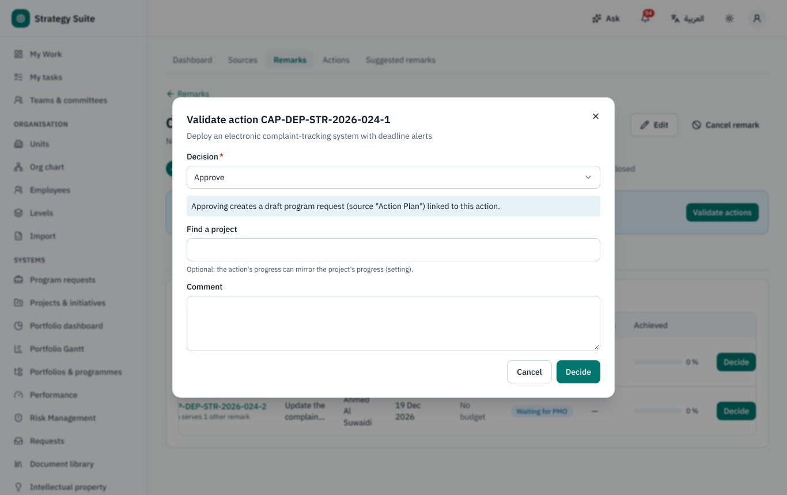
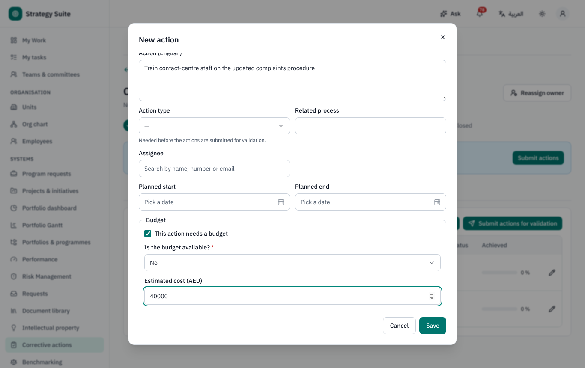
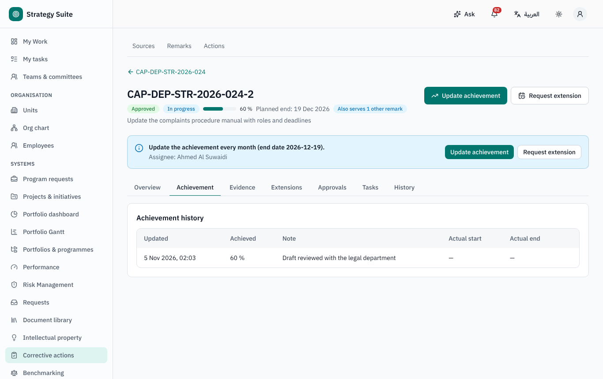
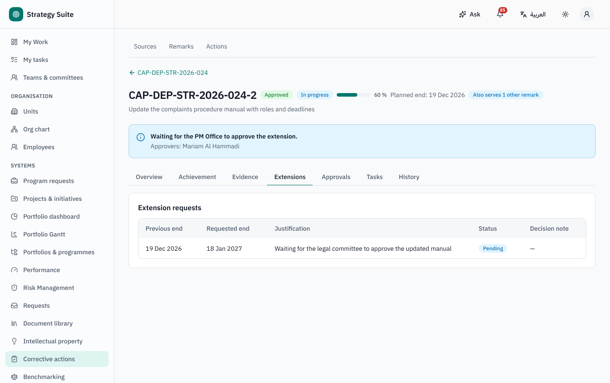
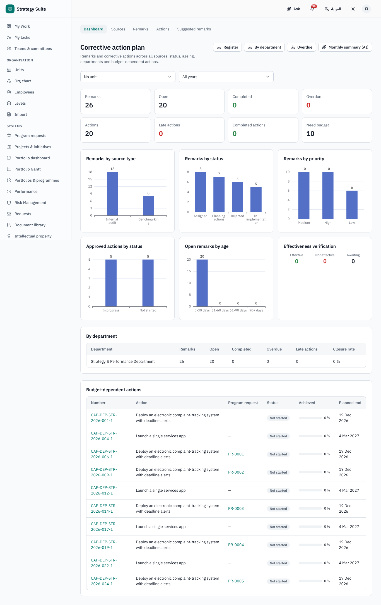

# Corrective Action Plan (CAP) — user guide

For remark owners (section / department heads), action assignees and the PM Office (the only validator). Arabic version:
[`../ar/user-cap.md`](../ar/user-cap.md).

Sidebar → **Corrective actions**: **Dashboard**, **Sources**, **Remarks**, **Actions**, **Suggested remarks**.

## 1. How it works

A **source** (an audit report, a benchmarking study, a customer complaint, a KPI that missed its target, a risk event…) holds **remarks**.
Each remark has an owner who accepts it, analyses the root cause and plans **corrective actions**; the PM Office validates the actions;
assignees implement them with evidence; the remark closes when every approved action is completed.

Remark stages: *Analysis › Corrective action › Implementation › Verification › Closed*.
Remark statuses: *Assigned · Rejection pending · Planning actions · In validation · Returned for correction · In implementation ·
Verification · Completed · Rejected · Cancelled*.

Remarks also arrive automatically from other systems: Benchmarking (development-plan items), Audit Management (improvement observations, when
configured), KPI targets missed and risk events / ineffective controls (when configured; they appear first in **Suggested remarks**, where
the PM Office raises or dismisses them).

## 2. Creating sources and remarks (PM Office)

**Sources → new source**: title, type, received date, owner, documents, optional team. **Add remark**: text (AR / EN), criterion, type,
priority, department and section, owner (defaults to the head of the section, else of the department). The **due date** = assigned date +
days for the priority (Settings → CAP). AI can **extract remarks from a report**.

## 3. Responding to a remark (owner)

1. You are notified. **Accept**, or **Reject** with a reason (final, unless the PM Office must confirm rejections — then *Rejection
   pending* until **Confirm rejection** or **Send back**).
2. **Root cause** tab: 5 Whys (up to 7), fishbone categories (people, process, equipment, materials, environment, management) or free text,
   attachments; required before submitting when your organisation says so. AI can help.
3. **Corrective actions** tab: new actions (details, type, assignee, planned dates, budget questions: required? available? estimated cost)
   or **Link existing action** of another remark (AI checks for duplicates).
4. **Submit actions** → each action goes to PM Office validation.

## 4. Validation (PM Office)

**Validate actions** shows all actions of a remark side by side: approve, reject or return (comment) each one; optionally link a project.
**Budget routing**: an approved action that needs a budget that is not available, and has no project, creates a **draft Program Request** in
Portfolio automatically (the action shows its badge; with *mirror project progress* on, the project's progress is copied to the action).

After validation the remark moves on: any action still waiting → *In validation*; any returned → *Returned for correction*; all rejected →
back to *Planning actions*; otherwise *In implementation*.

## 5. Implementing an action (assignee)

- Monthly reminder with your actions. **Update achievement**: %, actual start / end, note (history kept).
- Past the end date below 100 % → *Late*; you and the remark owner are notified; the PM Office after some working days.
- **Request extension** (new end date and justification) → PM Office approval → revised end date (the original is kept).
- At 100 % with at least one evidence file → **Request completion** → PM Office approval → *Completed*.
- When every action is completed the remark is *Completed* — or goes to **Verification** first (effectiveness check after N months,
  when switched on): **Verify effectiveness** → completed, or not effective → reopened with new actions.

## 6. Dashboard and reports

**Dashboard**: remarks by source type, department, status and priority; actions by status; overdue and ageing (0–30, 31–60, 61–90, > 90
days); closure rate per unit; budget-dependent actions; effectiveness results. **Reports**: action plan register by source, departmental
plan, overdue actions (PDF / Excel, bilingual).

## 7. Who can do what (defaults)

| Role | Can |
|---|---|
| Everyone | open CAP and see remarks they own and actions assigned to them |
| Remark owner (record role) | accept / reject, root cause, plan and submit actions, reassign |
| Action assignee | update achievement, request extension and completion |
| Source viewers (e.g. benchmarking coordinator) | read the remarks of their source |
| PM Office | sources and remarks, validation, confirmations, cancellations, settings |
