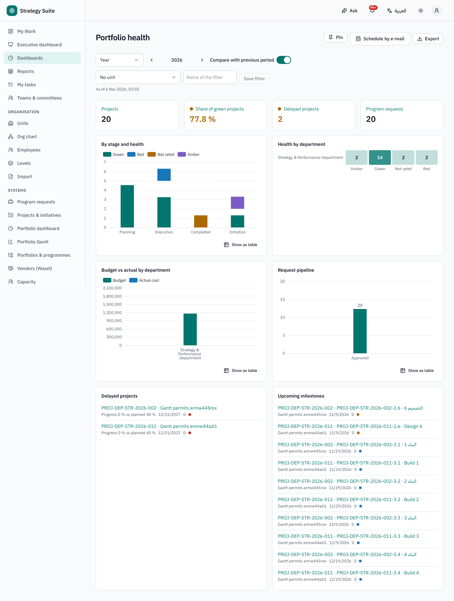
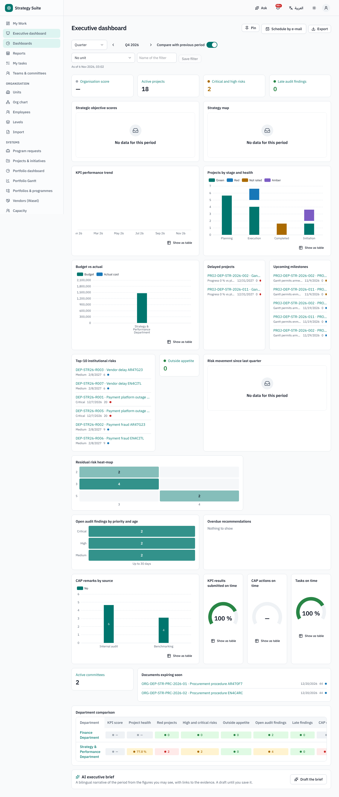
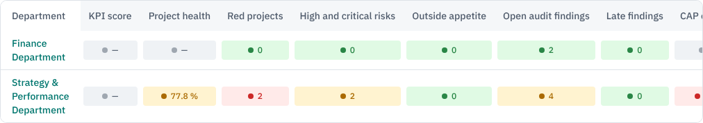
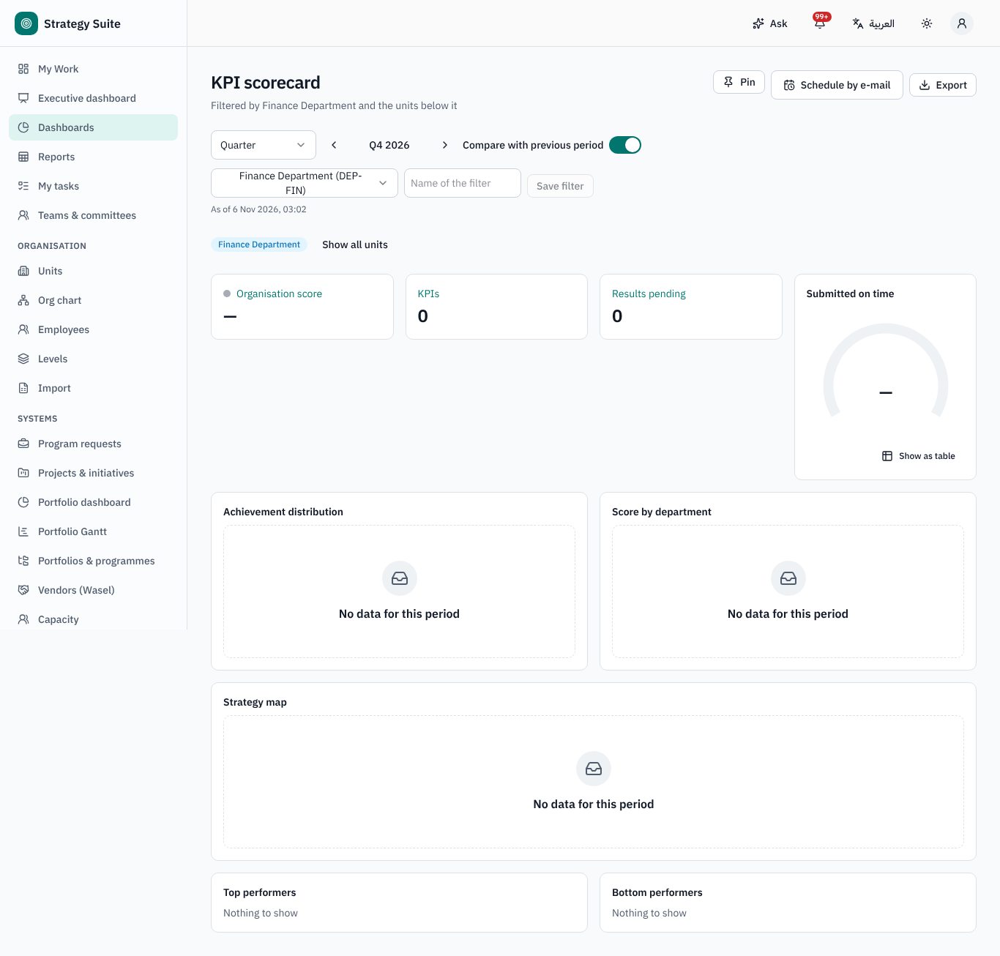
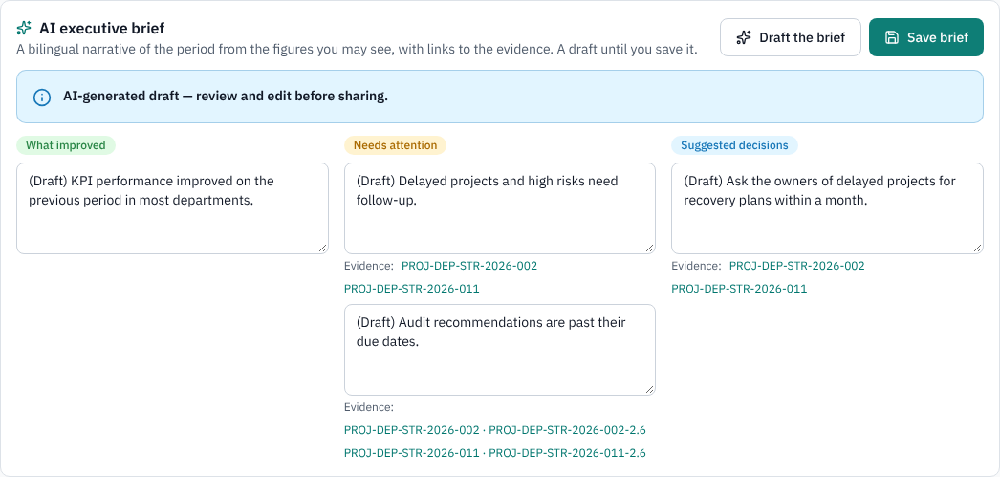
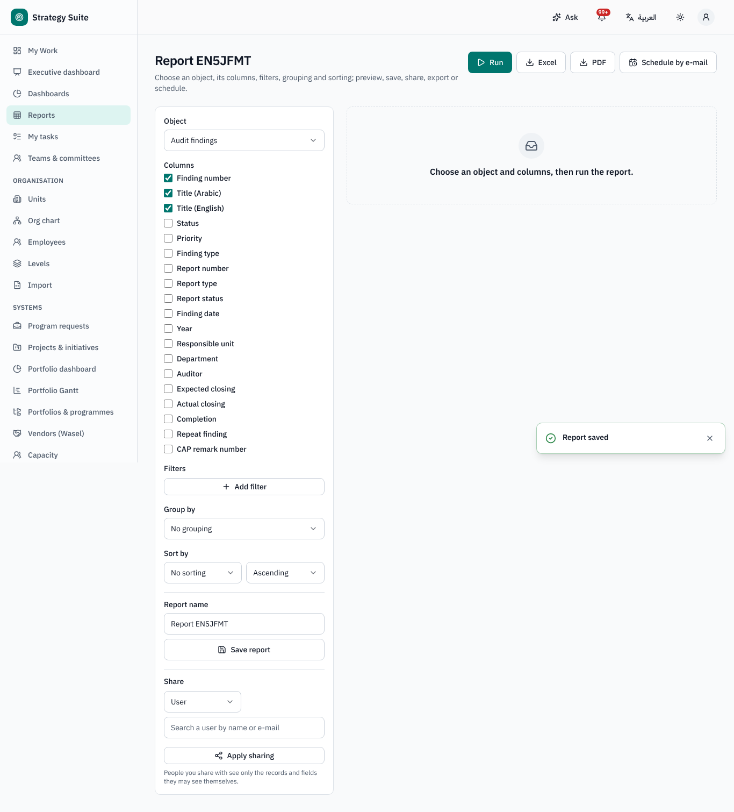
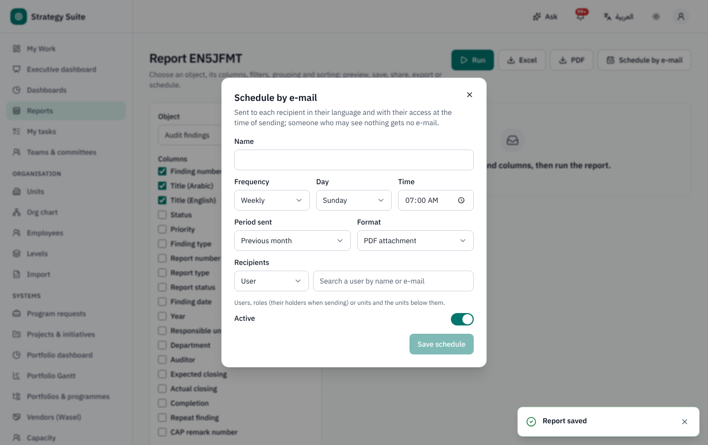
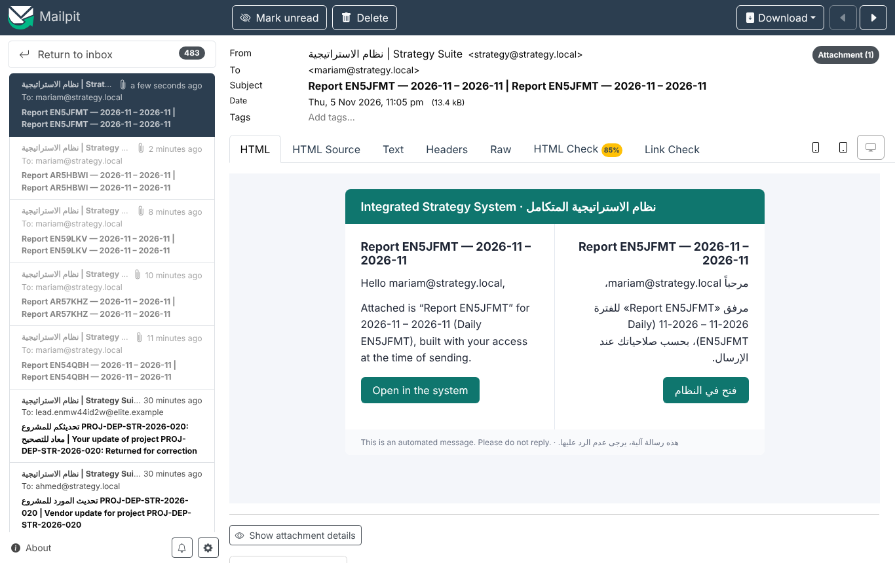
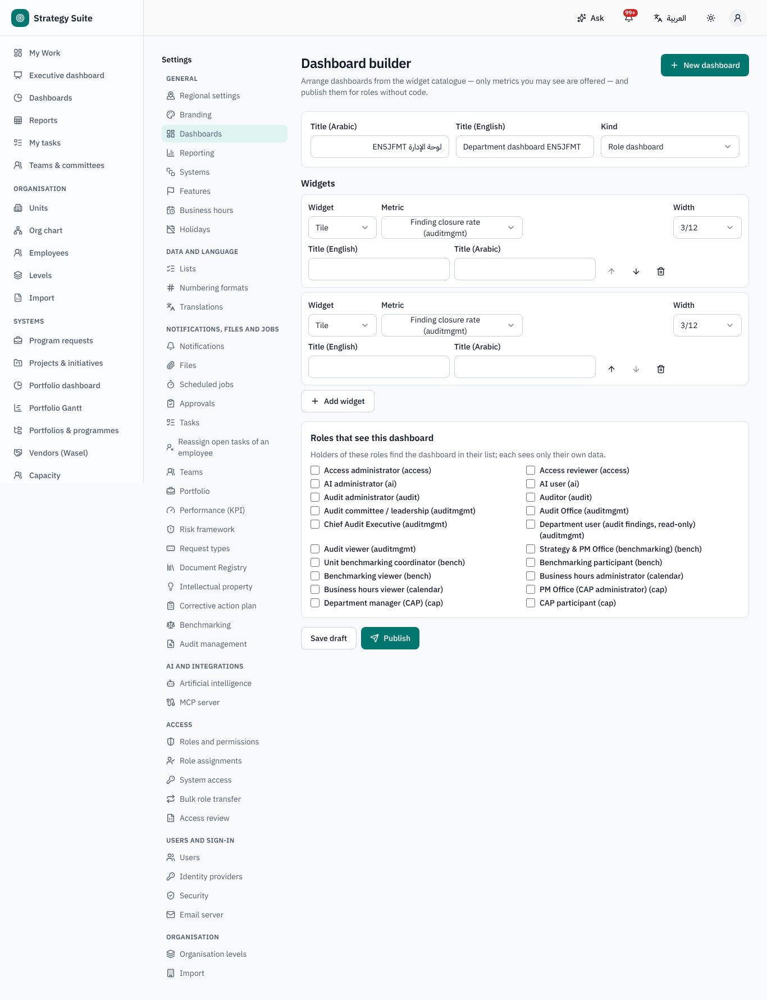

# Dashboards and reports — user guide

For everyone who reads dashboards, report authors, executives and dashboard administrators. Arabic version:
[`../ar/user-dashboards.md`](../ar/user-dashboards.md).

Sidebar: **Dashboards**, **Executive dashboard** (leadership), **Reports**. Every figure respects your access: the same dashboard shows
different numbers to different people, and a figure you may not see is shown as *Not available* — never as zero.

## 1. Four levels

| Level | What | Where |
|---|---|---|
| 1 — **My Work** | your pending approvals, tasks and due items from every system | home page ([guide](user-my-work.md)) |
| 2 — **Role dashboards** | operational views inside each system: PM project dashboard, portfolio dashboard, KPI pending results, risk heat-maps, audit follow-up calendar, team evaluations, CAP validation queue… | each system's own *Dashboard* page |
| 3 — **System dashboards** | the management view of one system (portfolio health, KPI scorecard, risk profile, audit closure, CAP closure, document library, IP register, benchmarking plan, team evaluations, task performance…) | **Dashboards** → choose a system; also linked from each system |
| 4 — **Executive dashboard** | one cross-system page for the Director General and leadership | **Executive dashboard** |

## 2. Reading a dashboard

- **Period**: *Month*, *Quarter*, *Year* or *Custom range* (whole months), with **Previous period** / **Next period**, and *Compare with
  previous period* (arrows and deltas follow whether higher is better). Figures that describe a state (e.g. open risks) show the state at
  the end of the period; figures that count events (e.g. approvals) add up the months.
- **Unit filter** ("Filtered by *unit* and the units below it", **Show all units**), system-specific filters, **Saved filters**.
- *As of …* tells you when the figures were last refreshed (changes appear within about a minute; a full refresh runs every 10 minutes).
- **Every figure is clickable**: figure → the system dashboard filtered to the unit and period → the records.
- Charts have **Show as table** (accessible alternative); **Export** → PDF, Excel or Image (PNG).
- **Pin** a dashboard to show it on My Work.

## 3. The executive dashboard

- **Strategy performance**: organisation and objective scores from KPIs (capped performance), trend, the strategy map coloured by
  performance.
- **Portfolio**: projects by stage and health, budget vs actual, delayed projects, upcoming milestones.
- **Risk**: Top-10, critical and high risks, outside appetite, movement since the previous period.
- **Governance**: open audit findings by priority and age, overdue recommendations, CAP remarks by source.
- **Organisation health**: on-time rates of KPI submissions, CAP actions and tasks; active committees; documents expiring.
- **Department comparison**: one row per department (KPI score, project health, risks, audit findings, CAP closure, overdue tasks)
  coloured with the limits set in Settings → Reporting. Click a cell to drill down.
- **AI executive brief** (when AI is on): **Draft the brief** → *What improved*, *Needs attention*, *Suggested decisions*, each with links to
  the **Evidence**. It is an AI-generated draft built only from what you may see; edit it and **Save brief** to keep it for the period.

## 4. Report builder

**Reports → New report** (report authors):

1. **Object**: projects, milestones, program requests, KPI cards and results, risks and treatment actions, teams and evaluations, tasks,
   documents, IP records, benchmarking studies, CAP remarks and actions, audit findings and recommendations, requests.
2. **Columns**, **Filters** (**Add filter**: field, condition, value; relative dates such as "this quarter"), **Group by** (up to two
   levels, with counts / sums / averages), **Sort by**.
3. **Run** (paged preview), export **Excel** (right-to-left sheet in Arabic) or **PDF** (bilingual).
4. **Save report**, **Share** with users, roles or units.

Security: fields you may not see (e.g. budgets without cost access, masked personal data) are removed from the columns and refused in
filters, grouping and sorting. A shared report always runs **with the rights of the person running it**, not the author's.

## 5. Scheduled e-mails

On a dashboard or a report: **Schedule by e-mail** → name, **Frequency** (daily at a time, weekly on a day, monthly on a day), **Period
sent** (previous / current month, quarter or year), **Format** (PDF, Excel or a link only), **Recipients** (users, role holders, units).
Each recipient receives the content **built with their own permissions, in their own language**; someone who may see nothing receives
nothing. **Schedules** lists your schedules with next / last run and the **Deliveries**.

## 6. Building dashboards (administrators)

**Settings → Dashboards** (or **Dashboards → Dashboard builder**): **New dashboard** → titles (AR / EN), kind, **Add widget** (*Tile*, *Bar
chart*, *Line chart*, *Bubble chart*, *Heat-map*, *Table*, *List*, *Strategy map*, *Department comparison*, *Gauge*, *AI executive brief*)
with a **Metric** or a **List**, **Break down by** / **Then by**, width and order; **Roles that see this dashboard**; **Save draft** and
**Publish** (new versions; the seeded system and executive dashboards can be edited, and re-seeding never overwrites an edited copy). The
builder only offers metrics the builder may see, and viewers always see their own scope.

