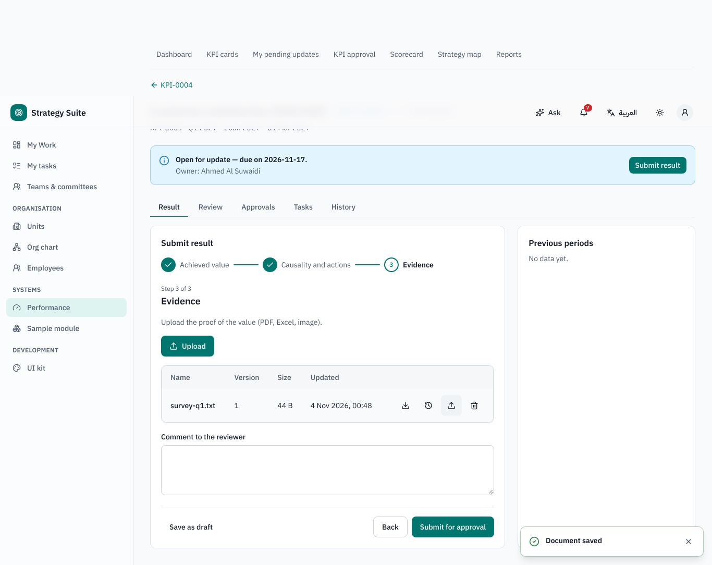
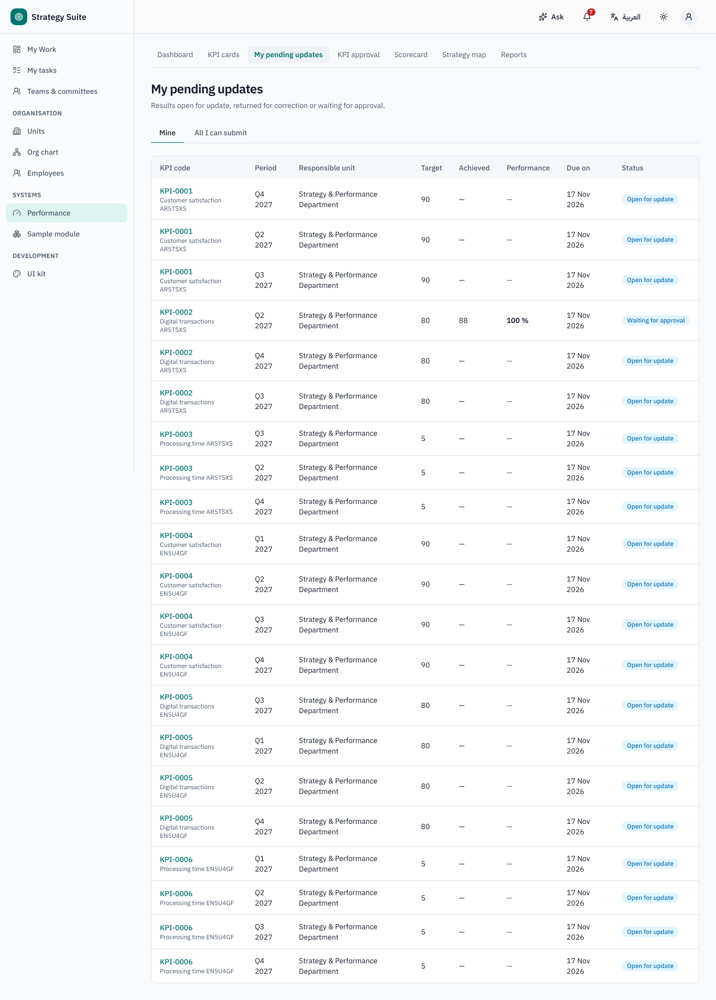
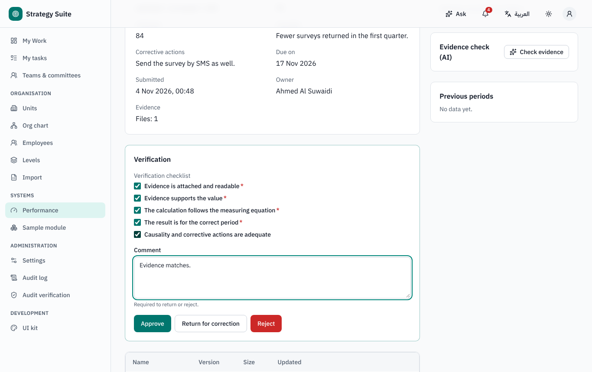
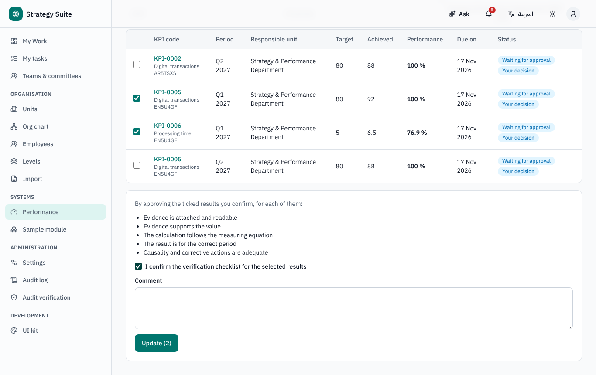
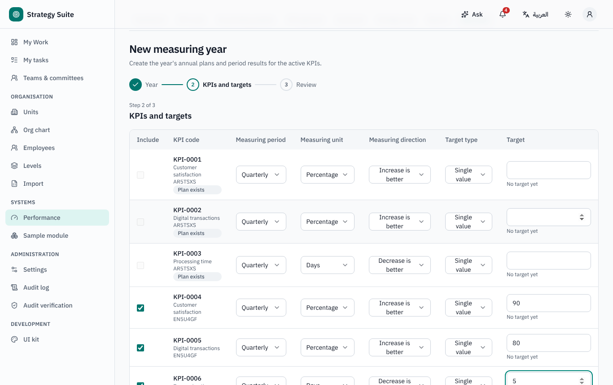
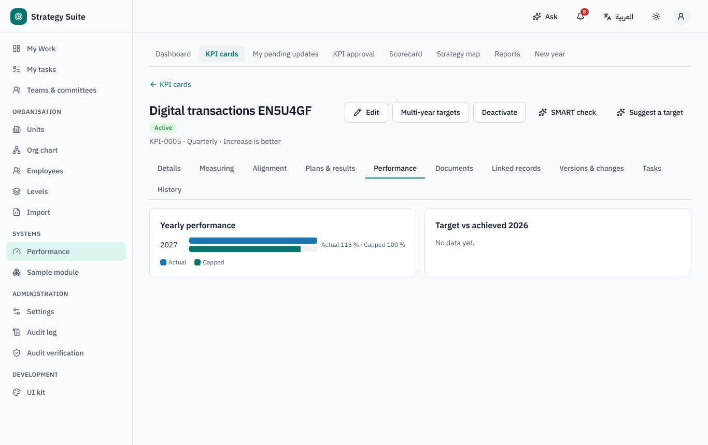
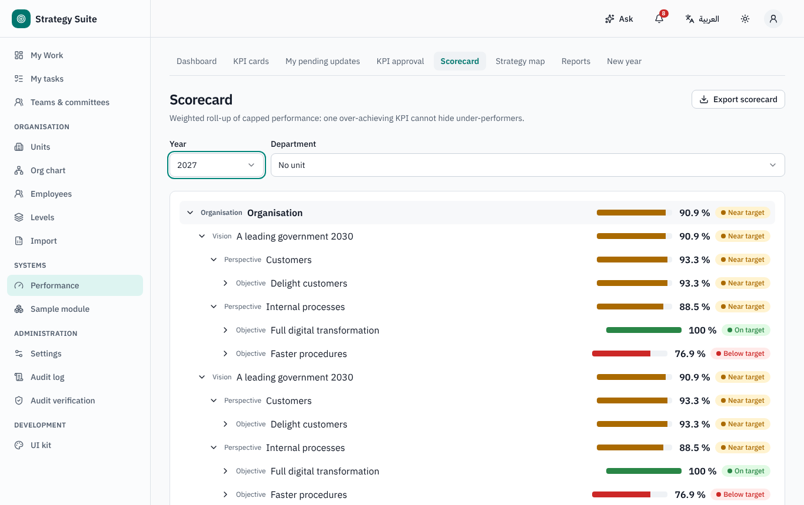
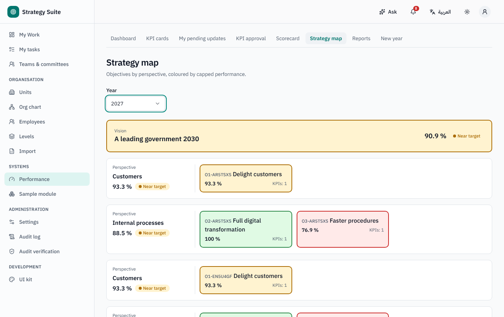

# Performance Management (KPI) — user guide

For KPI owners (responsible employees), department managers and the Strategy Office / PMO. Arabic version:
[`../ar/user-kpi.md`](../ar/user-kpi.md).

Sidebar → **Performance**: **Dashboard**, **KPI cards**, **My pending updates**, **KPI approval**, **Scorecard**, **Strategy map**,
**Reports**, **New year** (Strategy Office).

## 1. Concepts

| Term | Meaning |
|---|---|
| **KPI card** | the definition: code, name, responsible unit and employee, period (quarterly, half-yearly, annual, two-year), direction (higher / lower is better, range), target type, unit, equation, measuring method, alignment to a strategic objective, baseline and benchmark |
| **Annual plan** | one per card and measuring year, with the period targets |
| **Result** | one per period of the year; the owner submits it, the Strategy Office approves it |
| **Performance** | *actual* (can exceed 100 %) and *capped* (at most 100 %, used in every roll-up so one over-achieving KPI cannot lift a score above 100 %) |
| **RAG** | *On target* (capped ≥ 95 %), *Near target* (≥ 80 %), *Below target*, *Not reported* — bands configurable, also per KPI |

## 2. Submitting a result (KPI owner)

1. A period **opens the day after it ends** (default, Q-K2): e.g. Q1 (January–March) opens on 1 April and is **due on 15 April**; the
   half-year opens 1 July; the second half / full year opens 1 January of the next year, due 31 January. You are notified when results open,
   reminded 3 working days before the due date, and notified when overdue (your manager after 2 more working days). Late submission is
   allowed but flagged.
2. **My pending updates** lists your results *Open for update* and *Returned for correction*. Open one → **Submit result**:
   - enter the **Achieved value** (or the data elements of a composite KPI, or the **Scale level** of a qualitative KPI) — the
     performance preview updates as you type;
   - when the target is missed, write the causality and corrective actions (AI can draft them from your notes);
   - attach **evidence** (required when your organisation says so);
   - or tick **Not applicable for this period** (excluded from calculations once approved);
   - **Submit for approval**.
3. You may **Recall** while nobody has decided. A returned result shows the reviewer's comment; correct and submit again.

## 3. Reviewing results (Strategy Office)

- **KPI approval** lists the results waiting for you. **Review and decide**: the reviewer panel shows the **verification checklist**
  (required items must be ticked to approve), the AI evidence check (does the value appear in the evidence, does the period match) and
  anomaly flags (jump compared with the previous period, identical value, implausible value). **Approve** or **Return for correction** /
  **Reject** (both send it back to the owner with a mandatory comment).
- **Bulk approval**: choose year, department and period, tick the results, confirm the checklist once and **Update**; each result is decided
  on its own and the outcome is listed per result.
- Default chain: one step, Strategy Office; your administrator may add a department-manager review step.
- **Reopen** an approved result (reason required); **lock** a period at year end in Settings → Performance → Period windows.

## 4. A new measuring year (Strategy Office)

**New year** wizard: choose the year; every active card is listed with its period, unit, direction, target type and target (from the
multi-year target, else last year's plan). Untick the cards not needed, adjust, **Submit**: plans and results are created (re-running only
adds missing cards). Then review each plan's period targets and **confirm** it (single or bulk) — results open only for confirmed plans
(default).

## 5. Cards, scorecard and strategy map

- **KPI cards**: register with filters; a card has tabs **Details**, **Measuring**, **Alignment**, **Plans & results**, **Performance**
  (yearly actual and capped, period trend), **Documents**, **Linked records** (projects, risks), **Versions & changes**, **Tasks**,
  **History**. With *definition change control* on (default), changes to a card's definition go through an approval and create a new
  version. AI can draft a card from a description with a SMART check.
- **Scorecard**: organisation → perspective → objective → KPI, weighted averages of **capped** performance; department view.
- **Strategy map**: objectives by perspective, coloured by performance.
- **Reports**: data quality per department (on-time rate, rejection rate, evidence completeness), exports; AI quarterly narrative draft.

Annual figures follow the card's measuring method: *sum* (period values and targets added) or *average*.

## 6. Links with other systems

- Projects can link their KPIs to corporate KPIs.
- An approved KPI result is read by Risk Management: key risk indicators (KRIs) linked to the card can trigger a breach and a risk
  reassessment.
- A missed target can create a CAP remark (when configured in Settings → Corrective action plan).
- Benchmarking studies can update a card's benchmark value.

## 7. Who can do what (defaults)

| Role | Can |
|---|---|
| KPI owner (responsible employee) | submit and recall results of own KPIs |
| Department manager | read the department's KPIs (and approve if a review step is added) |
| Strategy Office / PMO | approve, bulk approve, reopen, new year, plans, cards |
| Performance administrator | settings, strategy hierarchy, measuring methods |
| Everyone (default) | open Performance and see the KPIs they are responsible for |
