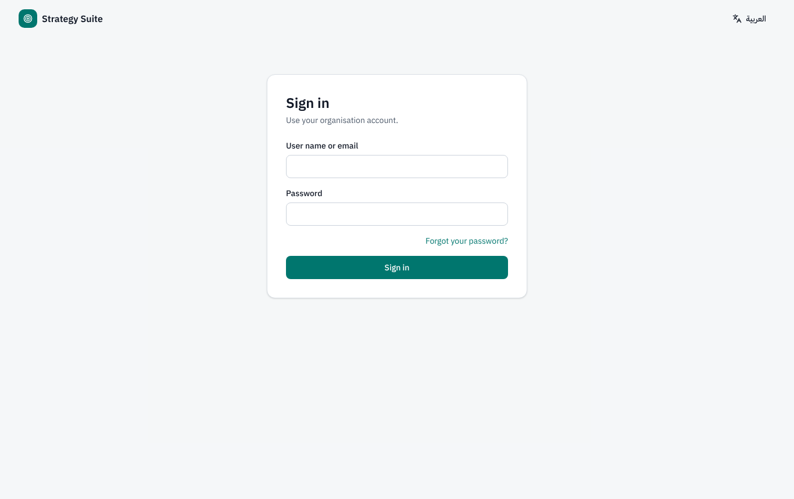
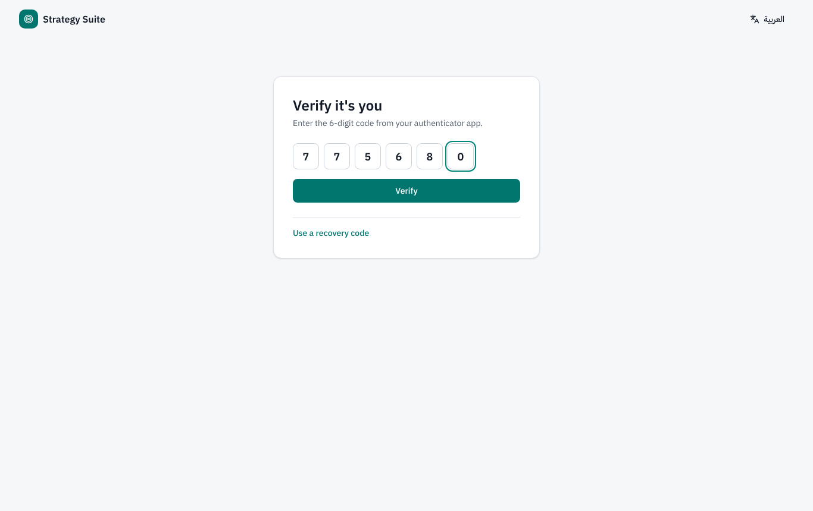
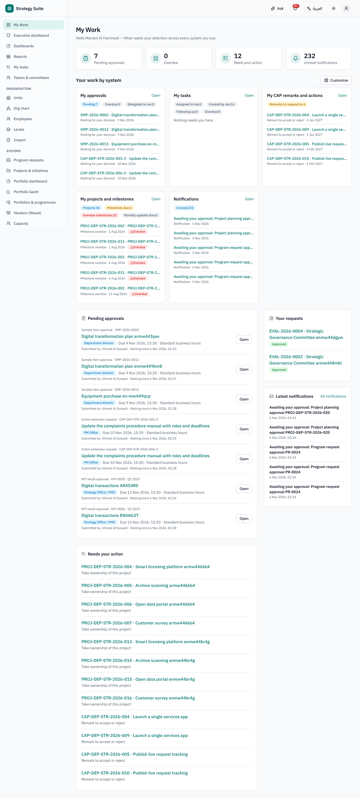
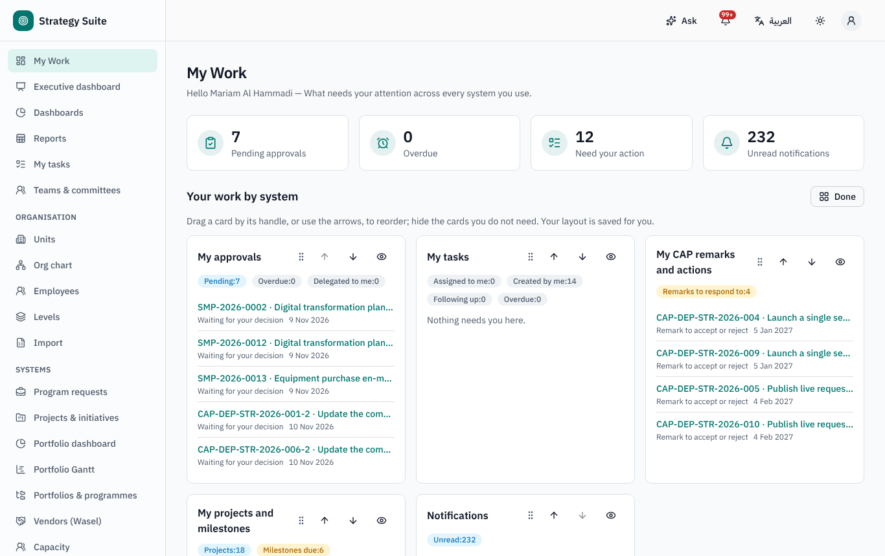
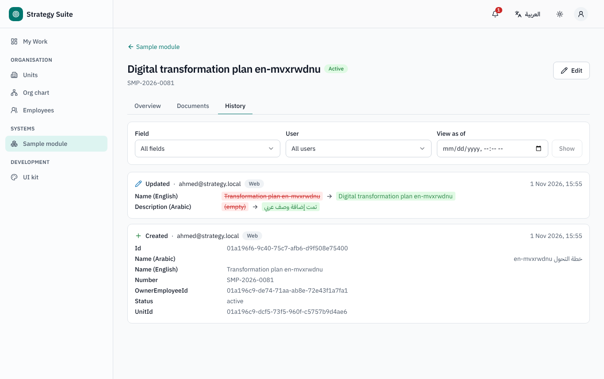
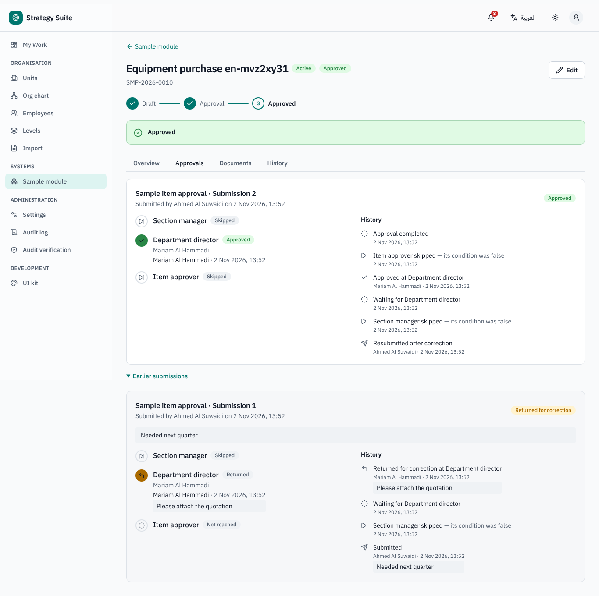
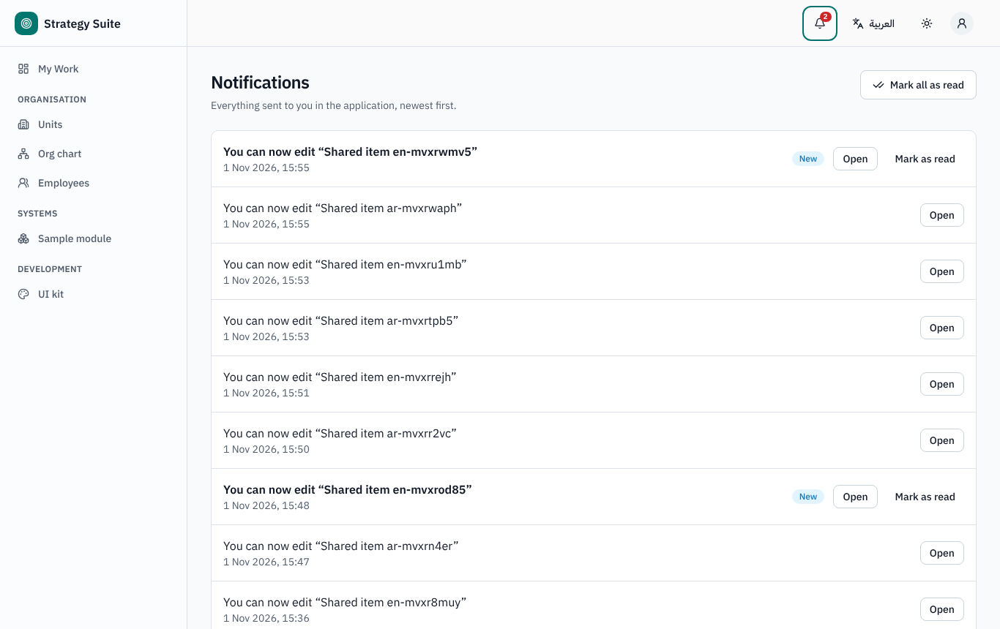
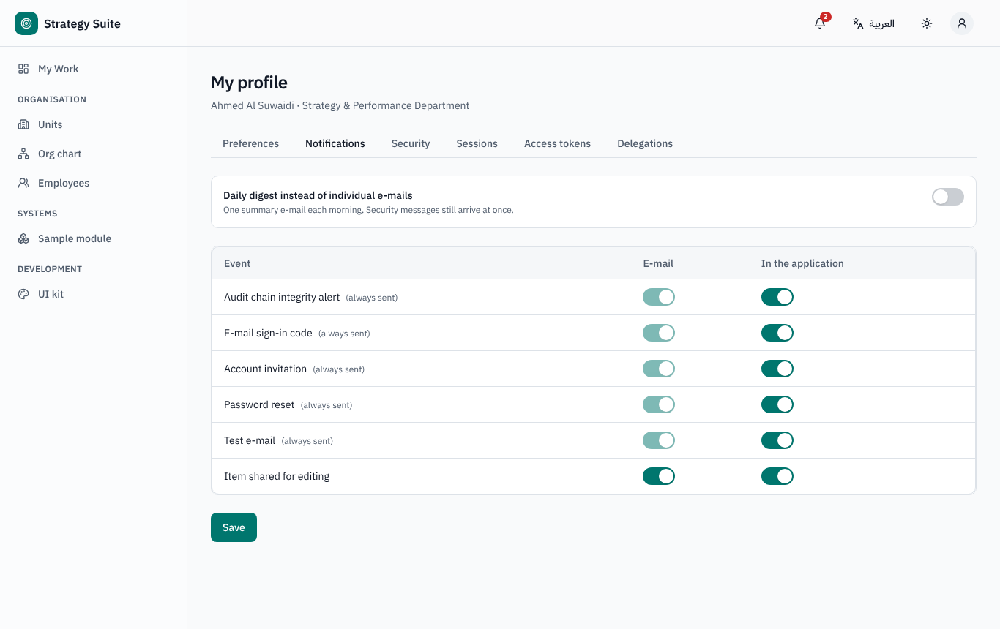
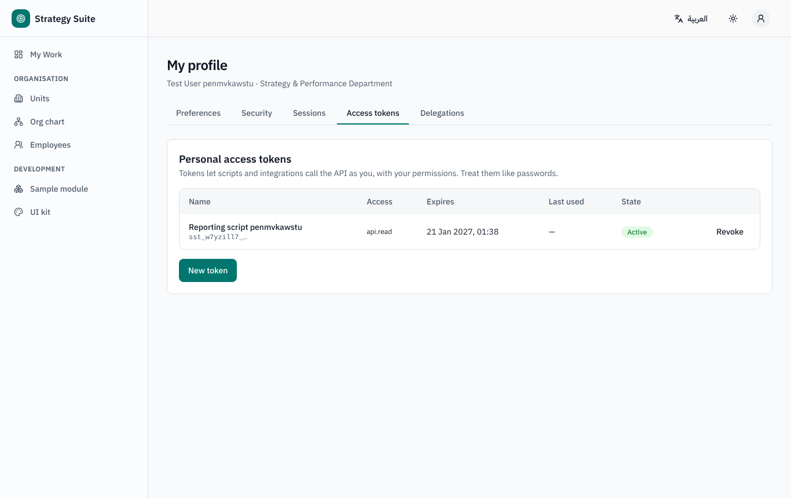
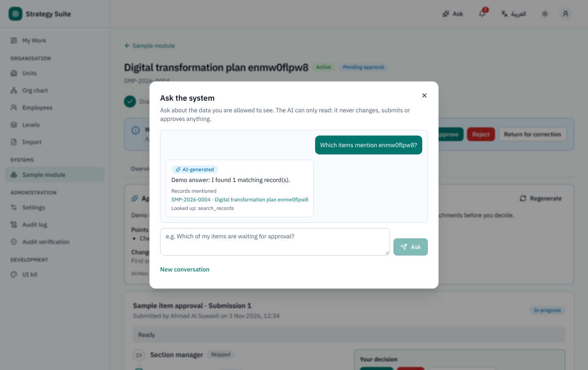

# My Work, approvals, notifications and your profile

For every user. Arabic version: [`../ar/user-my-work.md`](../ar/user-my-work.md).

## 1. Signing in

1. Open the address of your installation and enter your **User name or email** and **Password**, then **Sign in**. If your organisation
   uses single sign-on, UAE Pass or the directory (LDAP), use the **Continue with …** button instead.
2. If two-step verification is on for your account, enter the **Verification code** from your authenticator app, or choose
   **Email me a code**. A **Recovery code** works once each if you lose your phone.
3. Administrators (and everyone, if your organisation chose so) must set up two-step verification at the first sign-in: scan the QR code
   with an authenticator app (or choose the e-mail code), confirm a code, and **store the recovery codes** shown once.

 

Good to know (defaults, your administrator may change them): five wrong passwords lock the account for 15 minutes; a session ends after
30 minutes without activity and after 12 hours in any case. **Forgot your password?** sends a reset link to your e-mail.

## 2. My Work — your home page

**My Work** (first entry of the sidebar) collects everything that needs you, from every system you may open:

- **Counters**: *Pending approvals*, *Overdue*, *Need your action*, *Your requests in progress*, *Unread notifications*.
- **Pending approvals**: every approval task waiting for you in any system — record, step, *Submitted by*, *Waiting since*, *Due* —
  including tasks you hold **on behalf of** a colleague who delegated to you. Overdue tasks come first. **Open** takes you to the record.
- **Your work by system**: one card per system you can open — e.g. my tasks, my KPI results to submit, my risks and treatment actions,
  my CAP remarks and actions, my projects and milestones due, Wasel submissions to review, my teams and pending evaluations, my requests
  (documents, IP, benchmarks), audit follow-ups (Audit Office), notifications, pinned dashboards. Cards for systems you cannot open never
  appear.
- **Customise**: drag a card (or use *Move up* / *Move down* with the keyboard), hide or show cards, then **Done**. The layout is saved on
  your profile.

## 3. Record pages and the current-status banner

Every record (project, KPI result, risk, team, task, request, remark, finding…) opens on a page with the same shape:

- **Header**: number, title and status chips.
- **Stage stepper**: where the record is in its lifecycle.
- **Current-status banner**: what is waiting, *who* must act, and the buttons for the actions **you** may take now. If you see no button,
  nothing is waiting for you.
- **Tabs**: Overview, related items, **Documents** (upload, versions, preview), **History** (every change: who, when, old → new value,
  channel; filter by field or user; view the record *as of a date*).

## 4. Approving

When you are the current approver the record shows the **Approvals** panel with your buttons: **Approve**, **Reject**,
**Return for correction** (some processes add their own action names). A comment is required when rejecting or returning (your
administrator decides per step). Choose **Decide**, write the comment, **Confirm**.

- The panel shows every step (done, current, skipped and why, upcoming), the approvers, the due date ("Due … · business hours name") and
  the history of all submissions (*Earlier submissions*).
- **Approver brief** (when AI is on): one paragraph about the record and *what changed since the last submission* — the changed fields
  come from the record history, not from the AI. It is labelled AI-generated; you still decide.
- Steps have deadlines in working time. When one passes, the approvers are reminded and the step may be escalated to someone else.

Submitters can usually **recall** a submission while no decision has been taken (the record returns to draft).

## 5. Delegating your approvals (leave cover)

**My profile → Delegations → Delegate my approvals**: choose the colleague, the **First day**, the **Last day** and a **Reason**
(your account must be linked to an employee). During that period your approval tasks also appear in your delegate's My Work; when they act, the record
shows "*delegate* on behalf of *you*" and you are notified. In the panel your delegate picks **Act as** → you or themselves. Cancel a
delegation at any time from the same tab.

## 6. Notifications

- The **bell** in the top bar shows the unread count; the list opens the record. **Mark all as read** clears it. All notifications are on
  the notification page.
- E-mails are bilingual (Arabic right, English left) and link to the record.
- **My profile → Notifications**: per event choose **E-mail** and/or **In the application**, or tick **Daily digest instead of
  individual e-mails**. Security e-mails (password reset, codes) are *always sent*.

## 7. Language, theme and your profile

- **Language**: the language button in the top bar switches Arabic ⇄ English instantly (the whole layout mirrors). The choice is saved on
  your profile (**My profile → Preferences**) and used for your e-mails too.
- **Light or dark**: light, dark or *System* (unless your organisation fixed it).
- **Theme and apps** (when your organisation uses the Enterprise or Modern theme): the **app launcher** (grid button, top bar) opens any
  system you can use as its own **app** with its tabs and home page (quick actions, *My items in …*, the system dashboard); star apps to
  pin them as **favourites**. In Modern, **Ctrl + K** opens the command palette (records, pages, actions). **My profile → Preferences →
  Appearance**: your **Default app** (opened when you sign in), **Favourite apps** and — only if your organisation allows it — your
  **Theme** (Classic, Enterprise, Modern).
- **My profile → Security**: change your **Password** (signs you out everywhere else), manage **Two-step verification** (add / turn off a
  method, *New recovery codes*).
- **My profile → Sessions**: *Where you are signed in*; **Sign out** a device or **Sign out of all other sessions**.

## 8. Personal access tokens (API and AI assistants)

**My profile → Access tokens → New token**: a name, the access (**Read data**, **Read and change data**, **AI assistants (MCP)**) and
**Valid for (days)** (default 90, at most 365 unless your administrator changed it). **Copy the token now — it will not be shown again.**
The token acts as you, with exactly your permissions. **Revoke** it when it is no longer needed; anything using it stops at once. How to
connect Claude: [MCP guide](mcp.md).

## 9. Ask the system (AI, when switched on)

**Ask** opens *Ask the system*: a question in Arabic or English (e.g. "Which of my items are waiting for approval?"). The answer uses only
records you are allowed to see and lists the *Records mentioned* with links. AI never approves, submits or saves anything on its own; every
AI suggestion in the application is a draft marked *AI-generated* until you accept or edit it.

