# Portfolio Management — user guide

For requesters, project managers (PMs), project owners and the PM Office. Arabic version: [`../ar/user-portfolio.md`](../ar/user-portfolio.md).
Vendor collaboration is in the [Wasel guide](user-wasel.md).

Sidebar entries: **Program requests**, **Projects & initiatives**, **Portfolio dashboard**, **Portfolio Gantt**, and — when the features are
on — **Portfolios & programmes**, **Vendors (Wasel)**, **Capacity**, **Portfolio reviews**.

## 1. The big picture

| Step | Who | Result |
|---|---|---|
| 1. Program request (wizard) | any employee (requester) | `PR-0001`, submitted for approval |
| 2. Request approval | manager → PM Office → DG Office → Budget (route depends on the request) | approved → a **Project** or an **Initiative** is created |
| 3. Initiation (projects only) | PM takes ownership, writes the **charter**, charter approval, LPO, team formation | Planning opens |
| 4. Planning | PM: scope, milestones and weights (or releases / epics for Agile) | planning approval → Execution |
| 5. Execution | PM: **monthly update** of milestones with evidence | approved progress; at 100 % → Closure |
| 6. Closure → Impact | PM: closure form and lessons learned, then impact | **Completed** |

**Project or initiative?** Computed from the screening answers and the estimated budget: *Project* when every screening answer is *Yes*
**and** the budget is above the threshold (default AED 50 000); otherwise *Initiative*. The PM Office may **Change classification** with a
reason. Initiatives skip the charter, LPO, team formation, closure approval and impact: Planning → Execution → Completed (the PM Office
confirms at 100 %). Your organisation can change these stage templates.

## 2. Submitting a program request

1. **Program requests → New program request**. Choose **Fill manually** or **Start from a document** (AI, when on: upload one or more documents,
   **Read the documents**; the form is filled with highlighted drafts that you review field by field — anything *Not found in the
   documents* you fill yourself).
2. The wizard has six steps: **Program**, **Budget & cost files**, **Screening & priority**, **Delivery & partners**, **Operating costs &
   return**, **Practices & review**. **Save draft** at any time; errors are shown inline and all together on submit.
3. Budget path: depending on your answers you **Upload cost estimation file**, or **Download project scope template** and **Upload project
   scope** (the request then goes to the Administration Dept, who **Upload quotations** before you can submit).
4. **Submit for approval**. The record page shows the stage stepper (*Draft › Manager approval › PM Office › DG Office › Budget ›
   Approved*; steps not in your route are greyed) and the current status ("Waiting PM Office approval"…).
5. **Returned** → correct and **Resubmit after corrections**. **Rejected** is final. You may **Cancel request** (with a reason) while it
   is your draft.

When approved, the request shows "Approved — project *number* created" and **Open the project**.

The PM Office sees the **Proposal Assessment** tab (AI-drafted assessment, versioned) and may **Set approved budget** at the budget step.

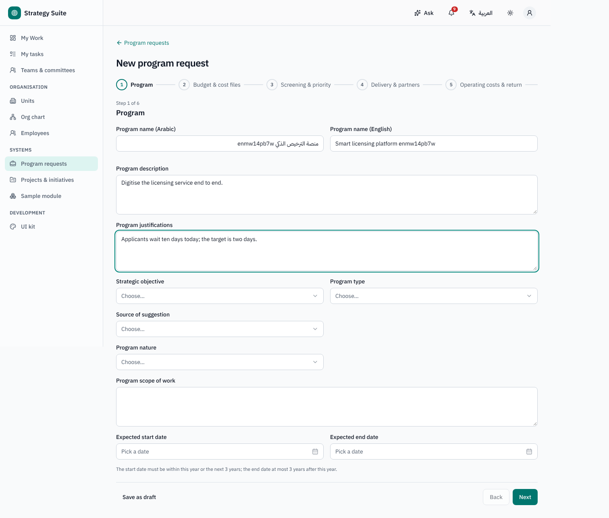
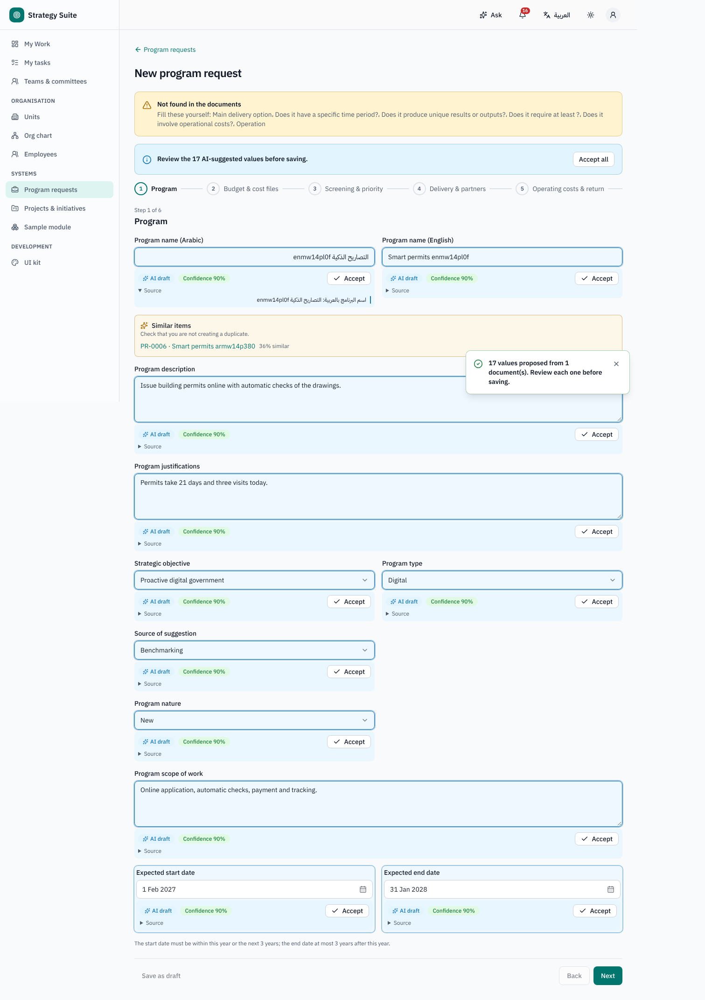
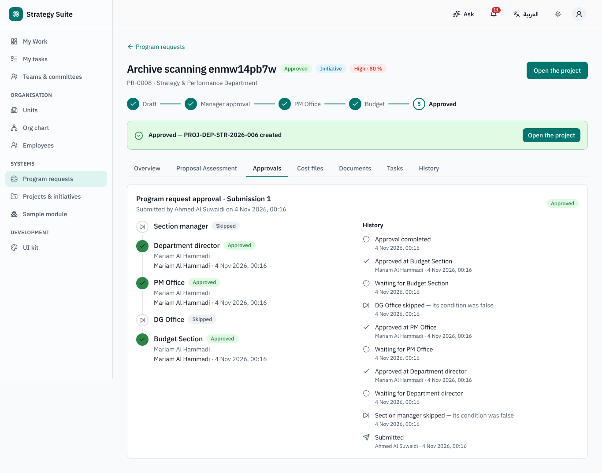

## 3. Taking ownership and the charter (projects)

1. A new project shows "Waiting for a PM". Any employee of the project's section can **Take ownership** (or the PM Office assigns the PM).
2. **Choose methodology** (Waterfall, Agile or Hybrid) while drafting the charter; afterwards it changes only through an approved change
   request.
3. Fill the charter tabs: **Overview** (details, budget and costs), **KPIs**, **Risks** (scored with the organisation's risk framework),
   **Stakeholders**, **Team** (proposed members), **Scope**, **Assumptions & constraints**, **Added values**, and the high-level plan in
   **Milestones**.
4. **Submit the charter**. The charter gate checks everything at once: at least one KPI, one risk, one stakeholder, three proposed team
   members, a scope, and a high-level plan whose weights total 100 %.
5. After charter approval (default chain: section manager when applicable → Department Director → PM Office): the procurement contact
   **Upload the LPO**, then **Form the project team** (a project team record in Teams; Planning opens when the team becomes active).

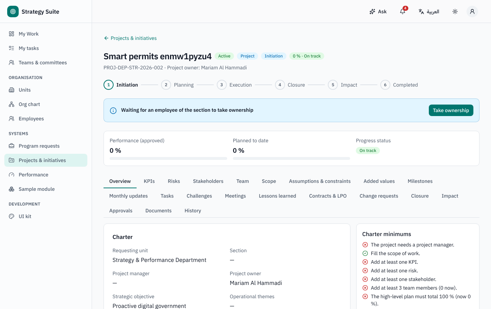
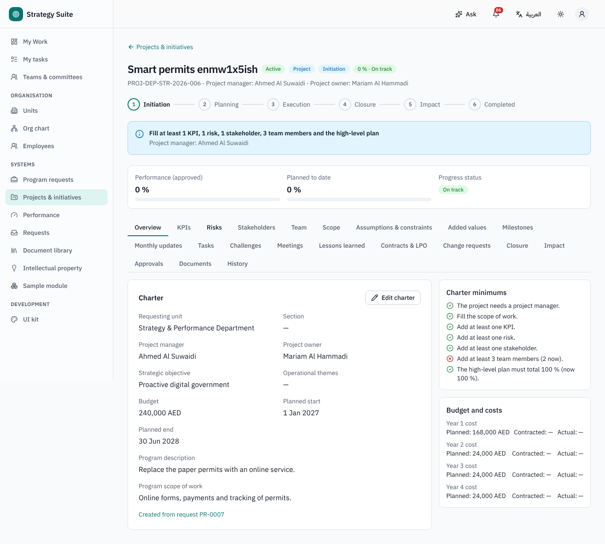

## 4. Planning

- **Milestones**: phases (one level) with milestones under them; each leaf milestone has planned start / end and a **weight**. The detailed
  leaf weights must total **exactly 100 %**. Mark deliverables and fill their fields. With **Templates** on you can *Apply template*.
- **Scope**: at least one item *in scope*.
- **Submit the planning** → planning approval (same default chain as the charter). On approval baseline **v1** is taken (when baselines
  are on) and Execution starts.

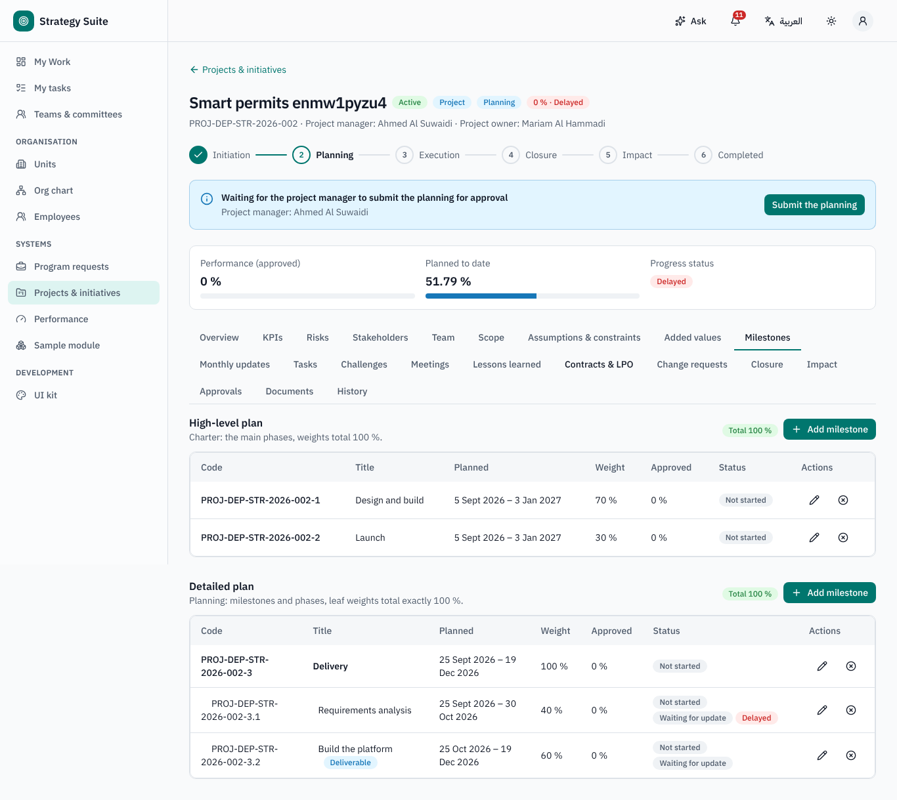

## 5. Execution — the monthly update

- On the 1st working day of each month the update window opens (you are notified). It is due after **10 working days** (reminder 3
  working days before; overdue notice after). The PM Office can **Open the update window now**.
- **Update milestones**: for each milestone the achieved part (never below what was already approved), actual start with the first
  progress, **actual end and an evidence file at 100 %**, and **causality + corrective actions when a milestone is late**. Open tasks on a
  milestone at 100 % only give a warning.
- Submit the monthly update → approval (default **Department Director → PM Office**, Q-P1). Approved values are locked; project progress
  is recalculated. Returned → correct the same window.
- Progress status is **Delayed** when approved progress is more than 5 points below planned-to-date progress, or a milestone is past its
  planned end below 100 %; otherwise **On Track**.
- With **Status report** on, the approved month can be downloaded as a bilingual PDF (the narrative can be drafted by AI and edited by you).

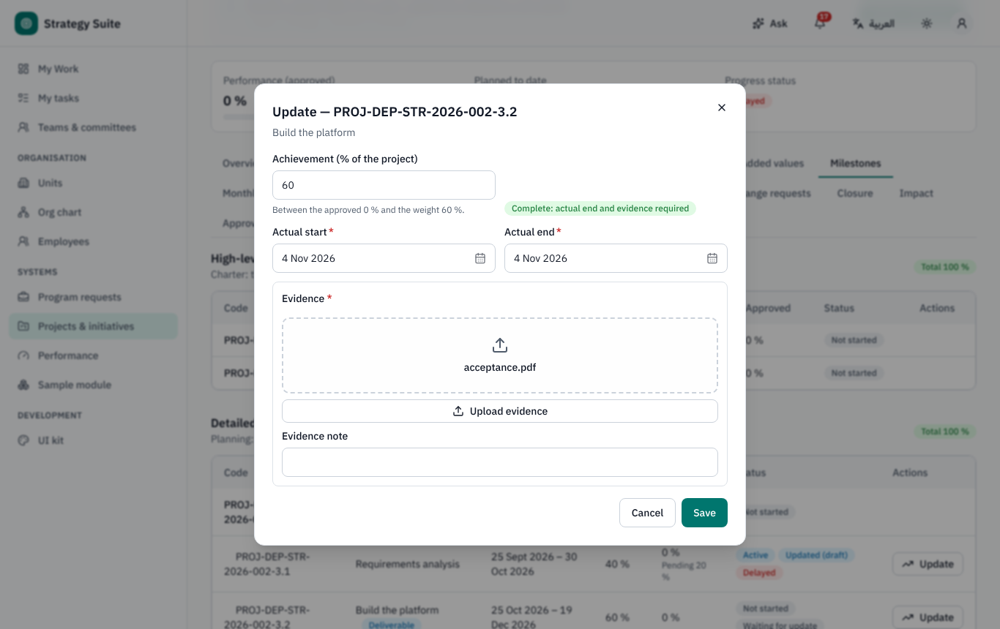
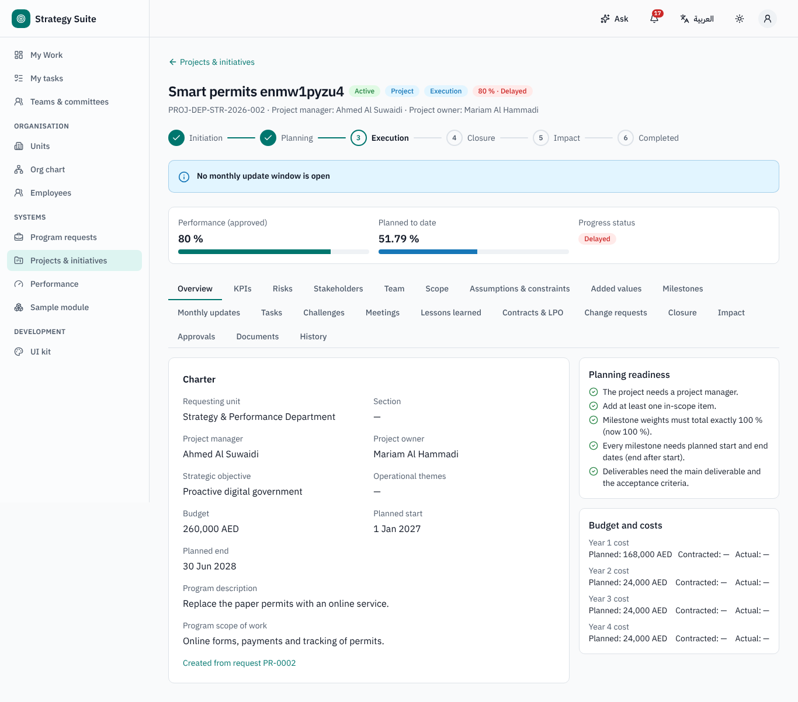

Other tabs during execution: **Tasks** (Task Management tasks linked to the project or a milestone), **Challenges**, **Meetings**,
**Lessons learned**, **Contracts & LPO**, **Approvals**, **Documents**, **History**.

## 6. Change requests

**Change requests** tab → **New change request** of type **Details**, **Postponement**, **Ownership**, **Cancellation**, **Merge** or **Put on hold**
→ **Submit**. Default chain: Department Director → PM Office → Finance Service Section (when cost is affected) → GM Office (cancellation,
merge, or a cost change above the GM threshold). Only one change request may be under review per project.

After approval nothing changes until the PM opens **Apply changes**: the dialog is pre-filled from the request (new PM / owner, dates,
budget, scope; optionally **Re-baseline** for details and postponement requests); you confirm and each change is applied and logged → status **Changes implemented**.

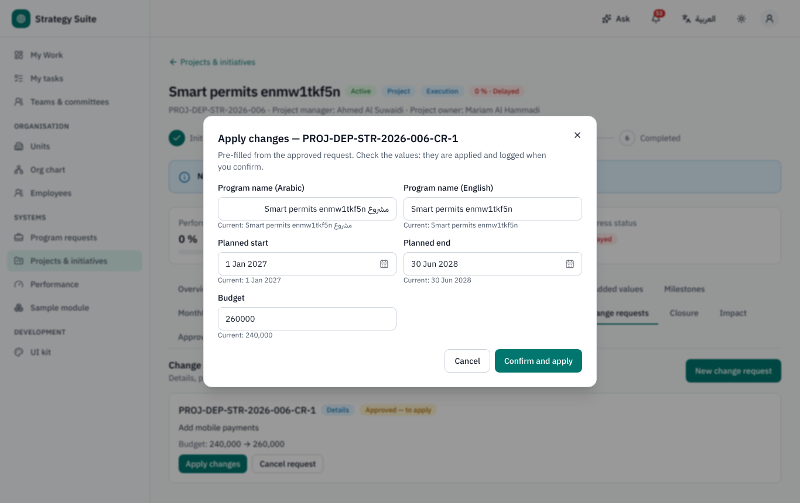

Hold / resume / cancel of a project is for the PM Office (with a reason). A pending approval can be **Recall**ed by the submitter or the
PM Office.

## 7. Closure and impact

When the approved total achievement reaches 100 % the project moves to **Closure**: **Fill the closure form** (summary of achievement,
main deliverables) and record at least one **lesson learned** → closure approval. Closure approval opens the project team's evaluation in
Teams. Then **Enter the impact** (cost performance and three satisfaction ratings, benefits measured) → impact approval (PM Office) →
**Completed**.

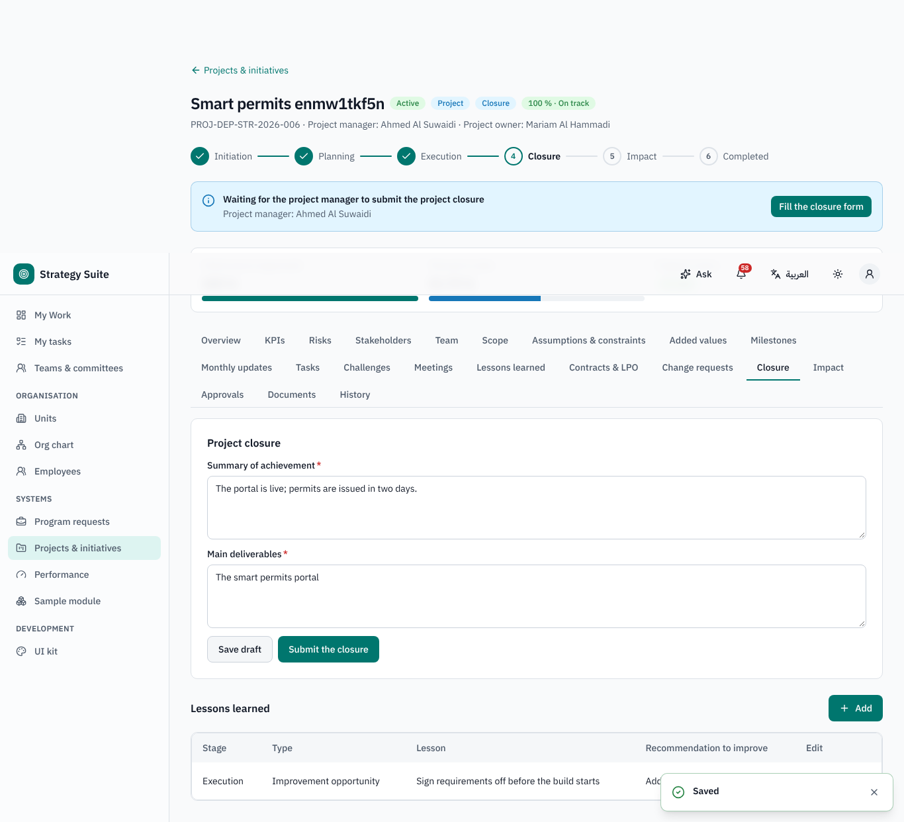 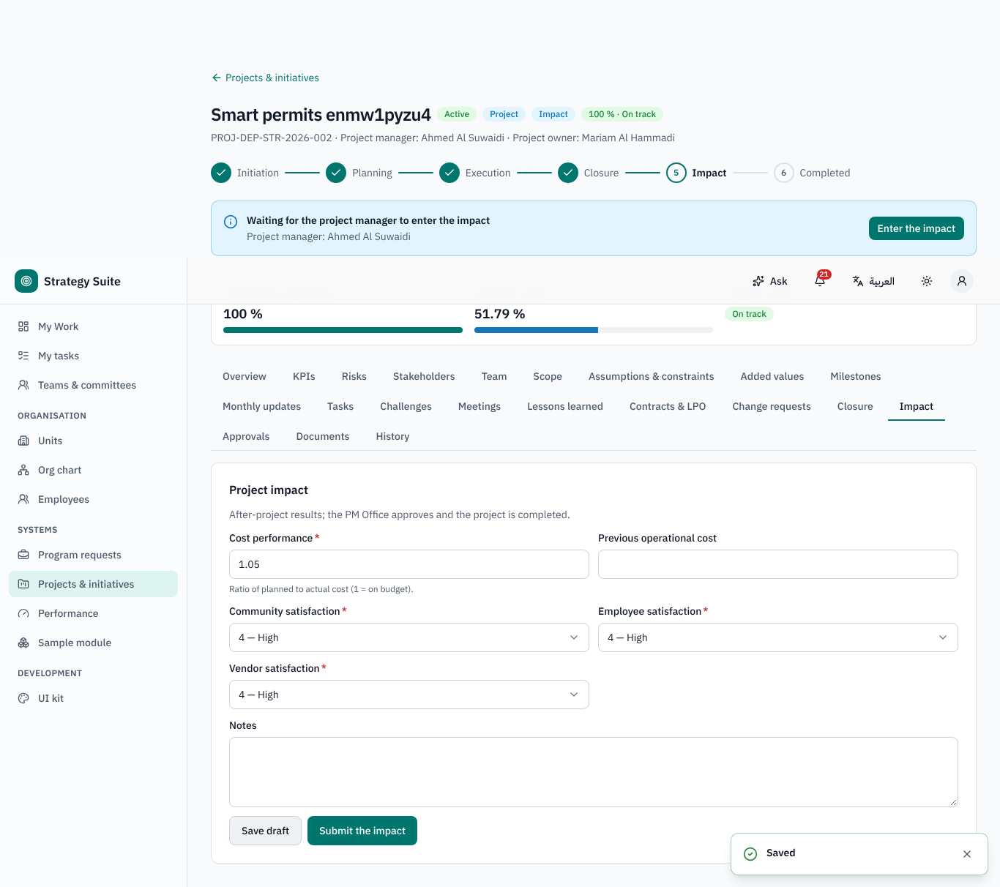

## 8. Agile and Hybrid projects

- **Agile**: plan releases → epics (weights total 100 %) → user stories (points) in the **Backlog**; work in **Sprints** (length 1–28 days,
  default 14) on the **Board**; charts: burndown, burnup, velocity, cumulative flow, cycle time. Progress = Σ epic weight × approved-done
  points ÷ epic points.
- **Hybrid**: waterfall phases and milestones; a milestone flagged *delivered in sprints* has its own epics (total 100 % of that
  milestone).
- **Progress approval**: *Monthly roll-up* (default; every closed sprint goes into the monthly update) or *Each sprint* (each closed sprint
  is approved on its own: Department Director → PM Office). Hybrid is always monthly.
- AI (when on) can draft the plan, stories and the status narrative; you accept or edit.

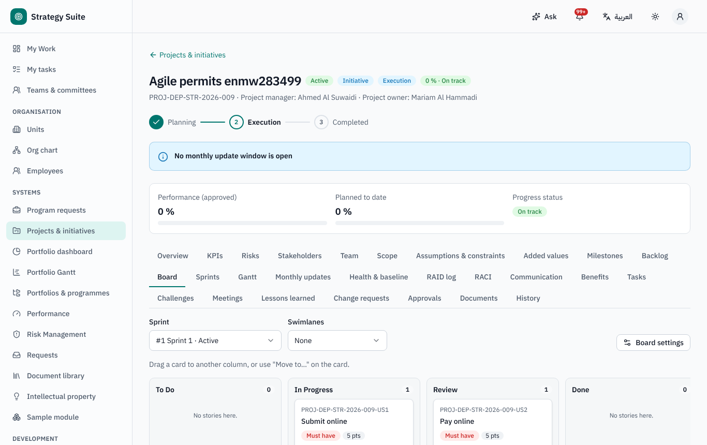
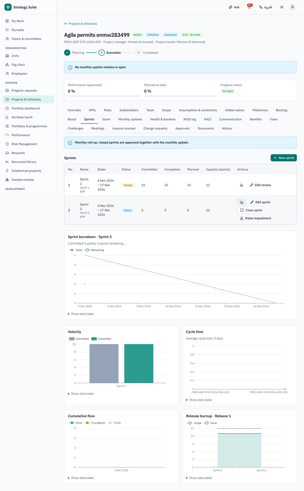

## 9. Standards features (each behind a switch in Settings → Portfolio)

| Feature | Where | Default |
|---|---|---|
| Portfolios & programmes | sidebar *Portfolios & programmes*; filters on dashboards and Gantt | on |
| Prioritisation (weighted criteria, bands High ≥ 80 %, Medium ≥ 60 %) | request assessment | on |
| RAG health (schedule, cost, scope, risk; overridable with justification) | **Health & baseline** tab, dashboards | on |
| Baselines and variance (v1 at planning approval; new versions only via a change request with *Re-baseline*) | **Health & baseline** | on |
| Earned value (PV, EV, AC, SPI, CPI, EAC…) | **Health & baseline** | **off** |
| RAID log (issues, assumptions, dependencies, decisions) | **RAID log** tab | on |
| Risk matrix 5 × 5, RACI, communication plan, benefits, quality sign-off, procurement payments and supplier rating, gate checklists, project templates | their tabs | on |
| Monthly status report PDF | Monthly updates | on |

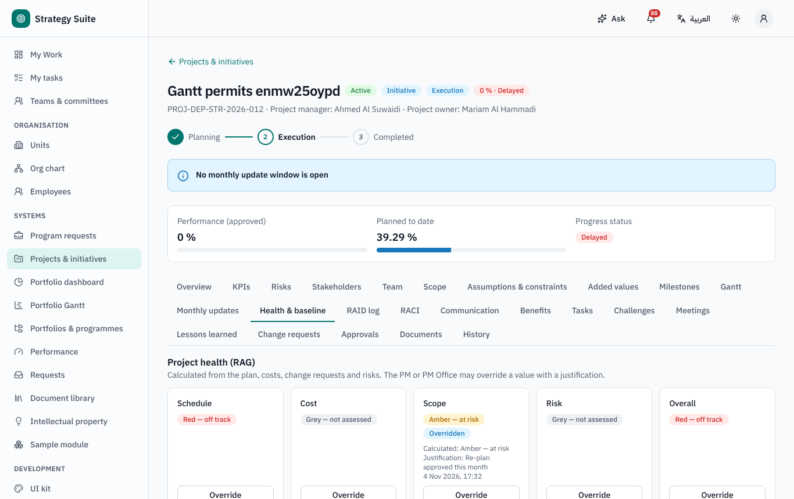
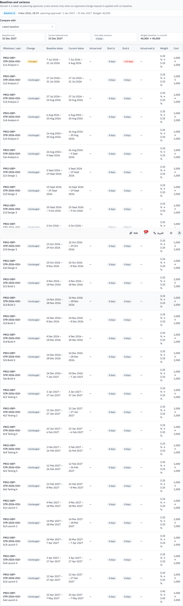
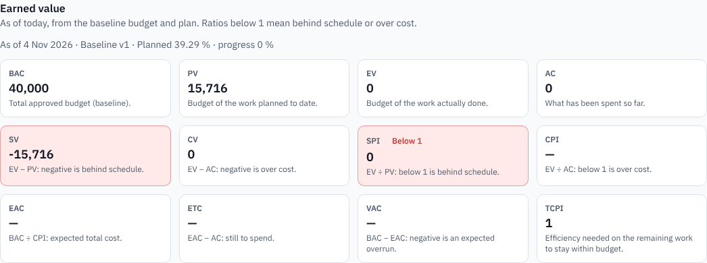

## 10. Gantt, dashboard and portfolio views

- **Gantt** tab (per project) and **Portfolio Gantt**: phases and milestones with planned, actual and baseline bars, achievement, delayed
  colouring, dependencies, quarter grouping; mirrored in Arabic. Export PNG / PDF.
- **Portfolio dashboard**: projects by stage and health, budget vs actual, delayed projects, upcoming milestones; drill down to projects.
  Costs and budgets are shown only to people allowed to see costs.
- **Capacity** (allocation of people across projects) and **Portfolio reviews** (quarterly review records) for the PM Office.

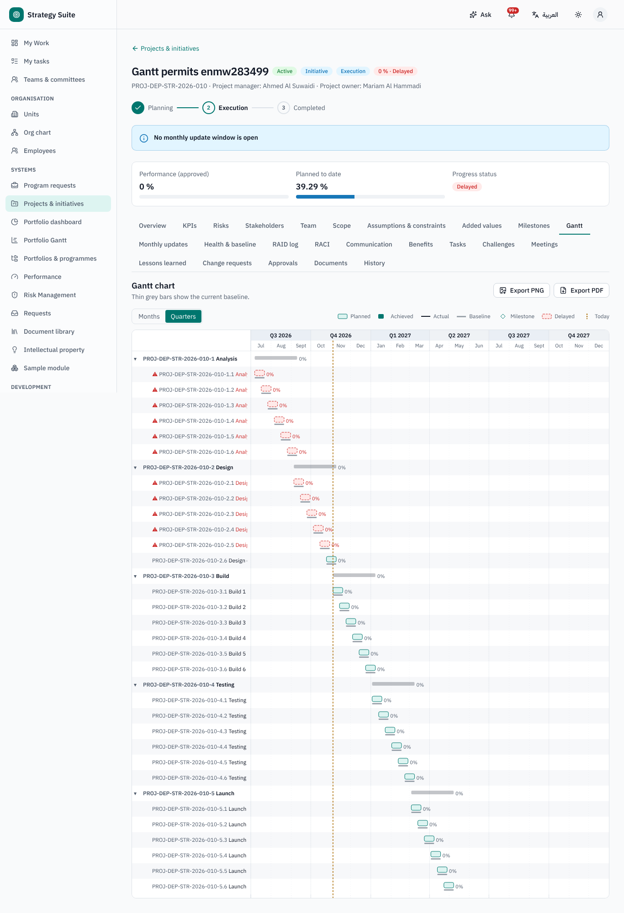
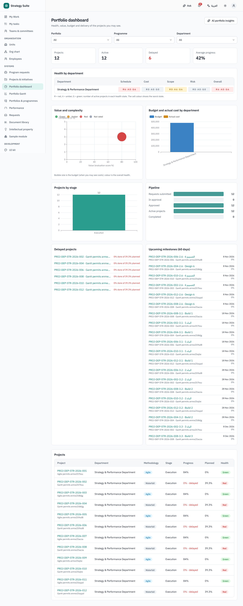

## 11. Who can do what (defaults)

| Role | Can |
|---|---|
| Requester (everyone) | create and submit own requests, see own requests |
| PM (record role on the project) | edit the project, monthly updates, change requests, apply approved changes |
| Project owner / team member (record roles) | read the project (team members may propose RAID entries) |
| PM Office | all projects: assign PMs, override classification, open windows, hold / resume / cancel, confirm completion |
| DG Office, Budget Section, Administration, Finance Section, GM Office | their approval steps / hand-offs |

Your administrator may change these in Settings → Roles and permissions.

## 12. Tips

- The **current-status banner** always tells you what is next and who is waiting; follow its buttons.
- Weights must total 100 % before planning can be submitted — the Milestones tab shows the running total.
- Evidence is required for 100 % milestones; upload it in the update dialog.
- AI assists (start from a document, plan generator, update assistant, status narrative) only draft; nothing is saved until you accept.
