# Requests, Document Registry and Intellectual Property — user guide

For requesters, processors (offices) and document / IP owners. Arabic version: [`../ar/user-requests.md`](../ar/user-requests.md).

The **Request Framework** is one engine for every request type: documents, intellectual property, benchmarking studies and any custom
type your administrator builds (Settings → Request types).

## Part 1 — Requests

Sidebar → **Requests**: **Request catalogue**, **My requests**, **Processing queue** (offices).

### 1.1 Submitting a request

1. **Request catalogue**: request types you may submit, grouped by category, with a description; search and **Start**. (Your intranet may
   also link straight to a request form.)
2. The wizard has one step per form section; **save as draft** at any time; fields are validated inline and on the server; review step.
3. Submit. The request page shows the **stage stepper**, the current status ("waiting … approval", who acts next), the form values
   (secret values such as an Emirates ID are always masked), attachments, the approval panel, timeline, Documents, History and Tasks.
4. **Returned for correction** → correct and resubmit. You may cancel your own draft or pending request.

Statuses: *Draft · In review · Returned for correction · In progress · Completed · Rejected · Cancelled*.

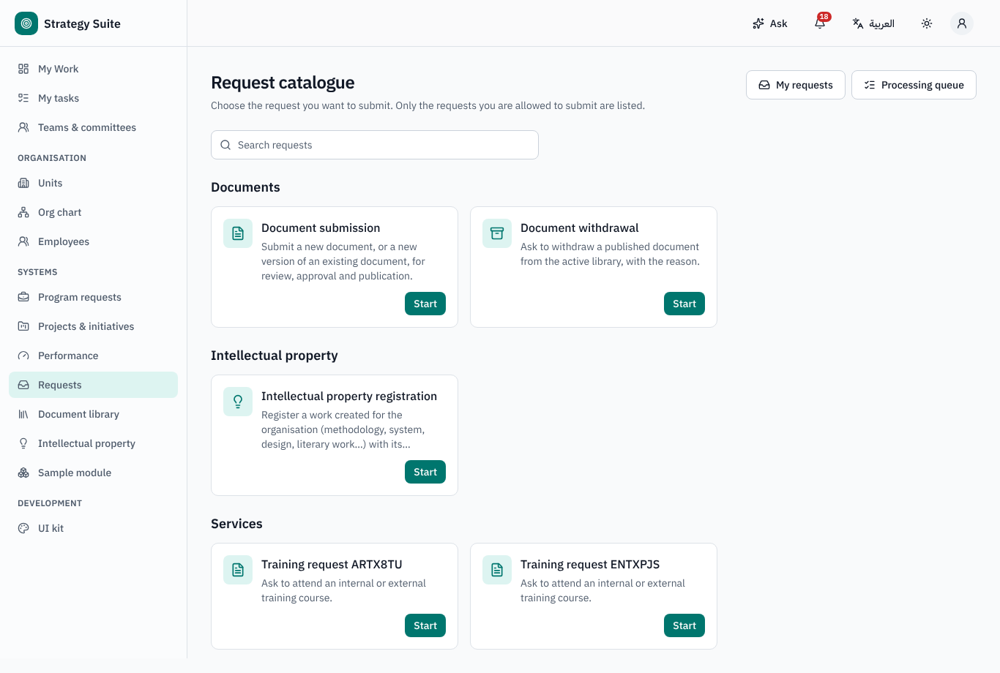

### 1.2 Processing (offices)

**Processing queue** → *Waiting for me*, filters by type, stage, status, unit and *Overdue only*; an SLA indicator in working time.
Approval stages are decided on the approval panel (some require a short form, e.g. the document classification, before approving);
processing stages have action buttons (e.g. *Complete*, *Publish*, *Return*). **Complete selected** is offered only where the completion
form has no required field.

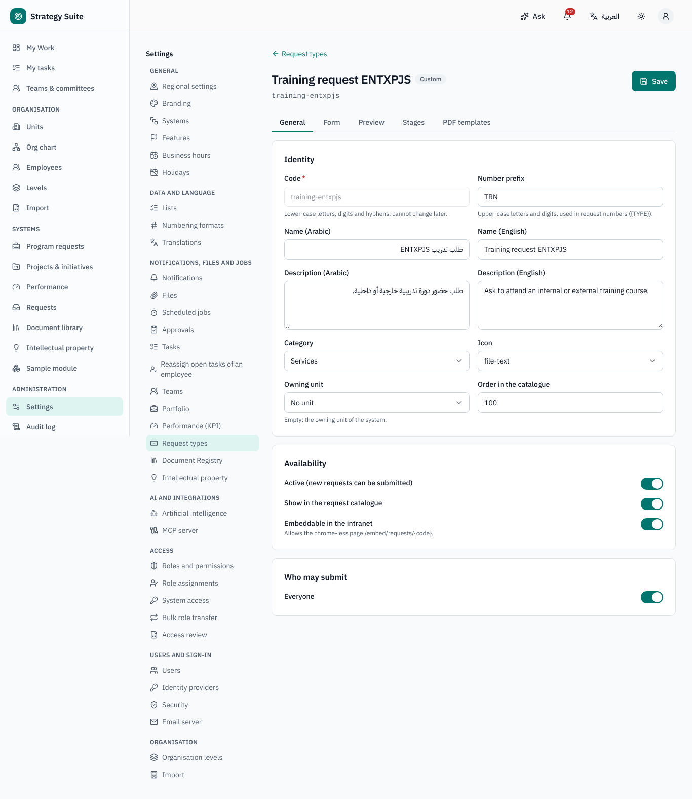

## Part 2 — Document Registry

Sidebar → **Document library**: **Library**, **Dashboard**, **Submit a document**.

### 2.1 Submitting a document or a new version

1. **Submit a document** (request type *Document*): name in Arabic and English, owner unit, description, **draft file**. For a new version
   of a published document tick *new version*, pick the document and give the **reason for change**.
2. **Review** (Strategy / document office): approve with the classification — level (Strategic, Legislative, Operational), type (policy,
   procedure, manual, legal document, strategy, form…) and **sensitivity** (*Public · Internal · Confidential · Secret*). AI can suggest the
   classification, a summary and possible duplicates. On approval the **Document ID** is assigned (e.g. `ORG-UNIT-POL-2026-01`) and the
   version (1.0, then 2.0…).
3. **Publish** (office): upload the signed final PDF, *share with all*, effective date, expiry date (proposed from the type: e.g. policies and
   procedures 24 months, manuals and strategies 36 months, legal documents and forms until superseded), acknowledgement required. The
   previous version becomes *superseded*.

Statuses: *Submitted · Under review · Returned for correction · Rejected · Approved – awaiting publication · Published · Expired ·
Withdrawn*.

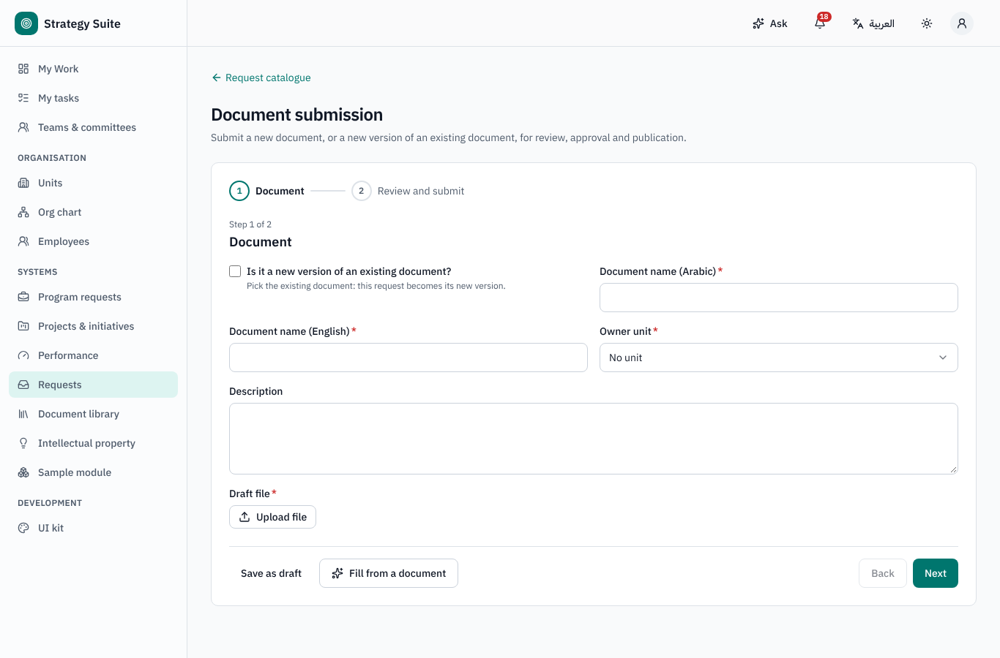
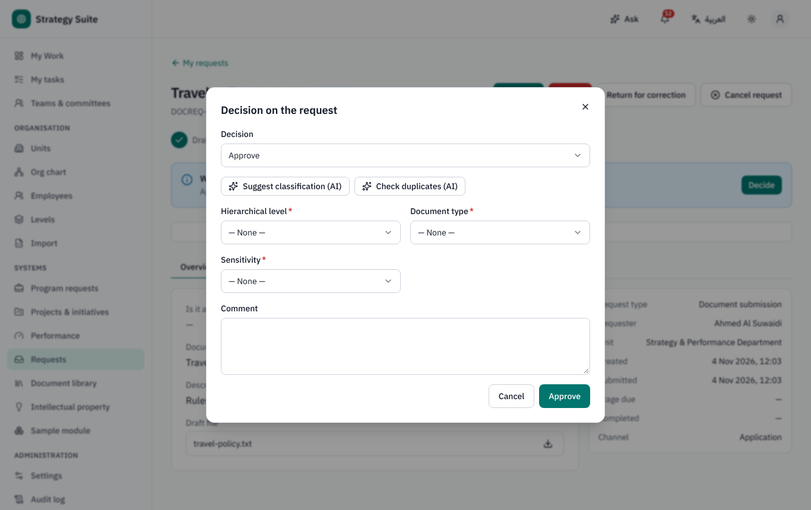

### 2.2 Library and document page

- **Library**: browse by level → type → owner unit, full-text search (titles, description and the text of the published file, Arabic
  normalised), filters for status, sensitivity, unit and *Expiring within … days*. You only ever see documents your clearance allows
  (others do not appear at all).
- **Document page**: viewer, metadata, version history with change summaries, **compare** two versions (text differences; AI can summarise
  what changed), related documents, IP badge, acknowledgements (**Acknowledge**), validity panel.
- **Download** carries the stamp "Uncontrolled when printed" on every page (the stored file is never changed).
- AI **Q&A** over the published documents you may see, with citations.

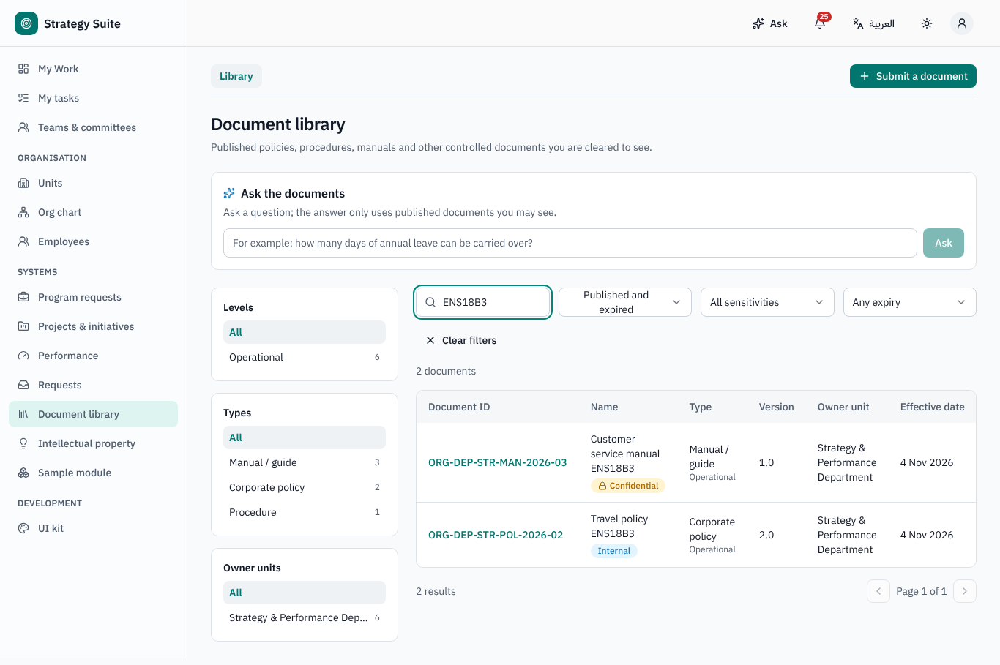
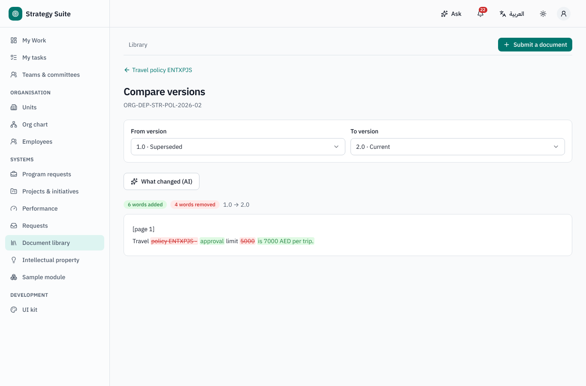

### 2.3 Validity and expiry (owners)

Reminders at **60 and 30 days** before expiry, with three actions on the document page: **Confirm still valid** (extends by the type's
period), **Submit new version** (the current version stays valid until the new one is published), **Request withdrawal** (withdrawal
request → approval → *Withdrawn*). Without action the document becomes **Expired** (still visible, marked as such).

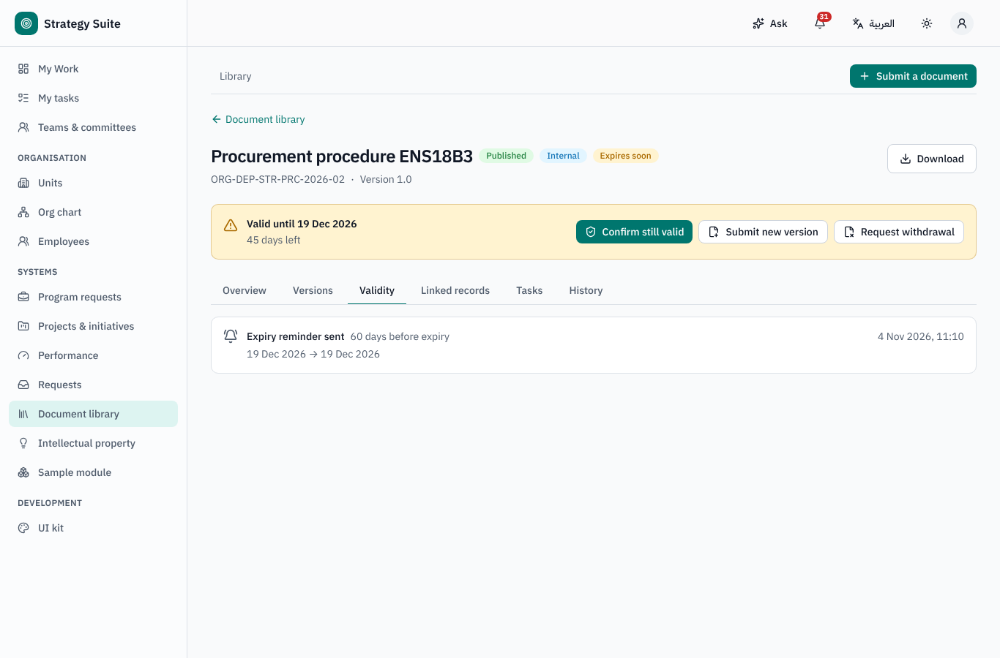

## Part 3 — Intellectual Property

Sidebar → **Intellectual property**: **IP register**, **Dashboard**; *My intellectual property* lists records where you are a contributor.

### 3.1 Registering an IP

1. From the Request catalogue: name (AR / EN), description, supporting files, **contributors** (employee or external person, organisation,
   Emirates ID — stored encrypted and always masked, role, **share** — shares total 100 %) and the **declaration** that the rights belong to
   the organisation.
2. **Review** (IP office): approve with property type and protection type → *Approved to file*. AI can suggest the types and check for
   similar records.
3. On the IP page the office continues: **Download MOET form** (bilingual PDF with the contributors — IP administrators only, audited),
   **Record filing** → *Filed with MOET*; **Record registration** (registration number and date, expiry proposed from the protection
   term, certificate) → *Registered* (employee contributors are notified); or **Rejected by MOET** → re-file or **Close record**.
   Internal-only protection (trade secret): **Register internally** with an internal number.
4. Renewal reminders at **6 and 3 months** before expiry; **Record renewal** → *Renewed*; at expiry → *Expired*.

When a document type is flagged *Creates IP register entry*, publishing such a document creates its IP record automatically (*Approved to
file*, linked to the document).

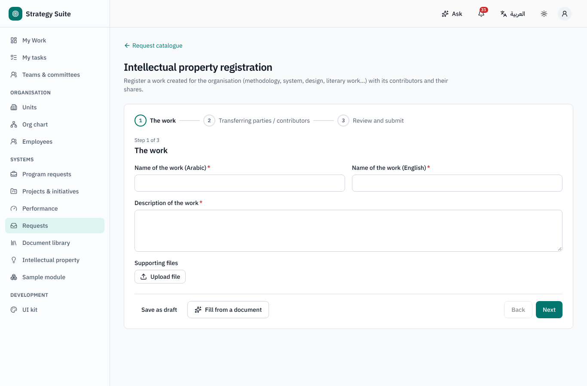
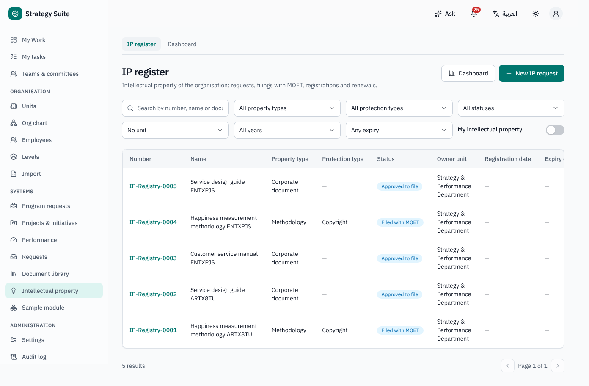
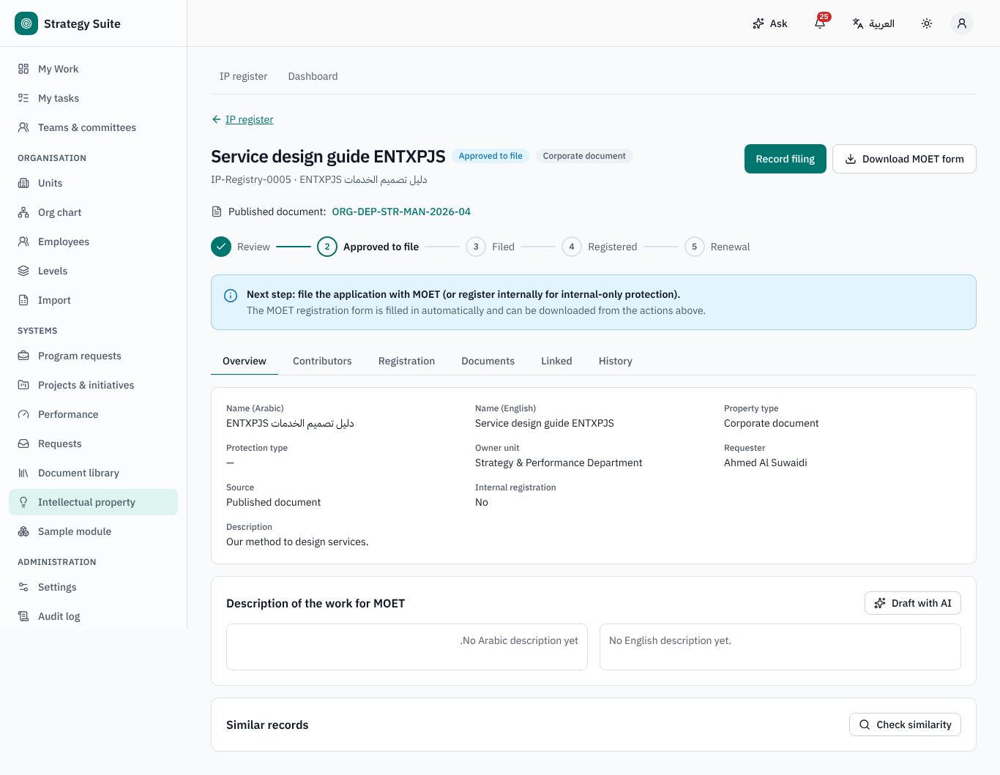
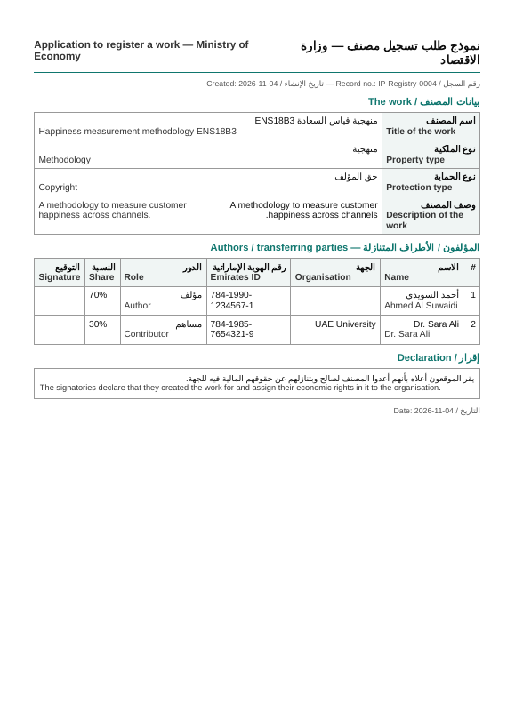

## Who can do what (defaults)

| Role | Can |
|---|---|
| Everyone | open Requests, the library and IP; submit requests; read documents their clearance allows; read own IP records |
| Request / document / IP office | process and approve, publish, set expiry, file and register IP |
| Document Registry administrator / IP administrator | settings; IP administrators also reveal Emirates IDs and download the MOET form |
| Request type administrator | the form builder |
