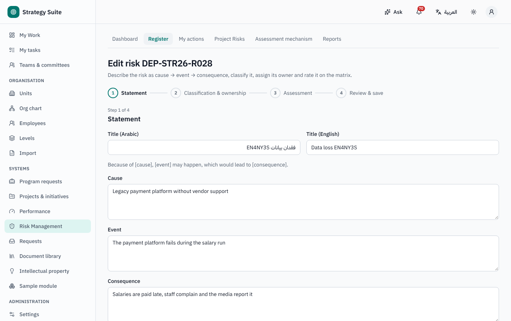
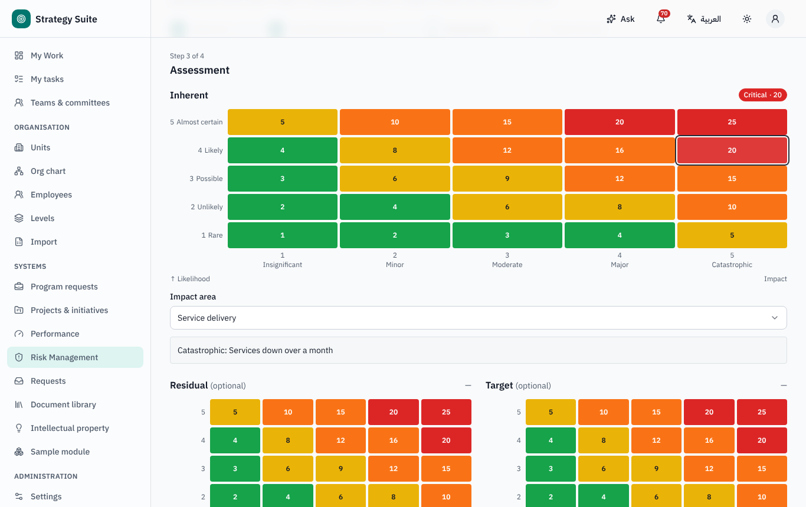
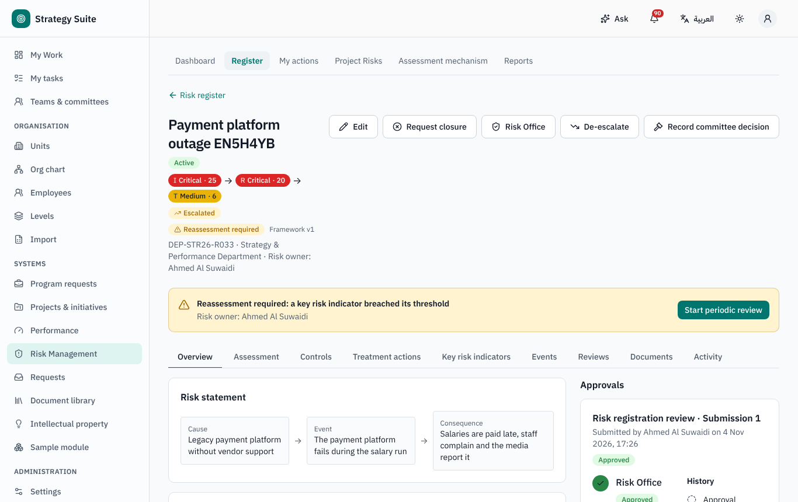
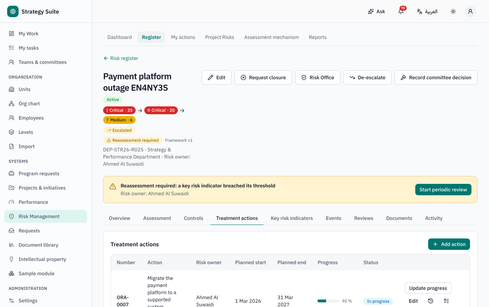
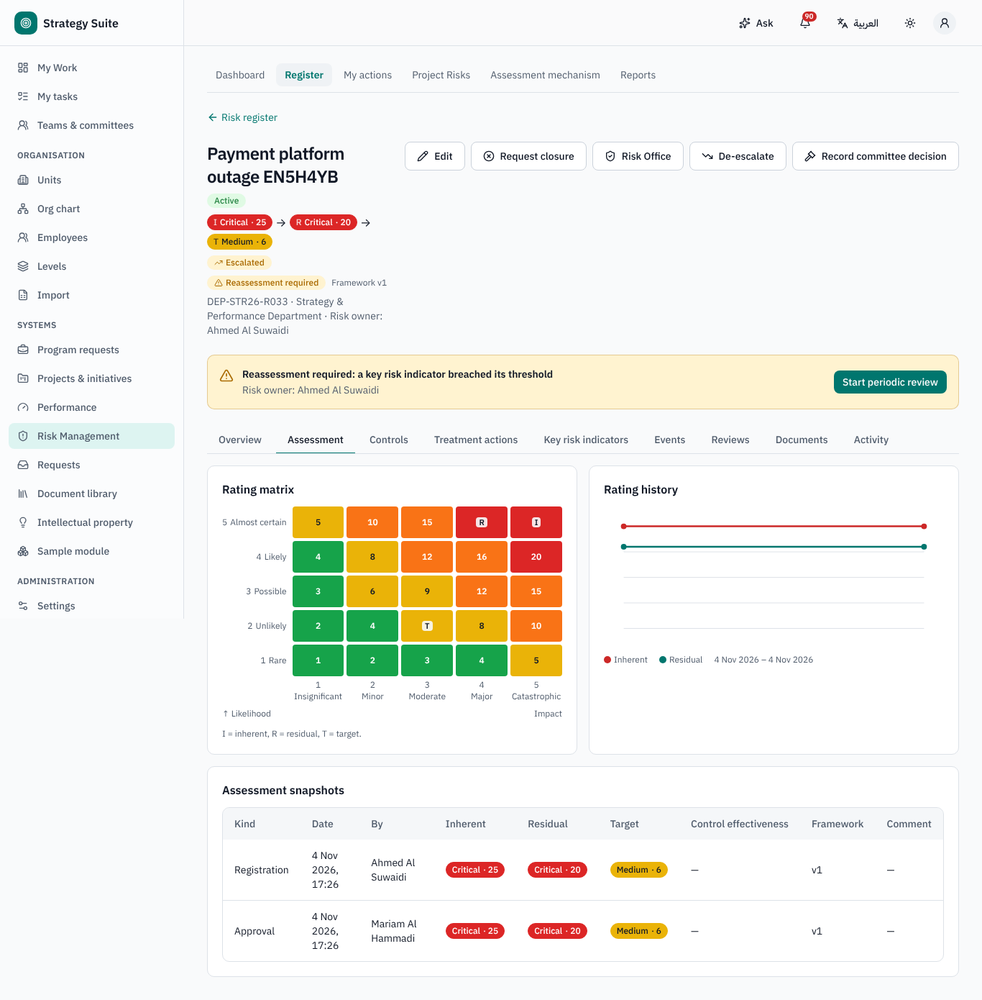
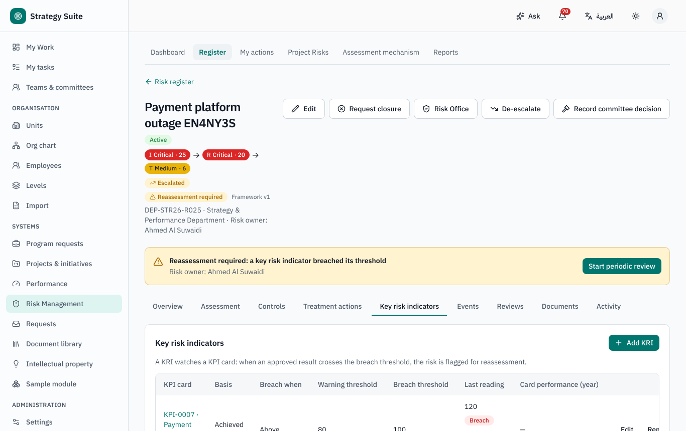
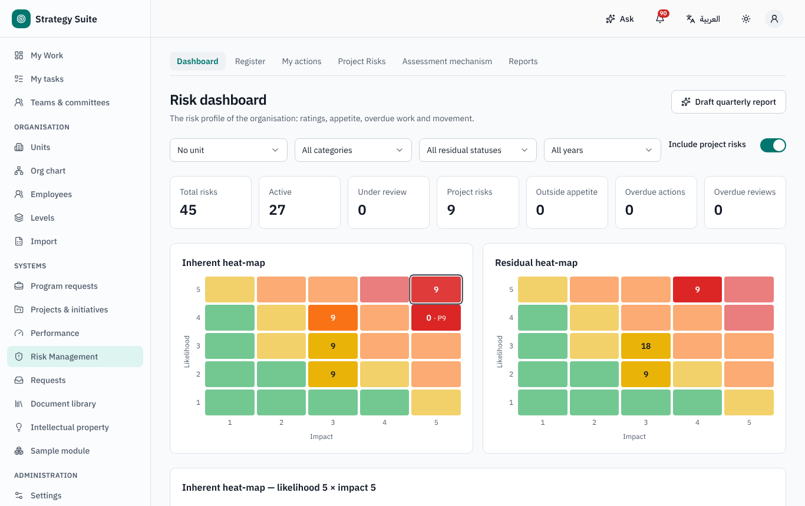
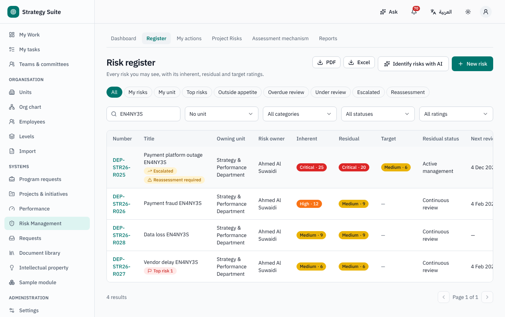
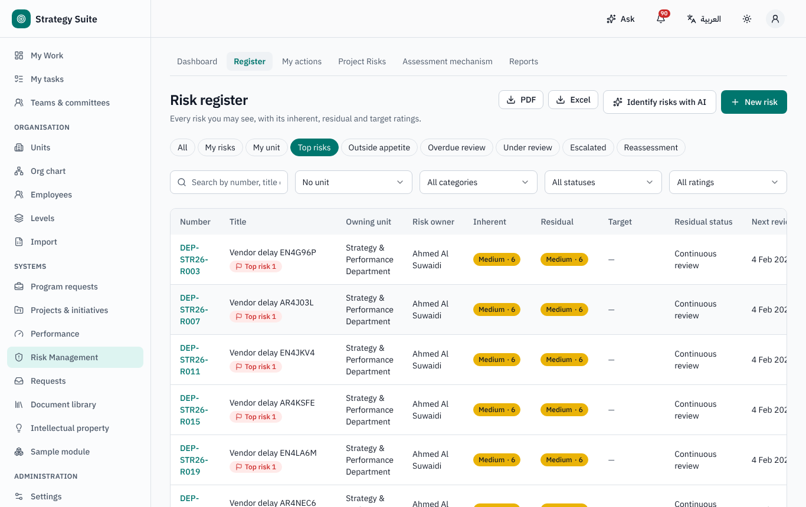

# Risk Management — user guide

For risk owners and coordinators, treatment-action owners, the Risk Office and the Risk Committee. Arabic version:
[`../ar/user-risk.md`](../ar/user-risk.md).

Sidebar → **Risk Management**: **Dashboard**, **Register**, **My actions**, **Project Risks**, **Assessment mechanism**, **Reports**.

## 1. Concepts

- Every risk is rated with the organisation's **risk framework** (Settings → Risk framework): likelihood × impact on configured scales give
  a score and a **band** (e.g. Low, Medium, High, Critical).
- **Inherent** rating (before controls) → **residual** rating (after existing controls, using their effectiveness) → **target** rating
  (after the planned treatment).
- **Appetite** per category: a residual score above the appetite is *outside appetite* and is escalated.
- Statuses: *Draft · Under review · Active · Closed · Rejected*.

## 2. Registering a risk

1. **Register → New risk**. The wizard: **Statement** (cause → event → consequence; AI can check the wording and suggest risks from a text
   or document) → **Classification & ownership** (category, unit, owner, objectives) → **Assessment** (click the cell of the matrix for
   likelihood and impact) → **Review & save**. The risk number is assigned on the first save.
2. On the risk page add **Controls** (existing controls with effectiveness), **Treatment actions** and **Key risk indicators**.
3. **Submit for approval** → the Risk Office reviews (it may adjust ratings, response and Top-10 before approving). Approved → *Active*,
   with the next review date. Returned → back to draft with the comment. Rejected → *Rejected* (the Risk Office may reopen it).

## 3. Treatment actions

- **My actions** lists your open treatment actions. **Update progress**: note, completion %, actual dates, evidence. You are reminded
  before the planned end; late actions are escalated to the risk owner.
- At 100 % the action is completed and you may **Convert to control** (rate its effectiveness): the risk's residual rating is
  recomputed and a reassessment is requested.
- **Create task** links a Task Management task to the action when a team does the work.

## 4. Monitoring and periodic review

- The **next review date** depends on the residual band (review frequency in the framework) and is moved to a working day. You are reminded
  before it and notified when it is overdue.
- **Start periodic review**: confirm or update each control's effectiveness, the residual likelihood / impact, notes on actions and a
  commentary → submit → Risk Office approval. AI can summarise what changed since the last review.
- An unscheduled reassessment is requested when a **KRI breaches** its threshold (from an approved KPI result), a **risk event** is logged,
  appetite is breached, an audit finding is linked or a framework change moved the band.
- **Events → Log event**: what happened, date, financial and other impact, near miss, root cause, lessons learned.

## 5. Escalation and closure

- A risk whose residual band is Critical or that is outside appetite is **escalated** automatically to the Risk Committee and the Risk
  Office; the Risk Office may **Escalate** / **De-escalate** manually; committee decisions are recorded on the risk.
- **Request closure** with a reason → Risk Office, then the **Risk Committee** when the residual band is Critical. Closed risks stay in the
  history; the Risk Office may **Reopen**.

## 6. Dashboard, register and reports

- **Dashboard**: tiles, **inherent vs residual heat-maps** (click a cell to list its risks; keyboard accessible), by category / unit /
  rating, outside appetite, Top-10, overdue actions and reviews, movement this quarter, KRI breaches; filters and *Include project risks*.
- **Register** with saved views (*My risks*, *Escalated*, *Reassessment*…), rating chips and export.
- **Project Risks**: the risks of Portfolio projects, live and read-only, filtered by your project access; each row opens the risk in its
  project. They are not copied into the corporate register.
- **Assessment mechanism**: the current framework as a printable bilingual document.
- **Reports**: register, Top-10, unit profile, action tracker (PDF / Excel).

## 7. Who can do what (defaults)

| Role | Can |
|---|---|
| Everyone | open Risk Management, register a risk, see the risks they own |
| Risk owner / coordinator (record roles) | edit, submit, review, request closure of their risks |
| Action owner | update the progress of their actions |
| Risk Office | review and approve, adjust ratings, Top-10, escalate, reopen, framework |
| Risk Committee | second closure step for Critical risks, committee decisions |
