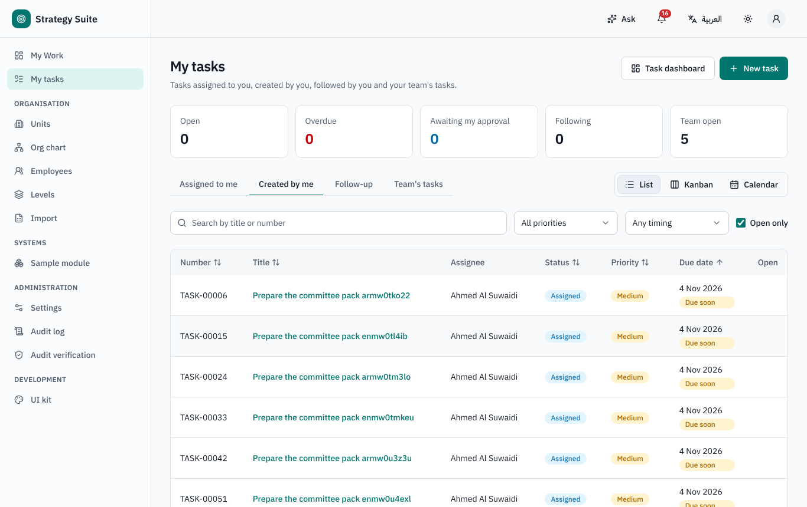
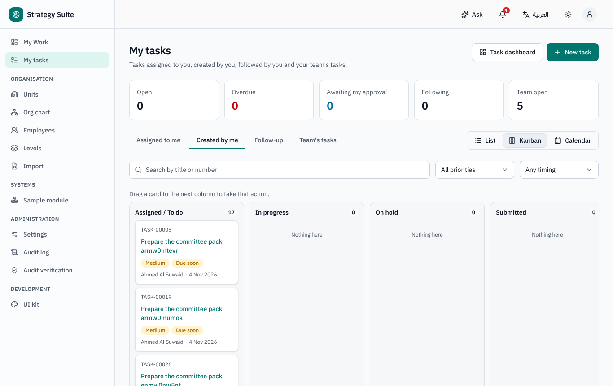
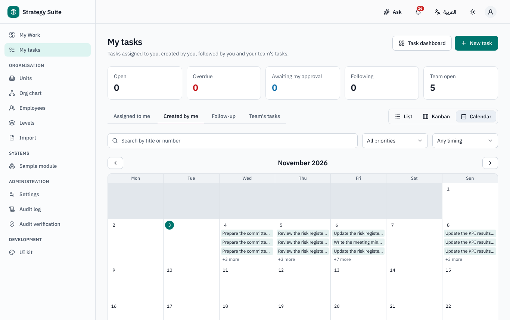
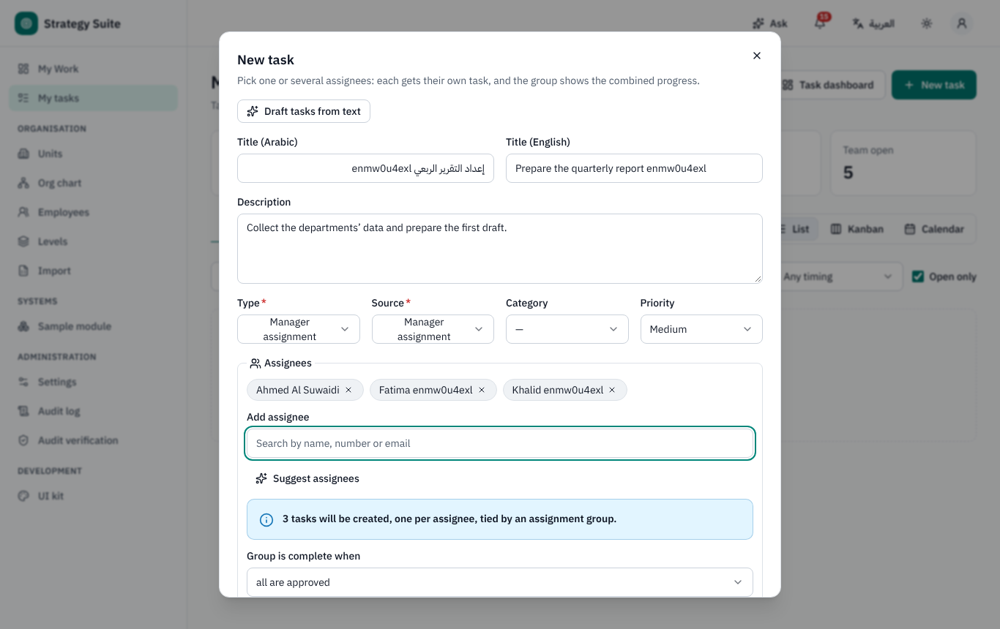
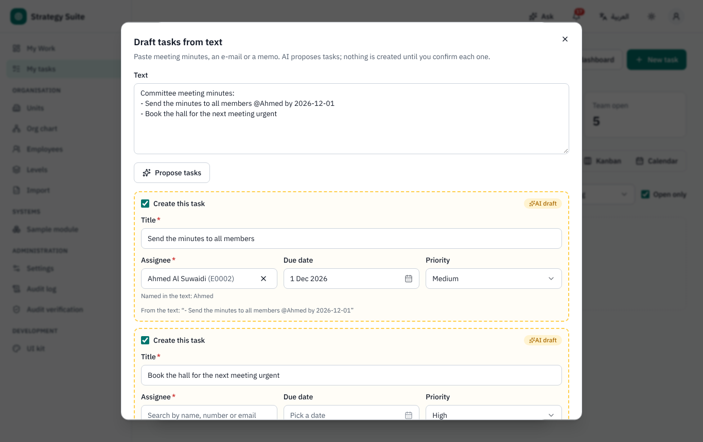
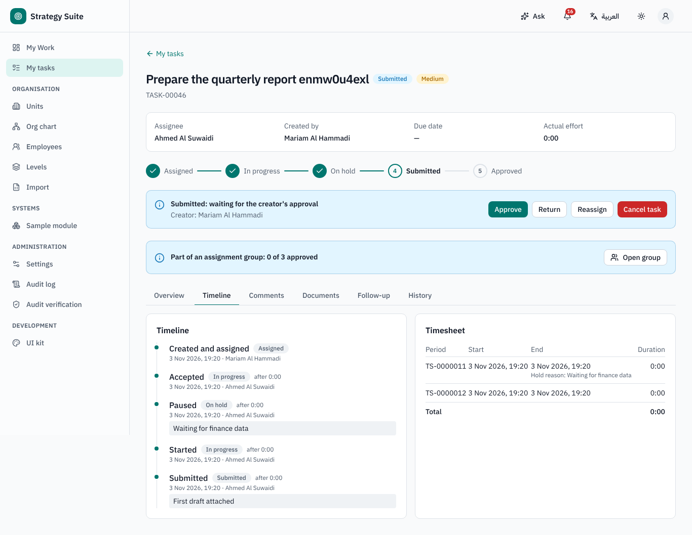
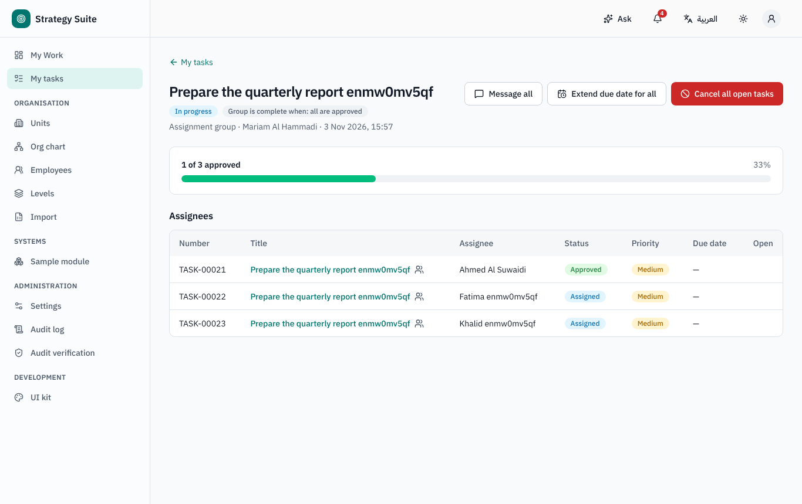
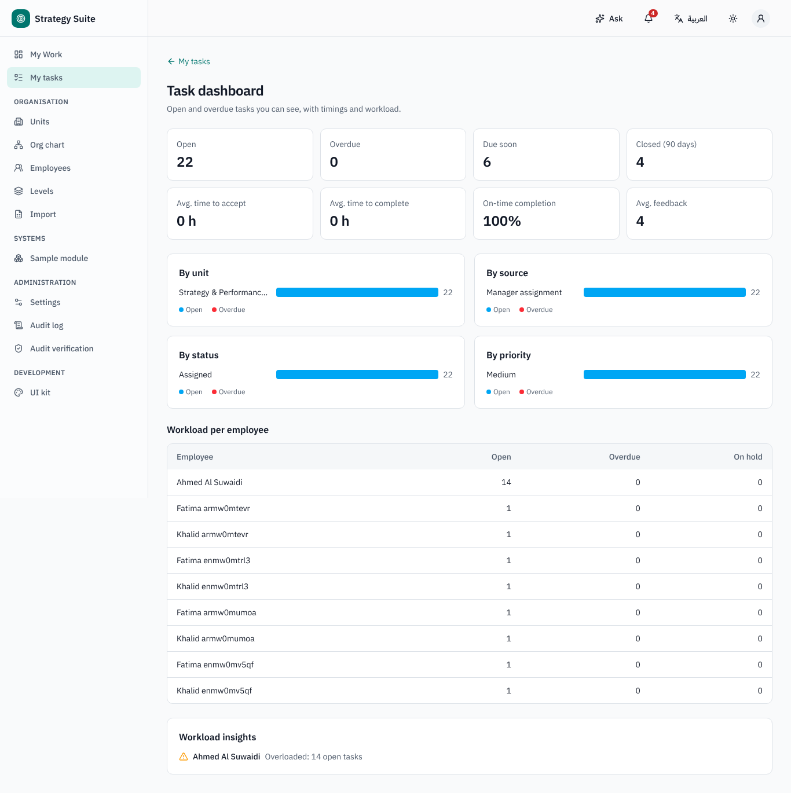
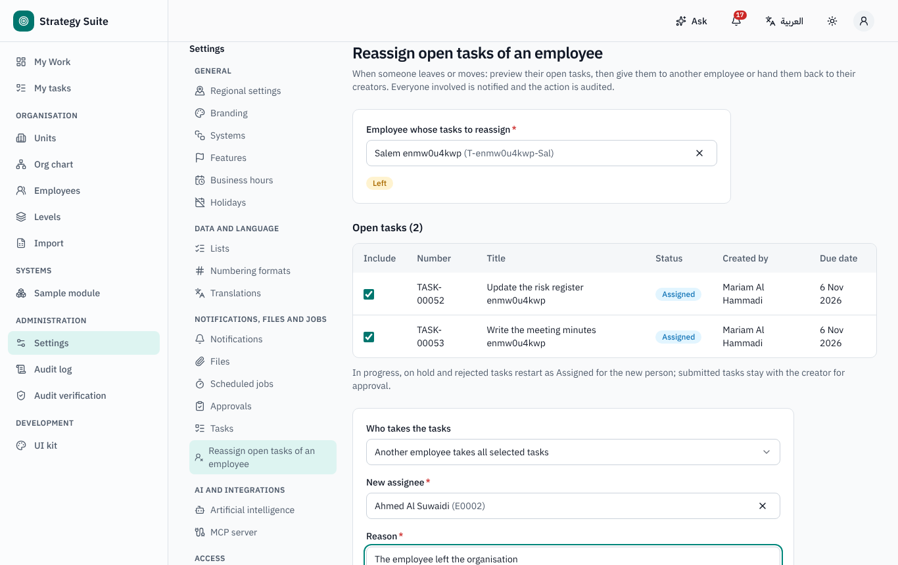

# Task Management — user guide

For everyone. Arabic version: [`../ar/user-tasks.md`](../ar/user-tasks.md).

Sidebar → **My tasks**. Tasks can stand alone or be linked to a record of any system (project milestone, risk action, team recommendation,
CAP remark, audit finding…); the record then shows its tasks.

## 1. My tasks

Tabs **Assigned to me**, **Created by me**, **Follow-up**, **Team's tasks** (managers: your direct reports), with counts. Views **List**,
**Kanban** (drag a card to change its status) and **Calendar**. Each task shows a status indicator: *on time*, *due soon*, *overdue*,
*on hold*.

## 2. Creating a task

**New task**: title, description, type, source, category, priority, start and due date, files, checklist, linked record, recurrence
(daily / weekly / monthly, until a date or a number of times), *confidential*.

- **Several assignees** (**Add assignee**, or a whole unit, or **Team's members (one task each)**): one task per person, tied together in an
  **assignment group** (complete when *all* or *any* are done). From the group page you can message all, extend the due date for all open
  tasks or cancel all open tasks.
- **Suggest assignees** and **Draft tasks from text** (AI, when on) only prepare drafts.
- **Save as draft** or **Create task**. The due time is the end of working time on the due date in the assignee's unit (a weekend or
  holiday moves to the next working day).
- Who you may assign depends on the setting (*anyone*, *my unit* or *my direct reports*). A department secretary may create tasks on behalf
  of their manager (the manager then approves).

## 3. Working on a task

**Full workflow** (default):

| Status | Assignee can | Creator can |
|---|---|---|
| Assigned | **Accept** (→ In progress) or **Reject** with a reason | edit, cancel |
| Rejected | — | **Reassign** or cancel |
| In progress | **Pause** (reason → On hold), **Submit** with a completion comment, **Add sub-task** | cancel |
| On hold | **Start** again | cancel |
| Submitted | — | **Approve** (with a feedback point and comment), **Return**, **Reassign** |

**Simple workflow** (per task type): *To do → In progress → Done* (**Mark done**), no acceptance and no approval.

Rules: a task cannot be submitted / done while a sub-task or a predecessor (dependency) is open; only the creator approves (an administrator
cannot approve someone else's task). Time is tracked automatically from accept / start to submit, with pauses and their reasons
(**Timeline**, with the timesheet).

Task page tabs: **Overview** (description, checklist, sub-tasks, dependencies, linked record), **Timeline** (events and timesheet), **Comments**
(@mention participants), **Documents**, **Follow-up** (add employees who follow the task; they can comment), **History**.

## 4. Reminders and escalation (defaults)

Reminder to the assignee before the due date, overdue notice to assignee and creator, escalation to the assignee's manager after some
working days overdue, reminder to accept a task left in *Assigned*, optional digest e-mail. Values are set in Settings → Tasks.

## 5. Confidential tasks

A confidential task is visible only to its creator, assignee and follow-up employees — not to managers, administrators or people who can
see the linked record. Some categories are confidential by default.

## 6. Dashboard and performance

**Task dashboard** (managers, HR): open and overdue tasks by unit, source, status and priority; average time to accept and to complete;
on-time rate; average feedback; workload per employee. Task results (time to accept, time to complete, on-time, feedback) are an input to
employee performance.

## 7. When someone leaves

Administrators use **Settings → Reassign open tasks of an employee** (also offered when an employee is marked *Left*): preview the
person's open tasks, then give them to another employee or back to their creators, with a reason. Everyone involved is notified.

