# Teams and committees — user guide

For requesters, team leaders, secretaries, members, sponsors and HR (team administrators). Arabic version:
[`../ar/user-teams.md`](../ar/user-teams.md).

Sidebar → **Teams & committees**: register (tabs *All*, *My teams*, *Teams I lead*, pending evaluation), **Request a team**, dashboard.
Teams are shared: projects, audits, corrective actions, benchmarking studies and other records can link a team.

## 1. Requesting a team

1. **Request a team**: type (permanent or temporary team, committee, project team…), names in Arabic and English, subject, objectives and
   mandate (AI can draft them), dates, owning unit, **members with their roles** and responsibilities (AI can *suggest members*), linked
   record, memo mode (generated or external).
2. **Submit for approval** → formation approval (default: Department Director of the owning unit → General Manager, Q-T5). Some team types
   need no approval and become active at once.
3. Approved → **Active**: the **formation memo** (`MEMO-YYYY-NNNN`, bilingual PDF with the members and the approval chain) is generated;
   members are notified. With an *external memo* the requester uploads the signed memo instead. Returned → back to draft; rejected or
   withdrawn → *Cancelled*.

Statuses: *Draft · Pending approval · Active · Inactive · Pending evaluation · Evaluation waiting approval · Closed · Replaced ·
Cancelled*.

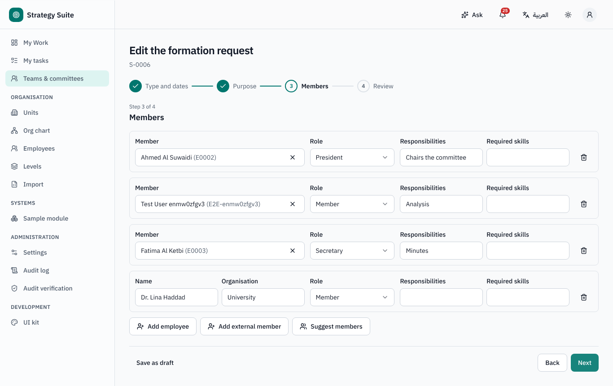
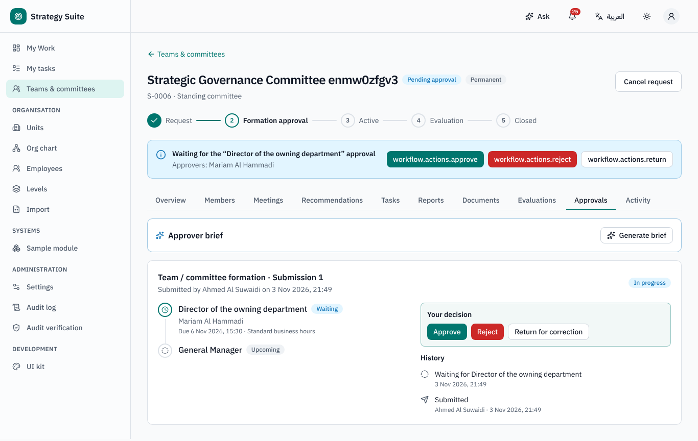
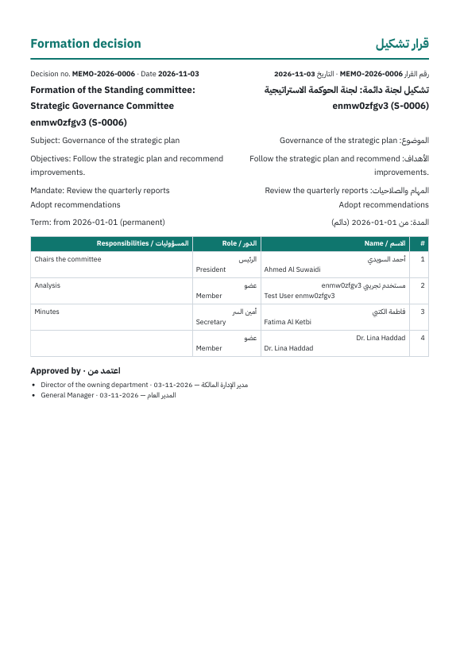

## 2. Running the team

Team page tabs: **Overview**, **Members** (with history), **Meetings**, **Recommendations**, **Tasks**, **Reports**, **Documents**,
**Evaluations**, **Approvals**, **Activity**.

- **Members** (administrator): add, leave (date, reason), replace, change role — every change is kept.
- **Meetings** (leader / secretary): **Schedule a meeting**, record attendance, **Minutes** and **Decisions**, then **Submit minutes** (the
  delay since the meeting is measured and used in the evaluation). **Write minutes with AI** drafts minutes, decisions and recommendations
  from your notes; you review and **Use this draft**.
- **Recommendations** register: owner and due date; the owner updates status with evidence; **Create task** opens a task linked to the
  recommendation.
- **Tasks**: **Task for all members** creates one task per active member (an assignment group).
- **Reports**: periodic reports (monthly / quarterly / … per type) are created automatically with a due date; the leader submits a summary
  and files; reminders and overdue notices go to the leader and sponsor.

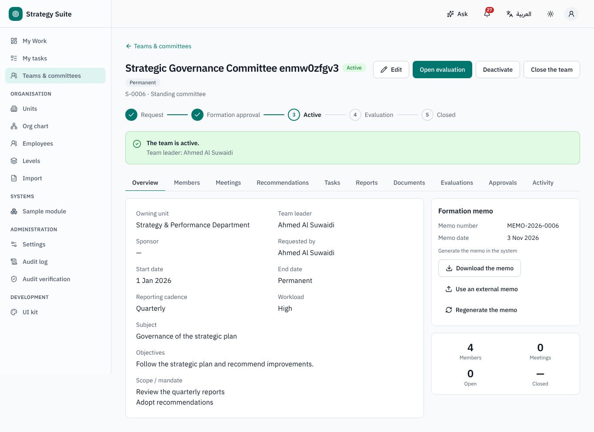
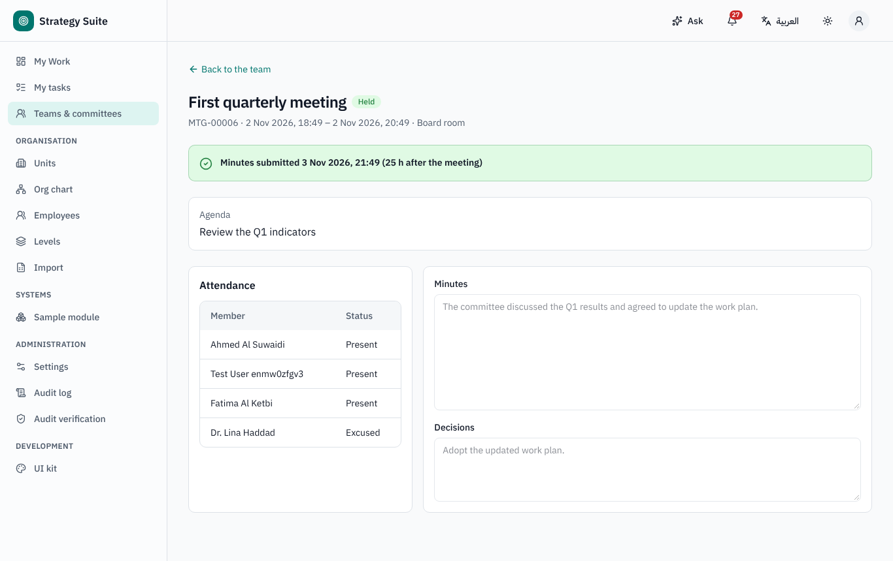
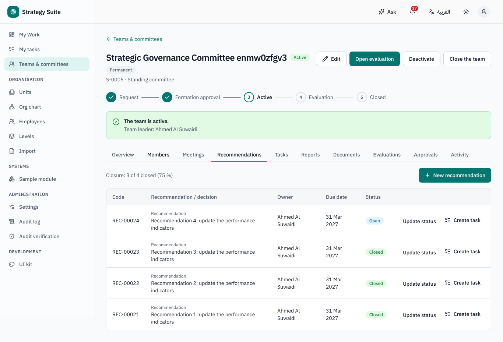

## 3. Evaluation

An evaluation opens **annually** for permanent teams (default 1 January, for the previous year), when a temporary team **reaches its end
date**, when its **linked record closes** (e.g. project closure approval), or manually.

1. The evaluator (default: the leader) opens **Open the evaluation wizard**:
   - **team criteria** — a level per criterion; some levels are *suggested* from data (e.g. recommendations closed, minutes delay) and a
     different level requires a justification;
   - **each member** — answers 1–5 to the questions and a comment (the leader is evaluated by the leader's evaluator);
   - **evidence** — mandatory above the score threshold;
   - review → **Submit for HR approval**.
2. *Points to check* flags inconsistencies (everyone rated 5, equal points, top grade with low attendance…); HR sees them too, and AI can
   summarise them.
3. **HR review** approves or returns (comment) with previous cycles side by side. Approval locks scores and grades.

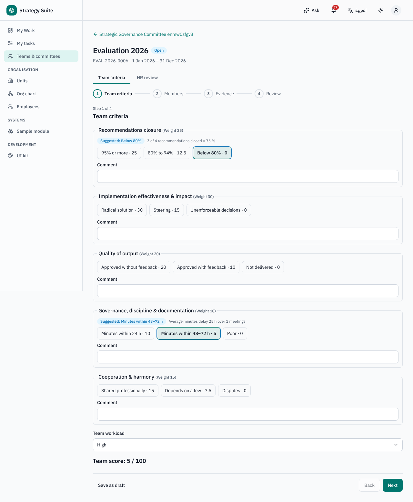
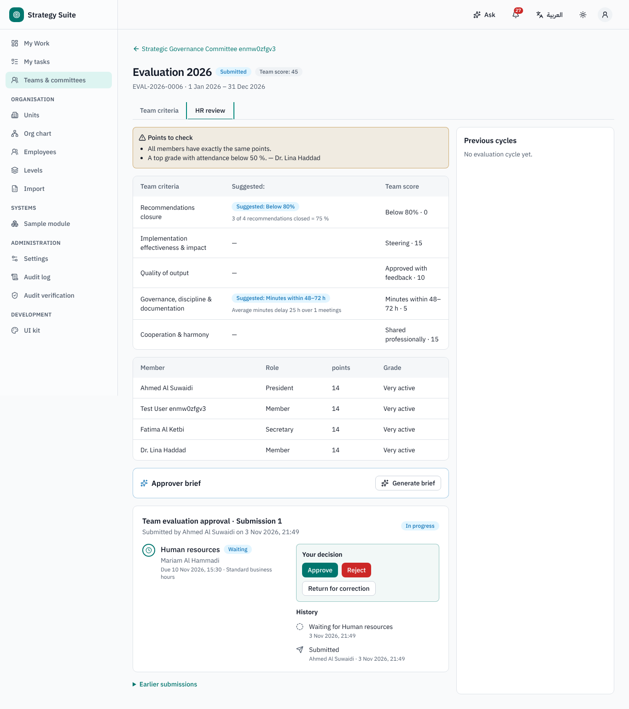

## 4. Rewards and certificates

After approval HR opens **Rewards**: the calculated amount per member comes from the **reward matrix** (grade × team workload × role); HR
may change the *Approved amount* (justification required when different), tick **Certificate** / **Financial reward**, **Save rewards** and
**Submit rewards for approval** (default: head of the Teams system's owning unit). Approved → numbered bilingual certificates
(`CERT-YYYY-NNNN`) are generated; the annual budget shows used / remaining.

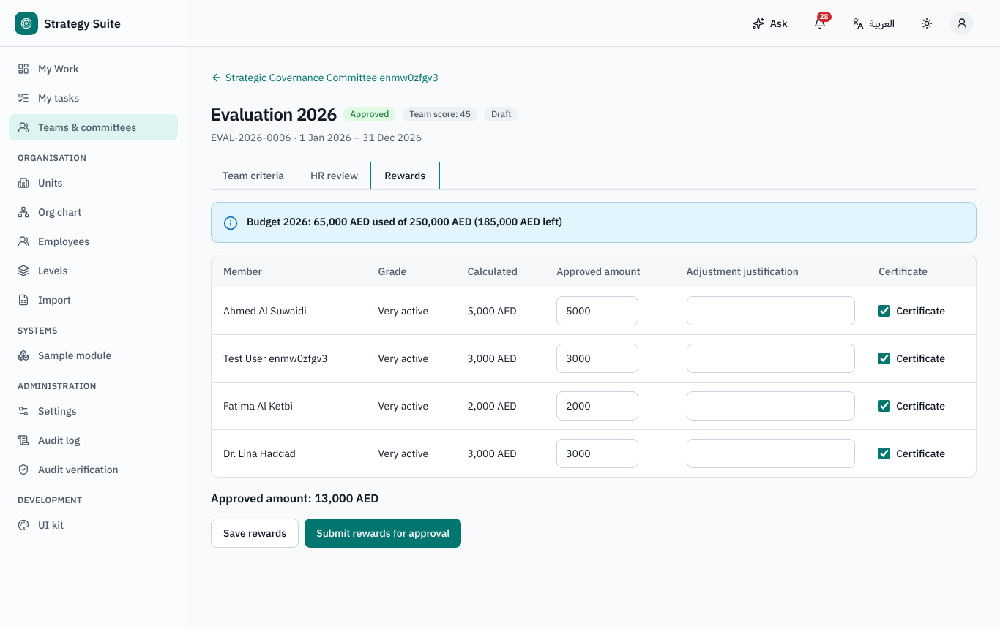
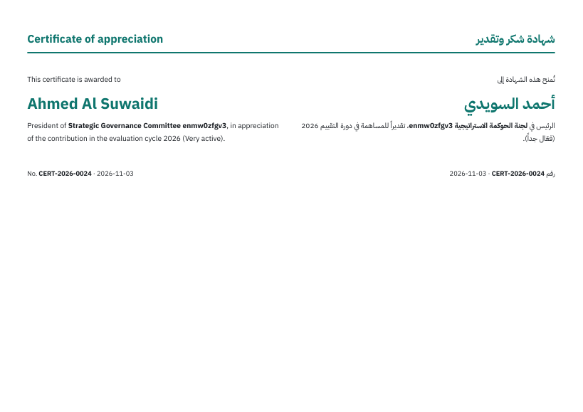

## 5. Other screens

- **Dashboard**: teams by type and status, evaluations in progress, recommendation closure, workload.
- **Employee page → Teams tab**: the person's teams and roles.
- **My Work**: *My teams and pending evaluations* card.

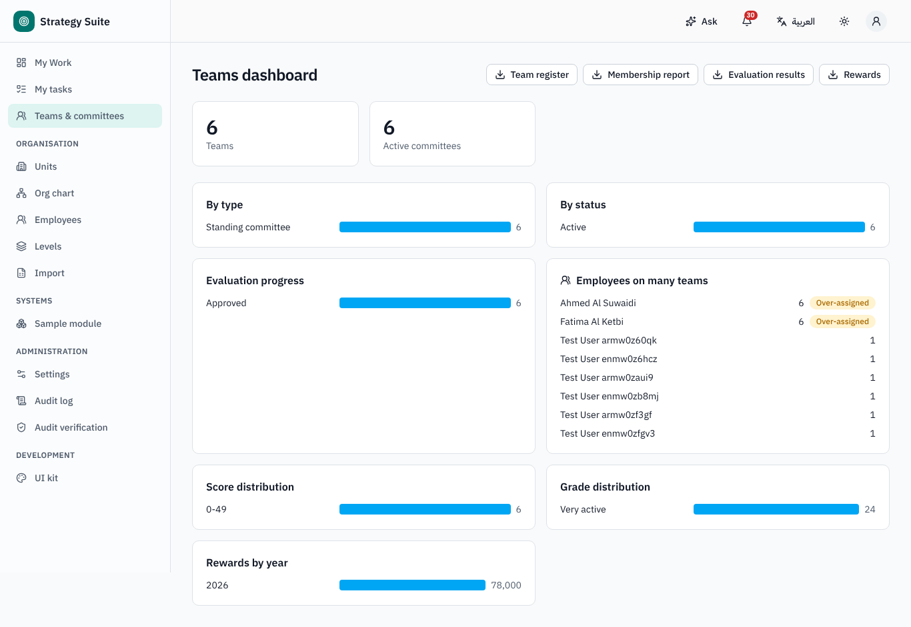

## 6. Who can do what (defaults)

| Role | Can |
|---|---|
| Requester | request a team, edit the draft, submit, cancel |
| Leader / secretary (record roles) | meetings, minutes, recommendations, reports, team tasks |
| Member | read the team, own recommendations and tasks |
| Evaluator | fill the evaluation |
| Team administrator (HR) | members, deactivate / close, open evaluations manually, HR review, rewards, settings |
