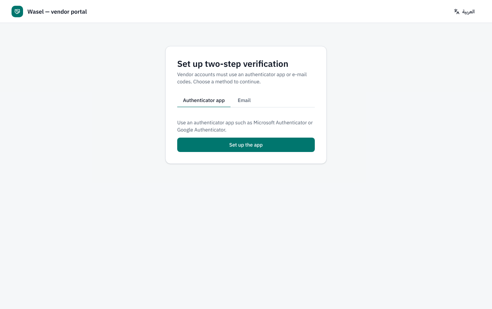
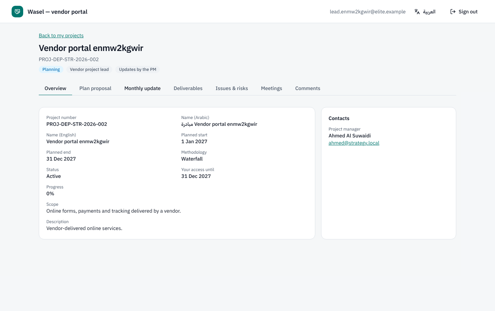
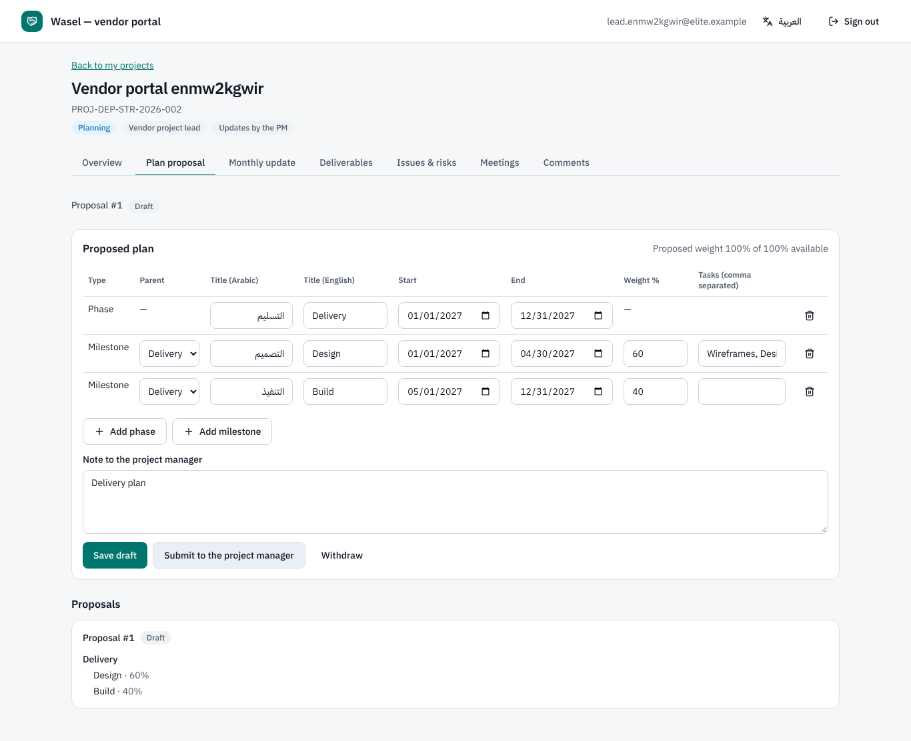
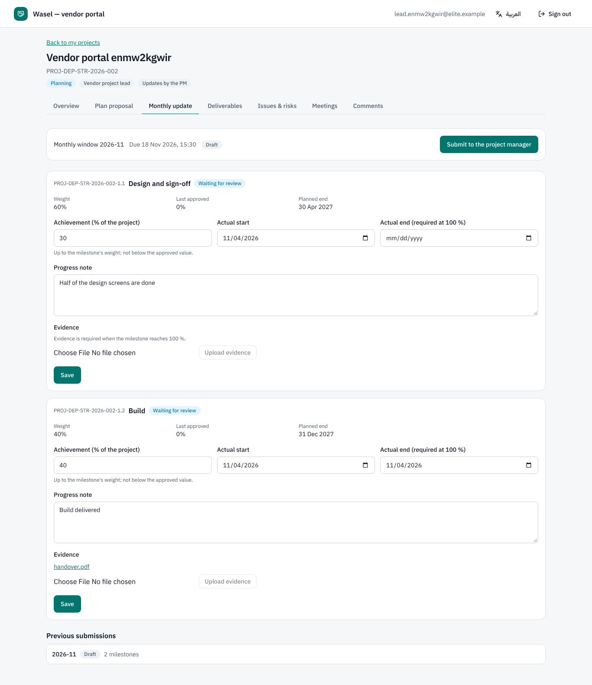
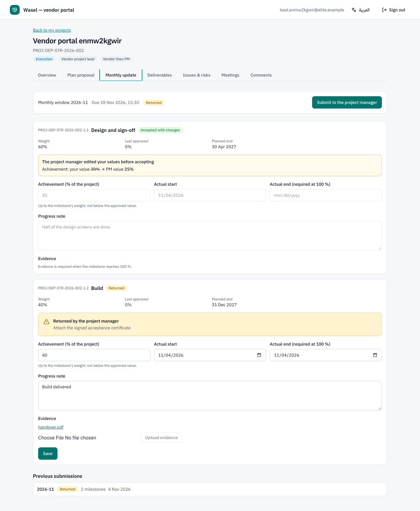
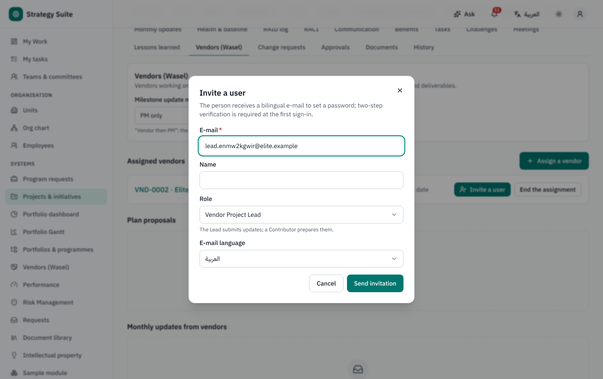
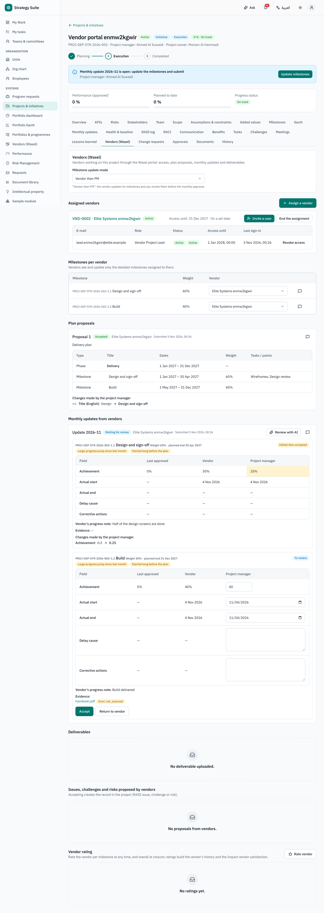
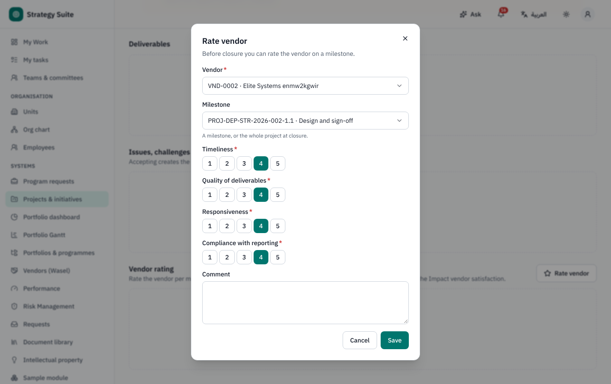

# Wasel vendor portal — user guide

Part A is for **vendors** (supplier users). Part B is for **project managers and the PM Office** who work with vendors. Arabic version:
[`../ar/user-wasel.md`](../ar/user-wasel.md).

Wasel is part of the same application but a separate, vendor-branded area at `/wasel`. Vendors see only the projects and milestones
assigned to them, and only the fields the organisation allows (never internal comments, approval history, budgets or costs unless the
organisation explicitly shares them).

---

## Part A — for vendors

### A1. Your invitation and first sign-in

1. The project manager invites you; you receive an e-mail (in Arabic and English) with a **set your password** link, valid for 3 days.
2. Choose your password, then **Sign in to Wasel** with your **E-mail** and **Password**.
3. Two-step verification is **always required** for vendors: at the first sign-in set up an authenticator app (or e-mail codes, if the
   organisation allows them) and keep your recovery codes. Later sign-ins ask for the code.
4. If your organisation switched on UAE Pass for vendors and the sign-in page shows the UAE Pass button, you can use it instead of the
   password; your account is matched by its e-mail address and the second factor is still asked.

Your access ends by itself on the date the project manager set (usually the contract end date, or project closure). Accounts without a
sign-in for 90 days are disabled; ask the PM Office to reactivate yours.

### A2. Your projects

The home page lists your projects. A project opens with tabs:

| Tab | What you do |
|---|---|
| **Overview** | number, name, scope, planned dates, stage and status, PM name and e-mail, your milestones (optional fields such as progress when shared) |
| **Plan proposal** | propose the plan for your share of the work during the project's planning |
| **Monthly update** | prepare the monthly progress of your milestones (when the project uses *Vendor then PM*) |
| **Deliverables** | upload deliverables (title, milestone, files) and see whether the PM accepted or returned them |
| **Issues & risks** | propose an issue, challenge or risk; the PM accepts or rejects it |
| **Meetings** | meetings you attend, with minutes; *confirm* the actions agreed |
| **Comments** | one thread per milestone, submission, proposal or deliverable; the PM is notified |

### A3. Proposing the plan

During the project's planning the **Vendor project lead** prepares the proposal: for waterfall projects phases and milestones (title in
Arabic and English, dates, weight, deliverable flag, proposed tasks); for Agile / Hybrid projects epics with user stories. The weights you
propose must total exactly the share you plan (not more than the unallocated weight of the plan). **Submit**; the PM accepts (possibly
after edits — you see the differences) or **returns** it with a comment, and you edit and resubmit. Statuses: *Draft · Submitted ·
Returned · Accepted · Withdrawn*.

### A4. Monthly update (*Vendor then PM* mode)

When the project's monthly window opens you are notified by e-mail.

1. Lead and contributors fill the progress of each assigned milestone: achieved part (not below what was approved before), actual start,
   **actual end and evidence at 100 %**, **causality and corrective actions when late**.
2. Only the **lead** can **submit**.
3. The PM reviews each milestone: *Accepted*, *Accepted with changes* (you see the PM's values) or *Returned* with a comment. If anything
   is returned the submission comes back to you.
4. When the organisation approves the month your submission becomes **Included in approved update**.

Statuses: *Draft · Submitted · Returned · Accepted by PM · Included in approved update*.

### A5. Good to know

- Vendors have no access to the internal application, AI assistants or the MCP server.
- Everything you submit is recorded in the audit trail (channel *wasel*).

---

## Part B — for project managers and the PM Office

### B1. Vendor register (PM Office)

**Vendors (Wasel)** in the sidebar: **New vendor** (shared supplier master), status *Active · Suspended · Blacklisted* (suspending or
blacklisting ends every vendor user's access immediately), vendor users with their status and last sign-in, assignments, and the
**performance history** (ratings per project and averages per criterion).

### B2. Assigning a vendor to your project

Project → **Vendors (Wasel)** tab:

1. **Assign a vendor**: vendor, contract, **Access until** (leave empty to use the contract's end date; or project closure / a set date
   per the settings).
2. **Invite a user**: e-mail, name, **Role** (*Vendor project lead* submits updates; *Vendor contributor* prepares them), e-mail
   language → **Send invitation**. An existing vendor account is reused.
3. Assign milestones to the vendor (**Milestones per vendor**).
4. **Milestone update mode**: *Updates by the PM* (default; vendors see but cannot prepare updates) or *Vendor then PM*.
5. **Revoke access** of a member or **End the assignment** at any time, with a reason; the vendor is told.

### B3. Reviewing vendor work

- **Plan proposal**: review side by side, edit if needed, **Accept** (milestones / epics are created and assigned to the vendor; the
  differences are recorded) or **Return to vendor** with a comment.
- **Monthly submission**: each item shows last approved values · vendor values · your values. *Accept*, *Edit then accept* or *Return*
  (comment required). You cannot submit the monthly update while a vendor submission is waiting for your review. Approvers see which values
  came *From vendor* or were *Edited by PM*. Optionally *Share with vendor* a note about the outcome (internal approval comments are never
  shown to vendors).
- **Deliverables**: accept or return. Accepting a deliverable does not sign off its quality (that stays with the owner / PM Office).
- **Issues & risks** proposed by the vendor: accepting creates the real record (RAID issue or challenge, or a project risk scored with the
  risk framework).

My Work shows a **Wasel submissions to review** card.

### B4. Rating the vendor

At closure (or per milestone at any time): **Rate vendor** on *Timeliness*, *Quality of deliverables*, *Responsiveness* and *Compliance
with reporting* (1–5) with a comment; the overall is the average. The closure rating pre-fills the project's vendor satisfaction in the
Impact form.

### B5. Settings (PM Office / administrator)

Settings → Portfolio → **Wasel**: default update mode, access expiry rule, end access at project closure, dormant days (90), the optional
vendor-visible fields (project description and progress shown by default; owner, budget, approval status and milestone cost hidden), and
UAE Pass for vendors. AI assists for reviewing vendor submissions are on the PM side only.
